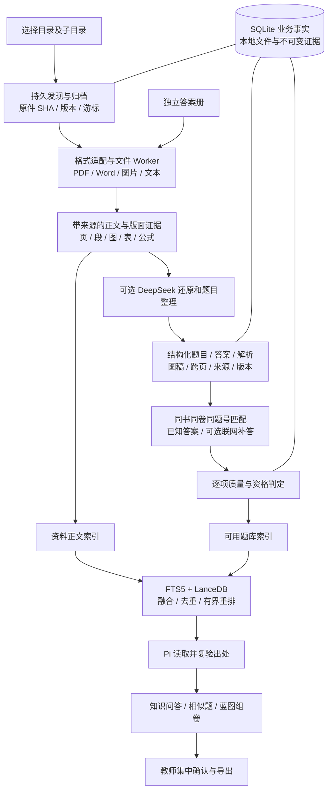

# 教师知识库整体架构与实施主线

## 2026-11-01 整套题库验收与队列调度

当前主线以任意完整题库目录为验收单位：导入→本地解析→已授权AI整理→题目/答案归档→检索/组卷→重启恢复。真实11文件/332294145B目录已本地收录，109/111 PDF页完成、两页待核；后关联答案册已修复，90条原规则候选保留并派生隐藏，不再阻止关联。原队列最多2份资料并行。最新完整六页试卷各12次真实AI处理，0可用→4自动稿/11待核；整批与题目冷启一致且无追加调用。v3原题覆盖修复只作用新普通原页，答案册及旧回执语义保留。已从实际题本检索到新自动稿，并在一次真实Pi/DeepSeek提问中检索、读取和返回同一新题及来源。完整质量门禁仍失败，图题/跨页/整卷上下文、答案合并、Pi组卷、40GB和安装仍未验收。统一证据wholeSetScheduling、lateAnswerRole与wholeExamProjection；207综合smoke不能作为本轮通过证据，记忆L2读回失败仍开放。

更新：2026-11-01。当前产品约束入口，不把设计写成已实现。服从 Master Goal、本地优先、Pi 唯一运行时和用户授权范围；替代知识库历史切片中互相竞争的“下一步”，保留历史验收证据。整个知识库目标仍未完成。

## 1. 教师最终获得什么

教师选择一个含子文件夹的资料目录，后台持续归档、解析和整理；题册与独立答案册分别处理后对齐，能暂停、退出、重启续作。日常只返回进度、可用数量、必要异常和可操作结果。小智可从资料中回答知识问题、按知识点找相似题、按蓝图选题组卷；正式试卷集中确认。原件、题目、图稿、答案和出处都能回看和修正。

“几十 GB”分别验收原文件字节、实际页数、可检索正文块数和结构化题数，四者不能互相替代。自动定稿是 AI 整理资格，不是题目绝对正确或教师签字。不能保证所有 OCR/模型永不出错；实现要求是可定位、可纠正、可恢复，发现疑点不冒充正确。

## 2. 已确定的总体选择

**一个桌面产品、一份业务真源、一套已有任务宿主、两类派生检索、一个生产 Agent。**

| 层 | 本项目确定使用 | 权责与边界 |
| --- | --- | --- |
| 产品入口 | 现有 Electron + React + typed preload | 文件夹导入、后台任务、资料/题本、小智、组卷；不另做第二个知识库应用 |
| 业务与任务事实 | 现有 SQLite | 文件版本、任务/页游标、来源、题目、答案、确认、变更记录；主进程原 writer 负责提交 |
| 原件与大产物 | 现有本地文件目录 | PDF/Word/图片、不可变 AI 输入图/回执、题图、正式产物；不把几十 GB 二进制塞进 SQLite |
| 文档与图像解析 | 现有 Hana/anydoc、Word 解析、PDFium + RapidOCR | 按格式适配；PDF 统一走文件 Worker；复用成熟引擎，不自研 PDF/OCR 引擎 |
| AI 还原与整理 | 原 MaterialAiRepository + 统一 DeepSeek API | 批次授权、受限输入、版本化提示/响应、真实调用账本；不另建 Agent Loop |
| 关键词检索 | 现有 SQLite FTS5 + 现有中文分词适配 | 精确词、题号、短语、公式线索，保留可重建派生关系 |
| 语义检索与重排 | 已锁定 LanceDB 0.30.0 + 本地 BGE embedding/reranker | 向量与索引可重建，原 Worker 执行；不是第二份业务数据库 |
| 小智调用 | 现有 Pi 工具、来源读取与版本复验 | 查询 → 读取证据 → 回答/选题；不把全库塞进 prompt，不由模型直接写业务表 |
| 交付 | EXE 本体 + 现有受管组件下载机制 | 首次配置完成必要运行时/模型下载与校验，随后本地运行；不要求老师手装数据库/Docker |

生产不引入独立 Redis/Kafka/Milvus/Qdrant，不整套嵌入另一个产品的账户、任务、数据库和 Agent。职责已有宿主时扩充原模块，不新建同义服务。

## 3. 数据真源和统一契约

### 3.1 三种数据必须分开

- **不可变证据**：原件版本、实际 OCR 回执、原页/裁剪坐标与图片 hash、真实 AI 两遍原响应、网页来源快照。失败和分歧照实保留。
- **可编辑业务事实**：规范题干、图稿关联、答案、解析、分类、书目关联、教师编辑和正式试卷。由 SQLite/本地文件及现有版本/变更记录共同持有。
- **可重建派生物**：FTS、LanceDB、embedding、重排缓存、缩略图、答案查找目录。重建不能改原件、教师内容或正式产物。

不为统一格式新建第三份题库。扩展现有 MaterialSource、MaterialPageSource、QuestionDocument、QuestionArchive 和 QuestionProjection 的版本化判别联合；Word 的 word-native 来源不能冒充 PDF 来源。

### 3.2 每个结果必须回答的问题

哪份原件/版本、哪页或哪个 Word 部分、哪块区域/原始题号、由哪个 parser/OCR/模型及提示版本产生、两遍输入/响应是否相符、是否跨页、哪些字段来自原书/答案册/AI/网页/教师、当前是否被教师修改、谁允许本次上云、读取时来源是否仍有效。

题干必须含完整条件、选项、小问、公式和表格；projection 是覆盖描述，不能成为省略规范题面的借口。图形文字概述不能替代实际题图。题目源图与答案/解析图分角色，避免组卷泄露答案。

### 3.3 质量分层，避免“一页卡住全书”

| 维度 | 目标语义 | 对下游的影响 |
| --- | --- | --- |
| 页用途 | 明确非题页 / 普通内容 / 题页 / 未判定 | 封面、版权页、纯目录、宣传页不抽题；普通内容可作为资料；混合页保留真实习题 |
| 转录质量 | 完整 / 空白 / 局部疑点 / 整体不可信 | 完整正文可供资料检索；未解决的局部范围不得混作完整原文 |
| 题面完整性 | 文字、公式、表格、图稿、选项、小问、跨页 | 每题独立判定，缺图题不因其他文字题完整而放行 |
| 答案/解析 | 未知 / AI 推导 / 原书 / 答案册 / 网页 / 教师 | 来源与正确性分开；同号跨卷不匹配；冲突保留候选 |
| 使用资格 | 可检索资料 / 可读题面 / 可补答 / 可组卷候选 / 正式确认 | 不能用一个全局 complete 或 ai_final 代表所有权限 |

**当前仅部分实现上述分层**。整页真正不可信仍阻止整页转录进入可信读取；已知局部疑点需要显式范围、唯一定位和两遍合并，不能在宿主猜测范围、删除 pageIssues 或降级 schema。历史状态通过 adapter 读取，旧 first_saved 单元沿冻结提示恢复。

## 4. 导入与后台处理架构

### 4.1 目录、格式和去重

沿 MaterialImportBatches 持久游标递归发现，当前发现片为128项；原路径授权/身份、文件版本和符号链接规则保留。不一次枚举整个目录到内存，不用 renderer 持有后台任务生命周期。按内容版本复用已有原件与解析结果，目录来源关系独立保留，重复导入不得产生重复正式题目。

当前接收扩展名为 PDF、DOCX、PPTX、XLSX、JPG/JPEG/PNG/WebP、MD/TXT。Word 指 **DOCX 原生支持**；旧 DOC、加密/损坏文件等须报告明确不支持或待转换，不能把“接收文件”称为结构解析全通过。旧 DOC 转换只作为未来可选受管适配，未接通不宣称支持。

PDF 首选原生文本与版面，扫描页用 RapidOCR；Word 保留原生结构、公式、表格与媒体关系，必要时复用原按题图稿。图片保留原图及 OCR。PDFium 的并行采用受控子进程，不在同进程多个线程同时调用。对普通页、题页和答案页分别消费同一来源证据，不三次扫描整份原件。

### 4.2 一个已有宿主，多阶段持久执行

保留现有导入、PDF 页任务、目录 AI 计划、AI 单元和索引任务的事实表与执行器。新增阶段挂接其游标、writer、租约、取消和恢复，不另建 Redis 队列或隐藏 Agent。阶段完成必须以 SQLite/文件实际发表为准，不能以子进程退出、模型 HTTP200 或 UI 文案代替。

工程目标为低并发：单 OCR/解析重任务、单 AI 单元，索引有界批量。当前 `local-utility-host.ts` 共享池是8个名额，解析队列有原优先级，但尚未统一区分重任务及前台保障；具体并发、内存和公平策略需沿原宿主实现并测量，**不是已完成的全局 QoS 保证**。检索/用户点击应优先于后台重排与重建；不同书公平推进，不被一个坏文件永久阻挡。AI 授权、预算、供应商退避和结果未知独立于本地任务重试。

任务持久键绑定原件版本、单元、引擎/提示/索引版本；阶段依赖有界，跨页只取必要相邻范围，禁止无限向后吞页。暂停释放资源，重启复验来源后续跑；付费结果未知不自动重发，重新授权与本地只读恢复分开。

复制临时文件 → 校验/同步 → 文件发表 → 同一 writer 写事实/变更记录；跨文件系统与 SQLite 不能假称一个物理事务。需要可恢复 journal 处理发表前/后的崩溃窗口、无主文件和磁盘不足。现有 ENOSPC 修复有证据，硬断电闭环仍待补。

### 4.3 AI、题册与答案册

本地 OCR 先产证据，再由 DeepSeek 对照必要原页/裁剪恢复可读题面；第二遍复核，schema/业务规则/来源复验后落库。两遍同模型不是独立正确性证明，不以不断调用直至输出一致替代质量设计。局部不可读只影响可定位条目，无法定位的疑点仍整体阻止。

题册/答案册可独立推进；关联以原件版本、完整试卷/章节标题、唯一题号、小问和题面上下文确定。书内重号、跨页续解、填空分隔差异需结构化处理，不能靠全局删标点/模糊标题强行匹配。先保存候选，证据齐备后沿既有 CAS/journal 补齐，教师字段优先。

内置浏览器补答是可选来源，不是导入必经网络依赖。复用现有浏览器/DOM 读取和网页补答工具，保留站点、原题匹配与答案出处；验证码/登录交互返回必要提示。网页文字不增加权限，不因抓到题解就绕过版本与答案冲突检查。

### 4.4 几十GB的磁盘、内存和费用预算

导入前按“受管原件新增量＋最大在途暂存＋必要证据/图稿＋索引与缓存＋安全余量”估算应用空间，说明用户原文件夹若仍保留，磁盘上还会同时存在原件副本。页图/图稿数量、正文块和向量数分别估算；不假定40 GiB原件只占40 GiB应用空间。压缩扫描PDF与原生文本PDF的膨胀比不同，需用代表性页采样并显示估计范围，处理过程中校正。

按页/小批次读取与发表，文件hash流式计算，不在renderer或主进程拼整书数组。限制同时解码页数、页分辨率、IPC输出和OCR/模型输入；超大单页返回可定位的处理错误，不放大上限直至进程失控。缓存预算与后台资源预算由原宿主管理，前台检索优先；实际阈值在普通16 GiB机器测定。

临时栅格、缩略图、FTS/向量等可重建缓存可按预算回收；原件、实际AI输入图/原响应、已发表题稿和教师正式产物不能冒充缓存自动删除。不可变证据增长需单独计量，保留/归档由用户明确选择。原件变化、磁盘紧张和目标卷空间不足时先暂停受影响阶段，其他可安全任务继续，不悄悄截断页或丢题。

AI为导入的可选阶段，文件夹授权绑定范围、模型/版本、允许输入与预算；本地OCR/归档不因拒绝云端而不可用。以页数和每页两遍调用估算费用范围并设置批次上限，达到上限或结果未知即暂停云端阶段。测试无限调用授权不能变成正式用户的无限费用默认值。后台只报告必要异常与预算不足，避免逐文件反复打断教师。

## 5. 检索与小智的大脑

**资料索引和题库索引分用途，共用原检索层**。资料回答可定位教材段落；相似题和组卷读取规范题目，不能拿零散 OCR 片段冒充可出卷题。

查询流程：意图/知识点与过滤 → FTS 词法召回 + LanceDB 语义召回 → RRF 融合 → 按来源/版本去重 → 有界重排 → SQLite 当前事实与来源复验 → Pi 按需读取原文。中文年级别名、短题号、关键词/公式检索单独覆盖；页码和题号优先结构过滤，不只靠向量。

FTS 当前已有中文字符/双字 token 适配；embedding 当前身份为 bge-small-zh-v1.5.q8.cls-l2.window512-stride64.v1，重排为 bge-reranker-base.q8.pair512.window2.v1。改变 tokenizer、模型、切块或距离度量须开新索引 generation，不静默混用。保持增量 changes/dirty、影子重建和旧可用代服务；索引失效时可降级关键词但必须公开覆盖不足。

`hasMore / exhausted / coverageComplete / rerank.complete` 必须真实。候选数限额或重排预算耗尽不能宣称查遍全库；下一阶段应按任务提供有界续查/扩召回和首查/预热策略。不通过无界候选/全库重排换取表面高召回。

组卷按蓝图过滤、分层选题、去重和约束检查；Pi 输出的是有来源的候选集，正式卷另行教师集中确认。图题必须能被实际渲染与导出，单独一段“如图”文字或整页缩略图预览不算可出卷图稿。

## 6. EXE 与可选组件

本体负责入口、权限、任务、数据与 Pi；OCR/PDF、embedding、reranker 等沿现有受管组件独立下载、配置与健康检查。包和模型分别核验来源、许可证、版本、hash、Windows 架构、安装/磁盘体积；下载目录只是暂存，验证通过后原子激活，保留当前可用版和恢复路径。

离线已有组件可继续工作；缺组件返回可安装/修复状态。组件下载失败、代理/TLS、无权限、杀毒占用和空间不足不应破坏原件。禁止把开发机 node_modules/Python 全局环境当作用户安装闭包。

**选型可行不等于安装交付完成**：当前开发构建、源码探针、第三方运行证据和实际安装包必须分别记录，最终在干净 Windows 用户环境验证下载→启动→导入→检索→重启→卸载保留数据。

## 7. 成熟方案复用决策

| 候选 | 已知适配点 | 本项目决定 |
| --- | --- | --- |
| LanceDB | 嵌入式检索库，项目已经锁定0.30.0并有真实 native 证据 | 保留为派生向量层，不重写向量引擎；规模/召回仍按本项目验收 |
| RapidOCR / PDFium | 项目锁定 RapidOCR 3.9.2、pypdfium2 5.14.0，已有文件 Worker | 保留解析/OCR底座，先统一所有调用者，不再各造 Buffer 通道 |
| Hana/anydoc / 原 Word 结构链路 | 已有工具与 DOCX 原生结构、题稿证据 | 继续适配统一来源契约，不把 Word 题身份复用于 PDF |
| AnythingLLM Desktop | 成熟个人知识库产品；本地对照有摄入/检索证据，也有页码丢失和错排 | 借鉴资料组织、可见进度和检索交互；不把整套独立 Agent/账户/事实库套入 Pi |
| 腾讯 WeKnora Lite | 官方有 SQLite + 内存队列的 Lite 形态；本地固定源已运行，但测试文档依赖未闭环 | 保留对照与可抽取适配能力；当前不默认替换。需通过相同真实文件/任务恢复/Windows闭包及质量门再考虑切换 |
| Docling | 官方提供版面、阅读顺序、表格/公式和多格式文档结构；本地旧对照仍漏清晰选项 | 只作可替换 parser 候选，不能凭功能表切默认；先在固定真实留出样本证明收益及运行成本 |

不同时集成多个完整 RAG 产品；只对替换的同一层做相同输入对照。用成熟引擎，项目自有代码集中于教师题库的来源、图题、答案匹配和使用资格。

官方依据（2026-11-01重新核对）：[LanceDB](https://github.com/lancedb/lancedb)、[RapidOCR](https://github.com/RapidAI/RapidOCR)、[PDFium并发约束](https://pypdfium2.readthedocs.io/en/stable/python_api.html)、[FTS5](https://www.sqlite.org/fts5.html)、[WeKnora](https://github.com/Tencent/WeKnora)、[AnythingLLM](https://github.com/Mintplex-Labs/anything-llm)、[Docling](https://github.com/docling-project/docling)。库代码许可证不能替代附带模型/二进制的单独许可核对。本轮不添加或更新依赖。

## 8. 当前可行性和缺口：先看证据再开工

| 层 | 当前代码入口 | 证据结论 |
| --- | --- | --- |
| 递归导入/恢复 | `main/assets/material-import-batches.ts`、`material-folder-ai.ts` | 持久发现与调度已存在；自然大目录和硬断电窗口仍未全验收 |
| 大 PDF 文件 Worker | `main/xiaozhi-agent/pdf-file-host.ts`、`python/omni_edu_ocr/pdf_stream.py` | 资料页/后台路径已有文件host，K0现已接通Pi页工具及原题消费者；资源与全用户链路仍待验证 |
| 来源/图稿 | `shared/material-ai-page.ts`、`shared/question-document.ts`、`shared/native-question.ts` | PDF有原页证据，Word有按角色题图；PDF逐题图稿及跨页还缺，不能假称图题已完成 |
| AI与答案册 | `main/assets/material-ai-repository.ts`、`material-book-answer-repository.ts` | 已有实际五题v6回写；最新另一批次两次HTTP200仍整页不确定，模型稳定性未通过 |
| 检索 | `main/assets/material-full-text.ts`、`main/retrieval/repository.ts`、`vector-store.ts` | FTS/向量/重排及 generation 已接入；自然语义召回、冷查与完整覆盖未达标 |
| Pi读取 | `main/assets/material-page-tools.ts`、`main/education/question-context-provider.ts` | K0已统一文件host和流式来源校验，page tool按共享10000页合同验证，改元数据页权限；完整Pi用户链路仍待验 |
| 交付 | 原OCR/embedding/reranker运行时及受管下载 | 开发证据不等于EXE安装闭包；干净Windows/普通教师机仍待验证 |

基线中的 `DOCUMENT_MAX_INPUT=50 MiB` Buffer接口和Pi的50页参数不能承担大PDF。K0当前已将这些原页/原题消费者接入原文件host、流式verify和统一页号合同；50MiB byte协议保留给其合法旧调用者。调度与完整Pi链路仍待关闭，不能据此宣称所有知识库规模限制已消失。

证据入口：

- [已有复用对照](../research/KB_REUSE_RUNTIME_EVIDENCE_20261028.json)、[WeKnora固定源运行](../research/KB_WEKNORA_RUNTIME_EVIDENCE_20261029.json)。
- [现有字节容量](../research/KB_BYTE_CAPACITY_20261031.json)：累计40 GiB，40份单页合成PDF，只有40块/6040 UTF-8字节正文。证明大字节归档及有限恢复，不证明40 GiB自然教材、百万正文召回或长期质量；早期冷混合约4.0/6.0秒，后续整合约3.96/4.54秒且40候选只重排20个、complete=false。不同构建观察不是受控改善/P95，不能说已满足快速高召回。
- [真实题册与答案册](../research/KB_ANSWER_ENTRY_SCOPE_20261101.json)：旧12题中5题答案来源已回写；图题/填空冲突保留。
- 本轮新真实批次 `aibatch_c50766ae-aea0-4d0c-965a-ac0544c0edba`：仅已检查主书第4页/必要OCR，两次真实HTTP200，12题均因整页uncertain_ocr等保留。报告在授权临时根 `question-ai-S0dq5s/report.json`，不上传原文/图片。不把请求成功当作质量成功。

**判断：底座组合与集成方向可行，整体教师工作流、规模质量与Windows交付尚未证明可行。** 先清理架构接缝和执行闭环，不能继续用单页绿色检查替代整体验证。

## 9. 固定实施顺序与退出门

| 顺序 | 一次要交付的整体能力 | 通过后才进入下一项 |
| --- | --- | --- |
| K0 原件访问与调度底座 | 统一文件式PDF能力及来源/页/区域契约，Pi、资料页、原题处理共用；任务和资源仲裁沿原宿主 | 同一真实大PDF在后台、Pi读取、原页/局部预览、跨50页、来源变化、暂停/重启一致；无整书Buffer/全库快照；消费者清单逐一闭合 |
| K1 目录后台闭环 | 单次递归目录持久导入，混合格式独立失败、公平推进、幂等、低资源、磁盘/崩溃恢复、组件准备 | 实际目录选择后无前台逐文件操作；停止/退出/冷启持续可恢复，不丢原件、无永久running、重复导入不重复题；公开未支持格式 |
| K2 高质量文档与题库 | 统一多模态来源契约、PDF逐题图稿/跨页、Word结构、正文与题目质量分层、双册匹配、AI/网页补答 | 代表性真实资料从目录到可检索正文/可用题/图稿/答案/来源贯通；局部失败不堵无关条目；不能错误混卷、删题或清真实疑点 |
| K3 小智检索与组卷 | 有界混合检索、续查/覆盖、冷启动、相似题/知识问答/蓝图组卷共用规范事实 | 教师标注留出查询的召回/相关性和端到端时延过门；Pi能实际调用并引用；组卷/导出含图表与解析，不靠数据库查询冒充 |
| K4 长稳与实际交付 | 单次自然混合40 GiB、高正文基数、长时间/故障矩阵、EXE及组件首次准备 | 达到下列目标，记录硬件、源码/包指纹、调用成本、页/块/题数量、未知/失败/恢复和教师反馈，再判断完整Goal完成 |

阶段允许修前置缺陷，禁止把后续细节又变成新的并行主线。表格局部实验已保存到本地WIP，不合并未完成入口；只在K2契约下回收可复用代码。每轮只更新本文件当前阶段、实施合同和统一进度；不再复制一组互相覆盖的“下一步”文档。

### 发布工程目标（待验证，非现有成绩）

- **容量与长稳**：单次递归自然混合40 GiB；分别报告文件/页/正文块/题量。24小时实跑、72小时压力长跑；含暂停、重启、进程崩溃、原件变化、磁盘不足、组件失败、模型超时/未知及索引重建。
- **质量**：留出集至少200条教师标注查询，按知识问答/相似题/精确题号/跨章节/公式/多格式分层；目标Recall@20≥95%，Precision@5≥85%，失败逐类归因。数值是候选门槛，不能用合成向量近邻Recall替代教学相关性。
- **速度**：在记录硬件和同一真实库上，目标热关键词P95≤300ms、热混合P95≤2s、冷混合首查P95≤5s；从用户操作到可用结果计时，包含编码、查询、重排、来源验证和IPC。回答模型生成另计，不用裸ANN时延冒充端到端。
- **资源**：参考普通16 GiB RAM/SSD用户机，目标后台稳定常驻总量≤4 GiB，短时峰值≤6 GiB；含Electron及所属Worker。前台交互/停止反馈目标≤300ms；按内存/CPU收缩后台任务，未达标先降后台负载。
- **一致性**：断点恢复、重复导入和重建后，原件hash/已确认题/正式产物不变；未知付费请求不自动重复；旧索引可继续服务或明确降级，不能静默给出假完整覆盖。
- **交付**：干净Windows普通用户从EXE首次启动完成必要组件下载和配置，再完成目录导入、检索、组卷、导出与重启；开发机通过不算用户安装通过。

## 10. 本轮批判审查与立即约束

1. 过去按“单页缺口→补接口→反复全套测试”推进，整体依赖和成功定义没有先闭合。改为K0–K4，每项有教师结果和明确退出门。
2. 已有成熟引擎，却在各消费者保留多种原件访问与页限制，造成大文件路径不一致。K0先统一adapter，不先换引擎或增加新服务。
3. 原文件字节、向量容量与自然正文召回混淆。三个报告分开，不能用40个正文块宣传几十GB知识库已验收。
4. 图表问题被混为缺图、整页不确定又影响所有题。先确定质量/资格多维契约，再实现局部范围和完整图稿；不靠放宽门禁变绿。
5. 同图同模型两次输出仍不稳定；新请求实际全待核。复用不可变证据、确定性校验与可追溯本地再处理，避免不断重复付费；保留真实疑点。
6. 回归应跟随架构风险。每个实现阶段跑一次必要集中门禁和关键故障；源码未再变不反复重跑同套测试，不拿测试数量代替功能。

当前阶段：**K0进行中**。文件式访问消费者和元数据页权限已实现，资源优先级/公平性、完整Pi用户链路和所有退出门尚未关闭。旧架构审查证据与本轮实现分开，D盘日常和安装包未更新；表格WIP保持本地保存。

## 11. K0实施合同：先贯通已有底座

目标模块为M01–M04，并保护M05/M06来源消费者。教师可见结果：同一本大于50 MiB、超过50页的PDF，在资料页、后台处理、小智原页读取和原题取图中使用一致来源与页号；无须拆书或把原件传入renderer。

| 既有消费者 | 当前接缝 | K0必须复用/补齐 |
| --- | --- | --- |
| `main/assets/material-ipc.ts` | 已把preview/layout接到`previewPdfFile`/`layoutPdfFile` | 保留typed preload与当前界面；作为统一适配基线 |
| `main/assets/material-page-tools.ts` | 基线为50页/全量snapshot/byte，K0本片已改为文件host和元数据权限 | 保留observed-version、脱敏、停止与分页；完整Pi交互仍须验 |
| `main/education/original-question-coordinator.ts` | 基线单页/多区域最大50，K0本片已对齐10000页合同 | 实际页数由文件Worker核验；原8区域/图像字节上限保留 |
| `main/education/original-multi-repository.ts`及原单区域repository | 本片已接入统一文件renderer，来源改为流式verify | 原候选账本、教师确认、来源/图稿身份和旧单页/多页读取不变 |
| `main/assets/material-layout.ts`、`material-page-preview.ts` | 文件/byte两套可选adapter | 文件原件读取保持有界、来源stamp/hash复验与缓存版本；byte入口只供已有小字节协议的明确调用者 |
| 导入/PDF页任务/AI单元/索引执行器 | 已有各自持久状态，尚无完整全局资源与公平性保证 | 复用原任务事实及资源宿主，列明取消/暂停/租约和索引前台优先关系；不得新增平行调度系统 |

修改范围：上述main消费者、相关shared页号/来源校验、现有工具与IPC契约测试、真实Electron来源路径和必要进度界面；仅在需要显式状态时扩展原typed preload。暂不新增业务表、不迁移原件、不升级依赖、不改Pi运行时、不删除旧入口、不在本阶段处理单题图表/跨页语义。

K0实现补充：页读取用同一SQLite语句查询来源版本、解析状态、正文/本页存在性与已知/未知页隐私标记，不加载整本正文。`partial`资料只允许已发表正文的对应页；未发表页仍拒绝，不能因同书其他页可读而放行。识别后再次复验相同权限和来源，原件由文件host复验。该规则与已有资料正文允许读取partial的方向一致，不自动把全书标完整。

缓存命中也必须以流式hash复验原件。只检查本次调用前后stamp相同，无法发现调用前已被同长度修改的文件；本片已修复该窗口并补回归，不能用修复前约48ms样本宣传当前缓存性能。SQL页权限不把正文载入JS，但还需在高正文基数上测查询计划与页/隐私索引需求，避免元数据查询仍扫描同书过多记录。

K0本片结果：源码`cbcfbb7`/`6322fa9`，整合main `c446966`为`613cc84`，13处Markdown冲突保留双方、无生产冲突。最终build/type、64项边界、240组件及真实题册5项通过。207项综合仅归缓存安全补强及协作者HTML整合前的冻结构建，未冒充最终全套重跑。实际生产页工具工厂+只读SQLite适配+原文件Worker完整读回第51页156行/3窗口、第62页68行/2窗口，资料UI双尺寸、区域OCR/原图、停止和冷启通过，0新云端/renderer错误、题目/答案/调用账本不变。此探针不是完整Pi对话或真实原题教师确认/导出验收。

性能边界：首次OCR旧样本约10–13秒；最终第62页重启后两窗口缓存读取（含流式hash）单样本约410ms，区域OCR/图像读取约7秒，不是检索P95或速度改善A/B。共享8-worker重任务仲裁、元数据查询计划、完整Pi链路仍留在K0，不提前进入K1；统一证据见基线`k0Implementation`。无DDL/新依赖，审计既有45项未清零；回滚仅定向回退本片adapter并保留缓存来源安全修复，不回退协作者合并，不删除原件/回执/WIP；完整回滚未演练。

验证顺序：先查明所有调用者和现有校验，冻结共享输入/错误/取消合同；实现同一文件host适配；用授权真实62页题册验证第51/62页、整页/区域、停止、来源变化和冷启。继续使用旧byte协议的合法消费者保留兼容回归；检查无整书Buffer及`readingSnapshot`全量扫描。未有实际用户路径、来源readback和进程资源证据，不标K0完成。

恢复与回滚：原件和已保存题目保持原身份；复用原版本读取，不改DDL。失败返回既有明确错误并可在当前入口重试，不能默默退回超限byte路径。按本轮独立提交revert适配实现，保留现存文件Worker和历史读协议；新增契约版本须保留旧读适配。硬断电/资源公平性问题若需跨阶段改动，应先在本合同记录实际依赖，不以局部工具通过提前关闭K0/K1。

本轮架构基线及验证范围见[统一机器可读基线](../research/KB_ARCHITECTURE_BASELINE_20261101.json)。表格实验WIP以本地stash `db8c35b6e2a7b291d7cf83bb6733ce23f34fb5cb`保留，未提交、未进入主线；其测试不能算本轮生产实现证据。

整合收尾：已将协作者main `6deee5d`合入`6d64574`，13处进度文档冲突保留双方，生产代码无冲突；最终build（含typecheck）及240/240组件exit0。仅说明本轮整合兼容，不说明K0/自然容量/质量已通过。本轮知识库自身仅文档变更，无时延改善；依赖审计仍45项（8高/29中/8低，0严重）。未重跑完整Electron/自然语料验收，D盘日常与安装包未更新；回退只revert知识库文档提交，保留协作者合并、原件与WIP。

## 12. 整套导入后的答案角色（2026-11-01）

整套资料验收继续作为主线。已修复“先导入/OCR后关联答案册”被规则候选阻止的问题：原writer/CAS保留全部题目及教师记录，只在当前有效答案角色下默认隐藏未经处理的规则候选；原始候选开关可查看，解除关联恢复。教师编辑/确认/收藏/分类/使用过的记录不隐藏，来源过期或未知格式保持可见，付费AI角色冻结不变。抽题读窗口中途变更角色时留在pending重读，不误报来源变化。

规则候选仅默认隐藏，原始候选开关/解除关联恢复同一ID；不使用AI覆盖标记冒充答案角色，不修改原字段。SQL从当前关联答案资源的索引成员构建ID集合，再核对归档/全部来源与教师保护；避免全题表JSON解析。原material_book_pairs幂等建表入口共用，旧库及空库兼容；没有新增业务事实、依赖、IPC或付费循环。

同一真实11文件目录数据库已有验证：90条答案候选逐字段不变，默认题本/待核524→434，原始524，解除恢复524，重关联与冷启一致；两个OCR冲突页仍待核。最终构建复验结果见统一基线lateAnswerRole。15关联/可见性/并发边界、13原来源边界，240组件已通过；完整AI→已知答案→Pi检索/组卷、40GB与安装仍未验收，Goal active。不得用此切片称全流程通过。 性能为本地524候选、50次热计数：旧无答案筛选中位0.054ms，初版逐题筛选2.056ms，索引候选集合0.703ms；额外筛选有开销，不是速度改善或40GB/P95验收。回退可先解除本轮关联恢复显示，再定向revert本片；原件/教师记录/AI原始回执不删，完整代码回退未演练。
