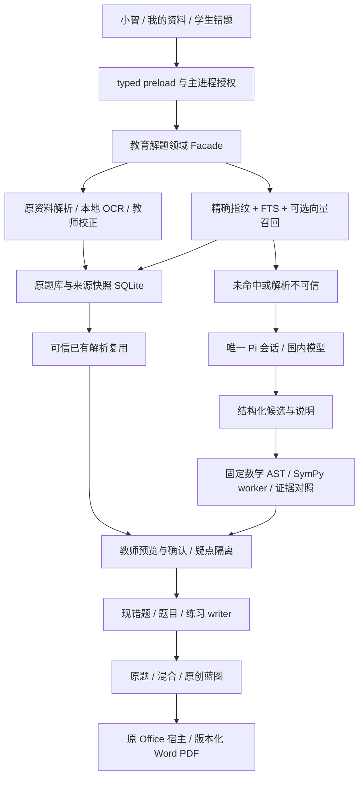

# 小智智能解题：现状审计、开源选型与实施方案

## 2026-10-09 KB-S3限定接受，下一S4（当前读点）

当前新增确定性整卷服务适配现题库/审批，不引入求解Agent或新服务。已有未核验解析只作为参考，缺答案/解析的题跳过，不将来源审核充当数学证明。Current Phase 4/5 DOING；Master ACTIVE。Current Task KB-S4：真实错题照片→本地OCR/教师确认→本机相似Top10→可审核练习；复用现错题facts/题库/PracticeReview。随后S5/S6学生卷与教师卷Word/PDF/真实图公式联合验收，再KB002 hybrid/ai_original/5变式及答案校验、KB003增量30–40GB。语义检索质量、可信答案与导出仍OPEN。

KB-S3 source_only整卷蓝图/审核/快照 LIMITED_ACCEPTED。build a0f860ac56680a4ddb1fa7798edd1e7c90812fae92f73b7a1156dddee7338448 /340文件；build/typecheck exit0、领域274、组件200/200、正式新版Electron12项/3启动/0 renderer错误、补充冷副本视觉3项/1启动/0模型请求、兼容smoke207/207。32张最终浅暗1366×768/1920×1080截图实际查看。23道教师UI创建对照，20道唯一题满足10×3+6×5+4×10=100；重复/缺答案/错年级、编辑废止、拒绝、精确缺口、真实源变化与恢复、幂等、停止无晚写、两次冷读和真实DeepSeek同Pi等待教师审批通过。原题不改，不自动补题，answerVerified=false；自制文字对照不是自然扫描卷或数学正确性证据。证据：apps/desktop/test-results/goal/kb-paper-20261009/closeout.json。


## 2026-10-09 KB-S2-B限定接受，下一S3（当前读点）

本片复用当前题面/版本合同，未加入新Agent或求解框架。DeepTutor的截断检索去重与OpenMAIC文件指纹不适合作为数学同题证明，使用薄本地投影比较；不等于答案验证。

KB-S2-B 保守同题候选/版本绑定 LIMITED_ACCEPTED。build cb0a5c473cbffc23d483cd2c2027f80405ac1fdbb57b44495fa4402072e8c79f /340文件；build/typecheck exit0、领域258、组件194/194、正式新版Electron12项/3启动/0 renderer错误、兼容smoke207/207。12张浅暗1366×768/1920×1080截图已实际查看。28道教师UI创建对照：跨记录ID/CRLF同题2条，改数值条件保持独立；20+2分页，真实Pi/DeepSeek同次10条安全别名/duplicateOf，源变化拒绝、精确恢复、两次冷启与索引重建通过。仅本地保守候选，绝不自动合并/删题或证明答案正确；页面范围current_page、Pi范围returned_candidates。证据：apps/desktop/test-results/goal/kb-identity-20261009/closeout.json。


## 2026-10-09 KB-S2-A 关键词底座限定接受（当前读点）

调研保持参考；本次采用当前SQLite而无新RAG/模型安装。只有已解析并保存的字段进入检索；可靠性与语义质量仍需对应证据。

KB-S2-A 关键词检索底座限定接受。当前build `443eae07f599fda05dfc5f241f85a8f62c942bc5cc9855cbc5e48f69777e3314` / 340文件；build/typecheck exit0，领域252、组件194/194、正式新版Electron11项/3启动/0 renderer错误、兼容smoke207/207。8张当前浅暗1366×768/1920×1080截图已实际查看。28道教师UI创建对照题，六项硬过滤命中22道、20+2分页；真实Pi/DeepSeek读10条并标hasMore；冷恢复、索引删除重建、旧来源拒绝与精确恢复均通过。不是语义Top10、同题指纹、答案正确性、100分卷、数学Word/PDF或30–40GB验收。证据：`apps/desktop/test-results/goal/kb-retrieval-20261009/closeout.json`。


## 当前最高专题优先级：知识库与智能组卷（2026-10-09）

十项开源调研仍有效；当前产品主线是知识库/组卷。不要继续扩大第三方调研取代现领域实现，未核许可证/硬件/性能依旧待核。

用户最新指示：整理上下文，集中完成知识库与智能组卷。当前唯一执行索引：[KB_EXAM_ACTIVE_TASK.md](../goal/KB_EXAM_ACTIVE_TASK.md)（仓库绝对定位 `docs/goal/KB_EXAM_ACTIVE_TASK.md`）。接续为 **KB-S2检索→S3纯题库100分卷→S4错题相似练习→S5/S6 Word/PDF联合验收→KB-002三模式/5变式→KB-003增量30–40GB**。R3/R4只按组卷/变式所需嵌入，通用解题长线及其他模式延后；下方旧节的R2→R3→R4线性Next不再是当前执行顺序。Master及知识库四项产品决策保持。


## 2026-10-09 B5-B限定接受与R2接续

§1–§10十项研究/12项目与两路线仍为选型依据。本次补齐此前scalar/document一致性未验缺口；研究许可证/性能待核字段不因工程测试通过改为已核实。

本节是当前读点，下方同日旧节保留历史证据，不能覆盖本节。M05/M10 B5-B仅来源事实一致性保护已接受：answer/analysis镜像冲突及v2题干冲突由同一只读helper检测；typed IPC保留安全错误，题本/同Pi来源弹窗拒绝展示冲突正文，精确恢复后可读。旧v1摘要语义、questionVersion、批准与原图未被自动修复或重写。

当前build 367d53b3d85dbb2e1855cbb7db977859f94129e529aec6898f40b2dca8d3f6bf / 340文件，正式前后、冻结快照与兼容smoke后一致。build/typecheck exit0；领域243、组件194/194、兼容smoke207/207；真实DeepSeek/Pi Electron24项/4启动/0 renderer错误。32张当前浅暗1366×768/1920×1080截图与4份原图实际查看；三个隔离标量故障均拒绝、精确恢复、冷启一致；原生手动压缩1次后冷继续通过。此压缩不是新的自然自动阈值基准，smoke仅兼容路径，不作新版视觉依据。

物理扫描无独立标准答案仍missing，图15未知标记不认作答案；教师自制跨页算术仅来源绑定对照，answerVerified=false。完整B5独立质量、可靠求解/五tools、语义Top10、100分卷/Office、30–40GB、自然教师、安装/VPN-off与完整Codex体验仍OPEN。

**Next：R2保守同题指纹/中文检索、硬过滤/版本与可信复用合同→R3受限AST/SymPy→R4同Pi五tools→R5–R7错题/组卷/Office/容量。** 不因缺物理答案停止后续，也不凭题面批准/来源标签把答案当正确。Master ACTIVE、Phase4/5 DOING。证据：`apps/desktop/test-results/goal/b5-facts-20261009/closeout.json`；首次RED/build/组件失败与回滚副本保留。无DDL/依赖/第二runtime/日常资料或凭据改动，无提交/push，另一worktree保留。


## 当前阅读起点：本轮低成本解题路线审查（2026-10-09）

按本轮用户要求，完成**现有源码审查 → 指定与扩展仓库联网核查 → 商用风险 → 两方案 → 推荐组合 → Demo门禁 → 开发清单**。本节优先于下方历史进度；完整十项设计仍在§1–§10，不另建重复系统。审查覆盖生产入口、工具、资料/题库/错题/审核与文件宿主接缝；不是所有第三方代码逐行安全认证。

### 当前事实与产品缺口

|问题|本轮真实判断|
|---|---|
|已有能力|Electron/React/TypeScript桌面；Pi生产会话/流式/取消/持久化/上下文整理；固定本地RapidOCR；MaterialRepository、确定性资料优先队列、原图/题面审核、题本、错题事实、练习审核及通用Office交付底座|
|接口/未完成能力|旧DeepTutor bridge dry-run、vendor中的完整服务不能当生产解题；五个拟定solver工具、受限SymPy、语义Top10、确定性100分试卷/数学Office输出、30–40GB容量尚未接受|
|OCR/RAG/模型位置|OCR在本地固定宿主；资料/题库检索主要是保存文本关键词匹配；DeepSeek由同Pi生成候选与解释。已审DeepTutor纯helper做格式/题型检查，`valid`不是数学正确|
|可扩展位置|`src/main/education`增加纯解题facade，复用现question context/review、practice review、mistake facts、MaterialRepository与Office宿主；typed preload仍是renderer唯一入口|
|重复/额外调用风险|`education_search_materials`和`search_teacher_knowledge`并存；同版本反复检索、解题/验证/讲解另开Agent、另建题库/会话/凭据库会放大成本。合并检索facade和版本化evidence bundle，不删除尚有消费者的adapter|
|规模限制|现题库查询是LIKE/元数据，≤20条；Pi摘要≤8条，非语义Top10。`score:0.9/0.6`是常数；资料正文先入内存，20,000 chunks/8MiB上限，超限失败，不是40GB方案|
|本次发现的未验缺口|题目scalar和document内答案/解析可能不一致；B5-B一致性guard已有未验草稿，旧v1直接reader的RED先失败，当前typed错误映射与组件fixture/正式故障恢复仍需补。不得静默覆盖题目来“修复”|

**接受状态必须分开**：B5-A `55b02f7d…` / 340文件已有限定通过证据（239领域、190组件、207兼容冒烟、22正式项/4启动）；本轮回读其报告，未重跑。当前source含B5-B未验草稿、领域RED exit 1，不可沿用旧结果标它通过。完整可靠解题与Master仍OPEN；Phase4/5 DOING。真实扫描物理卷没有独立标准答案，source/teacher/AI出处与答案正确性分开；补解须保留新增出处并独立核对。

### 开源采用决定与两条路线

已复核**12个GitHub仓库**：指定4项，加RapidOCR、Pix2Text、FlagEmbedding、SymPy、LanceDB、DeepTutor、Math-Verify、math-worksheets-skill。§2/§2.3逐项列地址、许可、实际模块、模型/硬件、接入难度与商用判断；§3.2逐项列维护、替代与退出。Star不用于替代源码、Issue与部署检查。

- Math bank不是只有CRUD：有保守去重、OMML/MTEF导入与公式/图片保留。但其[AGPL-3.0 LICENSE](https://github.com/JudgePeach/math-question-bank/blob/1251557ee23370ae0ef1f9733f6d5b6780112b44/LICENSE)要求评估分发与修改版网络源码义务；收费可行不代表闭源组合可随意复制。暂只参考设计，不借进程/HTTP边界假定免除义务。
- Edu-RAG元数据/混合检索与FastAPI是真实实现，但有内存BM25与LangGraph循环；Math-GPT实际执行模型Python、LLM verifier异常仍可`needs_hitl:false`。二者本轮常见许可证路径仍404，授权**待核实**，不复制进商业产品。见§2.1固定源码。
- PaddleOCR优先**局部公式/版面POC**，不装整套平台；专门公式识别不等于题目切分或题图理解。官方特定T4/Xeon环境的S/M/L耗时、模型存储量不能当本机显存/速度承诺，见§2.1；已有本机失败/超时不能抹去。
- SymPy采用受限AST构造和固定操作，不执行模型Python；[官方解析文档](https://docs.sympy.org/latest/modules/parsing.html)明确警告`parse_expr`使用eval。Math-Verify只比较答案且需解决[Windows timeout风险](https://github.com/huggingface/Math-Verify/issues/79)，不能证明全部步骤。

|方案|组合与开发复杂度|成本/维护与退出|结论|
|---|---|---|---|
|A 普通桌面优先|同Pi＋现RapidOCR/PDFium＋同SQLite保守指纹/中文FTS＋按评测可选小中文embedding/可重建LanceDB＋受限SymPy＋DeepSeek；扩展现域/合同，复杂度中等|不用新增GPU设备作为前提；云调用只在必要候选/改写，金额按§9测量。维护固定模型/Windows计算包；语义不可用退FTS，公式失败转人工校正，验证超范围标unknown|
|B 可选GPU增强|保留A全部事实/验证合同，增加整页PP-Structure/公式或一个本地视觉模型；复杂度与包体/部署负担较高|GPU/内存/驱动/模型许可与实测成本另计，不给未测显存承诺。只处理困难输入，不增Agent；随时禁用增强退A，原图与教师校正仍保留|

**推荐A**。先复用本地题库可信解析；未命中再由同Pi/DeepSeek生成候选、专业工具验算、按年级讲解；Qwen作为未来显式配置替代，不静默切供应商。FastAPI仅可选计算transport，默认复用现固定Worker；五工具和薄服务协议见§5。不采用百度等高价搜题作为核心，也不接未授权爬虫/逆向接口。

```text
图片/文字 → 本地解析/切题候选 → 必要条件校正与题目标准化
 → 保守精确匹配（可信解析复用）
 → 按需语义候选/教材证据 → 确定性或同Pi候选求解
 → 有范围的工具检查/冲突隔离 → 年级讲解/教师确认
 → 同错题事实与练习审核 → 相似题/三模式组卷 → 同Office交付
```

并非每题走全链。语义相近不能复用答案；RAG空结果仍可求解；来源有答案不等于可信正确。精确复用须有**显式答案核对记录或对应验证receipt**，题面确认/出处origin不能代替。当前尚无独立核验的source答案可作为来源参考内容展示，不能记作`trusted_cache_hit`或verified。

### 十项交付与直接实施顺序

|交付|本报告位置|
|---|---|
|1 现有能力与问题审计|本节、§1，包含上述七个现状问题|
|2 GitHub调研对比|§2/§2.3，12项目及固定SHA；维护/退出在§3.2|
|3 商业许可证风险|§3，代码/权重/依赖/题目内容分别核验|
|4 推荐架构与两方案|本节、§4；Pi唯一编排与同本地事实|
|5 Pi工具/FastAPI设计|§5，五tools prepare/finalize、schema与可选本地HTTP端点|
|6 识别/检索/求解/验证|§6；五输入类型、五教学模式和分学科检查范围|
|7 知识库/错题/组卷联动|§7；同审核/CAS、来源谱系、三种组卷与确定性队列|
|8 分阶段开发/测试|§8及[开发清单](../goal/XIAOZHI_SOLVER_IMPLEMENTATION_TODOLIST.md)，逐片合同与真实Electron门禁|
|9 成本/速度与优化|§9，设备/存储/教师校正与全部模型请求；缓存/批处理/路由/失败降级|
|10 最小Demo验收|§10；首片20题限定闭环，最终50题/200题对/30–40GB另验，全部指标是拟定门禁|

**接下来交开发Agent的顺序**：B5-B同源事实一致性/真实原图限定核对与恢复 → R2保守精确复用/可解释Top10 → R3受限验证 → R4同Pi五tools与讲解 → R5两MVP → R6数学Word/PDF → R7三模式/增量/30–40GB。B5更广的独立语义与答案质量随R3/R4持续验，不反复用原页展示替代解题落地；任何缺必要条件的题均不可越过确认。

本轮只读研究证据：`apps/desktop/test-results/goal/solver-audit-20261009/requested-route-review/`。12远端HEAD全部取得；19本地接缝保留hash，84历史捕获文件完整性无失败；本轮14份源/许可捕获＋5份补捕获成功，6许可404仍待核实、2错误测试路径404已按README补到`tests/`且保留首失败。LanceDB HEAD前进至`bcf5ee263f6d17e0e8fadae59ef1c68fbdcde513`，补核Apache许可/依赖/RRF，[提交](https://github.com/lancedb/lancedb/commit/bcf5ee263f6d17e0e8fadae59ef1c68fbdcde513)调整FTS tokenizer默认与测试，未升级/运行该依赖。Git本地/远端488f8109…与Master SHA不变；dirty/另一worktree/资料/凭据保留。没有新依赖、DDL、第二Agent或本轮功能验收。网页可能压缩源空白，固定raw文件hash为代码核查依据。

## 2026-10-09 B5-A：题本来源与答案声明的限定接受

审查后Goal实施更新：B5-A题本来源/答案声明限定接受，完整B5/可靠求解未完成。下方历史题本文案缺口已在本slice修复；默认桌面A/可选GPU B、12仓库/商用风险与退出设计不变，未安装上游项目。

当前 build `55b02f7db10fe4530098f0447bd92d89566841acb698e51b02e68ec6e38df9a3` / 340文件与正式前后、smoke后及固定快照一致。build/typecheck exit 0；领域 **239**、组件 **190/190**、兼容冒烟 **207/207**。真实 Pi/DeepSeek 正式 Electron **22项 / 4启动 / 0 renderer错误**。24张当前product-five-spaces浅暗1366×768/1920×1080截图实际逐张查看；新增答案出处与缺失/未核验提示均有当前像素。smoke只在正式进程退出后重建；另存并查看1张legacy兼容题本截图，不把该旧壳截图当新版设计验收。

题本参考答案与解析分别标注原资料提供、教师补充、小智生成、尚未提供或历史来源待确认；所有参考答案明确尚未独立核验。真实来源对照答案/教师解析与物理扫描题缺失都经过当前页面展开操作。教师确认题面不等于答案正确；原题、来源origin、批准、版本和图片字节保持，冷重启与同Pi精确读回通过。内部sourceKind/canonical/SQLite等不再出现在该题本的教师可见文案；未知来源不猜测。

仅接受B5-A来源/答案声明与本切片UI；完整B5独立图义/公式/条件/答案质量仍DOING。物理扫描卷无独立标准答案，仍missing；教师自制跨页算术只是来源绑定对照，不是扫描答案gold。answerVerified=false，不上传原图/私有路径，不将模型自评作证明。原生手动压缩1次与冷继续已验，不是新的自然自动阈值基准。完整可靠解题、Top10、100分数学卷/Office、40GB、自然教师、安装/VPN-off、完整Codex体验及Master后续阶段仍OPEN。

**Next：B5-B逐题独立对照来源/公式/必要条件与答案质量 → R2可信同题零额外生成、相似Top10 → R3受限AST/SymPy → R4同Pi五tools → R5–R7错题/组卷/Office/30–40GB。** 不重复B4四类兼容代替新质量任务，不把本轮文案修复当完整解题完成。

Evidence：`apps/desktop/test-results/goal/b5-source-20261009/closeout.json`；正式 `education-journey-n5msKi`，含当前源/加载脚本、固定build、日志、24张已查看截图、失败与回滚点。 本地/远端HEAD 488f8109d68027a6eb488e9d04c4eb5073d153cd（dirty），Master SHA未改，Phase4/5 DOING、Master ACTIVE。无DDL、新依赖、第二runtime、日常资料/凭据变更、提交或push；另一worktree保留。历史节保留当时范围，不覆盖本节。

## 2026-10-09 B4-D：单区域完整审核与新旧版本同构建兼容的限定接受

最新实现范围更新：审查后的Goal推进已补B4-D fresh单区域完整审核与v1single/v1multi/v2修订真实兼容。下方旧“单区域未验”仅历史。本报告十项审查/12项目/许可风险/默认桌面A与可选GPU B仍为设计依据；实际解决数学题、五tools、语义Top10、规模成本尚未接受。

当前build `e02ddc1d62d37152928c97718ea14894389982fcdbfd2453cb673cd08a417c51` / 340文件与四次正式流程前后、smoke后out和固定快照逐文件一致。build/typecheck exit 0；领域 **239**、组件 **185/185**、兼容smoke **207/207**。真实Pi/DeepSeek正式 **50项 / 13启动 / 0 renderer错误**：fresh single 20、旧v1单页10、旧v1多页10、新v2再修订10；40张浅暗1366×768/1920×1080截图实际逐张查看。smoke在四次正式进程退出后才重建，未与正式测试重叠。

只接受已核对文本传递和版本/权限/恢复安全。真实扫描原图已查看，图15深色标记显式记录来源不明；未核实的必要读数保持missing。物理卷没有独立标准答案，算术跨页资料是教师自制绑定控制，不能作为扫描答案gold。answerVerified=false；Pi只获必要文本，不发原图/私有路径。原生手动压缩1次＋冷继续不是新的自然自动阈值基准。完整B4/B5、可靠解题、语义Top10、100分数学卷/Office、40GB、自然教师、安装/VPN-off和完整Codex一致性仍OPEN。

**Next：B5原图/公式/来源/答案质量合同与独立核对 → R2可信同题零额外生成/相似Top10 → R3受限AST/SymPy → R4同Pi五tools → R5–R7错题、三模式组卷、Office与30–40GB。** 现题本可见`teacher_resource`/`generated`内部来源文案，列为B5/R2产品文案待修，不把40截图限定核对当整页UX完成。

Evidence：`apps/desktop/test-results/goal/question-projection-20261009/b4d-closeout.json`，含当前源码/加载脚本、build、命令、首次失败、40张已查看截图及回滚快照。 本地/远端HEAD 488f8109d68027a6eb488e9d04c4eb5073d153cd（dirty保留），Master SHA未变、Phase4/5 DOING、Master ACTIVE。没有DDL、新依赖、第二运行时、日常数据/凭据变更、提交/push；另一worktree保留。历史节只保留其当时范围。

## 2026-10-09 B4-C：新多区域审核与完整转写传递的限定接受

审查后的Goal实施已形成B4-C六项完整文本传递和真实Pi手动压缩/续用限定证据，当前build33ffc86c…；旧“B4草稿未有正式链”现为历史。许可证/两路线/成本假设不因内部测试成为商用授权或实测账单。可靠解题和五tools仍未落地。

接受范围是教师提供六项文本的完整传递与版本/审核/恢复安全，不是每个图义已经独立判真。图15已有深色标记，来源不明，须补明确原图审查；物理卷无独立标准答案，保持 missing；跨页算术是教师自制来源控制，不冒充扫描卷答案gold。完整B4/B5、可靠解题、语义Top10、100分数学卷、40GB、自然教师、安装/VPN-off与完整Codex一致性仍OPEN。

**Next：B4-D：原图细节/不明标记质量审查、单区域新审核与新旧版本联合正式门禁 → B5 → R2可信同题复用/Top10 → R3受限AST/SymPy → R4同Pi五tools → R5–R7。**

Evidence：`apps/desktop/test-results/goal/question-projection-20261009/b4c-closeout.json`；正式 `education-journey-cHFfHO`，定点视觉 `education-journey-otIM5j`。本地/远端 HEAD `488f8109d68027a6eb488e9d04c4eb5073d153cd`；Master/日常数据/凭据/另一worktree未改，未提交或push。Phase **4/5 DOING**，Master **ACTIVE**。以下旧节仅保留当时证据，不能覆盖本节。


## 2026-10-09 B4-B Goal续行记录

审查之后的Goal实施已补齐B4-B旧题修订接缝，236领域/183组件/10项真实Pi正式路径；当前build3ccdf438…，旧0467789a…仅历史草稿。新初审/完整图义/压缩及B4/B5未接受；本报告的许可证/两方案/成本假设不变。B4-C：新多区域审核六项字段的正式入口（先更新原KB-ORIGINAL-MULTI旧stem选择器），完整图/公式/选项与独立答案审查，编辑/停止/压缩/恢复联合验收→B5→R2精确可信复用与Top10→R3受限AST/SymPy→R4同Pi五tools→R5–R7。

Evidence：`apps/desktop/test-results/goal/question-projection-20261009/`；正式 `education-journey-H1dgFq`。兼容冒烟 **207/207，exit 0**；见最终b4b-closeout.json。Phase4/5 DOING、Master ACTIVE。

## 最新源码复核与交付边界（2026-10-09）

本轮遵循用户指定的七步顺序，只补充审计、联网复核与方案交接；没有在此复核中新增产品代码、安装依赖、调用计费模型或重构运行时。十项交付均在本报告§1–§10；实施卡在 `docs/goal/XIAOZHI_SOLVER_IMPLEMENTATION_TODOLIST.md`。下方历史记录保留其当时范围，本节与正文当前表优先。

- **已接受范围**：现Pi治理、本地文字OCR/资料解析前置及B3多区域原图、来源答案审核各有限定证据；不等于可靠解题、完整DeepTutor、100分整卷、Top10或40GB完成。
- **当前B4草稿**：真实源码已有 question-document.v2、六项题面投影、新原题审核writer、main账本/源hash/资产读回及Pi脱敏reader，新增审核字段界面。已有229项领域通过日志和build通过日志，本轮只回读日志；旧题补全编辑、正式Pi/Electron、双尺寸浅暗视觉与完整故障/恢复仍OPEN，不能标B4完成。
- **当前build**：`0467789a15928939eeaea49340b6ca6c52e04ca80d427f071181a2357d83637d` / 340文件，与B3历史接受build `df2a6f83…`不同。当前运行窗口、日常profile与安装包未验，不能沿用B3测试结果给新build背书。
- **联网证据**：重新核12个远端HEAD、14份固定源码hash和18份本地接缝；14份固定源码无变化。LanceDB HEAD前进到 `32436a7ad7d005660d994f7e76265cf49fc874b4`，补读其Apache-2.0 LICENSE、Python依赖及RRF。此前 `d3390a9…` 留作研究快照；不自动升级生产依赖。新提交涉及依赖与FTS测试，Windows兼容仍需POC。[提交来源](https://github.com/lancedb/lancedb/commit/32436a7ad7d005660d994f7e76265cf49fc874b4)。
- **许可与质量**：Edu-RAG/Math-GPT授权仍待核实；Math bank AGPL不直接复制进闭源产品。Math-GPT实际执行模型Python且LLM verifier异常可返回needs_hitl=false，不能采用为确定性验证；Paddle公式/版面POC已有质量/超时失败记录，不升级为默认成功能力。
- **成本与下一步**：重新核DeepSeek及Qwen官方价目，§9是假设算式，不是实测账单。先完成B4/B5 → R2可信同题/相似检索 → R3受限AST/SymPy → R4同Pi五tools → R5–R7错题/组卷/Office/容量。现原图审核和变式审核、题面确认和数学正确性分别接受。

完整证据：`apps/desktop/test-results/goal/solver-audit-20261009/final-current-review/readback.json`、`supplement.json`、`current-build.json`。图谱调用未完成，使用有界当前源码回读；不是全仓逐行审计或上游测试认证。Git本地/远端均 `488f8109d68027a6eb488e9d04c4eb5073d153cd`，dirty和另一worktree保留。Master ACTIVE、Phase4/5 DOING。

## 本轮交付入口：低成本路线与商业集成审查（2026-10-09）

按用户最新要求，本轮完成现状 → 联网核查 → 许可风险 → 两套方案 → 推荐 → Demo 门禁 → 开发清单；不继续 B4 产品开发。以下十项正文是统一交付，不另建十套重复设计：

|交付|正文|
|---|---|
|现有项目能力与问题审计|§1，结合下表最新 B3 状态|
|GitHub 开源调研对比|§2 的 11 项＋§2.3 新增项目，共 12 项（指定 4 项＋扩展 8 项）|
|许可证与商用风险|§3；许可未核实的代码不迁移，AGPL 参考设计与获得商业授权分别处理|
|推荐架构/两套可行方案|§4；默认普通桌面 A，可选高资源 B，数据合同与 Pi 相同|
|Pi 工具/FastAPI 服务|§5；五工具是领域能力，FastAPI 是可选传输层|
|识别/检索/求解/验证|§6；已有可信解析优先复用，图/条件缺失先校正|
|知识库/错题/组卷联动|§7；复用同题库、审核与文件版本，不另建 solver 事实库|
|阶段开发与测试|§8 与 `docs/goal/XIAOZHI_SOLVER_IMPLEMENTATION_TODOLIST.md` 最新任务卡|
|成本/性能|§9；成本公式、官方价目和假设算例分开，不承诺未测命中率/设备性能|
|最小 Demo 验收|§10；独立答案真值、错误通过零、原件/导出/恢复的量化门禁|

### 当前代码结论与证据边界（B4-D更新）

|当前程度|本轮核查结论|
|---|---|
|生产运行时|`production-host.ts` 直接注入现 Pi；`runtime-authority.ts` 仅在隔离测试条件允许 legacy-test。旧 Python bridge 的 fake stream/AgentLoop 不作生产求解入口|
|题库查询|`db.ts` 的真实查询是 `LIKE`＋元数据条件，最多 20 条；Pi adapter 当前最多返回 8 条摘要，未实现语义 Top10，也不是严格同题答案复用|
|资料检索|现 `education_search_materials` 与 `search_teacher_knowledge` 都在同 Pi 挂载，有重复查资料的风险；应合为同一个检索 facade/evidence bundle，保留兼容 adapter|
|原题与原图|B3原图/来源、B4-B旧题修订、B4-C六项传递及B4-D单区域/新旧正式兼容分别限定接受；图15未知来源标记已显式记录，逐题语义/公式/答案独立质量与完整B4/B5仍待接受，不能称可靠题目理解|
|Pi 完整读题|当前e02ddc1d…build正式50项覆盖fresh single、旧v1单/多页和new-v2修订精确读取，手动压缩/冷继续；旧v1不能自动升级，须教师补全。传递正确不证明图义/答案正确；完整B4/B5仍DOING，不删document绕过|
|数学验证与五 tools|本轮在生产教育域/注册接缝未发现已挂载的 SymPy 验算或要求的五工具。现 DeepTutor normalize 检查题型/JSON，不证明答案正确；不是可靠解题 Demo 已完成|
|可扩展底座|保留 MaterialRepository、原题/变式 review、practice review、mistake facts、学生隔离、Pi 流式/取消/压缩/持久化和 Office 文件审批；新增纯解题域接既有宿主|

以下为B4-C之前的只读研究历史，不表示当前build或当前运行测试状态。

本地/远端 HEAD 均 `488f8109d68027a6eb488e9d04c4eb5073d153cd`，dirty 工作和另一 worktree 保留。图谱已索引但精确符号缺失、snippet 行号与当前代码漂移，因而用有界当前源码复核，不把旧图当行为证据。本轮重读 8 份生产接缝并留 hash，逐文件回读当前 out **340/340** 与 B3 已接受 build `df2a6f83…` 一致；这是完整性回读，**没有重新运行 build、组件/Electron 测试或 provider 计费调用**。

只读复核 **12 个远端 HEAD**；原 11 项与已审快照一致（SymPy 为先前已补审 `8c02bd2…`），84 份历史源码 hash 无不一致；新捕获 20 份源码/许可/测试配置。6 项常见许可证路径 404 与 2 项新增项目的猜测路径 404 保留，后者已从 README 找到 `tests/` 正确文件并补核，前者仍为授权待核实。未执行上游代码/测试、安装依赖/模型、上传资料或修改凭据。

证据：`apps/desktop/test-results/goal/solver-audit-20261009/requested-review/capture.json`、`supplement.json`。研究方法可重放，但不等于上游安全认证或发行许可闭包完成。价格再次按 DeepSeek/阿里官方页核对，§9 仍是价目快照和假设算例。**百度等高价专业搜题不作核心依赖，不接未经授权搜题爬虫；PaddleOCR 本地开源组件不属于该付费服务依赖。**

Next：B4/B5 完整必要题面 → R2 可信同题复用/相似检索 → R3 固定数学验证 → R4 同 Pi 五 tools/讲解 → R5–R7 错题/组卷/数学导出/大库。R3 新增现成固定验证器的适配 POC，详见 §2.3；不能直接把它的 PASS 当小智确定性验证通过。

## 2026-10-09 B3 多区域原图与来源答案审核：纵切限定接受

先前“本轮只审查”属于上一交付轮次，本次Goal续行恢复§42/§44产品验收。下方十项审查/11项目/许可/两路线结论仍有效；本次未重新安装或迁移第三方runtime。

Phase **4/5 DOING**，Master **ACTIVE**。只接受 B3 多区域原图/来源审核纵切，不接受完整原题转写、数学正确性、B4/B5 或完整 KB-EXAM-001。

最终 build `df2a6f837b39d5feaa66df56b4239101552ebd613c23277a2ef4b4e317c99828` / 340 文件与当前 out、正式流程前后逐文件一致。build/typecheck、renderer **181/181**、领域 **225**、真实 DeepSeek/Pi 正式 Electron **12 项 / 3 启动 / 0 renderer 错误**、全部 5 张原件像素对照和旧兼容 **207/207** 通过。12 张深浅主题、1366×768/1920×1080 截图及 5 张原图实际查看。停止真实范围渲染子进程实测 **1617ms / SIGTERM**，不外推其他设备或完整性能基准。

真实物理扫描题两块原图完整保留条件、图14/图15、表、选项与小题；**手工文字仅摘要，缺少例如“不更换实验器材”等完整条件，不能单独作为 LLM 完整题面**。该卷没有独立答案 gold，答案保持 missing。另 3 页算术对照为明确教师自制材料，只验证跨页及来源锚点，不冒充该卷标准答案；来源答案与教师补解分别保存。scope 更改须重确认，source CAS、外帧拒绝、真正确认 SQL 事务中 main 强制死亡/回滚、冷恢复、损坏整组报错/恢复与幂等均通过。

复用同 Pi、ai_confirmation_items、question_bank_items/document_json 与 QuestionAssets；取消修复沿现 owner AbortSignal，不新增 AgentLoop、DDL、依赖或模型。SDK 12 条 assistant usage 保留，cacheRead 是 SDK 报告 token，不是题库命中率；SDK 价格 0 表示这里未知，不等于账单免费。

**Next：B4 完整必要题面上下文精确合同 → B5 联合验收 → R2 可信精确复用/相似 Top10 → R3 受限 AST/SymPy → R4 同 Pi 五 tools → R5–R7 两 MVP、Office、三组卷模式和 30–40GB。** 不得通过删除 document 或仅发 stem 绕过 `document_context_unavailable`。完整解题/语义检索/数学导出/40GB、自然教师、设备/安装/VPN-off 仍 OPEN；Master 其他 DT/MA/JOIN 与 Phase6–8 保持 OPEN。

Evidence：`apps/desktop/test-results/goal/original-multi-20261009/closeout.json`；最终正式路径 `education-journey-15t76q`。本地/远端 HEAD `488f8109d68027a6eb488e9d04c4eb5073d153cd`（dirty 保留）；未提交/push，不改日常资料、凭据、历史或另一 worktree。Master SHA 未变。以下历史保留其当时范围，以本节和最新真实证据为准。

## 本轮技术路线修正结论与真实状态（2026-10-09 06:35 起复核）

本节是当前阅读起点；下方日期相同的历史切片保留其当时范围。依照用户本轮要求，**先审现有源码，再联网核查、比较许可与两套方案，最后交付任务清单；本轮不继续产品重构、安装依赖或调用付费模型**。原 Master Goal 保持 ACTIVE，Phase 4/5 DOING。本专题方案已交付，完整智能解题尚未完成。

### 十项交付位置

|交付|正文位置|当前判断|
|---|---|---|
|现有项目能力与问题审计|§1，及本节能力表|真实生产接缝审查；不等于全仓逐行安全审计|
|GitHub 开源对比|§2，11 项项目表|四个指定项目＋七个扩展候选，均有地址、许可、模块、模型、硬件、难度、采用判断|
|商用风险|§3|AGPL、未取得许可、权重/依赖/题目内容权利分别处理|
|推荐架构与两套方案|§4|推荐 A；GPU/整页视觉 B 可选，数据合同相同|
|Pi 工具与 FastAPI 服务|§5|五 tools 是设计；FastAPI 仅可选薄计算接口，默认复用现 Worker|
|识别→检索→求解→验证|§6|可信同题直接复用；未命中仍可求解；检查范围明确|
|知识库/错题/组卷集成|§7|同 SQLite/文件、同审批与来源 CAS；不新建题库真源|
|开发与测试计划|§8 与[开发任务清单](../goal/XIAOZHI_SOLVER_IMPLEMENTATION_TODOLIST.md)|按依赖纵切推进；未验能力仍 OPEN|
|成本与性能|§9|官方价格假设模型、缓存/调用/设备摊销；实测单题账单与命中率 unknown|
|最小 Demo 标准|§10 及本節 Demo 顺序|拟定门禁；当前无完整 Demo 接受证据|

### 当前能力：接受、草稿、计划分开

|模块|真实代码/证据|结论与直接扩展位置|
|---|---|---|
|唯一 Pi、工具注册/流式/停止/审批/压缩|`production-host.ts:339,382–389`；`pi-session.ts:499–511`；旧入口由 runtime-authority 限为 legacy-test|KEEP，不接 Codex CLI 或新的 LangGraph/多 Agent runtime；limitsEnforced:false 仍生效|
|本地文字 OCR、PDF/原页/文字框、后台任务|MaterialRepository/固定 OCR Worker；B2-c `material-layout-20261009/closeout.json`|已限定接受；保持教师校正，不称公式/图义自动正确|
|单题单区域原题入库|原 original-question repo/coordinator、同确认账本和正式资产根；B1 closeout|限定接受；完整题目依然需多块/跨页与出处核对|
|多区域、跨页及来源答案|**当前未提交草稿** `original-multi-review.ts`、`original-multi-repository.ts`、typed preload、审核 UI、gallery，沿现账本|EXTEND 的代码已有，不能再写“尚无任何实现”；也不能标 DONE。已有 build/typecheck/领域/组件日志，**尚无 B3 正式 Electron、真实图/答案/视觉及完整故障验收**|
|Pi 读取已入库图文题|`question-context-provider.ts:34` 遇 document 返回 `document_context_unavailable`|明确阻断不完整题面，B4 必须补齐必要条件/图义，不把本地显示原图当模型完整读到|
|题库/教材检索|SQL 关键词；Pi 最多 8 条/64 别名；`search-provider` 调固定 DeepTutor matcher；readingSnapshot 限 20,000 chunks/8MiB|EXTEND 为同检索 facade、保守指纹/中文 FTS/分页。0.9/0.6 是匹配常数，非语义概率。当前链不能证明 40GB|
|可靠求解/五 tools/SymPy|生产注册未发现拟定五 tool 或固定 SymPy 检查宿主；现 question-worker 只归一化/格式检查|OPEN；解题 facade 放现 `main/education`，不复制第三方自有库/会话|
|错题/变式/练习/Office|原 mistake-facts、question-review、practice-review、office-artifact 宿主|KEEP/EXTEND；真实确认与版本链存在，可靠 Top10、100分蓝图、数学卷导出仍 OPEN|

**运行版本漂移已揭示**：先前 B2-c 接受构建为 `85d8e4d7…`，但当前 out 已由 B3 草稿构建更新。不能继续把那份 B2-c 报告称作“当前 out 全部已验”；本轮只读记录当前构建，不启动、替换或回滚日常实例。下一实施必须先冻结草稿构建身份、检查正在运行的实例，再在隔离 profile 完成 B3 验收。

### 本轮联网与许可复核

- 11 个 upstream HEAD 再次只读核对；10 个与初审快照一致，SymPy 为已补审 `8c02bd2b177bce1775cd3688cef07d225f69345d`。未安装 HEAD 版本，不将主分支当稳定发行包。
- 新捕获 **25 份**固定 SHA 的源码/许可证/官方公式文档，先前 **84 份**来源散列回读无失败。许可证及代码结论继续见§2–§3。7 次 404 原样保存：Edu-RAG/Math-GPT 三种常见许可文件各未取得，RapidOCR 根 `MODEL_LICENSES.md` 此次未取得。前两项仍**待核实授权**；后一项须对所选已锁模型的实际 notices 单独查验，不能据根文件不存在断言模型无许可，也不能宣称最新版模型许可闭包已通过。
- Math-GPT 真实 solver 将模型 Python 写临时文件并 `subprocess.run(sys.executable, timeout=2)`；verifier 使用 LLM，异常返回 `is_verified:false, needs_hitl:false`，路由仅检查 needs_hitl。其“sandbox”注释不提供操作系统隔离，也不构成数学检查通过。参见[solver 固定源码](https://github.com/krishnasrivaibhav2027/Math-GPT/blob/588e1b661af3bb193fda9b1a538d565f0955b860/app/agents/solver_agent.py)、[verifier](https://github.com/krishnasrivaibhav2027/Math-GPT/blob/588e1b661af3bb193fda9b1a538d565f0955b860/app/agents/verifier_agent.py)。
- Math Question Bank 的 AGPL LICENSE 已回读；本轮 GNU FAQ 页面抓取超时，网络交互义务依固定 LICENSE §13 与历史官方来源，不虚称 FAQ 再核成功。[许可证](https://github.com/JudgePeach/math-question-bank/blob/1251557ee23370ae0ef1f9733f6d5b6780112b44/LICENSE)。闭源产品当前只参考设计；独立 HTTP 服务不能自动消除许可义务。宽松许可组件也须审依赖/权重、保留 NOTICE；题库内容权利不由软件许可证授予。
- Paddle S/M/L 的官方耗时来自特定 Linux CPU/GPU纯推理，显存、常驻内存和本机整卷速度未由该表证明。已有本机公式 POC 的错误/超时仍保留；M 是候选，不能默认装全套或宣称中文公式可靠。
- 最新[DeepSeek 定价](https://api-docs.deepseek.com/quick_start/pricing/)重新取得，Flash 低谷/高峰价格与§9一致；[缓存规则](https://api-docs.deepseek.com/guides/kv_cache/)要求完整命中已持久化的前缀单元，best effort，不能承诺每轮固定命中率。仍按真实 hit/miss/output 记账。
- [Qwen 官方文档](https://help.aliyun.com/zh/model-studio/qwen3-5-flash)中动态别名与 `qwen3.5-flash-2026-02-23` 快照的缓存/Batch 支持不同。选择模型、地区和快照时须同时锁功能与价格，不能把动态别名缓存能力套到固定快照。当前产品仍默认 DeepSeek，Qwen 仅退出方案。

### 推荐与最小 Demo 顺序

推荐 **A：现 Pi＋已锁本地 OCR/PDFium＋同 SQLite 精确指纹/中文 FTS＋可选小 embedding/可重建 LanceDB＋受限 SymPy＋DeepSeek**。先复用教师可信答案；可形式化题用固定工具；其余由当前 Pi 生成候选、验证后明确范围并审核。方案 B 的整页视觉/GPU增强适合困难输入，维护及部署负担更高，失败可退回 A。两套详细比较、每项替代/维护/退出在§3.2/§4.1。

1. 接续 B3 草稿的正式验收，补 B4 完整必要题面；输入不完整先校正，不让 LLM 猜漏图/公式。
2. 先做**教师已校正题目/文字输入**的题库复用与受限数学闭环，复杂手写、自动全卷切题无需全部达到最终指标才开始文字求解，但其失败必须显式停在校正。不能用这个缩小 Demo 冒充全产品接受。
3. 第一端到端 Demo 建议固定 20 题（12 已核文字题、6 印刷截图、2 带图校正题；不是现有金标准集），有独立来源答案/人工验算；另固定 ≥20 条差数字/否定/定义域/图与源版本反例，以及 ≥30 条支持/不支持数学验证样例。20/20 可追溯，重复同版本题无额外生成请求，critical 错误通过 0，停止/拒绝不写正式事实，冷恢复一致。
4. 其中真实错题完成本地 OCR→校正→同学生归档→相似题 Top10 或诚实不足→教师确认练习；纯题库整卷达到既定 100 分蓝图，缺题明确失败，Word/PDF 经原审批/版本宿主回读。二者仍是 KB-EXAM-001 MVP，不被单题 Demo 取代。
5. 扩展至§10 的 50题识别、200题对检索、年级讲解与完整图/公式评测；最后做设备/安装/无VPN、30–40GB、三种组卷模式。准确率、速度和实际金额测后再承诺。

本轮证据：`apps/desktop/test-results/goal/solver-audit-20261009/route-realignment/`。包含 11 HEAD、固定源文件/hash、许可失败、660 个产品源码/manifest前后校验及文档校验；未复制源码到产品、未重跑/宣称上游测试或完整解题 Demo，未改真实数据库/资料/配置/密钥。历史统计不是本轮重新运行的测试结果。

## 2026-10-09 B2-c 原页文字区域：生产纵切限定接受

十项现状/11项目/许可证/两路线/成本/工具/开发Agent任务审查保持§1–§10。B2-c是审查后沿现源码的最小复用落地：原固定OCR延伸，不引入高成本搜题、私有爬虫或第二runtime。推荐A不变；受限SymPy/题库优先等尚待R2–R4实现。

Phase **4/5 DOING**，Master Goal **ACTIVE**。仅接受B2-c文字区域切片；完整B2、R1-B、KB-EXAM-001、可靠解题与两条最终业务闭环仍OPEN。

最终build `85d8e4d7ecf997f052bf56f532c73e09d5f0710dfc7bc993ffaf8ab8b408f872`（340文件）与当前out逐文件一致；build/typecheck、renderer179、领域216、原生兼容11、正式Electron11/2启动/0 renderer错误、旧smoke207/207通过；16张深浅双尺寸截图实际查看。

公开物理扫描卷6页共304待校正文字行；UI识别＋回读实测每页7.851–8.900秒，不是纯模型基准或总体准确率。Page4 S₂→zS、Page6 U₀→U。且部分选项漏识别，原图完整保留；不能称完整切题/数学正确/来源答案。临时校对稿未存为正式题目，重启只复用派生候选cache；本片0模型请求，不等于整个解题成本0。S/M公式POC未推广；自然教师/日常profile、安装、16GB、VPN-off、30–40GB未验。

下一步：知识库方案§41 B3完整多块/跨页题目与来源答案审核→B4完整必要Pi上下文→B5联合验收→R2可信精确/语义Top10→R3受限SymPy→R4同Pi五tools→R5–R7组卷/错题双MVP、Office/三模式与30–40GB。Master其他DT/MA/JOIN与Phase6–8保持OPEN。

Evidence：`apps/desktop/test-results/goal/material-layout-20261009/closeout.json`（含source/build清单、commands、first-failures、manual-review和16张实际查看的截图）；正式当前UI为`education-journey-NEu3AR`，旧207仅兼容证据。

以下历史保持当时范围，当前状态以本节与真实证据为准。

## 2026-10-09 B2-b 版面/公式可行性结论（包含失败，非生产完成）

本轮十项交付见§1–§10，11项目含源码/许可/替代退出，两条方案与量化Demo门禁已有；新增本机公式/文字框可行性证据见知识库方案§37–§38。推荐现Pi/SQLite/固定OCR＋题库优先＋受限SymPy＋DeepSeek，M只候选，不因实验而推广全套Paddle。

6页公开扫描卷保留304文字行四边形，单页3.609–4.263秒。S中文/单位/LaTeX质量失败；M三清晰crop主要内容匹配预先人工转写（1.494–2.331秒），退化单位错误、图表180秒超时、空白两次减号。没有完整题界/数学正确性/总体准确率证明。CPU实验设备i7-13650HX/约32GiB，不是16GB基准。

仅测试env安装71个hash锁包与官方本地权重，未改生产OCR/资料/数据库/凭据。商业发行闭包、Windows进程树强制取消和安装/设备门禁未接受。原正式out SHA e128d1521fb00761a3b8f3ecd8248fb21ccda6362ee419792d4fd90d153a060f/340文件与Master/worker/manifest未变，无新产品UI或solver完成证据；未提交/push。

Next：知识库方案§38 B2-c版本化候选协议/现teacher入口合同→B3多块/跨页/来源答案→B4完整Pi题面→B5联合验收→R2可信检索→R3受限验证→R4五tools→R5–R7双闭环/Office/三模式/大库。Phase4/5 DOING，Master ACTIVE；本片不将完整B2、KB-EXAM-001或可靠解题标完成。

Evidence：apps/desktop/test-results/goal/layout-formula-20261009/closeout.json、manual-review.json、first-failures.json；知识库方案§37为结论、§38为下一合同草案。下方原历史证据保持其范围。

## 2026-10-09 B2-a 后台资料整理（限定接受）

十项审查/两路线/商用风险/成本/Demo设计保持§1–§10；本次Goal续行是B2-a渐进切片。推荐A不变：现Pi+同SQLite+固定本地OCR/Office，公式候选/受限SymPy/可信检索仍需后续POC。最新公式候选与license声明见知识库方案§34和research/reuse-decision.json，无新模型部署。

B2-a 后台资料整理已实现，已验最终build e128d1521fb00761a3b8f3ecd8248fb21ccda6362ee419792d4fd90d153a060f/340文件：build/typecheck、renderer177、统一领域209（新增队列17）、正式Electron11/4启动/0 renderer错误及12张双尺寸深浅截图通过。实际deepseek-flash/Pi实读触发优先解析，SDK usage单独保留，不算账单/单题成本。同一最终build兼容207/207通过。仅B2-a持久后台整理切片接受；完整B2/R1-B/KB-EXAM-001未完成。

Phase4/5 DOING，Master Goal ACTIVE。仅本机确定性任务消费，无新依赖/DDL/AgentLoop/公式模型安装；不把OCR正文当原题、标准答案或已审核事实。新队列仅显式采用资料，旧占位不自动消费；旧同步入口保留。单文件整体提交与重启，不承诺页级checkpoint、30–40GB吞吐、PID复用抢占或自然教师/安装验收。Git本地/远端HEAD均488f8109d68027a6eb488e9d04c4eb5073d153cd，dirty保留、未提交/push；日常资料/配置/历史及另一worktree未改。

Next：B2-b真实版面块与唯一公式候选许可/设备POC（方案§34）→B3多块/跨页/源答案教师校正→B4完整必要Pi图/公式上下文→B5联合验收→R2可信检索/Top10→R3受限SymPy→R4同Pi五tools→R5–R7双MVP/Office/三模式/大库；Master其余DT/MA/JOIN/Phase6–8保持OPEN。

Evidence：apps/desktop/test-results/goal/material-background-20261009/（commands、first-failures、source-manifest、visual-review、native-usage与真实readback）；完整收口见该目录closeout.json；最终207在accepted-build5运行，之前build3的207仅为历史证据。下方历史保留，以本节与实际证据为准。


## 2026-10-09 B1 原题资产与教师审核：单题单页切片接受

十项源码/开源/许可证/两路线/成本/Demo设计已于前次审查交付，固定上游来源保留；本次Goal续行实施第一原题入库切片。下方各时间节是对应历史证据，不把“上轮审查无代码”套到本轮。推荐A不变：现Pi+固定RapidOCR/PDFium+同SQLite；公式候选、embedding、LanceDB与受限SymPy均待POC/验收，未安装。实际native usage成本字段0仅SDK元数据，不是账单或免费费用，当前单题金额/缓存命中率仍unknown。

仅接受单题、单页、一个原件区域的原题审核/入库切片。完整B1/R1-B、KB-EXAM-001、可靠解题、100分组卷/错题Top10/数学导出/30–40GB仍OPEN；Phase4/5 DOING，Master Goal ACTIVE。

最终build/typecheck通过；renderer174/174、统一领域192（新增原题边界17）、真实DeepSeek正式Electron13/4次启动/0 renderer错误、独立原PDF与候选/正式PNG逐像素对照2项通过。8张深浅主题、1366×768/1920×1080原题审核与题本截图已实际查看。最终accepted-build4与当前out逐文件一致，采用现evidence.mjs指纹SHA `991bcce76eab745609ccb8fa012ff2d17711749366261656e753514d0fa94a0b`（340文件）；旧smoke207通过于build3 `d16dfa9b639d55c0b517b5b94c754a18b6f8c5e56fc160ed4ed4ccc936989da4`，main与最终不同，不能称全207在最终构建运行。

真实Pi请求证明本轮正文实读→工具→审核流程，不证明数学答案正确；教师交互为隔离Electron自动操作，不是独立人类教师签收。当前答案origin=missing，未新增学生事实。原图只在本机显示，Pi题面reader遇document仍明确拒绝不完整文本读取；完整上下文待B4，不允许漏图解题。

Next：B2真实版面/题块定位、唯一公式候选许可/权重/设备POC、现SQLite上的确定性持久解析任务与任务优先→B3完整题块/跨页/来源答案校正→B4题本/Pi完整必要上下文→B5原图/公式/答案与恢复联合验收→R2可信精确复用/语义Top10→R3受限验证→R4同Pi五tools/讲解→R5–R7双业务闭环/导出/三模式/大库，继续Master其余任务。

Evidence：`apps/desktop/test-results/goal/original-review-20261009/closeout.json`。本地/远端HEAD `488f8109d68027a6eb488e9d04c4eb5073d153cd`一致；dirty保留。无新依赖/DDL/Worker或AgentLoop，无提交/push；测试使用隔离资料/数据/profile，未改日常凭据、资料、历史或另一worktree。Master SHA未变：`dbc1619f5a0390a150b4b8940cbc0e2147623920ae2815c34a2b353860f41302`。

以下保留历史，当前实现状态以本节和最新真实证据为准。


## 2026-10-09 当前解题路线复核（阅读起点）

本次按“先源码审查→联网核查→许可→两方案→推荐→Demo标准→任务卡”完成文档复核，未修改产品源码、数据库、依赖或凭据。完整十项交付仍在§1–§10；本节更新其实现时点，旧快照保留追溯。证据：`apps/desktop/test-results/goal/solver-audit-20261009/current-review/`。Phase4/5 DOING，Master Goal ACTIVE。

|当前教师能力|判断|下一缺口|
|---|---|---|
|Pi工具注册、流式输出、取消、会话账本、审批、自动压缩|KEEP：现production-host/pi-session；不设置token预算阻断|五个解题tool尚是设计，不另建Agent|
|本地照片OCR及扫描PDF文字、原页/区域预览|KEEP/EXTEND：RapidOCR3.9.2/PDFium5.14.0固定宿主，预览已限定接受|版面/公式转写、跨页完整切题、手写专项未验|
|同题库题面结构与来源版本|KEEP：question-document.v1及document_json，图/公式/来源参与questionVersion，旧文本SHA兼容|单题单页正式题图/原题确认writer已限定接受；多块/跨页/源答案及完整Pi读取仍待做|
|题目检索/答案读取|EXTEND：真实SQLite关键词查询；返回answerVerified:false|没有可信精确匹配/语义Top10；有document的题当前明确拒绝文本工具读取，不能漏图解题|
|变式/练习/错题/Office|KEEP/EXTEND：既有教师ledger、CAS、学生隔离、同事务事实、文件审批|原题审核与generated变式分离；100分蓝图、验证记录、数学导出尚未接受|
|专业求解与验证|OPEN：尚无受限SymPy服务/验证闭环|先完整原题，再检索与验证，最后同Pi候选/讲解|

11个上游HEAD全部与已审快照一致（SymPy采用已补核8c02bd2），84份原来源与5份补核文件hash无失败；原17项捕获失败保留，不冒充许可/能力已核。Math-GPT的真实solver会运行模型生成Python，verifier仍调用LLM，其异常分支needs_hitl:false可进入讲解；不接入该实现。Edu-RAG有LangGraph及内存BM25，不能直接作为40GB/Pi底座。Math bank为AGPL设计参考；Edu-RAG/Math-GPT授权仍待核实。

**推荐A保持不变**：现Pi＋RapidOCR/PDFium＋只选一个公式/版面候选POC＋同SQLite精确指纹/FTS＋按评测选小中文embedding/可重建LanceDB＋受限AST/SymPy＋DeepSeek。B为GPU/本地视觉增强，同一数据合同、可退回A。API价格只用于§9假设算例，不冒称实测单题费用或缓存命中率。

当前唯一下一实施卡：R1-B/B1正式同源question-assets/v1与原题审核writer合同→B2版面/公式和持久任务→B3教师校正→B4完整必要Pi上下文→B5原件/答案/冷恢复接受；之后R2可信答案复用/Top10→R3受限验证→R4五tools/讲解→R5–R7两条业务闭环、三模式与大库。FastAPI仅可选纯服务transport，默认固定worker；不新增学生端平台。

本次仅回读既有build/原页12项/Electron与像素证据；没有重跑产品build、E2E、provider或40GB实验。既有原页接受不能证明完整原题或答案正确。

## 2026-10-09 R1-B/B1 原页保真预览（最新，限定范围）

仅接受B1原页/区域预览小切片，完整B1/R1-B/KB001与可靠解题仍OPEN，Phase4/5 DOING，Goal ACTIVE。现“我的资料”可在本机查看PDF原页、翻页、放大、停止、重试；源变化/丢失/坏文件诚实提示。保留图、表、公式及选项的原件栅格，不等于自动切题、公式转写或答案正确。无新依赖/DDL/模型调用/另一AgentLoop，无原题/答案/学生事实写入。

最终out与accepted-build3逐文件一致，SHA b3e51f18bbe0ff8604918a3a4dc846020136679dc6e5f4333686827ad3839843 / 340文件。最终build/typecheck通过、renderer174、领域175、正式Electron12/2次启动/0 renderer错误/前后build一致，3项独立原件像素对照通过，8张深浅双尺寸原页截图已查看（仅预览面板；不代替完整Shell/动画/教师D/安装E）。PDF13及旧smoke207在accepted-build2通过，其main/preload与最终完全一致，renderer不同；不混称全207在最终build运行。旧image宿主10通过，同新固定runtime。证据：apps/desktop/test-results/goal/material-preview-20261009/closeout.json；逐命令/首失败/回滚与指纹均保留。

Next：B1正式question-assets/v1同源快照、现ledger原题类别与内部writer精确合同/实现→B2真实版面/唯一公式候选POC/持久确定性后台任务→B3教师校正确认→B4题本/Pi完整必要上下文→B5逐题原图/答案/故障恢复验收。然后R2–R7及KB001纯题库100分/错题Top10/Word-PDF/重启双闭环，继续Master其他任务。

以下保留历史，当前状态以上节为准。


## 2026-10-09 R1-B/B1 题面与版本底座（最新，限定范围）

审查十项交付保留，之后按Goal进入R1-B渐进实现。B1题面/来源合同及增量版本底座已落实，详见知识库方案§27和apps/desktop/test-results/goal/question-document-20261009/closeout.json。本片没有复制新第三方仓库、安装依赖或上线solver，原许可证/成本/性能未知边界不变。完整B1/R1-B与可靠求解仍待接受；正文历史审计中“questionVersion尚不含图来源”已被本片可选document扩展，旧文本题没有自动获得出处。Next：补齐B1同源题图资产根/哈希/授权与现审核ledger原题类别/内部writer合同，再B2真实版面与唯一公式候选POC/持久任务→B3教师校正确认→B4题本与Pi完整上下文→B5原件逐题/故障/冷恢复。R2–R7及KB001双闭环保持OPEN。

以下保留历史，当前状态以上节为准。


日期：2026-10-09。状态：**审计与设计交付；扫描PDF文字前置已限定接受，可靠解题闭环尚未实现/验收**。适用：M02–M07、M09、M10；关联 KB-EXAM-001，沿用原 Master Goal，不建立第二运行时。

### 前次R0复查快照（当前进度以本文阅读起点为准）

本轮按用户要求完成源码审查、开源核查与实施设计，不新增产品代码、DDL或依赖。已有R1-A不是本轮新实现：当前out与accepted-build逐文件指纹相同（340文件，`8f2c2f180a5bf337dbff2258c9ec408d06cba944a4c2bf86d1867019f38c693b`）；已有13项正式Electron报告和closeout保留。它只证明扫描PDF文字、实际页码及停止/重试/CAS/冷恢复，不证明完整原题、公式/图形或答案正确。

复查11个上游HEAD：10个未变；SymPy从`a0be64b…`推进到`8c02bd2b177bce1775cd3688cef07d225f69345d`。已补核新LICENSE、parser、solveset及本次根式级数精度修复/测试源码；没有安装或运行新版本。原84文件哈希全部匹配，17项原捕获失败原样保留；证据为`solver-audit-20261009/source-refresh.json`、`sympy-refresh/…/manifest.json`及原manifest。下文旧固定链接仍对应其已审快照，不以最新HEAD替代稳定发行版本。

**下一实施任务是R1-B：完整原题图文/公式/来源→教师校正确认→现题库/Pi读取**。先冻结精确共享schema/增量迁移/资产与审核合同；再R2可信解析复用、R3受限验证、R4同Pi解题。首次审计中“PDF草稿未验”的时点已被以下当前结果更新，不重新排队R1-A、不声称解题Demo完成。

## 阅读导航与执行结论

本文对应本轮要求的十项交付：§1 现状审计；§2 开源对比；§3 商用风险；§4 架构与两套方案；§5 Pi/FastAPI 合同；§6 处理流程；§7 业务集成；§8 开发测试计划；§9 成本性能；§10 Demo 验收。开发任务卡见 [实施清单](../goal/XIAOZHI_SOLVER_IMPLEMENTATION_TODOLIST.md)。

建议采用 **现有 Pi + 本地 RapidOCR + 可插拔公式识别 + SQLite 题库/FTS + 按需本地向量检索 + 受限 SymPy + DeepSeek**。Qwen 为后续显式配置的替代供应商。保留现有审核、取消、来源版本、学生隔离和 Office 交付链。先验证“可信原题答案直接复用”，再建设“未命中题生成并验证”，最后扩展相似题和三模式组卷。

Math Question Bank 用于功能/设计对照，AGPL 代码不直接并入闭源产品；Edu-RAG、Math-GPT 目前不能作为已获商用许可的代码源。Math-GPT 的验证机制也不足以直接采用。DeepTutor 继续复用已有固定版本的纯教育算法，不启用它的完整 AgentLoop。PaddleOCR 属于本地开源组件，采用它不等于依赖百度付费搜题服务。

### 审计边界与现场

- 本地 `master` 和只读远端 HEAD 均为 `488f8109d68027a6eb488e9d04c4eb5073d153cd`；存在大量未提交变更，不能把 HEAD 当成全部在审源码。另一 worktree 保持不动。
- Master 2584 行，SHA256 `dbc1619f5a0390a150b4b8940cbc0e2147623920ae2815c34a2b353860f41302`，本轮未修改。原 Goal ACTIVE、Phase 4/5 DOING。
- 已审生产入口、Pi 注册/会话、资料/OCR、检索、题目审核、练习、错题事实、Office 持久化及前端接缝；这不是逐行检查全部第三方 vendor 的安全审计。收尾时图谱 list_projects 已确认当前根目录存在索引（7624 nodes/15397 edges），但 index_status/search_graph 返回 Transport closed；采用有界真实源码回退，不以失效图结果判断实现，也不拿另一 worktree 的图替代本地。
- 正式开发目录：`apps/desktop/src/main`、`src/preload`、`src/shared`、`src/renderer`；本地 Python 在 `python/omni_edu_ocr`，固定教育 helper 在 `src/main/education`，`python/vendor` 是第三方源，不等于已挂生产入口。
- 2026-10-08开始的扫描PDF草稿现已通过R1-A文字前置接受：build、renderer174、领域164、正式Electron13、旧image宿主10、旧smoke207；这是既有证据回读，未在本轮重跑。首末页对照发现选项漏识、表格/仪表/坐标图丢结构，因此完整原题仍OPEN。
- `test/` 已有真实样本：4 份 PDF 共 36 页，均为扫描件；另有 6 张照片。公开卷主要是物理，尚无独立数学标准答案集。样本仅本地使用，不将含学生信息的文件上云。用户允许补答案/讲解，但新增内容是 AI 候选，不能标原书答案或拿它自身当测试标准答案。
- 当前教师工作台支持学生关联语境；本轮“学生输入”挂现有小智/错题入口，不新增学生端、账户平台或 LMS。若未来建设独立学生端，另立边界合同。

## 1. 现有项目能力与问题审计

当前 `apps/desktop/package.json` 声明 Electron `^43.2.0`、React `^19.2.8`、TypeScript `^5.7.2`、HeroUI `^3.2.2`、sqlite3 `^6.0.1`，Pi为 `@earendil-works/pi-{agent-core,ai,coding-agent,tui}` **1.0.2**，anydoc **0.1.2**，docx **9.8.1**、Playwright `^1.62.0`。这是当前manifest声明，实际构建/发行须按lockfile与产物核验；不沿用历史Pi0.80.x方案当当前SDK。LangGraph/Codex依赖仍存在，不等于生产同时使用其Agent运行时。Python现OCR固定运行时与教育纯helper职责分开。

### 1.1 入口 → 工具 → 领域 → 数据 → UI → 持久化 → 导出

|链路/现有实现|真实能力与证据定位|缺口/本轮判断|处置|
|---|---|---|---|
|Electron → Pi|`main/index.ts` 注册 PiConsoleFacade；`xiaozhi-agent/production-host.ts:373` 注入教育/题库/资料/审核工具；`pi-session.ts` 的 customTools dispatcher、流式事件、取消与 worker pool|生产唯一 Pi；旧 runtime 仅 `legacy-test`。不需要 Codex CLI，也不应接第二 AgentLoop|KEEP|
|小智会话治理|已有 run/session 账本、审批、队列、模型目录、自动压缩、受保护上下文和恢复；production host 配置 `limitsEnforced:false`|无需为解题另造流式会话/预算运行时。过程展示为工作摘要，不展示私有思维链|KEEP|
|资料|`assets/material-repository.ts`、`material-ipc.ts`、shared/materials、MaterialsWorkspace/MaterialBodyPanel；同 SQLite teacher_resources/resource_chunks，原文件有 hash/路径检查；`material-original`与`material-page-preview`提供有界同源原页/区域|扫描PDF文字/预览与 B3 多区域跨页原图、来源审核分别限定接受；自动完整切题、全文语义与数学答案仍未接受|EXTEND|
|照片 OCR|`xiaozhi-agent/ocr-host.ts`、固定 RapidOCR exe/manifest、`students/mistake-ocr-repository`；教师校正、来源校验、取消与学生隔离|已存在本地 OCR 前置链；文字 OCR 不等于公式识别、题图理解或整卷切题|KEEP/EXTEND|
|题库查询|`db.ts:3973 searchQuestionBank`、`education/question-context-provider.ts`；真实保存题查询与版本读回、脱敏、来源别名|Pi最多8条、整轮别名最多64；过滤/分页不完备，关键词排序。当前B4草稿v2需真实审核及资产回读，v1仍拒绝不完整上下文；正式完整原题交付未接受|EXTEND|
|知识检索|`education/search-provider.ts` 复用 DeepTutor 固定 matcher，对已存 chunk 做精确/规范化/关键词匹配；另有 `education-tools.ts` 的 search_teacher_knowledge|不是已实现的教育 RAG 向量/重排闭环；embedding_status=pending 不能视为索引成功。两个检索入口易重复查资料|ADAPT 同一 facade|
|题目归一化|`education/question-worker.py:load_helpers/normalize` 从固定 DeepTutor AST 投影三个纯方法，校验 JSON/题型/字段/选项|有格式质量检查，无数学验证、SymPy 或解题服务；不能把 valid 当答案正确|KEEP/EXTEND|
|题目审核|`education/question-review-repository.ts:74` 现 writer 全部 `sourceKind:'generated'`；现有源版本 CAS、教师编辑确认、幂等事务|适合变式候选；不能用这条 writer 把教材抽题伪标成原题。缺确认答案出处和工具验证记录|EXTEND 原审核，分清来源|
|练习|`practice-review-repository.ts` 绑定 active student/session、引用版本；当前 sources ≤8|有学生练习集合，未实现无学生整卷蓝图和 100 分约束；不能仅把 8 改成 20|EXTEND|
|错题事实|`students/mistake-facts-repository.ts`：校正 OCR 后可写参考答案/实际作答/错因/知识点/难度，根题与真实记录同事务|可接解题结果候选；未经教师确认不能把模型错因/分数写成学生事实。没有已验方法相似 Top10|KEEP/EXTEND|
|Office 导出|`xiaozhi-agent/office-artifact-{service,coordinator,state,api}.ts`，现文件审批、版本、恢复；shared/xiaozhi-office-artifacts|已有通用文档产物；现 OfficeDraft 主要段落/表格，不等于数学试卷 AST 的公式/题图/学生教师卷正确导出|KEEP/EXTEND|
|前端|新版五空间及资料、学生、题本、练习、审核卡有真实入口；PDF原页/多区域审核与题本原图已限定接受|B3 多区域/跨页原图已接受；缺完整必要文字/图义与Pi读回、可验证解题卡/验证范围及完整整卷UI|EXTEND|
|DeepTutor bridge|`python/omni_edu_deeptutor_bridge/bridge.py` 有 fake stream 的 DT-0 dry-run；vendor 有 FastAPI 源码|不能视为生产真实求解。生产纯 helper 接入与整套后台能力不同|保留兼容证据，不启用新 runtime|

路径除另注均相对 `apps/desktop/src/`。细读示例：[题库 Provider](../../apps/desktop/src/main/education/question-context-provider.ts)、[题目纯 helper](../../apps/desktop/src/main/education/question-worker.py)、[审核 writer](../../apps/desktop/src/main/education/question-review-repository.ts)、[Pi 生产挂载](../../apps/desktop/src/main/xiaozhi-agent/production-host.ts)。

### 1.2 七个审计问题的直接回答

1. **已实现**：Pi 对话/工具治理、部分本地资料抽取、照片 OCR 与校正、关键词题库/资料查询、保存题读回、变式/练习/学习计划审核、错题事实与 Office 通用产物底座。历史正式链曾验过印刷数学照片→五变式→练习→两周计划→实际结果→重启；不是当前任意题可靠求解。
2. **接口/原型/未挂载**：旧DeepTutor bridge的fake dry-run、vendor FastAPI/多模式、embedding pending状态；完整题目图文解析、智能蓝图组卷/数学验证/语义Top10尚无完整已验链。扫描PDF文字前置已限定接受，不再列作未验草稿。
3. **OCR/RAG/LLM 位置**：OCR 是本地固定 RapidOCR；检索当前主要 SQL/关键词 matcher；LLM 在唯一 Pi/DeepSeek 下完成候选生成、说明和压缩。不是“所有功能都没有”，也不是“完整 DeepTutor 已融合”。
4. **直接扩展点**：MaterialRepository、question context/review、practice review、mistake facts、Pi production host、Office 宿主；新解题域放 `main/education/solver`（拟定），共享契约放 shared，计算 worker 固定入口。
5. **重复实现风险**：新旧 teacher knowledge 搜索；遗留 LangGraph/DeepTutor loop；另起知识库、题目表、会话/凭据后台。兼容接口退役以调用者迁移和正式回归通过为条件，不现在删文件。
6. **挂载层**：typed renderer→main domain facade→existing store/retrieval/OCR/verification worker；同 facade 注册为 Pi tools。Python 只算数/识别/向量，不拥有业务事实或 Agent 调度。
7. **不必要调用**：已有可信答案仍重新生成、每次全文重检索、LLM 分类后再多 Agent 拆解/验证/讲解、审核再次检索同版本，都可能增加费用。目前未测真实调用分布，不能虚构节省百分比；用账本测量，再按 §9 优化。

### 1.3 哪些证据不能外推

历史 `test-results/goal/dt05-photo-cycle-20261006/closeout.json` 的 171 组件/160 领域/21 正式实例及旧 smoke 是对应旧 build 的限定证据，不是本轮求解或 40GB 性能证明。历史 AI 变式曾出现解析错误，教师实际修订后才接受，说明 schema 和多步文字都不能证明数学正确。

现 `runEducationWorker` 固定 Python 脚本、5 秒/输入输出上限有价值，但开发环境寻找系统 Python，并带 `-S`。不能直接加 `import sympy` 就宣称 Windows 打包可用；新增计算宿主要打包独立固定依赖/许可证/协议，复用宿主取消与进程生命周期，不能让用户安装一整套 Python。

### 1.4 本轮复查的扩展边界

- `MaterialRepository.readingSnapshot`把候选chunk取到内存，再脱敏、调用固定matcher；shared上限为**20,000 chunks / 8MiB UTF-8正文**，超限返回`too_large`。这是一条有界当前搜索链，不能扩常量就称支持40GB。R2改为有硬过滤、分页/磁盘索引的有限候选召回，读取仍走版本校验；R7实测40GB增量及恢复。
- `db.searchQuestionBank`的`score:0.9/0.6`是关键词命中/默认分支的常数，**不是语义相似度、概率或答案置信度**。Pi提供的是`ranking:existing_local_keyword_match`并明确答案未验证。以后UI/推荐不能把这些常数解释为正确率，去重与同类练习需要分别评测。
- `questionVersion`已将可选严格document纳入SHA，覆盖题块、图元数据、原题位置与答案出处；旧无document的文本题SHA保持兼容，损坏document拒读。仅有元数据不代表真实原题；§30单题单页快照/writer/审核现已接受，全文题块/跨页与完整上下文仍OPEN，不能绕过CAS或漏图解题。
- `QuestionReviewRepository.decide`明确写`sourceKind:'generated'`，用于父题变式审核。原题识别需要独立候选类别和严格来源校验，复用审核账本/事务和题库writer；不能把这个常量改成teacher_resource使所有历史变式变原题。`MistakeFactsRepository.confirm`已有本地OCR校正、根题与记录同事务，是错题联动复用入口。
- 新五tools目前是设计，并未在`production-host`上线；不要以已有`education_read_question`会返回answer/analysis就宣称`solve_question`或确定性验题已完成。

## 2. GitHub 开源项目调研对比表

**方法**：基础11项与本轮追加1项共12仓库，只读 `git ls-remote HEAD`，按真实 HEAD 捕获选择性 raw 源码/许可证并记录 SHA256；没有 clone、安装或执行这些仓库。历史 GitHub REST 403、猜测路径404、Paddle大patch的2MiB截取限制均留记录；本轮首失败亦保留。“未核实”不等于“项目不存在该能力”。可复用是技术判断，仍受许可证和 Windows POC 门禁约束。

|项目/GitHub|代码许可核验|实际模块/额外模型|硬件与接入难度|商用风险；采用结论|
|---|---|---|---|---|
|[Math Question Bank](https://github.com/JudgePeach/math-question-bank)|根 LICENSE **AGPL-3.0**|`question_duplicates.py` 版本化指纹/保守去重；`docx_helper.py` 原生 OMML/MTEF 和图像保留；`pdf_vision_request.py` 外部 VLM 识别/重试；LaTeX/Word 试卷输出。OCR/AI 解析依赖额外 API，TeX/Pandoc 有额外安装|CRUD/原生解析 CPU；公式图识别多由云模型；TeX 不宜整套塞默认包。整合难度高|AGPL/字体/TeX依赖。**参考设计，暂不复制代码进闭源**；不是仅 UI，但不提供免费的本地全自动搜题/验题|
|[Edu-RAG](https://github.com/EasyRoc/edu-rag)|根 LICENSE/LICENSE.md/COPYING 未取得；页面未见明确许可证，**待核实**|真实 FastAPI/SSE、subject/grade/chapter 元数据、Milvus Lite+内存 BM25/RRF、本地 CrossEncoder；实际 LangGraph 门控/重试/分解。需 embedding、reranker、LLM|CPU 可试小模型；重排懒加载，内存 BM25 不适宜直接套 40GB；Milvus/多次 LLM 和 Windows 支持须另验。难度高|无核实许可禁止复制。**架构参考，不整套采用**；检索不充分拒答不能替代小智未命中仍求解的路由|
|[Math-GPT](https://github.com/krishnasrivaibhav2027/Math-GPT)|根三种常见许可文件均未取得，**待核实**|真实 LangGraph parser/classifier/retriever/evaluator/solver/verifier/explainer 等节点；solver 从模型代码块执行 Python，verifier 再调 LLM；图片用 VLM。需 Groq/Gemini/检索相关模型或 API|云 API 主体，另有本地分类/向量依赖；多 Agent 调用及网络依赖高。难度高|许可未核实；生成代码无 OS 沙箱。**不采用 runtime/执行/验证模块**，仅作流程反例与教学输出参考|
|[PaddleOCR](https://github.com/PaddlePaddle/PaddleOCR)|根 LICENSE **Apache-2.0**；具体权重/转化包逐件核验|FormulaRecognition、PP-StructureV3：文本/布局/表格/公式组件；不是完成题干与答案关联的业务切题器。需对应模型权重/Paddle runtime|S/M/L 性能差异大；CPU 可跑部分模型，但整页多模型/VL 不能许诺普通电脑流畅。难度中到高|代码许可宽松；模型/依赖分别锁定。**选公式/版面组件做 POC**，不默认全安装|
|[RapidOCR](https://github.com/RapidAI/RapidOCR)|根 LICENSE **Apache-2.0**；既有固定模型通知位于固定 revision 的 `python/MODEL_LICENSES.md`，本轮最新 HEAD 根同名文件未取得|已有本机采用：文字检测/方向/识别和 ONNX 后端。需 OCR 权重；不是公式 LaTeX 专家|旧image运行时约271MB；当前manifest为646文件、279,007,043bytes（不是安装包体积）；CPU路径现成。扩展难度低|保留既有模型notices/hash，不将旧权重许可外推至新模型。**继续作为默认文字OCR**，不用另造重复OCR|
|[Pix2Text](https://github.com/breezedeus/Pix2Text)|代码 **MIT**；MFR-1.5 模型卡 MIT；全链依赖另审|`LatexOCR` 公式图→LaTeX，ONNX/PyTorch；完整布局依赖 cnstd、doclayout-yolo、PyMuPDF、Torch；纯公式模型可直接使用，无需完整包|CPU ONNX 是候选，公式逐图实际速度未测；全包安装体积大。单模块难度中，全包高|**全包不推荐**：PyMuPDF/YOLO 等许可不能继承 MIT。公式 MFR 单模型路径为 Paddle 替代，依赖闭包审核后 POC；pro 权重不混作免费开源|
|[FlagEmbedding](https://github.com/FlagOpen/FlagEmbedding)|代码 **MIT**；BGE-small-zh-v1.5 卡 MIT；reranker-v2-m3 卡 Apache-2.0|本地中文 embedding、dense/sparse、多语模型和 CrossEncoder。需额外权重|小中文模型 CPU 可试；BGE-M3/重排器更重，不默认最大全套。Windows 打包/转换另验。难度中|锁模型/transformers/torch/ONNX 转换依赖。**小模型语义检索候选**，reranker 只对少量候选按需启用|
|[SymPy](https://github.com/sympy/sympy)|主代码 **BSD-3-Clause**；LICENSE 内还有第三方 notices|solveset、精确有理数、代入、化简、集合/方程及条件处理；无模型|CPU、无需 GPU。需受限输入、进程超时/资源控制；难度中|原始 `parse_expr` 使用 eval。**采用固定操作/数学 AST 路径**，不执行模型 Python，不保证几何证明/所有主观题正确|
|[LanceDB](https://github.com/lancedb/lancedb)|OSS LICENSE **Apache-2.0**|嵌入式向量表、FTS、hybrid/RRF；需 embedding 才有语义；无 LLM|本地 CPU/SSD；Windows wheel/native 文件锁/索引须验。难度中|OSS与Cloud产品/许可证不混同。**可重建向量索引候选**，SQLite 仍唯一事实，首片先有 FTS 基线|
|[DeepTutor](https://github.com/HKUDS/DeepTutor)|根 LICENSE **Apache-2.0**；现已复用固定旧版本|question pipeline 归一化/题型/问题检查，以及教育题目输出格式；最新 HEAD 代码非现已验版本。完整 pipeline 带自有 AgentLoop/检索/模型|纯 helper CPU 已适配；全平台资源和模型负担较大。纯模块低，全平台高|**继续纯算法复用**；新 helper 独立 AST/依赖审查，禁止整套接入第二运行时；学习策略不是确定性数学证明|
|[Math-Verify](https://github.com/huggingface/Math-Verify)|根 **LICENCE Apache-2.0**、pyproject 相同；grader/utils 文件保留 **MIT** 文件头，两类通知均保留|解析候选/标准答案、表达式/集合等价比较；依赖 latex2sympy2_extended；无需模型|CPU，但 Windows timeout 实现启动局部函数的 multiprocessing，公开 Issue 与源码显示需专门 POC。难度中|**仅作受限答案比较候选**；不是解题器或步骤证明器。默认 Windows timeout 路径不可不验直接商用|

### 2.1 四个指定项目的真实代码结论

**Math Question Bank**：题库 CRUD 和前端编辑是小智已有能力，不迁移它的 SQLAlchemy/SQLite 另建真源。值得观察的是公式保真导入（不支持项保留图片供审）、保守去重、来源核对和试卷输出。指纹保持数字、关系符号、选项/小题顺序，不因语义相近自动合并；原题与变式不能靠 embedding 距离判为同一题。PDF/VLM 识别和 AI 讲解仍有 API 成本。依据：[去重源码](https://github.com/JudgePeach/math-question-bank/blob/1251557ee23370ae0ef1f9733f6d5b6780112b44/mathbank/question_duplicates.py)、[Word 原生抽取](https://github.com/JudgePeach/math-question-bank/blob/1251557ee23370ae0ef1f9733f6d5b6780112b44/mathbank/docx_helper.py)、[PDF 模型请求](https://github.com/JudgePeach/math-question-bank/blob/1251557ee23370ae0ef1f9733f6d5b6780112b44/mathbank/pdf_vision_request.py)。

**Edu-RAG**：`K12VectorStore` 真有 subject/grade/chapter/knowledge_point/chunk_type 字段，不只是 README；BM25 corpus/docs 保存在进程列表。`core/graph.py` 真有门控→retry→分问题生成→合成，多次 LLM/重排会放大成本；其门控分数是检索 logit/sigmoid，不是数学可靠性。只参考硬过滤、融合、检索失败显式反馈，不能以“教学知识库”名称认定已证明 40GB/增量一致性/题图关联。依据：[向量与 BM25](https://github.com/EasyRoc/edu-rag/blob/965a296b83be816caaf087c967b51ea81dd1ee6f/core/vectorestore.py)、[重排](https://github.com/EasyRoc/edu-rag/blob/965a296b83be816caaf087c967b51ea81dd1ee6f/core/reranker.py)、[图编排](https://github.com/EasyRoc/edu-rag/blob/965a296b83be816caaf087c967b51ea81dd1ee6f/core/graph.py)。

**Math-GPT**：源码确实生成 Python/SymPy 片段，并以当前 Python 执行临时文件。只有 2 秒 timeout，无文件/网络/子进程权限沙箱；不是安全专业计算服务。verifier 用结构化 LLM 报告和 confidence 决定 HITL，API 错误返回 `is_verified:false, needs_hitl:false`，图按 needs_hitl 路由时仍可进入 explainer。存在降级讲解路线，不能称可靠验证闭环。依据：[solver](https://github.com/krishnasrivaibhav2027/Math-GPT/blob/588e1b661af3bb193fda9b1a538d565f0955b860/app/agents/solver_agent.py)、[verifier](https://github.com/krishnasrivaibhav2027/Math-GPT/blob/588e1b661af3bb193fda9b1a538d565f0955b860/app/agents/verifier_agent.py)、[路由](https://github.com/krishnasrivaibhav2027/Math-GPT/blob/588e1b661af3bb193fda9b1a538d565f0955b860/app/agents/MathAgent/math_graph.py)。

**PaddleOCR**：FormulaRecognition/PPStructureV3 是 PaddleX pipeline 包装，能复用识别而非直接拿来当整卷题目业务服务；公式模型与布局/图像预处理必须区分。官方数值只能作为选型线索，见下表；不能替代小智样本实验。

|组件|官方存储量/公式推理时间示例|选择影响|
|---|---|---|
|PP-FormulaNet-S|224MB；高性能 CPU 254.39ms/单公式|轻量候选，对中文复杂公式不能凭体积认定适配|
|PP-FormulaNet_plus-S|248MB；CPU 260.99ms/单公式|偏英文公式，中文试卷优先比较 M|
|PP-FormulaNet_plus-M|592MB；CPU 1615.80ms、GPU 1040.27ms/单公式|支持中文复杂公式的优先 POC；一页多公式延迟累积|
|PP-FormulaNet_plus-L|698MB；CPU 3125.58ms、GPU 1476.07ms/单公式|更重；不设为普通笔记本默认|
|PP-StructureV3 / VL|多模型版面/表格/公式链；本轮没有小智目标硬件峰值实测|只针对整页启用；并发与模型常驻内存要测，题图仍原件保真|

前四项来自固定 HEAD 的[官方公式说明](https://github.com/PaddlePaddle/PaddleOCR/blob/dab3fe35379033fdcb2d0e9572fac0b36c9a9ebf/docs/version3.x/module_usage/formula_recognition.en.md)，测试为 T4/Xeon Gold 6271C、Ubuntu20.04、Paddle3.0，纯推理不含前后处理，CPU为 high-performance 列。BLEU不是题目识别正确率，本表不转换为产品准确率。[PP-StructureV3 文档](https://github.com/PaddlePaddle/PaddleOCR/blob/dab3fe35379033fdcb2d0e9572fac0b36c9a9ebf/docs/version3.x/pipeline_usage/PP-StructureV3.en.md)有各模块配置；VRAM/速度均须对选定配置实测，不能把 GPU benchmark 当 CPU 承诺。

### 2.2 活跃度、Issue、可复现性和维护证据

下表记录检查所得，不以 Star 排序；commit 日期为 patch 中作者日期，**不是发布日**。merge HEAD 的 `.patch` 可能展示所合并子提交，不冒称为 HEAD 日期。

|项目/HEAD 前缀|提交/测试与部署线索|Issue 检查与尚欠验证|
|---|---|---|
|Math bank `1251557`|2026-10-07 patch 改 OMML roundtrip 测试；根有 tests/workflows，Python/FastAPI、TeX/Pandoc文档。不是只有 CRUD|[Issue](https://github.com/JudgePeach/math-question-bank/issues)可见翻译请求；测试未执行、商业许可未解决|
|Edu-RAG `965a296`|2026-06-15 patch 更新核心节点说明；requirements/测试目录及 FastAPI入口存在|[Issue](https://github.com/EasyRoc/edu-rag/issues)页面当时无 open；无 open 不证明成熟；CI实际通过/许可证待核实|
|Math-GPT `588e1b6`|2026-08-05 patch 改模型名；页面仅2 commits；FastAPI/Streamlit及requirements|[Issue](https://github.com/krishnasrivaibhav2027/Math-GPT/issues)已查看，不能据此认定验证可靠；未运行测试/部署|
|Paddle `dab3fe3`|commit页是 docs 优化；HEAD作者日期未可靠取得，保留SHA。公式及pipeline部署说明丰富|[Issue](https://github.com/PaddlePaddle/PaddleOCR/issues)见 #18320 CPU延迟、#18369 PPStructure 输出问题、#18305跨页同坐标题图覆盖；作为必须测试的风险，不断言所有配置有bug|
|RapidOCR `0700743`|2026-10-08 patch 更新发行模板；Python包与模型许可证；小智已锁旧3.9.2，不自动升级HEAD|[Issue](https://github.com/RapidAI/RapidOCR/issues)已查；当前设备/固定模型延迟另测|
|Pix2Text `f52e671`|merge patch 子提交2026-08-23，带VLM配置测试；`test_latex_ocr.py`已读，依赖真实模型，无本轮运行|[Issue](https://github.com/breezedeus/Pix2Text/issues)作为持续维护入口；完整依赖/权重的商用闭包待审|
|FlagEmbedding `fd1a2bd`|merge patch 子提交2026-08-24版本变更；实际embedder/reranker源码与官方模型卡|[Issue](https://github.com/FlagOpen/FlagEmbedding/issues)已查；ONNX转换一致性、Windows部署、中文题对评测未跑|
|SymPy `8c02bd2`（旧审`a0be64b`）|最新merge #30699修复rs_nth_root精度；3文件改动含测试，另补核LICENSE/parser/solveset。旧快照algebraic/test_solveset仍保留|[最新提交与测试差异](https://github.com/sympy/sympy/commit/8c02bd2b177bce1775cd3688cef07d225f69345d)及[Issue](https://github.com/sympy/sympy/issues)；本轮未执行其测试，复杂表达式/Windows受限子集仍需POC|
|LanceDB `d3390a9`|2026-10-08 patch Java依赖；实际Python table/RRF与pyproject已读|[Issue](https://github.com/lancedb/lancedb/issues)已查；Windows wheel/崩溃恢复/中文FTS配置待POC|
|DeepTutor `6cf793b`|2026-10-08 v1.6.14 patch；question pipeline已读，本地仍固定旧helper|[Issue](https://github.com/HKUDS/DeepTutor/issues)已查；新版不自动迁移为小智已验版本|
|Math-Verify `ba3d3aa`|2026-01-10更新latex依赖；有tests、明确依赖锁；grader/parser/utils已读|[Issue](https://github.com/huggingface/Math-Verify/issues) #79 Windows pickling；#85标点引发错误通过/拒绝。必须把这些反例加入POC|

本轮没有安装上游依赖、运行上游 tests/benchmark 或测其覆盖率；一些猜测测试路径404已记入manifest，没有据此声称整个仓库没有tests。11项覆盖数学Agent/验证、去重/语义检索、中文卷面识别、公式、教育知识和错题变式；目前未发现可以不改即满足全部小智闭环且许可/Windows部署都已验的单一仓库。

当前复核另查看[RapidOCR Issues](https://github.com/RapidAI/RapidOCR/issues)：#749字符框分数对应、#744长行方向分类、#743特定新模型CPU性能报告。均为报告者线索，不视为小智固定3.9.2配置已复现；B2加入方向/框/公式裁剪核对，不为这些报告直接升级模型。Paddle跨页同坐标题图覆盖和Math-Verify Windows timeout报告也与已读源码对照，接入前必须用本项目正式宿主复现/排除。Issue状态和网页抓取有缓存，固定源码SHA与本机实验才是采用依据。

### 2.3 本轮扩展：math-worksheets-skill 固定验证/产物绑定候选

|GitHub / 许可|实际可复用模块与模型|设备 / 接入|商用 / 维护 / 替代 / 结论|
|---|---|---|---|
|[math-worksheets-skill](https://github.com/stellawuellner/math-worksheets-skill)，固定 HEAD `21312be26efeb3d97fff3e07891f345431af0b96`；根 LICENSE **MIT**|`scripts/verify.py` 固定题型计算、problem_count 覆盖与 manual 区分；`tests/check_answer_key.py` 按题绑定导出答案/单位；`tests/check_prose_consistency.py` 发现题面数值漂移。验证本身无需模型，题目生成沿当前 Pi/DeepSeek|纯验证 CPU＋SymPy/mpmath；其完整导出依赖 TeX/Poppler/Linux shell，不能默认搬到 Windows。小模块适配中等；全技能迁移高|保留 MIT/依赖 notices。**列入 R3/R6 的局部适配 POC，暂不生产采用**；重用测试和覆盖规则优先，输入适配、域/资源边界须补。失败回退既有受限 AST/SymPy 与教师复核，不改变事实/Office 真源|

本轮读到真实 LICENSE、verify、两个绑定检查、numeric/domain 反例测试、run_tests/coverage 与 CI：已有自动测试配置，但在 Ubuntu/Python3.11，未核 CI 当前成功、未在小智 Windows 跑测试。Issue 页面当前无 open，不能推导成熟/安全。README 的评测数字是作者声称，不移作小智指标；最近 HEAD 已固定，日期/性能未另核，标待测。

**必须保留的边界**：

1. `safe_parse` 限制字符/名称和表达式长度后仍调用 `sympy.sympify`；不能视为已满足小智“不解析不受信表达式”的 AST 安全合同。生产只接白名单 AST 构造表达式，移除字符串执行入口，增加整数/指数/节点/深度限制与宿主实际进程超时/取消。
2. `sym_equal` 仍有数值采样降级；采样一致不能发布成符号恒等证明。对应结果映射 `partial/unknown`，仅可报告数值范围与容差，不盲接上游 PASS。
3. `check_answer_key` 核对逐题 TeX 答案/单位，值得复用匹配逻辑与反例；小智实际交付 Word/PDF，须通过现 Paper AST/Office 对应版本及实际文件回读适配，不能拿 TeX 检查冒充 Office 正确。
4. `check_prose_consistency` 明确为启发式，不是所有题文与计算一致性的硬证明；图条件/题面数字 → 数学建模这一步仍需独立样本和教师核对。manual 出口不转成 verified，更不能自动发布待审题。

固定源码依据：[验证器](https://github.com/stellawuellner/math-worksheets-skill/blob/21312be26efeb3d97fff3e07891f345431af0b96/scripts/verify.py)、[答案绑定](https://github.com/stellawuellner/math-worksheets-skill/blob/21312be26efeb3d97fff3e07891f345431af0b96/tests/check_answer_key.py)、[题文一致性](https://github.com/stellawuellner/math-worksheets-skill/blob/21312be26efeb3d97fff3e07891f345431af0b96/tests/check_prose_consistency.py)、[边界测试](https://github.com/stellawuellner/math-worksheets-skill/blob/21312be26efeb3d97fff3e07891f345431af0b96/tests/test_audit_fixes.py)、[MIT](https://github.com/stellawuellner/math-worksheets-skill/blob/21312be26efeb3d97fff3e07891f345431af0b96/LICENSE)。不安装该 skill 来冒充五个生产 tool，不让它自行执行编译/网络脚本。

## 3. 开源许可证与商业使用风险说明

### 3.1 许可决策

1. **AGPL 不等于禁止收费/商用**。Math bank 的[LICENSE](https://github.com/JudgePeach/math-question-bank/blob/1251557ee23370ae0ef1f9733f6d5b6780112b44/LICENSE)包含传播/对应源码义务；§13 针对修改版通过网络与用户交互的源码提供。闭源产品直接复制/改写其模块、链接组合或把它部署为对用户服务，均需评估具体衍生/组合关系。不能以独立进程、HTTP API 或“只取几十行”自动免除义务。现方案只参考行为/设计；如需其代码，先取得明确商业授权或选择符合AGPL的产品交付模式，再做法律审核。[GNU 官方 FAQ](https://www.gnu.org/licenses/gpl-faq.en.html)说明许可与组合程序问题。
2. **找不到许可证不等于默认 MIT**。Edu-RAG/Math-GPT 已核根常见license路径和页面，仍无可确认授权；暂按“不可复制/分发到商业产品”处理，直到作者授权文件和贡献权属明确。只能独立实现通用需求/参考流程，不复制其表达。
3. **MIT/Apache/BSD 可作为闭源集成候选，但有义务**：保留许可/版权/NOTICE、标记修改及相关分发材料，Apache专利/商标条款遵守；核对每个直接/传递依赖。SymPy自有LICENSE包含多项第三方通知，不能只写一个BSD标签。
4. **代码、权重、数据、字体/渲染器分别审核**。Pix2Text主包MIT，但setup含PyMuPDF/doclayout-yolo等；[PyMuPDF 官方许可](https://pymupdf.readthedocs.io/en/latest/about.html#license-and-copyright)的AGPL/商业双许可不能被主包MIT覆盖。公式纯模型路线可减少此依赖，仍锁权重与loader闭包。模型卡许可证不是训练资料权属的完整证明。
5. **Math-Verify**：仓库LICENCE Apache2，grader/utils有MIT文件头；保留二者，不“统一改成小智版权”。Windows超时适配是另一个质量/维护风险，与许可证兼容分开判断。
6. **题目内容不是软件许可授予的题库权利**。教师上传教辅、试卷的合法使用/导出范围与对外分发不同；不建立未经授权公开搜题库，不从第三方私有接口爬取，不把样本考试内容混入软件安装包。AI补解保留生成标识、父题/依据，不许冒称出版社原解。

### 3.2 每项选择的替代、维护和退出机制

|选择|维护负担|替代/退出机制|
|---|---|---|
|RapidOCR文字|固定模型/ONNX/Windowsexe更新测试，成本低于全套Paddle|统一 OCR v2 block合同，可切换选定Paddle模型；保留原图/校正，索引可重建|
|Paddle公式/布局 POC|runtime/model体积、GPU兼容、跨页图资产，较高|Pix2Text纯MFR模型或教师框选+手工LaTeX；都不可用时明确待校正，不推断缺失符号|
|BGE-small embedding|权重、tokenizer/转换、维度与版本更新，中等|先SQLite FTS/结构过滤；embedding provider可替换，按新版本重建派生索引，不改题目事实|
|LanceDB派生索引|native依赖、锁/压实/恢复，中等|继续FTS精确/关键词并显示语义不可用；导出ID/版本/向量重建，SQLite无迁移到云必要|
|SymPy固定操作|限定题型/条件与反例维护，中等|部分固定有理数算术/代入或教师复核；超范围标unsupported，不让LLM自证|
|Math-Verify可选适配|Windows timeout/解析误判回归，较高|先SymPy结构AST及标准答案对照；不依赖其默认进程封装，失败保留unknown|
|DeepSeek|官方目录、协议/usage/价格/可用性适配，中等|用户主动配置Qwen；固定模型版本/供应商不会静默切换；不更改历史答案来源|
|Math bank/EduRAG/MathGPT参考|不承担其整套runtime维护；有独立需求合同|许可未解决时不复制；用宽松组件和既有store实现约束，不迁移第三方DB|
|math-worksheets-skill局部适配候选|固定题型、覆盖检查与TeX绑定反例维护；字符串解析/数值采样不能沿用为证明|POC失败退回白名单AST/SymPy与现Office逐题绑定检查；仅固定计算helper适配，不安装独立skill/runtime，不改变题目事实|

新包采购前清单：代码license＋模型revision/hash＋NOTICE＋依赖SBOM＋安装/模型包实测bytes＋Windows离线安装＋移除后读取旧事实。没有上述记录，不加入生产默认依赖。本轮不安装新的调研包。

### 3.3 已有基础依赖也须纳入发行许可闭包

现安装的 `@earendil-works/pi-coding-agent` 1.0.2 与 `@firecrawl/anydoc` 0.1.2 的 package.json 均声明 MIT；这是本地 manifest 核验，不等于全部分发材料已经齐备。当前 Pi 安装包根目录未找到 LICENSE 文件，须在发行前从对应固定上游版本核实并保留版权/许可文本，连同 SDK 其余包、native/模型/Office 传递依赖形成 SBOM。该缺口不改变既有 Pi 唯一编排决策，也不能据此改接另一框架。没有运行 audit、安装干净发行包或核验完整依赖闭包时，不标“商业发布门禁已通过”。

## 4. 智能解题系统推荐技术架构

### 4.1 两套可行方案

|比较|A：普通桌面默认，推荐|B：本地高资源增强|
|---|---|---|
|OCR|既有RapidOCR文字；任务限定公式crop，Paddle M或纯MFR按POC择一；教师校正兜底|整页PP-StructureV3＋公式模型；必要时当地可部署视觉模型，但不一开始装多个|
|检索|保守精确指纹＋SQLite FTS/元数据；需要时BGE-small＋LanceDB、少量rerank|同一题库合同，扩大embedding/reranker与批处理；不能另建事实DB|
|求解|可信解析复用；可形式化题SymPy；其余单一Pi/DeepSeek候选＋验证|同一Pi/验证协议，难题选择明确的更强模型/API；不是多个agent相互投票|
|设备|计划测试Windows CPU/16GB/SSD基线，非已证最低配置；模型按需释放|有NVIDIA GPU和更多RAM/SSD，显存按具体组合测；不能写成统一8GB即可|
|开发/维护|中：接现store/host，新增边界有限|高：GPU驱动、多个pipeline、内存生命周期与打包支持更复杂|
|API成本|原题复用最低；未命中文本生成按tokens计|更多本地识别电力/设备成本，困难题更强API可能更贵|
|退出|关闭公式/语义增强可继续手工校正与精确/FTS；不丢原资料|降级A，事实/教师确认/历史产物完全兼容|

选择A的理由：产品已具备本地OCR/教师审核/Pi账本，当前最大缺口是题目保真和验证合同；先引入全套多模型平台不能消除这些缺口。高精度复杂扫描/手写输入留B作为可选增强，先实测A识别失败分组再决策。

### 4.2 统一架构



后台整理：同SQLite持久任务＋确定性异步scheduler，任务优先、分批、取消、崩溃恢复；不是Pi之外Agent。FTS/向量/缩略图可重建；资料、题目、审核、学生实际结果和产物为真源。不得把30–40GB内容放进Pi上下文。

## 5. Pi Agent 工具与 FastAPI 服务设计

以下是**拟定合同**，不是新增已上线工具。先冻结shared schema/权限，再实现。Pi SDK既有注册、流式事件、错误码、取消/幂等和会话持久化直接复用；`production-host.ts` 注入同一个教育facade，不安装重复解题runtime插件。

### 5.1 工具边界

|工具|输入与返回|模型调用/写权限|
|---|---|---|
|`solve_question`|`prepare`：同轮已观察的sourceRef＋version、讲解模式/年级→标准题、精确匹配/证据、确定性解或需要候选的plan。`finalize`：planRef＋version＋结构化candidate→验证报告/待审解题结果|本地准备/提交本身不偷偷开LLM；未命中由当前Pi继续生成候选，finalize复用同verify方法。存候选账本可幂等，正式题库写走原审核|
|`explain_question`|solutionRef＋version＋direct/hint/detailed/error_analysis/transfer→可复用说明或与当前Pi共享的讲解plan|直接复用可信说明可零新增生成请求；语言重写在当前Pi一次生成/同finalize，不默认再开讲解Agent|
|`retrieve_similar_questions`|同版本题、结构filter、目的duplicate/practice、topK≤10、cursor→候选来源、匹配依据/范围、不足|扩展现education_search_questions同facade；不另做同名独立索引，结构/ACL过滤不可放在仅LLM后处理|
|`verify_answer`|问题AST＋候选AST/answerRef＋assumptions＋referenceAnswerRef→局部验证/冲突/unsupported|纯计算；同答案版本已验复用receipt，不执行Python代码、网络或数据库写|
|`generate_similar_questions`|父题reference/version＋知识点/年级＋数量/变化维度→变式plan；finalize接候选|适配原question review草稿；当前Pi生成→去重/验证→教师审核。保留parents，不能将AI变式改成原题|

工具不是五个新的Agent。精确/语义/教材证据检索一次形成带版本 evidence bundle，后续工具同run复用；但提交确认前仍读取最新源版本CAS。旧education_search_questions/read_question可当adapter，迁移消费者后再退役重复入口。最大8条与新分页/Top10版本化扩展，旧v1读取保持。

### 5.2 领域数据合同草案

```typescript
type VerificationStatus =
  | 'passed_supported_checks' | 'failed' | 'conflict'
  | 'partial' | 'unsupported' | 'timeout' | 'unknown';

interface SolveEnvelopeV1 {
  schemaVersion: 'xiaozhi.education.solve.v1';
  requestId: string; idempotencyKey: string;
  source: { ref: string; version: string; questionRevision: number };
  purpose: 'solve' | 'hint' | 'explain' | 'error_analysis' | 'transfer';
  expectedVersion?: string;
}
interface SolutionCandidateV1 {
  answer: string;
  teachingSteps: Array<{ text: string; claimRef?: string }>;
  claims: Array<{ kind: string; operands: unknown; assumptions: unknown }>;
  sourceKind: 'trusted_bank' | 'deterministic' | 'ai_generated';
  evidenceRefs: string[];
}
interface VerificationReceiptV1 {
  status: VerificationStatus;
  coveredClaimRefs: string[]; uncheckedClaimRefs: string[];
  failures: Array<{ code: string; claimRef?: string }>;
  engineVersion: string; problemVersion: string; answerVersion: string;
  assumptionsVersion: string; referenceVersion?: string;
}
```

正式schema须把上例 `unknown` 换为有界 discriminated union，`additionalProperties:false`；不能把这段草案直接当已安全validator。Math AST固定节点，如 rational/symbol/add/mul/pow/eq/set/interval 和有限白名单函数；节点数/整数位数/嵌套/指数上限，符号与定义域显式；未知operator拒绝，不走eval。

Session/student/教师资源scope由main绑定，不信任模型传入的studentId/accountId或文件路径；ref必须由本轮实际发现，变更后 source_changed。云context只包含脱敏必要题目/片段；原始学生图和整本教材不自动上传。任何模型输出只写候选，教师确认记录与verification receipt分离。

状态机：parsed_unreviewed → input_confirmed → matched/needs_candidate → candidate_ready → verified_partial/verified_supported/failed → teacher_pending → confirmed/rejected。失败题隔离，timeout/unsupported不能转成verified。工具错误统一 `invalid_input/source_changed/permission_denied/cancelled/timeout/unavailable/unsupported/conflict`，保留首次失败但不把原题/密钥写入stderr。

### 5.3 FastAPI 的位置和可选协议

**默认先沿现固定 NDJSON worker transport**，避免为单机复制一个服务平台。用户要求的FastAPI设计可作为同纯函数的可选薄transport；部署需求真正出现再启用。现vendor中有FastAPI源，不代表小智需要启动其完整服务。

|拟定端点|职责|边界|
|---|---|---|
|POST `/v1/ocr/jobs`|处理主进程复制到授权spool的图片/页，返回jobRef|本地CPU任务；只接opaque artifactRef，不收任意路径/URL|
|GET `/v1/jobs/{ref}/events`|SSE progress/result，版本化事件|无LLM token推理流；Pi自己的流仍现host维护|
|DELETE `/v1/jobs/{ref}`|取消实际worker/等待close|幂等；已提交事实不通过DELETE回滚|
|POST `/v1/math/verify`|AST固定验证→receipt|无API密钥/文件路径/执行代码参数；不碰SQLite事实|
|POST `/v1/retrieval/embed`|有界脱敏文本batch→向量/版本|仅本地模型，SQLite ID/过滤/索引提交由main拥有|
|GET `/v1/health`|协议/引擎/模型hash/就绪状态|不暴露环境变量/配置路径|

只监听127.0.0.1随机端口，main生成每次启动nonce，校验授权请求/Origin、限制body/并发/超时；不开放跨域`*`或对外公网。FastAPI无自有会话DB/LLM Agent/凭据管理，原typed preload是renderer唯一入口；不存在renderer直接访问端口的绕行。Python fixed exe依赖打包；stdio/HTTP同一schema与取消规则，删除HTTP适配不影响事实。

## 6. 题目识别、检索、求解、验证流程

### 6.1 输入路线（A：拍照识题）

|输入|默认策略|失败/误差处理|
|---|---|---|
|普通印刷文字题|现RapidOCR本地→保留框/原图→教师确认关键条件|数字、否定词、单位无法确认时暂停求解；不让LLM“补完整”|
|复杂公式|文字检测＋框选公式→专门公式OCR→LaTeX渲染对照|OCR置信不是正确性。上下标/根号范围/关系符号重点核对；保留手工输入|
|几何/电路/函数图|保存原图crop和题文，教师补图中条件；可选经明确授权的匿名crop多模态|图不能只由文本/embedding代替；比例、直角、连线推断是候选；未验证图条件明确标注|
|整页扫描卷|版面块→阅读顺序→题号/小题/选项/共享图/答案候选关联；跨页延续需教师合并|layout模型不直接给可靠题界；不完整题隔离，保留实际page/bbox，不把页当题|
|手写错题/重叠批注|印刷与批注区域分开、本地OCR/公式POC→校正|现样本存在批注但无专项正确率证据；不承诺手写全自动。不清晰图提示重拍/手工输入|

低成本多模态是可选增强而非默认批量上传：本轮官方DeepSeek `deepseek-flash` 和Qwen3.5-flash文档均有视觉能力；**产品已接图片入口/脱敏许可是否支持是另一个实现问题**，不可因API支持就突破本地规则。相较本地，API少设备部署但增加图像token、网络与隐私成本；原始学生照片仍不自动发送。

### 6.2 题库优先（B）

1. 归一化保留原文；统一空白/确定等价的显示格式，**不抹去数字、条件、否定、单位、图与选项顺序**。题干/选项/小题/图hash组成版本化精确指纹；建立唯一或候选重复索引，教师合并保持原来源。
2. 精确命中只在授权scope且当前版本、条件/图/选项均一致时复用。可信 = 有明确参考答案/来源和**显式答案核对记录**，或相应受限验证receipt；题面确认、出处origin与老记录“教师核对”tag都不足以自动判可信。现未独立核验的来源答案可以显示为参考内容，但不能计作可信缓存命中或verified。
3. 不精确时：subject/grade/题型/范围/已确认状态等硬过滤→FTS候选→可选语义候选→RRF→必要时少量crossencoder。语义题即使近似也不可直接复用答案。
4. 索引返回ID/version/ref而非事实副本；main从SQLite重读校验再提供题目。相似度不作为正确概率。
5. 教材知识用于证据或方法说明；检索为空时转deterministic/LLM解题，不把Edu-RAG的“无证据拒答”套在所有数学题上。

中文FTS也须先POC：核实当前Windows SQLite构建的FTS5/tokenizer能力，用中文术语、数字、单位和否定条件评测；不能只启用英文分词就称中文混合检索完成。FTS/向量召回用于候选排序，均不代替保守精确指纹和最终事实版本校验。

### 6.3 求解与讲解（C）

路由顺序：可信完全相同原题→直接返回来源解析；可形式化题→固定计算/验证服务；其余→Pi一次结构化候选生成，携带年级/方法约束与少量证据→受限专业检查→说明验证范围/教师复核。遇冲突可一次显式修复候选，保留原版本；并非每题必须走全部检索、rerank、云调用。

|教学模式|输出合同|
|---|---|
|直接解答|答案/单位/定义域＋关键依据＋来源/验证范围|
|逐步提示|一次给当前最小提示，隐藏后续答案，等后续输入；不默认每步启动新agent|
|详细讲解|已知/所求→适用公式或思路→带理由的可读步骤→验算→易错点|
|错因分析|区分学生实际作答与模型推测；标证据，不把未观察错因写事实|
|举一反三|变化维度＋父题谱系＋新题/解析候选＋去重/验证结果→教师确认|

小学用具体量/图示/算术及年龄适宜词汇，初中用规范方程/函数/几何条件，高中显式参数/分类讨论/定义域。不能拿超年级的微积分解法强行说成学生已掌握。输出的是可解释教学步骤，不是模型私有思维链；检查后的改写仍需检测答案/关键条件是否被改动。

### 6.4 可靠性验证（D）

- **算术/代数**：有理数精确值、原方程代入、集合解比较、漏根/增根、分母非零、根式/对数定义域、不等号与参数分支；固定操作可用SymPy。单纯`simplify(a-b)==0`不证明所有条件/全体步骤。
- **物理/应用题**：单位维度与数值代入、已知条件、模型假设对照；检查支持范围，不能因数字对就证明电路/几何建模正确。
- **几何证明/开放问题**：没有形式化完整验证时标partial/unsupported，用条件一致性/参考答案/教师审阅；不加一个LLM裁判就标verified。
- **语文/历史/主观题**：出处与证据一致性、评分点/参考答案/冲突检查；相似表述无唯一等价判断时供教师确认。
- **答案冲突**：保持原书/教师/AI/工具结果分别可见；不按模型confidence自动覆盖参考答案。原书也可能有误，教师审改保留版本。
- **安全**：禁止模型生成Python/temp script执行；SymPy官方[parse_expr说明](https://docs.sympy.org/latest/modules/parsing.html)警告eval，采用白名单AST构造；杀实际worker、控制内存/节点/输出，错误不fallback到未经验证“正确”。
- **Math-Verify候选**：可测答案等价，不检查全部教学过程。[Windows Issue #79](https://github.com/huggingface/Math-Verify/issues/79)与utils源码的局部函数Process需规避/外层固定worker timeout；对标点、百分数、集合、gold提取失败保留分母与unknown，不能统计时丢掉难题。

## 7. 与知识库、错题本、智能组卷的集成方案（E）

### 7.1 同一事实真源

现QuestionBankItem已有可选严格document与同表document_json增量列，覆盖有序text/latex/image/table/choices/subquestion、材料page/bbox与源hash、answer/analysis来源；题库仍唯一真源。单题单页及B3多区域/跨页原题writer已将canonical document、stem/answer/analysis投影与批准账本同事务提交，正式PNG、来源答案角色锚点、教师校正与题版本读回已有各自限定接受；B3不新增DDL。六项必要文本的Pi上下文已有B4-B旧题修订和B4-C新多区域正式传递限定证据；逐题图义/不明标记质量和单区域新旧联合接受仍待B4-D/B5。schema合法/教师确认题面不能证明答案正确。

解题结果/验证receipt作为题目某一版本的候选/附属记录进入现审核领域，正式答案修订走同SQLite事务和CAS，不能另设“solver_questions”当第二库。模型建议知识点/难度不直接覆盖确认值。修改题干/图/答案/assumptions/参考答案任一版本，使旧verification与批准失效；保留历史可读。

### 7.2 错题联动

学生照片→本地OCR→教师校正→原mistake-facts根题＋记录；Pi读取脱敏题＋实际作答→求解/错因候选→教师确认，再走原practice review。没有实际作答时不编造学生错误/成绩。相似Top10同时给知识点、方法、难度、来源与“为何相似”，不足10明确返回真实数量。

变式修改数量/关系/图条件后重新生成答案并验证；语义很近不等于可照搬原答案。多父题引用与生成类型保持；题目与练习确认分开，取消不写部分正式题。建议先父题5变式，再支持Top10引用的新合同，保留旧≤8的兼容读取。

### 7.3 三种组卷模式与知识库整理

- `source_only`：只取满足蓝图的已确认完整原题及其解析。题量/分数/知识点不足报缺口；不能暗中生成、用候选凑卷或改总分。
- `hybrid`：先原题，再按明确缺口生成/改编候选；完成去重、可行验证、教师确认后进入正式卷，各题标来源。
- `ai_original`：模型新题也携带知识范围/依据，逐题验证/隔离；原创题不能标教材原题。
- 整卷用确定性blueprint composer：题数/分数/题型/难度/重复/覆盖约束，paper保存题版本快照、审核与质量；不是让LLM自由输出“100分”即可。
- 文档Paper AST接现Office宿主；公式/图片/答案解析、学生卷/教师卷分离，导出走真实审批/版本和Word/PDF读回。通用OfficeDraft不够时扩展契约，不建设第二导出系统。
- 30–40GB后台按源hash＋parser/OCR/embedding版本增量，指定资料优先，低并发批处理；任务 persisted queued/running/succeeded/failed/cancelled，重启把无owner的running可恢复，不自动反复重试坏文件。coverage显式parsed/needs_review/failed/unparsed；未解析不能在检索页声称已涵盖。

## 8. 分阶段开发与测试计划

依赖顺序：审计/合同 → M02/M03资料保真 → M04/M05检索和原题 → M10受限验证/解题 → M07相似练习＋M06组卷 → M09数学导出 → M11/M12恢复/安装/大库。原KB-EXAM-001的组卷和错题两个MVP不被求解专题取消。

|阶段/任务|教师可见结果|复用/新增范围|验证与完成门禁|
|---|---|---|---|
|R0 本轮|能审阅现状、12项研究、许可风险/两方案/成本/任务卡|本文＋清单＋状态同步|只读HEAD、源码/license/官方价格、文档链接与diff；仅方案交付DONE|
|R1 / KB-S1|真实资料→原图/公式校正→完整原题候选→确认入库|先检查现PDF草稿；共享块/来源/原题审核及最小持久任务，原writer扩展|公式/图/答案出处人工oracle；新旧库迁移/取消/崩溃/CAS；正式Electron＋读回|
|R2 / KB-S2|硬过滤/精确答案复用、可解释Top10|扩展现题库context与同检索facade，FTS；向量/重排选一个组件POC|精确匹配反例、完全不同/变式不误复用、检索评测、零额外生成请求证据|
|R3 / SOLVE-001|受限数学检查与明确未验证范围|固定worker/SymPy/可选MathVerify、版本化receipt|除零/域/增漏根/不终止/恶意AST/Windows离线；失败隔离，不执行代码|
|R4 / SOLVE-002|文字或校正题→未命中求解→各年级讲解→审改|五tools同facade、Pi生成与finalize、真实DeepSeek；Qwen另切片|真实provider日志/usage、答案与步骤oracle、流式取消/压缩/恢复/版本冲突|
|R5 / KB-S3/S4|source_only100分＋错题Top10专项练习|确定性蓝图、现practice review新合同|真实题不足报缺口；学生隔离、总分/题型/来源/重复检查；两条用户链|
|R6 / KB-S5/S6|教师预览→Word/PDF→重启回读|Paper AST和现Office宿主|图/公式/答案/分页Word/WPS/A4人工审阅，审批拒绝/文件版本/CAS恢复|
|R7 / KB-002/003|hybrid/original/5变式，大库后台稳定|同题库/审核/索引scheduler，不增Agent|去重/验证/隔离；分级至真实30–40GB、Windows设备性能/离线安装/备份|

每阶段：Recherche/Reuse → Contract → Implement → Typecheck → Unit/Integration → 正式Electron → 真实图/公式/答案核对 → Failure/Recovery → Acceptance → 更新CURRENT_STATE。每片写修改表/契约/IPC/UI/测试、兼容/回滚，完成当前接受才推进依赖下一片。R1-A、单区域B1、B2-a/B2-c与B3多区域/跨页原图及来源审核各有其限定接受；当前接续B4完整必要题面与Pi读回，再B5联合验收，不重做已验下层，也不跳过它直接搭FastAPI。

桌面最低门禁：`npm run build`、`npm run test:renderer-components`，领域用现`test:education-capabilities`、正式用户链扩展`test:education-journeys`；关键路径改变再`npm run test:smoke`。不得现在将未写用例的runner通过数作为解题接受。Python测试限定固定操作/失败边界，非大量镜像实现测试。报告精确命令/pass/fail/skipped、首次失败、源HEAD＋dirty patch hash、build文件SHA、实际provider/model与receipt、截图/SQLite文件读回、回滚点；fixture/proxy与正式provider分别记录。

## 9. 成本预算与性能优化方案（F）

### 9.1 成本公式与本轮官方价格快照

```text
单题成本 = 本地OCR/公式设备与电力摊销 + 索引建库摊销
         + 在线Embedding/Rerank摊销 + Σ全部模型请求成本
         + 验证CPU摊销 + 存储/备份摊销 + 教师校正时间成本

每次模型成本 = (cache_hit_input * P_hit
               + cache_miss_input * P_input
               + output_tokens * P_output) / 1,000,000
```

价目快照2026-10-09，随官方变动重读，不作为签约报价。usage不齐全则unknown，重试/失败/压缩/图片token也要计入，不能只算最终回复。

|模型/条件|输入命中 / 未命中 / 输出，每百万token|依据|
|---|---|---|
|DeepSeek `deepseek-flash`，off-peak|US$0.003 / 0.15 / 0.60|[官方定价](https://api-docs.deepseek.com/quick_start/pricing/)|
|同模型peak|US$0.006 / 0.30 / 1.20|同上；峰时依官方时段规则，不能给用户保证一直低谷|
|Qwen `qwen3.7-flash`，华北2北京，输入≤32k普通实时|输入¥0.20 / 输出¥0.80；缓存/Batch另计|[本轮官方价格复核](https://help.aliyun.com/zh/model-studio/model-pricing)，仅作为候选，不是现产品已支持|
|Qwen `qwen3.5-flash`，华北2北京，输入≤128k普通实时|显式cache hit ¥0.02 / 输入¥0.20 / 输出¥2.00；显式创建另¥0.25|[官方模型价格/地域与档位](https://help.aliyun.com/zh/model-studio/qwen3-5-flash)|

DeepSeek snapshot还有V4 Pro更高档位，但默认无需升级；本轮审查没有调用凭据/计费请求。DeepSeek现Flash文档有视觉能力，不沿用“全部DeepSeek不支持图片”的旧假设。Qwen价格有地域/上下文/Batch区别，显式缓存创建需另计，不能直接沿用DeepSeek的自动前缀缓存实现。qwen3.7-flash以2000输入/1000输出且无额外调用的假设约¥0.0012，不含图片/缓存创建/识别/设备等；下方¥0.0024算例对应qwen3.5-flash，不混用型号。当前production-model-settings仍绑定DeepSeek，Qwen是计划适配，不声称现产品已可切换。

**假设算例，不是实测单题预算**：一次文本生成输入2000、输出1000，无额外请求，DeepSeek off-peak无cache为 `$0.0009`；50%输入命中为`$0.000753`；peak无cache`$0.0018`。同token假设Qwen北京低输入档无cache为`¥0.0024`。未包括图片、识别/索引、讲解重写、压缩/失败重试。10,000次完全相同token假设的off-peak文本生成约`$9`，不能冒称真实1万道复杂题费用。不同币种不做未经核验汇率换算，也不能仅据token价决定题目质量。

### 9.2 具体优化机制

1. **结果缓存优先**：题指纹/题版本＋答案/验证引擎/假设/参考答案版本＋grade/mode＋prompt/model版本＋授权scope。可信完全命中直接复用；改题/图/答案/教学模式后相应缓存失效。学生私人错误分析不得跨学生返回；公开原题解可共享但不得携带学生事实。
2. **Provider prefix cache**：[DeepSeek官方说明](https://api-docs.deepseek.com/guides/kv_cache/)是相同前缀复用，不是保存答案。system/tools固定版本和顺序，动态任务/证据放后；不能为了hit重排工具历史、审批/学生边界或屏蔽压缩。记录实际hit/miss，未经量测不给命中率承诺。
3. **调用路由**：固定元数据/规则先做分类；精确可信解析不默认LLM重写；RAG只取少量必要证据，引用一次；新题一次结构化求解/说明，verify纯计算；必要修复有明确错误，保留候选，不开多个Agent互评。
4. **批处理**：离线embedding固定batch按设备内存调；OCR页/题图缓存以sourcehash/模型版本键；题目同素材多次请求合并in-flight计算；interactive任务抢先但不丢后台checkpoint。不自动批量云上传教师资料。
5. **降级**：reranker不可用→保留FTS/语义候选并声明排序能力；embedding不可用→精确/FTS；OCR公式不明→教师校正；verify超范围→partial/unsupported；LLM超时/余额/网络错误→可恢复失败和已有可信资料；禁止未经同意静默更换供应商/模型或把无验证题标正确。
6. **性能指标**：分OCR、检索、生成、验证、导出测冷/热P50/P95、峰值RAM/VRAM、磁盘/模型包字节、调用次数/hit/miss/output、cancel实际进程close时间；不要只有总体平均值。
7. **无运行预算阻断**：本轮仍不设Agent token预算；成本仪表/本地worker安全上限不等于强制预算。自动上下文压缩沿现Pi原生方案、版本化摘要和受保护审批/事实来源；任务上下文和检索证据按需，压缩后可由ref重读，旧完整正文仍本地保留。

### 9.3 30–40GB资料的容量/建库规划

原文件字节与OCR页数/文本token/向量数无固定换算；不能从40GB推导几万chunks或固定费用。先inventory（文件类型/扫描页/可解析文字/重复hash），抽样实测每类页处理时间与chunk产量，再估总工时/硬盘。禁止全库每次扫描/加载BM25列表/上下文全文。

向量纯数据下界 `N * dimension * dtype_bytes`：例如100万条512维float32约2.048GB（仅向量，不含索引/文本/元数据/旧版本/备份），是容量算式，不是当前库测量。扩容/压实需磁盘余量检查、任务暂停/恢复；old/current索引切换维持source revision一致。后台处理不覆盖原文件、确认题、正式产物。首片不装GPU栈；30–40GB真实数据的速度/峰值/成本在R7报告后才给设备推荐。

## 10. 最小可用 Demo 验收标准

下面是**拟定验收门槛，均未达标证明**。流程安全是硬门槛；识别/质量/速度是分组报告，不把teacher修正后成功率写成OCR准确率。

### 10.1 数据与内容真值

- 在独立测试根、同正式Pi/Electron路径执行；现用户test物理扫描卷用于页/图/来源，不用它冒充数学20题标准答案集。
- 建立50题冻结评测集（建议10普通印刷、10复杂公式、10图形、10整页/跨页、10手写/批注），另有≥30可形式化算术/方程/定义域验证题与≥20故障反例；允许与50题重叠，分母固定。
- 至少20份小学/初中/高中讲解人工rubric样本。人工确认/独立验算形成oracle；AI新增答案须教师独立核对后才可成为gold，记录出处和校正。缺gold则unknown，不删除样本求漂亮数字。

### 10.2 量化门禁

|验收项|拟定门槛/证据|
|---|---|
|来源保真|100%已确认题可回到源文件hash/page/实际图区域；漏条件/共享图未确认则不可进入正式题库|
|OCR/题目切分|报告各组CER、关键数字/符号错误率、完整题界准确率、教师耗时及原图；印刷关键条件正确率目标≥95%、完整题界≥90%，未测不承诺；图/手写单独报告且必须校正|
|精确复用|≥20确认原题重复请求，题干/图/选项/版本一致时全部正确匹配；变数字/否定/域/图的≥20反例不得误复用；无额外生成请求（允许Pi用户入口原生路由请求，分别统计）|
|相似检索|固定≥200人工题对/查询标签，报告关键词baseline vs方案Recall@20/MRR@10/nDCG@10/各组；提议Recall@20≥90%、Top10教师认可≥85%，不足不凑数；硬scope/年级/学科过滤100%|
|受限数学验证|白名单受支持题报告pass与gold一致；除零/增漏根/域/单位/解析失败/恶意AST/资源超限等critical反例**错误通过0个**；unchecked不能计成passed，全步骤未检显示范围|
|讲解质量|20样本中已发布答案/关键条件/公式/步骤独立复核一致；各年级方法适配、hint不泄答案、冲突可见；候选错题隔离率100%|
|source_only整卷|真实已确认原题20题100分；题型/分数/年级/来源/去重约束100%，缺题测试明确失败无AI补题|
|错题链|真实照片→本地OCR/校正→同学生根题→Top10或明确不足→教师确认练习→冷恢复；无自动写分数/推断事实|
|Word/PDF|学生卷无答案泄露，教师卷有版本对应解析；公式/图/分页逐页看，Word可编辑，Office/WPS/A4读回；文件审批拒绝不生成正式文件|
|故障恢复|OCR/embedding/model/verify缺失或超时、source_changed、取消、应用崩溃、重启、索引损坏均显式状态；幂等不重复事实、跨student/session零泄露|
|性能|选定Windows CPU/16GB/SSD记录冷/热；拟定精确/FTS P95≤1秒、受限verification P95≤3秒、停止后实际worker退出≤3秒；这是开发目标非实测，超标写明并调整配置；云首token/总时长单测不保证|
|无VPN/安装|隔离Windows安装包无Python/开发缓存，断网仍OCR/精确检索/验证，国内网络可调已配置国内API；真实设备/网络未测不能标完成|

### 10.3 本轮接受与下一任务

本次交付：当前生产接缝审计更新、12仓库固定SHA源码/许可复核、两套方案及默认组合、五工具/transport合同草案、联动/成本/量化门禁和开发任务卡。既有R1-A、B1、B2-a/B2-c及B3原图/来源审核分别限定接受；本次只回读其范围/文件hash，没有重跑功能测试。**没有接受Demo、可靠解题、完整原题/公式识别、40GB性能或完整KB-EXAM-001**。当前下一实施与顶部最新节一致：B4必要完整题面→B5联合验收→R2可信题库优先→R3确定性验证→R4同Pi五tools→R5–R7两MVP，不重复已接受下层或跳过不完整题面。

## 附录：可复核来源与证据

本地研究日志位于忽略目录 `apps/desktop/test-results/goal/solver-audit-20261009/`：`remote-heads.json`、`source-manifest.json`、`extra-manifest.json`、`upstream-inventory.log`（REST403）、两份capture脚本/log；selected raw文件位于upstream/<owner--repo>/sources。该目录只用于本机核验，不加入商业发行包；永久文档保留仓库链接与SHA，便于证据目录被清理后重查。

|仓库|2026-10-09只读HEAD SHA|
|---|---|
|JudgePeach/math-question-bank|`1251557ee23370ae0ef1f9733f6d5b6780112b44`|
|EasyRoc/edu-rag|`965a296b83be816caaf087c967b51ea81dd1ee6f`|
|krishnasrivaibhav2027/Math-GPT|`588e1b661af3bb193fda9b1a538d565f0955b860`|
|PaddlePaddle/PaddleOCR|`dab3fe35379033fdcb2d0e9572fac0b36c9a9ebf`|
|RapidAI/RapidOCR|`0700743fc8bfb3943cd8e40e84547f14c7d15dfc`|
|breezedeus/Pix2Text|`f52e671247c14a29aa59b44e99849e00aee984cd`|
|FlagOpen/FlagEmbedding|`fd1a2bdf69488ffebe0327999d4400d8c8058a0b`|
|sympy/sympy|复查HEAD `8c02bd2b177bce1775cd3688cef07d225f69345d`；原捕获快照`a0be64b90beabfaa8f76fcb31f2983b2476adfb4`保留|
|lancedb/lancedb|最新只读HEAD `32436a7ad7d005660d994f7e76265cf49fc874b4`；此前研究快照 `d3390a9ca71eb19fad4c3c5901b64c433b6ab2ec`保留|
|HKUDS/DeepTutor|`6cf793bd868ba5ecbe64722936d4be8fab5a01df`|
|huggingface/Math-Verify|`ba3d3aaff23b3f4cac7a14672b4f6e293d97c98b`|
|stellawuellner/math-worksheets-skill|`21312be26efeb3d97fff3e07891f345431af0b96`|

补充一手来源：[Pix2Text MFR-1.5模型卡](https://huggingface.co/breezedeus/pix2text-mfr-1.5)、[其全包依赖](https://github.com/breezedeus/Pix2Text/blob/f52e671247c14a29aa59b44e99849e00aee984cd/setup.py)、[BGE-small中文模型](https://huggingface.co/BAAI/bge-small-zh-v1.5)、[BGE重排模型](https://huggingface.co/BAAI/bge-reranker-v2-m3)、[SymPy许可证](https://github.com/sympy/sympy/blob/a0be64b90beabfaa8f76fcb31f2983b2476adfb4/LICENSE)、[Math-Verify仓库许可](https://github.com/huggingface/Math-Verify/blob/ba3d3aaff23b3f4cac7a14672b4f6e293d97c98b/LICENCE)、[Math-Verify Windows timeout源码](https://github.com/huggingface/Math-Verify/blob/ba3d3aaff23b3f4cac7a14672b4f6e293d97c98b/src/math_verify/utils.py)、[LanceDB RRF](https://github.com/lancedb/lancedb/blob/d3390a9ca71eb19fad4c3c5901b64c433b6ab2ec/python/python/lancedb/rerankers/rrf.py)。

验证命令及收尾结果见 Goal/ACCEPTANCE 的2026-10-09条目。所有上游性能/许可证/能力判断只覆盖此固定快照与已读文件；发布/模型更新需重新检查，不能把“最新源码有”当“小智当前有”。
