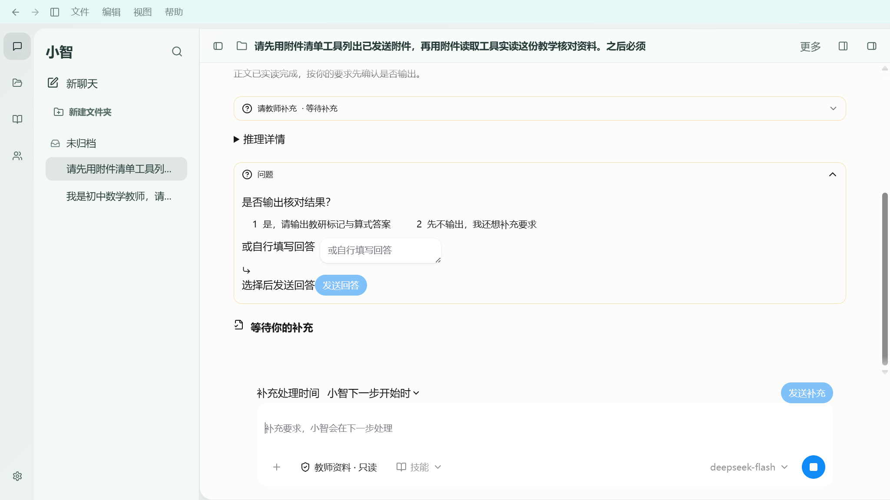
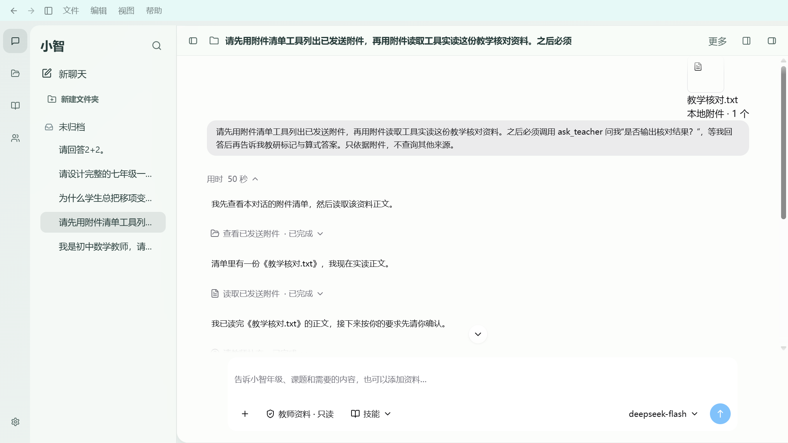
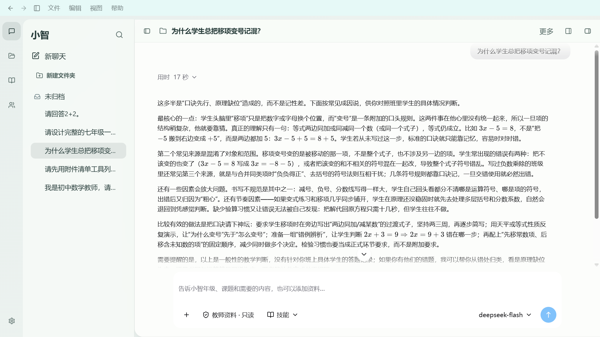

# 桌面公开过程展示：本轮交付与剩余差距

用户最终确认：默认公开工作说明＋真实工具；provider 原生 reasoning 仅在详情查看。小智本地修复与真实运行验证已完成，教师最终观感验收、准备延迟及 Git main 交付仍未闭合。不能声称与参考端像素完全一致。

## 参考证据与根因

实际观察用户指定的当前 ChatGPT/OpenAI.Codex 窗口：本轮运行中的公开段落和工具行，以及上一轮完成后的“用时”入口，实际展开并重新收起。没有另外发送新请求；不宣称参考端新跑了一条完整请求或捕获了逐帧自动交接。四张原始参考截图含其它会话侧栏标题，仅在 Git 忽略的 apps/desktop/test-results/desktop-reference-current 保存。

| 发现 | 修复 | 可核对证据 |
| --- | --- | --- |
| 固定420px示例时间轴、圆点层级和重复标题，与当前桌面正文式过程不一致 | 运行时普通 ChatMessage/OfficeMarkdown，与结果正文同列同结构；正文阶段再切成一个原厂折叠入口 | 7项桌面对齐检查、29项真实运行、完整宽度940px/无溢出 |
| 原生推理与公开工作说明默认混排，内容口径不一致 | 默认只呈现公开说明/工具；推理详情由用户点击后挂载，不生成假说明 | live-default-public-only.png、真实 SDK 哈希/重启读回 |
| 使用原厂 ChatTool 仍呈现大块边框状态卡，说明问题在应用组合 | 工具改用原厂 ChainOfThought 紧凑披露行；保留原证据/来源查看 | before-boxed-tool-row.png → public-tool-process-1366.png |
| 工具只靠中文标题，缺少稳定操作语义图标 | 从真实 tool_start.tool 保存可选 toolName，独立分类/图标模块；旧记录通用图标 | 真工具 directory/file-read/question；单位测试覆盖写入/网页等 |
| 过程与正文交接需要明确事件，靠数组末项或整轮终态会太晚 | 沿用显式 assistant_phase 与立即边界刷新，首个正文可见帧前关闭整个过程 | ordinary/tool/natural 三次真实流采样，正文多次长度变化且过程关闭 |
| 耗时与内容默认位置不一致 | 上方“已处理/用时”，没有底部重复计时 | final-natural-1366/1920.png |

参考与小智的整体导航、色板、侧栏及输入框不是本轮完全复制范围；保留现有教师业务入口。仅亮色，无 vendor 源码修改、全局 !important、全局 token 覆盖或新增依赖。

## 修改文件及职责

- AgentTraceStreamingDemo.tsx / AgentTraceHeader.tsx：正文式运行态、最终整体折叠入口、上方计时。
- AgentTraceTimeline.tsx / AgentTraceText.tsx / AgentReasoningDetails.tsx：公开内容顺序、同正文结构、原生推理按需挂载。
- AgentTraceTool.tsx / AgentToolGlyph.tsx / agent-tool-kind.ts：紧凑工具行、来源证据与语义图标；AgentTraceNotice.tsx 独立保留压缩/隔离提示。
- shared/office-agent.ts / shared/xiaozhi-projection.ts：可选 toolName；现有 publicItems metadata 持久化，无 DDL/新 IPC；旧记录兼容。
- generate-agent-trace-utilities.mjs / agent-trace-streaming.utilities.css：仅本组合 scope 的所需工具类；移除不再使用的 AgentTraceStreamingParts.tsx 应用辅助代码。
- desktop-process-boundaries.mjs / model-reasoning-electron.mjs / launch-reply-trial.mjs / package.json：新增定向检查、更新真实流程验收及固定构建试用启动。

以上路径均相对于 apps/desktop/src 或 apps/desktop/scripts/xiaozhi-agent；前轮未提交的展示适配器、流式缓冲和样式隔离修改继续保留。根目录四份协作文档、Goal四份状态和稳定CURRENT入口已同步。

## 最终验证

当前工作树 apps/desktop 执行，完整记录在 [desktop-process](desktop-process/)；不是仅静态demo。

| 命令 | 结果 |
| --- | --- |
| npm run build | 通过，renderer index-DsZOFAzl.js |
| npm run test:desktop-process | 7/7 |
| npm run test:reply-presentation | 16/16 |
| npm run test:model-reasoning | 16/16 |
| npm run test:agent-trace | 19/19 |
| npm run test:renderer-components | 217/217 ＋ 样式隔离8/8 |
| npm run test:model-reasoning-electron | 最终全新 real DeepSeek 实例 desktop-process-XAeXw5，29/29，0控制台错误 |
| git diff --check | 通过；既有LF/CRLF提示不是diff错误 |
| npm audit --json | 20项已知告警：critical1/high9/moderate5/low5；无依赖升级 |

真实运行配置仅通过 XIAOZHI_AUDIT_ENV 引用本机已有配置，不复制凭证。最终实例使用隔离Temp库；实际附件目录/正文读取、教师提问及回答、正常正文、停止、故障、SQLite与重启、复制/教师确认导出均验证。provider字段与SDK原始块作哈希对照。自然解释输出0列表行/0标题行；不据此承诺所有问题文风完全相同。

亮色1366×768和1920×1080：实际 Hover、键盘 Focus、Active 采样及官方CSS对照、完成展开/收起均通过。矩阵JSON保存 computed style、matched/winning选择器、层和来源。停止、失败、运行、正文流与冷读另有截图。旧207项回归本轮未重复执行，上一轮串行通过记录继续保留，不冒充本轮证据。

当前窗口标题“小智 · 桌面对齐 · 公开过程版（1c54）”，PID227992；从 test-results/desktop-process-trial-XAeXw5/build 的固定构建副本启动，避免后续构建覆盖资源。SQLite展示metadata和结果正文冷读一致，reduced-motion/light检查通过。没有自动发新模型请求。

## 截图

调整前工具状态卡：

调整后公开过程及不同工具图标（完成后手动重开回看，默认推理详情关闭）：

最终正文与上方收起入口：

1920尺寸、运行及交互状态截图见同目录。参考端原始截图未随此报告上传。

## 未解决事项

1. 本地准备延迟：本轮单次普通请求13576ms/工具请求13691ms；之后供应商首推理712ms/1716ms。还没优化本地准备，不能归因于组件渲染，也不能靠伪造推理掩盖等待。默认没有公开说明时只显示真实处理状态；原生字段仍可在详情查看。
2. 阶段协议：真实显式answer事件已验证；没有阶段标记的provider仍需等待SDK stop确认，不能保证所有provider首字前交接。
3. 参考端的新请求逐帧交接、精确像素/全部图标外形未测量；当前证明流程行为及截图观感改进，不宣称完全一致。整体高级感、长历史和Master仍DOING。
4. main和origin/main仍为 b5a7fc685070e95f4110b1b98a8304a63d71fb7d。D:\WorkProject\EduProject\.git\worktrees\EduProject\index.lock 仍为旧空锁；此前用户已授权清理，但自动审批以 blocked by policy 拒绝删除。本轮没有换方法绕过，未提交、未推送。预备提交摘要：`修复小智公开过程与正文交接及语义工具展示`。
