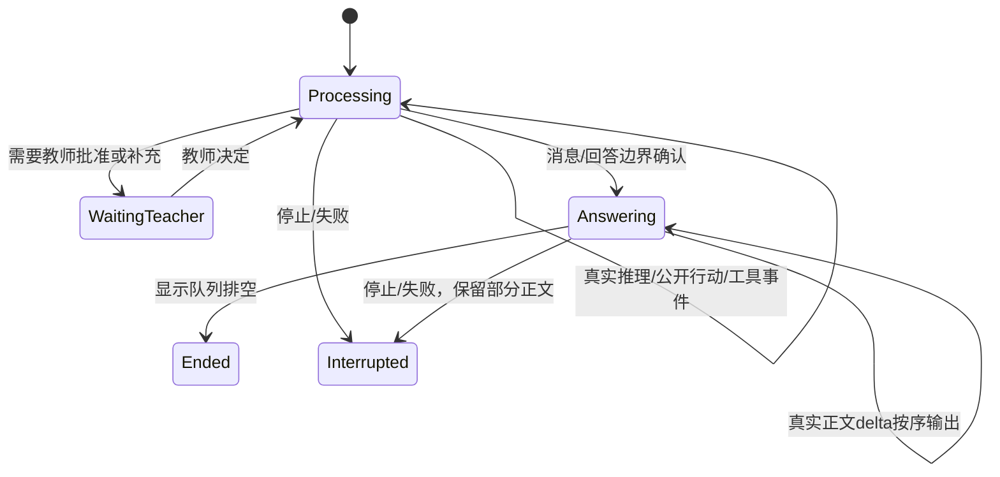

# 小智回复链路：需求、实现与成熟 Harness 对照审计

实施状态更新：用户批准后已按本审计方案局部修复，最新结果见 [REPLY_PRESENTATION_DELIVERY.md](REPLY_PRESENTATION_DELIVERY.md)。以下为实施前冻结证据；原始 before JSON/截图保留，当前审计脚本输出另存 event-phase-after.json。

日期：2026-10-24。结论：核心差距是消息语义、阶段交接和流式呈现层，不是再换一个组件、叠加提示词或整体升级 SDK。

本轮只调研、审查和复现。没有继续修改生产功能、第三方 vendor、主题或真实用户数据库；保留上一轮未提交修改。新增两个审计脚本及证据。用户明确要求先定位调研，并要求分模块引用、保持 AI 可读性，后续实施以此为约束。

## 1. 当前有效需求

用户明确说明使用的是**上轮测试窗口**，因此日常 D: 目录版本差异不能归为本次反馈的主因。

目标交互：真实过程流式呈现 → 自主调用实际工具并更新过程 → 过程完成后收起 → 最终正文正常输出。耗时位于上方过程标题，正文下方不再出现“本轮用时”。保留指定 HeroUI Agent Trace Streaming 设计及亮色；不要用假推理、静态步骤或模型私有内部状态补画流程。

## 2. 已证实的实现偏差

|级别|需求与差距|代码证据|造成的效果|
|---|---|---|---|
|P0|过程结束与正文交接被误绑到整个宿主运行终态|OfficeAgentTrace.tsx:28、AgentTraceStreamingDemo.tsx:20 只看 turn.status；TraceItem effect 只在 settled 变化时关闭|正文已经流式出现、甚至 assistant_end(final=true) 后，思考仍展开；还要等权限检查、清理、持久化完成|
|P0|折叠粒度错了：小块折叠不等于整轮过程收起|AgentTraceStreamingDemo分别map推理/过程，无整轮总披露；真实冷启动为4个思考块＋6个执行块|即使每个aria-expanded=false，仍留下10个标题；用户期待一个含耗时的过程入口，这不能由十个小块的终态断言证明|
|P0|正在流式的普通文本被按“数组最后一个”猜成正文|agent-trace.ts:9–10 的 running && item===current|工具前说明先出现在正文；tool_start 加入新 item 后，同一段文字被移进过程区。不是稳定的过程/答案语义|
|P1|真实多轮顺序被两组数组破坏|AgentTraceStreamingDemo.tsx:22–23 先渲染全部 modelReasoning，再渲染 parts|实际“思考1→工具1→思考2”变成“思考1→思考2→工具1”，难以理解自主执行的来龙去脉|
|P1|应用明确关闭了官方 Markdown 默认动画|OfficeAgentTrace.tsx:18、OfficeAgentTurn.tsx:29 传 animated=false；官方 markdown.tsx:242 默认使用 blurIn|组件文件和 CSS 没改，也会因业务 props 改变原本流式观感。isStreaming 仍真实工作，不能误称完全没有流式数据|
|P1|没有独立的、可控的文本呈现缓冲|PiEducationWorkspace.tsx:115–127 每个事件直接投影到整页 snapshot|可见节奏直接受到网络块、异步脱敏和 React 调度影响；缺少明确队列与追赶策略。是否掉帧需另测，本轮不编造 FPS|
|P1|耗时位置不符要求|OfficeAgentTurn.tsx:33 在正文后追加 office-turn-duration|上方每段思考时间与下方整轮墙钟并存，既重复又容易混淆“模型推理时间”和“处理时间”|
|P1|验收验证了旧策略，未验证用户最终目标|model-reasoning-electron.mjs:63 正文明明正在输出，却明确断言思考 aria-expanded=true|25项通过只能证明该版本符合这些断言，不能证明过程→正文的交接满足用户要求|
|P2|部分“模板感”由 UI 强加，不是模型提示词|OfficeReplySources.tsx:13 无来源时固定追加核对提示；OfficeAgentTurn.tsx:33 固定耗时尾注|改模型提示词不会去掉这些 UI 附加内容。默认文风单题0分点也不代表相关性、简洁度与阅读体验已通过|

“冷重启全部收起”与“运行中的交接正确”是两件事，不能互相替代。

### 本轮复现

命令（apps/desktop）：`node scripts/xiaozhi-agent/reply-gap-audit.mjs`。

用**当前实际 reducer + renderer**执行受控 SDK 事件夹具并渲染，确认三处偏差。该证据是组件/投影复现，不是假称真实模型验收。

|输入边界|当前实际呈现|
|---|---|
|工具前文字到达|“先核对资料”在正文|
|随后 tool_start|正文消失，同一文字进入公开过程|
|下一段正文流式|两段思考仍展开；DOM顺序是 reasoning1、reasoning2、tool1|
|assistant_end(final=true)，host尚在running|两段思考仍展开|
|宿主 completed|才收起|

完整记录：[event-phase-reproduction.json](event-phase-reproduction.json)。脚本以检出旧行为为目标；后续产品验收必须改为期望行为，不应永久要求保留这些偏差。

命令：`node scripts/xiaozhi-agent/reply-gap-cold-electron.mjs`。

真实 Electron 从**上轮隔离教学数据的副本**冷启动：4个思考块收起、6个执行披露块、额外输入栏状态0、pageerror/console error 0；1366×768与1920×1080截图通过。无新 provider 请求，不能用它声称动态流式已经通过。详见 [cold-electron.json](cold-electron.json)、[1366截图](cold-1366.png)、[1920截图](cold-1920.png)。原测试数据未修改；当前没有仍在运行的旧 Electron 进程可附着，不能声称重新捕获了用户当时的现场帧。

## 3. HanaAgent 最新代码对照

已核实用户所说项目是 [liliMozi/openhanako（HanaAgent）](https://github.com/liliMozi/openhanako)。官方 README、package description 与现有 vendor 来源吻合。

本轮从官方仓库独立 clone，未覆盖原本地来源目录：

- 版本：0.450.0。
- 固定提交：`9a6cabf8c513db5edc6cf8179a538c9075885c6e`，官方 main 在查询时与 clone 一致。
- 路径：`C:/Users/ZhouXuan/AppData/Local/Temp/xiaozhi-harness-research-20261024-084021/openhanako`。
- Apache-2.0。仅研究源码，未安装依赖、运行其 Agent 或升级本项目 vendor。

|机制|Hana真实实现|小智应借鉴的边界|
|---|---|---|
|块状态|[ThinkingBlock.tsx](https://github.com/liliMozi/openhanako/blob/9a6cabf8c513db5edc6cf8179a538c9075885c6e/desktop/src/react/components/chat/ThinkingBlock.tsx#L14) 读取 sealed，展示状态不等于整个任务状态|模型块结束、工具结束、整个run结束分开|
|流式缓冲|[use-stream-buffer.ts](https://github.com/liliMozi/openhanako/blob/9a6cabf8c513db5edc6cf8179a538c9075885c6e/desktop/src/react/hooks/use-stream-buffer.ts#L26) 明确30Hz；thinking/text共享时间节流，thinking_end立即flush|先有独立缓冲和终态flush，再谈动效；不是给网络文字强加固定逐字延时|
|工具边界|[同一文件tool_start/tool_end](https://github.com/liliMozi/openhanako/blob/9a6cabf8c513db5edc6cf8179a538c9075885c6e/desktop/src/react/hooks/use-stream-buffer.ts#L393) 工具开始前flush文本；调用按ID更新，多工具组全部结束后可收起|工具开始/结束是实际事件，不从文案猜状态|
|消息身份|ensureMessage/messageId、turn-local buffer与beginTurn/finishTurn|稳定消息ID，不用当前数组末尾判断语义；一个消息内的thinking置前与整个run把所有thinking搬到前面不是一回事|
|呈现分发|[AssistantMessage.tsx](https://github.com/liliMozi/openhanako/blob/9a6cabf8c513db5edc6cf8179a538c9075885c6e/desktop/src/react/components/chat/AssistantMessage.tsx#L246) 按ContentBlock.type分发|渲染器消费已归一的类型，避免视图边渲染边猜phase|
|专项测试|[use-stream-buffer.test.ts](https://github.com/liliMozi/openhanako/blob/9a6cabf8c513db5edc6cf8179a538c9075885c6e/desktop/src/react/__tests__/hooks/use-stream-buffer.test.ts#L154) 验证未结束时已刷新、空块sealed、工具ID和恢复|测真实边界与增量，不只测最终字符串/最终折叠|

重要限制：Hana当前 ThinkingBlock 的 open 默认是 false，也没有在 sealed 变化时强制关掉用户手动展开；它不是用户要求交互的逐项现成替代品。不能因此擅自改回“运行默认收起”。此外，ThinkingBlock、use-stream-buffer、ToolGroupBlock 三份关键文件与本机旧0.449.0来源逐字哈希相同；版本0.450.0并不意味着升级即可解决小智问题。EduDev现有vendor主要提取Hana后端适配，未等价复用上述前端消息流层。

另一个避免误判的点：Hana仓库存在use-adaptive-stream-text.ts，但本轮搜索未发现其在聊天组件的调用；实际StreamingMarkdownContent是Markdown内容+块入场样式。不能因为有一个平滑hook文件，就断言主聊天正在使用它。

## 4. Codex公开实现对照（不是私有桌面端源码）

查询时官方 main 固定为 `970111f6cb62cc02fe36a82ea7d71b37a2889c97`。研究的是 [openai/codex](https://github.com/openai/codex) 的公开TUI实现，只作事件/呈现设计参考，不伪称获取了Codex桌面端私有UI源码，也不把它当Rust代码可直接搬进React。

- [chatwidget/streaming.rs](https://github.com/openai/codex/blob/970111f6cb62cc02fe36a82ea7d71b37a2889c97/codex-rs/tui/src/chatwidget/streaming.rs#L438)：消息阶段区分Commentary/PartialAnswer/FinalAnswer，消息完成与stream队列排空有独立处理。
- [history_cell/activity_group.rs](https://github.com/openai/codex/blob/970111f6cb62cc02fe36a82ea7d71b37a2889c97/codex-rs/tui/src/history_cell/activity_group.rs#L1)：工具完成时保持原位置，活动详情跟随稳定调用顺序。
- [streaming/chunking.rs](https://github.com/openai/codex/blob/970111f6cb62cc02fe36a82ea7d71b37a2889c97/codex-rs/tui/src/streaming/chunking.rs#L1)：Smooth/CatchUp根据队列深度和积压时长切换，保序并减少显示落后；不是模型输出多少就立刻重建整页，也不是刻意拖慢已收到的答案。
- [chatwidget.rs](https://github.com/openai/codex/blob/970111f6cb62cc02fe36a82ea7d71b37a2889c97/codex-rs/tui/src/chatwidget.rs#L1)：持久历史与active cell分开，输出流与运行指示状态分别管理，避免重复进度指示。

这些证明成熟实现有清晰的消息与显示生命周期；不证明任何产品的所有情况都恰好符合用户想要的默认展开/收起策略。

## 5. 推荐最优方案：保留Pi和官方视图，重做呈现契约

不要再靠叠加提示词或复制示例名称解决时序问题。保留Pi唯一执行循环、真实工具权限、typed preload、原厂HeroUI设计、现有正文/导出真源。

### 5.1 两套状态，分开管理

- **执行状态**：running/waiting_teacher/settling/completed/failed/interrupted。代表宿主还在做什么，持久化和失败处理继续准确。
- **呈现状态**：processing/answering/ended。代表教师此刻应看到什么，控制过程披露与答案流。不能用一个running布尔值替代两者。
- thinking/tool/assistant-activity各自有开始、增量、结束、ID和首个事件顺序。模型块完成不等于工具组完成，更不等于整个run已持久化。

### 5.2 一条有序过程与一个稳定的正文出口

原先modelReasoning、publicItems分别存储可以兼容，但渲染前须归一为有稳定ID、sequence和类型的时间轴；不能先map全部推理，再map全部工具。公开行动说明、实际工具和供应商实际推理各有类型，不能将它们统称为模型原始思考。

每轮增加一个**总过程披露边界**，内部仍使用原厂Agent Trace Streaming条目。过程结束后整个容器收起，只保留一行状态/耗时/展开入口，不是留下4个思考＋6个执行标题；最终正文在该容器之外。该边界是业务组合，不修改vendor、字体、色彩、圆角或官方交互状态。

目标状态图：

在向答案交接时封存并收起已完成的过程；正文出口保持稳定位置和消息身份。后台SQLite收尾不继续让结束的思考区展开。失败/停止保留真实部分内容及状态，不伪标“已完成”。终态自动折叠一次，之后允许手动查看。

### 5.3 正视当前provider的阶段能力

当前Pi适配将assistant新片段先记commentary，在message_end的stopReason出现后才确认final；它没有在每个text_delta上得到“这一定是最终正文”的显式保证。Codex模型的phase能力不能由一个CSS组件补出来。

优先使用真实、明确的阶段事件。缺phase时保留稳定、未最终定性的assistant片段，得到实际message/tool边界后封存/标注；不要按关键词、最后一个数组元素或另调模型猜测，不能为了视觉承诺把正文整段缓存到结束再一次显示。须专门验收“先文字后tool_call”的兼容分支。

若产品要求所有provider在**最终正文第一个字出现之前**百分百准确知道它是final，则必须选用或接入提供该语义的协议能力；当前DeepSeek兼容通道不能靠改props保证这种未来信息。这是方案需明确记录的兼容边界，不应再用25项终态断言掩盖。

### 5.4 恢复流式显示而不制造假流

- 接收、脱敏、投影、显示分层；只有脱敏后的真实内容进入renderer。
- 参考Hana约30Hz合并UI更新；边界、错误、停止立即flush。不是按固定字符间隔凭空制造慢打字。
- 保留原始累积文字，Unicode/Markdown未闭合也不能丢字；队列积压时追赶，终态需排空。
- 移除业务层未经确认覆盖的animated=false，恢复官方默认；prefers-reduced-motion仍应遵循。
- 把网络首片延迟、本地准备、IPC/脱敏、显示积压分别测量。此前6–7秒本地准备不能用动画遮盖，也不应为了抢首片跳过权限校验。

### 5.5 耗时和文风

顶部AgentTraceHeader统一承载过程耗时，正文下面删除office-turn-duration。纯模型推理时长与包含工具/等待的处理时长分开命名和计算，不能把整轮墙钟伪称纯思考时间。

普通问答是否有分点由任务内容决定，不再以“列表数必须为0”作为通用质量标准。先去除UI强加的重复脚注/耗时；只有需要来源或核验时展示必要信息。已有权限、实际来源和教师确认信息不可隐藏成“没有风险”。

## 6. 模块拆分与落地顺序

遵守用户最新要求，不往单个文件继续叠加。建议按以下职责建立/抽取模块，名称可按现有目录微调：

|模块|唯一职责|
|---|---|
|shared/chat-presentation.ts|类型、呈现阶段、兼容版本定义|
|shared/chat-presentation-reducer.ts|稳定ID、顺序、阶段转换的纯投影|
|main/xiaozhi-agent/presentation-event-adapter.ts|现有Pi事件→公开呈现事件；不接管执行循环|
|renderer/.../useChatStreamBuffer.ts|会话隔离、批量更新、终态flush与背压|
|renderer/.../useAgentTraceState.ts|披露、手动展开、阶段交接、计时|
|AgentTraceStreamingDemo / AgentTraceHeader / AgentTraceTimeline|只组合官方组件、标题与条目，不猜provider语义|
|OfficeAgentAnswer.tsx|稳定正文流、必要来源和回复动作|

现有pi-session.ts只接适配器，PiEducationWorkspace.tsx只接订阅hook，OfficeAgentTurn.tsx只组合视图。使用明确输入/输出和依赖，不引入任意事件总线，不拆成大量单行微模块，不改vendor。

实施顺序：

1. 冻结新呈现契约与目标断言，先让错时序/错顺序/文字搬移用例报红。
2. 贯通事件适配→纯投影→官方组件，先解决过程/正文交接和上方计时。
3. 加流式缓冲、恢复官方动画，测接收至显示延迟，不用“页面可见”冒充流畅度。
4. 真实Electron/Pi/当前provider复测普通回答、多工具、未知phase、长文本、停止/失败、教师确认和冷重启；最后再处理整套聊天高级感。

## 7. 验收必须改变

- 逐段核对“行动说明→工具1→下一段说明→工具2→结果”顺序，不只核最终工具总数。
- 正文交接前后逐帧记录披露状态；人为延长宿主收尾，确认UI不等SQLite收尾才结束过程。
- 明确无phase provider的兼容行为；先文字后工具不能文字传送、丢失或复制两次。
- 记录SDK/主进程/IPC/DOM时间戳、可见字符增长、缓冲积压及结束flush；完整正文应与复制/导出一致。
- 总耗时只在上方，正文下方无重复计时；不会将工具等待算成纯模型思考。
- 原厂Hover/Focus/Active/流光与Markdown入场保留，双尺寸、减少动态效果、长历史及错误路径分别测试。

现有测试通过数仍属历史证据，不能作为本方案已实施/已接受的证明。本轮没有请求模型、运行Hana/Codex、升级依赖或处理Git锁；main仍停在b5a7fc6，之前空锁阻塞是独立交付问题，不是本次上轮测试窗口交互偏差的解释。
