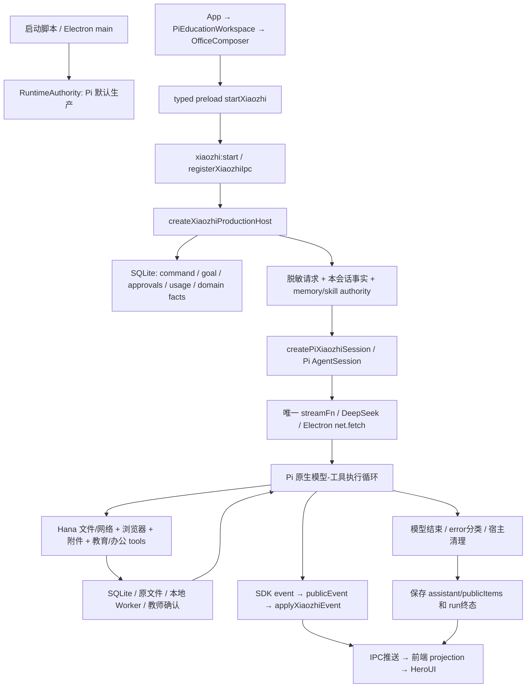

# A · 当前架构真实画像

## 1. 基线与检查边界

- 工作区 `D:/WorkProject/EduProject`；HEAD `488f8109d68027a6eb488e9d04c4eb5073d153cd`，大量既有未提交改动。审计对象是当前工作文件，不是只审 HEAD。
- 核心 SDK：`@earendil-works/pi-{coding-agent,agent-core,ai,tui}` 均锁定 `1.0.2`。现生产供应商为 DeepSeek；GLM、自定义供应商不是当前生产路径的同等能力。
- 日常入口：根启动脚本 → `apps/desktop/scripts/start-desktop.mjs` → 构建 `out` → Electron `out/main/index.js`。`main/index.ts:209` 有单实例锁；新进程存在不能证明新窗口或新构建已接管。
- 只读观察到 PID 234140 的 Electron 主进程执行上述 `out/main/index.js`，Responding=true，但 MainWindowTitle 为空。本轮没有据此声称已看见正常窗口，也未核验该进程加载代码与源 SHA 一致。
- 已读取 `kb-review-math-20261012/progress.json`：历史记录为 LIMITED_ACCEPTED、modelRequests=0；该记录只证明其声明的公式显示切片，不能作为网络/视觉/完整 Harness 本轮通过证据。
- 工作区存在同期持续交付，后续又出现 `kb-bulk-review-20261012/progress.json`：build SHA `8800d50f520b64e8269cddc7fbd91a5078c2a0aa0a8133f215b8d46025675029`，报告记载5项/2次启动/0 renderer错误，仅为整卷修改一键检查的限定实例。本轮只读该报告，没有重跑；不能当成公开图、联网或完整Harness验收。四根文档中的教育分支状态继续保留，不被本审计覆盖。
- Master文件在审计收口前SHA为 `dbc1619f5a0390a150b4b8940cbc0e2147623920ae2815c34a2b353860f41302`。源码结论以证据表逐文件SHA为准；不宣称整个脏工作区或日常进程固定在单一构建。
- 索引包含小智、DeepTutor、OpenMAIC、ai-agent-book、Edurag_study。排除 edu-rag。手工审阅覆盖核心入口和执行边界，未声称阅读全部业务、测试、生成文件。`EVIDENCE.md` 是具体覆盖表。
- 图服务当前项目索引 7624 nodes / 15397 edges，但生产宿主关键函数缺节点；重新索引后仍缺。参考仓库索引调用出现 Transport closed。使用实际文件补足，不用图中“没找到”证明代码不存在。

## 2. 当前执行链

准确入口：`main/index.ts:515` → `xiaozhi-agent/ipc.ts:25/37` → `production-host.ts:createXiaozhiProductionHost` → `pi-session.ts:createPiXiaozhiSession`。前端 `PiEducationWorkspace.send` 经 `preload/index.ts:168` 发起；异步事件订阅在 `PiEducationWorkspace:117`。

### 用户输入到最终响应的逐环节评价

| 环节 | 当前实现 | 判断 |
| --- | --- | --- |
| 输入/意图 | 会话、附件、学生上下文、用户文本；模型结合教育 system/skills 选择 tools | 没有独立可审计的意图契约；不必为所有短问题增加一次分类 LLM |
| 上下文 | 固定提示词、授权版本、选中记忆、Pi 历史、同会话事实索引 | 已有隔离保护；事实重复、缺关键任务选择机制 |
| 规划 | `update_plan`，最多8条、一条进行中，SQLite control保存 | 公开声明；不是任务依赖图或执行引擎 |
| 模型调用 | 唯一原生 `streamFn`，DeepSeek兼容设置，Electron provider-scoped fetch | 非 Codex CLI，无第二编排器；retry显式关闭 |
| 工具选择 | Pi 原生 tools + 宿主授权过滤 | 真实自主工具选择；定义与执行/权限元数据散落 |
| 工具执行 | 宿主 schema/范围校验，Hana快照，教育/办公 coordinator，本地Worker | 多域有CAS/审批；通用timeout、错误、重试/效果判定不统一 |
| Observe | 原生 toolResult 回模型；tool_end映射页面成功/失败 | 能根据结果继续和改计划；没有“必须重新规划”证据协议 |
| Verify | 各领域结构/来源/确认门禁；Office产物使用宿主实际交付文案 | 缺通用 criterion→证据→独立验证器；不能把所有域校验称为任务验证 |
| 状态 | active Map + SQLite多种状态表 + Pi JSONL native entry | 有恢复机制；不是统一 Task/Step/Attempt检查点 |
| 总结 | Pi最后assistant文本，宿主落盘后宣布本轮完成 | 当前运行完成与业务验收不同义，但产品文案混淆 |

## 3. 任务书问题的直接回答

**是否真正 Agent？** 是工具执行型 Agent，已有真实 Act/Observe 循环；尚不是具备可靠任务级 Verify/Resume 的完整教育工作执行器。

**计划动态调整？** 模型可在工具返回后重新调用 update_plan；系统没有稳定 stepId、依赖、变更版本和依据绑定，动态调整的质量和正确性不受宿主保障。

**无效调用与循环？** 全量事实索引每次 prompt 重插，持续目标可反复续跑；源代码能证明机制，不能量化真实浪费比例。费用不设限与防失控不是同一需求。

**失败分类/恢复？** classifyError 用错误文本正则，网络工具有 typed错误、retryable；SDK retry=false。很多领域有安全恢复，但“换个提示词重新发送”不是步骤恢复，也没有全局策略自动确定哪类读操作可重试。不得称完全没有恢复。

**复杂子任务？** Goal 有目标、criteria字符串、summary/nextStep、CAS；plan有文本状态；缺Task/Step依赖和效果检查点。停止/重启能保守中断，不能可靠继续每个未完成子任务。

**证据完成判定？** run仅要求模型正常结束和提交成功；Goal.report readyForReview由模型提供，evidence只有runId/callId/label。最终教师逐项勾选有价值，却不等于机器核验每项标准。

**多轮漂移与污染？** native authority epoch 会隔离撤销记忆/技能与未完成工具，当前选中记忆有版本/fingerprint；不存在“所有记忆无差别塞入”的证据。任务frame与摘要的业务关系仍缺显式协议；具体错误频率待实验。

**规划/执行/验证/总结可区分？** 原生事件能区分模型/工具，但公开协议没有统一 verification/plan.changed/decision 等；UI无法可靠表达这些阶段。无需显示隐藏思维链。

## 4. 数据、权限、恢复

| 数据 | 真源/边界 | 重构处理 |
| --- | --- | --- |
| 教师/学生/题目/产物事实 | SQLite、本地文件；教师确认、来源与版本 | 原DAO/领域校验保留，不让judge写入事实 |
| Pi模型历史与compaction | native session树/JSONL，宿主binding、memory/skill epochs | 保留原格式，通过adapter定位run/entry，不改写历史 |
| 本轮公开时间线 | active.turn内存，终态metadata.publicItems | 新增durable event ledger；不能把native JSONL直接公开 |
| 审批/副作用 | approvals、text changes、Office artifacts等独立状态机 | 纳入统一EffectReceipt引用；保留原事务/哈希/教师边界 |
| 目标 | SQLite goal payload + CAS，一会话一活跃Goal | 兼容迁移；旧completed不补造verified证据 |
| 上下文/记忆 | selected L2/L3版本范围、选中学生脱敏、native epoch | 自动检索候选必须在已授权范围；自动优化不得改FACT |

公开图链：`public-image-runtime.ts:createPublicImageRuntime`（见证据表实际导出名）→列附件→教师明确确认公开用途→准备image block→streamFn实际payload校验→供应商响应receipt。`prepared/submitting/received`不同于识别内容正确。学生原图仍本地OCR，不能为修复视觉直接解除隐私边界。

## 5. MCP、插件与Codex事实

Pi SettingsManager 禁用全局/项目 extensions/packages/prompts自动发现，主机只注入受控原生扩展。生产代码没有产品MCP服务器管理入口；开发助手当前可用的图、HeroUI、网页工具不等于小智可调用。

当前工作区 `.codex/config.toml` 未找到，不能把AGENTS中的“推荐ECC配置”写成已启用服务。`@openai/codex`为devDependency、旧office脚本保留；生产authority只允许Pi，legacy-test要求隔离临时根及特定flag。不能因仓库含Codex包就称当前接入CLI。

Skill已有managed catalog、文件哈希、CAS、busy门禁和Hana安装工具；这是受控技能内容，不是任意执行插件沙箱。未来MCP仍经同一个tool executor，单独实现服务器信任、凭证隔离和来源变更重确认。

## 6. 性能与上下文事实

`db.ts:getAiConversationSession:4364` 查询本会话全部消息，无LIMIT；host.snapshot重建全部projection，UI映射所有turn，protectedContext也遍历历史来源再裁剪。**全量本地读取已证实；全量反复发模型未证实**，Pi已有真实压缩和provider window检查。

事实索引有条数/字符限制，不等于按当前step相关性选择；11700字符门禁覆盖add插入的记录，前置学习/组卷/题目记录另以条数限制，不应宣称统一严格token上限。建议测长会话后再确定分页/增量参数，不虚构性能基线。

收口差异：同期工作修改了db.ts，首次文档检查因此失败（保留validation-first-source-drift.json）。已重新读取会话读取/追加方法，SQL仍读取全部消息且无LIMIT；引用更新为当前行号和SHA。未覆盖或修改这部分业务代码。
