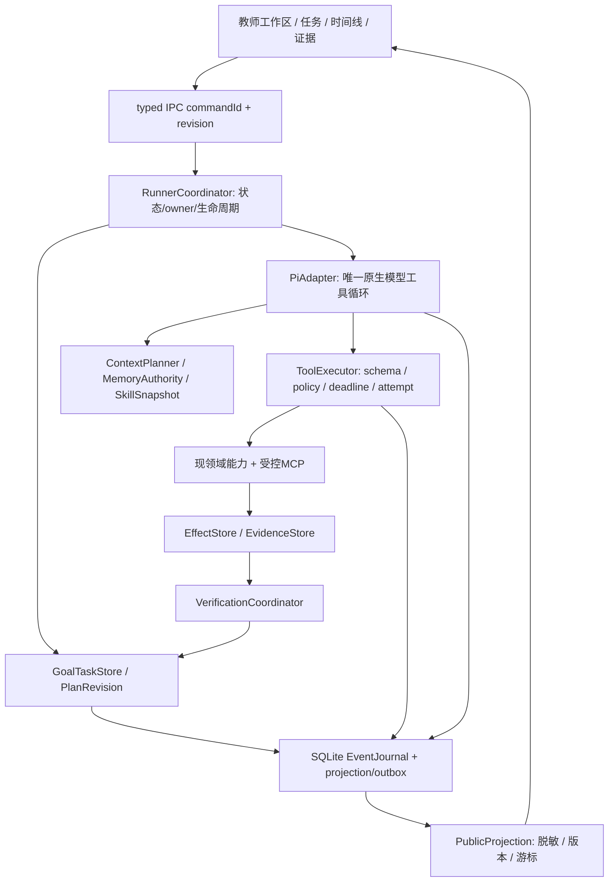
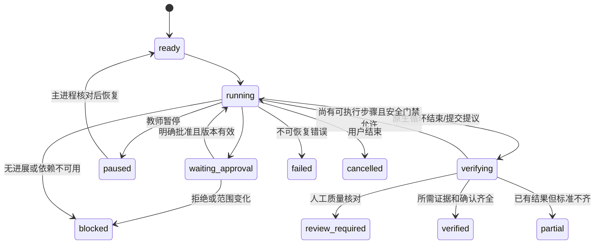

# D · 目标 Harness、方案取舍与迁移合同

**这是下一轮设计，不是当前已实现的接口。** 新路径均标“拟新增”，实际参考路径见C/Evidence。Master约束：Pi唯一生产编排，本地优先，SQLite事实，原文件本机，教师确认/隐私/来源谱系保持。

## 1. 两种方案与明确推荐

| 比较 | A 渐进式补现宿主 | B 核心控制面重构，Pi保留 |
| --- | --- | --- |
| 做法 | host增加completion gate，publicEvent加日志，补局部retry/失败卡 | 先统一Goal/Task/Step、Effect/Evidence/Verifier/Event，PiAdapter仅接原生循环，旧领域经adapter纳入 |
| 复用 | 当前代码最大化，短路径少迁移 | Pi/provider/native history/领域事务/OCR/安全/UI组件均保留；调整宿主职责和共享契约 |
| 收益 | 快速堵最明显伪完成，短期风险较低 | 完成/恢复/事件/上下文共用协议，复杂教师任务可持续验收 |
| 技术债 | 多套domain status、计划声明、事件保存依旧粘连；每个新tool再加特例 | 一次建立统一底座，adapter有删除门禁；不保证完全消除所有领域复杂度 |
| 复杂度 | S/M逐项；总成本随工具数增长 | 前期L，分H01–H05切片后新增能力成本降低 |
| 迁移风险 | 易出现旧状态与新UI互相猜测 | schema增量/事件双读/单写/旧会话unknown；范围更大但可明确回滚 |
| 适用 | 只有短任务、短期修一个故障、无复杂恢复要求 | 当前多域教育与办公、长任务、真实事件、可靠完成的目标 |

**推荐 B。** 当前问题由共享语义缺失造成，A会继续把验收/恢复特例塞进host。B不是“大推倒”：H02先引入验证契约、H03引入事件/恢复，再逐域抽取；单次Goal只做一个纵向切片，旧入口验收前保留。第一个上线切片可采用A式adapter过渡，但最终目标固定B。

不引入：第二AgentLoop、Postgres/Redis/Kafka、独立Web服务、LangGraph主图、mu整个desktop、任意插件执行、默认外国judge服务。中国API由同PiProviderAdapter接入，当前DeepSeek先验收。

## 2. 职责边界



| 层 | 承担 | 明确不能承担 |
| --- | --- | --- |
| RunnerCoordinator | 接收/幂等、owner generation、暂停取消恢复、调用Pi一次执行、等待commit | 不自行另写while(model)循环，不决定题目答案事实 |
| PiAdapter | native AgentSession、turnBoundary、streamFn、tool hooks、native history/compaction | 不改造Pi内核；不自动扫描全局技能/MCP目录 |
| GoalTaskStore | 目标/criteria/plan版本、Step依赖、领域证据引用 | 不相信模型update_plan的completed字段 |
| ToolExecutor | manifest、入参schema、授权范围、资源调度、timeout/retry、effect reconciliation | 不用model/judge批准写入或外传 |
| VerificationCoordinator | deterministic验证、human复核、open-ended quality judge分层 | 不以文本“完成”或API200替代真值；judge失败不默许通过 |
| ContextPlanner | 当前任务frame、近期原生历史、相关证据、授权内记忆、摘要 | 不将总结/网页/图片指令提升为权限或长期FACT |
| EventJournal/Projection | durable事件、投影、补拉、脱敏、状态一致 | 不存储/展示隐藏思维；不向renderer给钥匙/原私有路径 |

## 3. 共享类型草案

拟新增 `src/shared/xiaozhi-task.ts`、`xiaozhi-event.ts`、`xiaozhi-tool.ts`、`xiaozhi-evidence.ts`；旧契约由adapter单向转换，避免同义字段反复复制。

```ts
type TaskState = 'draft' | 'ready' | 'running' | 'waiting_input'
  | 'waiting_approval' | 'paused' | 'blocked' | 'verifying'
  | 'review_required' | 'verified' | 'partial' | 'failed' | 'cancelled';
type RunState = 'queued' | 'running' | 'waiting' | 'settling' | 'settled'
  | 'interrupted' | 'failed'; // settled不等于task verified
type EffectState = 'not_started' | 'prepared' | 'authorized' | 'executing'
  | 'committed' | 'rejected' | 'cancelled' | 'unknown';

interface Criterion {
  id: string; text: string; required: boolean;
  verifier: 'web_source' | 'image_content' | 'file_artifact'
    | 'domain_snapshot' | 'human_review' | 'quality_rubric';
  expectedRef?: string; revision: number;
}
interface Goal { id: string; sessionId: string; revision: number;
  objective: string; constraints: UserConstraint[]; criteria: Criterion[]; }
interface Task { id: string; goalId: string; revision: number;
  state: TaskState; activePlanRevision: number; }
interface Step { id: string; taskId: string; planRevision: number;
  title: string; dependsOn: string[]; criterionIds: string[];
  state: TaskState; inputRefs: string[]; latestAttemptId?: string; }
interface PlanChange { from: number; to: number; proposedBy: 'model'|'user'|'rule';
  reasonCode: string; publicReason: string; evidenceIds: string[]; }
```

`UserConstraint`保留用户原句/sourceMessageId及scope；自然语言由模型提议解析，宿主检查引用真实、版本一致、不可扩大权限。短聊天没有必须生成的Task DAG；显式工作任务才需要criteria与计划，不用多次LLM让每条消息变繁琐。

### Tool协议

```ts
interface ToolManifest {
  name: string; version: string; label: string; domain: string;
  inputSchema: object; outputSchema: object;
  effect: 'read'|'local_write'|'external_write'|'upload';
  policy: string[]; resourceKey: string; deadlineMs: number;
  retryPolicy: 'never'|'safe_read'|'reconcile_only';
  concurrency: 'exclusive'|'bounded_read';
}
interface ToolCallContext {
  sessionId: string; goalId?: string; taskId?: string; stepId?: string;
  runId: string; callId: string; attemptId: string; ownerGeneration: number;
  scopeRevision: number; idempotencyKey?: string; signal: AbortSignal;
}
interface ToolReceipt {
  callId: string; attemptId: string;
  outcome: 'success'|'failed'|'blocked'|'cancelled'|'unknown';
  error?: { code: string; category: 'input'|'permission'|'auth'|'transient'
    |'unsupported'|'conflict'|'storage'|'internal'; retryable: boolean };
  effectId?: string; evidenceIds: string[]; outputRef?: string;
  durationMs: number; sourceVersion?: string;
}
```

Tools manifest只描述能力；执行仍走原领域服务。`office_* / education_* / mcp_*`都入同边界，不重新实现文件系统和浏览器安全。权限判定与实际exec前再验scope/source；审批绑定精确效果与版本，拒绝/失效不能被retry绕过。

只读短暂错误可bounded指数退避+jitter，初始上限2次由H04校准；401/403认证、unsupported、permission绝不盲重试。外部写入/本机文件写入超时→unknown→query/reconcile，确定无效果且授权仍有效才恢复。**取消不等于外部动作回滚；timeout race不等于子进程/服务已停。** 迟到callback必须有attempt/generation fence，不写新任务状态。

### Evidence / Verify

```ts
interface EvidenceRef {
  id: string; taskId?: string; stepId?: string; callId: string; attemptId: string;
  kind: 'web'|'image_payload'|'image_answer'|'artifact'|'sqlite'|'human';
  authorityRevision: number; sourceVersion: string; digest: string;
  observedAt: string; localRef: string; publicSummary: string;
}
interface VerificationResult {
  id: string; criterionId: string; criterionRevision: number;
  verdict: 'pass'|'fail'|'unknown'|'needs_human';
  evidenceIds: string[]; verifierVersion: string;
  reasonCode: string; publicExplanation: string;
}
```

网页：搜索摘要≠正文；真实URL/读取时间/段落支持结论。视觉：能力/授权/actual image payload/有效response≠识别答案正确；合成图盲答案/教师核对另验。文件：存在/hash/格式可开/源版本/提交receipt；不以文件名代替验证。教育：现schema、来源、受限数学验证、教师确认分别映射，不把answerVerified=false晋升。

只允许VerificationCoordinator写pass；模型报告ready仅进入verifying。所有required criteria pass且必要教师确认完成→verified；未知/人工待定→review_required或blocked/partial。无machine判据的开放式工作明确needs_human，不强迫用judge制造客观事实。

## 4. 生命周期、事件与前端同步



`step completed`由宿主验证，不允许模型直接修改；用户可删除/调整criteria形成新版，历史保留。恢复不是重新执行整prompt：加载Goal/PlanRevision/Step/Evidence/Effect，核原生entry与scope，先reconcile unknown effects，再只继续ready的依赖步骤。不会自动重播历史审批。

```ts
interface HarnessEvent {
  schemaVersion: 1; eventId: string; sessionId: string; cursor: number;
  runId: string; goalId?: string; taskId?: string; stepId?: string;
  attemptId?: string; ownerGeneration: number; revision: number;
  occurredAt: string; correlationId: string; causationId?: string;
  kind: 'task.created'|'plan.changed'|'step.started'|'tool.started'
    |'tool.progress'|'tool.settled'|'decision.recorded'|'approval.required'
    |'verification.started'|'verification.result'|'checkpoint.committed'
    |'task.paused'|'task.blocked'|'task.settled'|'response.delta'|'response.done';
  payload: PublicSafePayload; // 每kind有独立schema，并非任意JSON透传
}
```

拟新增typed IPC：`getTaskSnapshot({sessionId, afterRevision?})`、`listTaskEvents({sessionId,afterCursor,limit})`、`mutateTask({commandId,taskId,expectedRevision,action})`、`onHarnessEvent`。接收应用当前frame窗口与参数校验，renderer没有DB/SDK凭证。

顺序：领域事务/状态→event及outbox commit→公开推送；客户端只显示主进程事件。cursor按会话单调，duplicate丢弃，gap停止“已同步”展示并补拉；快照含lastCursor/revision，一致替换后接续。delta每50ms或2KiB合并是待测初值，不阻塞关键tool/approval/verification事件。后台和重连也可补拉。

private payload分存本地受控证据；公开event不带API Key、原学生内容、base64图、全路径或内部思维。事件展示公开行动原因/证据引用；模型声明与宿主验证要区分。摘要只能减少内容，不能扩大scope。

## 5. 本机持久化与并发

增量表草案：`xiaozhi_tasks/steps/plan_revisions/attempts/effects/evidence/verifications/events/outbox`。沿用现SQLite基础，foreign refs与索引按session/task/cursor/revision；迁移幂等，旧DB副本/空DB双验；原Goal表通过adapter读取，不删历史。

关键事务：任务state/revision + verification refs + event同一SQLite提交。文件effects延续现intent→staging→file→fact流程，journal仅引用同receipt；native JSONL与SQLite无法天然原子，保存entryId+binding digest，通过recovery对账，不虚构跨介质exactly once。

单机默认一会话一个owner generation，多个会话可工作；写同实体/路径exclusive，读初始bounded=2，实际以性能与工具边界校准。Pi仍负责工具调用顺序，executor负责资源授权/互斥；不同时额外部署调度服务。崩溃后的owner不能写新attempt结果。

## 6. 上下文与长期记忆

装配顺序：稳定system/policy/tools前缀 → 用户Goal/constraints原句 → 当前Task/ready Step与关键证据 → 当前授权范围内相关记忆 → 近期完整原生消息（保持tool pairing）→ 教师本次请求。

- 同会话动态事实按Task相关性和版本选择；context manifest记录selected/omitted IDs、字符/token估计、capability来源、authorityHash；不是把11700字符称完整token预算。
- 保留Pi原生compaction、准备/提交/失败语义，检查当前Task/Goal/constraints重新由DB注入。压缩前后重读证据/审批真源，不从摘要继承权限。分支水位记录祖先entry；撤销选中记忆继续native epoch隔离。
- 长tool输出存原文及query范围、保留证据指针；优先确定性摘要，不为省token盲用judge删公式/表格。只有实际测量有收益才active裁剪。
- FACT/PREFERENCE/INFERENCE/STRATEGY/PROMPT/SKILL分开：学生事实仍原DAO+教师确认；推断带source/version/confidence与expiry，候选不能冒充FACT；安全规则/credentials/schema禁止自动优化。
- 与Master数据flywheel对齐：反馈→Candidate→离线replay/eval→约束gate→有限promote→可rollback。自动个性偏好不要求每轮教师开关，但只在已授权数据范围；现manual memory selector保留作安全管理入口，不是最终自动体验完成证明。
- 提示词/技能版本、模型实际ID、策略版本写manifest；纯确定性短消息不需要计划judge。优先准确闭环，不先以token最小化限制用户任务。

## 7. 迁移与删除条件

1. 冻结当前source/build/日常环境，旧capability被评估后分类：RUNTIME保留Pi；DOMAIN保留教育/办公；INFRA保留安全/SQLite/Worker；LEGACY仅隔离兼容测试。
2. H02先增加Verify/结果语义adapter，旧消息completed映射`settled + verification unknown`，不改历史事实。
3. H03事件写入单一journal，旧publicItems双读；新事件单写，禁止新旧两套审批effects同时执行。
4. H04–H06抽取tool/context/task接口，逐域golden对比。domain source/current snapshots仍真源。
5. UI先映射ledger再加入新组件，旧入口保留至旧会话/停止/冷恢复/各尺度通过。
6. 只有迁移验证+无在用消费者+typed IPC兼容+回滚演练后删除旧adapter。回滚仅切回已验代码并保留新增数据，不删除已发生的文件/外部效果。

功能开关拟由宿主固定版本配置选择`harnessContract:v1|v2`，教师UI不暴露引擎名。每session固定直到迁移完成，活动run禁止切换；事件/effect真源不得因回滚变成不认识即自动重放。
