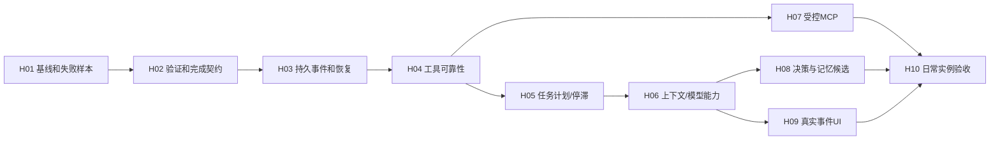

# F · 下一轮可执行 Goals

这些是**待用户下一轮正式开启的实施任务**，不是已完成清单。本轮只交付设计。每次选一个Goal，产出自身交付合同/证据，结束更新Master状态文件和四根协作文档。不要把所有Goal塞成一次大改。

## 依赖与优先级

H02/H03/H04为底层可靠性先行；H07不阻塞没有MCP的已有工具链，但其独立边界必须在宣称MCP支持前验收。H08可shadow上线，不能因judge失败影响既有确定性任务。H10全功能验收结束前，Master仍ACTIVE且各未验边界明确OPEN。

## 全部Goal共用交付门禁

每个Goal合同写明：模块M01/M10/M12与具体教育域、backend→preload→UI缺口、精确改动、旧数据/失败/回滚、证据和不做范围。源码/构建SHA、commandId/runId/模型实际ID、日常与隔离profile、新旧会话、DNS/VPN状态分别记录；禁用模型自评作为通过依据。

涉及桌面代码执行 `npm run build`、`npm run test:renderer-components`、本Goal专项测试；关键用户路径改动执行 `npm run test:smoke`，但旧legacy测试不冒充Pi用户闭环。全部收尾 `git diff --check`。日常out正在被用户使用时先保留原版本、在自有测试目录冻结构建验证，不边build边接受旧进程结果。UI另做真实Electron操作/视图检查；真实provider与mock分开。

先前失败保留，再修再测；任何skipped/blocked/未执行不得进通过分母。不得因连续3次自动脚本成功删除用户反馈。旧DB副本、新DB、冷启readback都需证据。密钥使用既有加密配置，不抄入文档/测试报告。

## H01 · 固定当前入口和失败样本（首个Goal）

- **目标/必要性**：建立可归因基线，阻止不同构建、profile、模型或素材成功冒充用户故障解决。
- **文件/模块**：启动.md/start-desktop.mjs、测试样例说明书.md、scripts/acceptance、tests/fixtures、docs/acceptance/CURRENT；M12/M10。原则上不改生产功能。
- **步骤**：记录source/out digest与实际进程路径；复制隔离测试build；采集NET-01/NET-02/IMG-04等现说明书原始素材与盲答案；核当前保存模型/开关/旧会话；建立缺证据=未验证的report schema。
- **依赖/风险**：用户运行现场/凭证/网络可用；不得自动关闭VPN或读取全profile私密内容。工作区持续变更时只接受冻结构建，不借历史SHA。
- **自动/实例验收**：report validator拒绝exit0+缺报告、provider预检提升UI成功、漏case、首次失败被覆盖；从当前页面至少复现/明确记录网络、公开图、文件三条链，失效路径留receipt。
- **DoD**：基线和首次失败有可复现输入/构建/状态，所有未验证层级标清；不是要求此Goal完成所有修复。
- **回滚**：只新增自有测试材料，撤掉测试launcher入口即可；不改真实设置或原素材。

## H02 · 完成与验证契约

- **目标/必要性**：修P0-01；把run settled与task verified分离，结果必须证据支持。
- **文件/模块**：拟shared/xiaozhi-evidence.ts、xiaozhi-task.ts；main/xiaozhi-agent/verification、production-host/goal-coordinator adapter；shared projection/preload/OfficeConversation；M10，复用各domain校验。
- **步骤**：Criterion/Evidence/Verification schema；真实web/image/file/SQLite读回adapter；确定性Verifier；readyForReview只能请求检查；公开partial/unknown/needs_human文案。
- **依赖/风险**：H01；现Office/题目教师事务不可弱化。不能把model final_state当真实读回，也不能因需人工评估让简单聊天卡住。
- **自动/实例验收**：关键tool失败但回复正常；伪callId/hash、过期source、不同task证据、无criteria、received但图形答错全部不verified；有效替代读来源满足标准可以pass。实跑NET-01/IMG-04/FILE-01各含失败反例。
- **DoD**：UI、DB、重启后的验证范围一致；旧completed显示unknown，不能伪造历史通过。结果与安全失败优先于模型声称。
- **回滚**：v2 feature adapter关闭新任务验证入口，保留证据数据；不能降级成失败也显示成功。

## H03 · 事件journal与恢复

- **目标/必要性**：修P0-02；真实过程durable，可补拉/恢复而不重播效果。
- **文件/模块**：拟events/journal.ts、events/projector.ts、recovery.ts、增量SQLitemigration；xiaozhi-agent/ipc/preload/shared事件；PiEducationWorkspace客户端cursor；M01/M10/M12。
- **步骤**：状态+event+outbox事务；owner generation/revision fence；nativeEntryId对账；typed snapshot/listEvents；gap补拉；旧publicItems双读单写adapter。
- **依赖/风险**：H02；文件/JSONL/SQLite非单事务。DB失败必须暂停，不能最佳努力忽略关键event；可合并delta但审批/工具终态/验证不得掉。
- **自动/实例验收**：event重复/乱序/缺号、renderer重载/切会话、工具settled后main死亡、终态commit失败、旧owner迟到回调；冷启重放页面而不是动作。全新/旧DBmigration及回滚演练。
- **DoD**：每个执行效果有稳定receipt和恢复处置，补拉后UI/DB一致；unknown只核验。中断状态不永久running。
- **回滚**：保留journal/增量表，切回兼容projection reader；禁止删除已提交event或重新授权旧effect。

## H04 · 工具执行可靠性

- **目标/必要性**：通用错误/timeout/retry/effect治理，修P1-02/07与P0-03操作保护基础。
- **文件/模块**：拟tools/{manifest,executor,execution-bound,retry,effect}.ts；pi-session注册、Hana/file/web/browser/Worker adapter；shared tool协议；M10/领域安全。
- **步骤**：适配OpenMAIC timeout小模块并保留许可；统一输入/output schema与错误；资源锁/读并发；无进展/不响应信号工具race；safe_read retry；unknown效果reconcile；计划变更/重试写journal。
- **依赖/风险**：H03；Pi1.0.2签名与0.78.0参考不同，race不保证外部效果停止。写入、上传和外部点击仍教师确认，不批量放权。
- **自动/实例验收**：忽略signal工具、迟到progress、读429/timeout、401/permission零retry、重复write/同文件锁、源版本变化、cancel与shutdown；网络正文替代来源实例；确认后file→fact切断恢复。
- **DoD**：所有生产tools都有manifest+明确效果/取消/时限/策略；原领域行为golden保持；没有两个executor或无限重试。
- **回滚**：按tool provider切旧adapter，保持receipt兼容；未知写入不重放。新依赖若有，说明许可/体积/Windows影响并锁定。

## H05 · Goal/Task/Step与有限续跑

- **目标/必要性**：修P1-01与P0-03；稳定任务计划、变化原因、依赖与证据停滞。
- **文件/模块**：拟tasks/store.ts、plan.ts、goal-runtime adapter；现goal-state/control-tools/instruction-queue；typed任务操作，最小计划UI；M10。
- **步骤**：稳定IDs/PlanRevision/criteria映射；用户修正来源保留；model状态为proposal；native turnBoundary核依赖/验证/无进展；pause/resume正确剩余steps，queued文本仍现原生队列机制。
- **依赖/风险**：H04；禁止另写Goal→model while。旧目标迁移、编辑/撤回/dispatching已锁的消息必须保留正确语义。
- **自动/实例验收**：依赖环/重复ID/旧version、工具失败改计划、文字变化但无新证据、连续改plan空转、暂停等待确认、resume不重复写、goal更换后迟到judge不影响新目标。
- **DoD**：多步教育/办公自然请求可看到真实计划与变更依据；每个完成step有验证；所有终态可恢复/查看。
- **回滚**：旧Goal读adapter保留、活动v2任务先安全暂停，不能把未完成step批量改completed。

## H06 · 上下文与模型能力

- **目标/必要性**：修P1-03/04，目标不丢、能力未知不被当无效凭证；同DeepSeek路径可用。
- **文件/模块**：拟context/planner.ts、manifest.ts；compaction-context/native-authority/pi-session/model-capabilities/model-settings；typed capability与设置提示；M10/M01。
- **步骤**：按当前Task选证据+版本增量；分支水位/近期完整tool frame；保留原生压缩；credential/models/capabilities分别验证，固定官方来源/probe provenance，不猜模型能力。长历史分页DAO/快照不整库扫。
- **依赖/风险**：H05；当前官方schema需真实请求与官方文档复核，目录失败不可静默复活旧模型；未知图能力不能直接试发真实学生图。
- **自动/实例验收**：models缺扩展字段、缓存过期/401/网络、明确text-only、支持图但链路失败；公开合成图授权/拒绝/payload/response/盲答案；压缩/撤销记忆/切学生/分支后目标与授权不漂移；1000轮context/DB/render性能对照。
- **DoD**：同日常保存配置、新旧会话、压缩后的NET/IMG链成功或准确限定；费用限制选择不移除无进展保护；不新增固定国外服务依赖。
- **回滚**：保留原生history/summary，关闭新context选择算法；能力来源回退unknown，不强行开启视觉。

## H07 · 可控MCP工具层

- **目标/必要性**：支持按教师工作接入扩展tools，同时明确开发MCP与产品MCP区别。
- **文件/模块**：拟mcp/{catalog,trust,adapter}.ts、shared MCP状态、typed管理IPC/settings；PiAdapter原生registerMcp；M10。
- **步骤**：核Pi1.0.2原MCP APIs；适配mu catalogue/trust设计；只显式配置server；tool/schema hash+scope+effect mapping，env凭证私有，认证状态/重连/撤销；同ToolExecutor纳管。
- **依赖/风险**：H04/H03；stdio本地程序有执行权限，远端tool不可仅凭名称当只读；许可证和打包依赖先审。
- **自动/实例验收**：受控testserver tools/list/call与错误、server改地址/schema、凭证泄漏、断线/超时、撤销、任意tool越权；国产公网可用只读service作为扩展实例，无法访问明确blocked。
- **DoD**：从管理页面显式添加→调用→回执→重启保留信任边界；未认证/未知效果不可静默执行。无Codex CLI依赖。
- **回滚**：禁用MCP catalogue与server，撤销凭证句柄；现内建tools继续工作；不删除已发生外部效果。

## H08 · 可审计决策与记忆候选

- **目标/必要性**：公开关键决策而非隐藏思维；与Master版本化flywheel一致，防临时推断污染事实。
- **文件/模块**：拟decisions/{spec,ledger,engine}.ts、memory/candidates.ts；memory-scope/skills/domain facts adapter；M10，现学生/题库域不改真源。
- **步骤**：适配mu bounded spec、stateDigest、fallback/ABSTAIN；先shadow、脱敏DeepSeek判定仅路由/选择；FACT/PREFERENCE/INFERENCE不同生命周期；版本候选→replay/eval→有限promotion→rollback。
- **依赖/风险**：H06/H02；judge不能覆盖权限/事实/验证fail，不带默认Jev/国外服务。来源变更或版本过期后候选失效。
- **自动/实例验收**：judge失效/迟到/不同goal、网页prompt injection、推断冒充成绩/答案、candidate效果下降回滚、跨学生泄露、停滞回退；公开decision引用真实证据且无reasoning原文。
- **DoD**：路由决策可离线回放，性能/质量有基线；不合格候选不promote；Teacher原FACT字节与版本不被后台修改。
- **回滚**：mode=off/shadow、恢复原routing与选中memory；保留审计候选，不覆盖事实。

## H09 · 真实事件UI与可用性

- **目标/必要性**：按E完成专业、可信的任务工作区；前提后端已有真实状态。
- **文件/模块**：PiEducationWorkspace/OfficeConversation/OfficeToolProcess/OfficeComposer；拟TaskHeader/Plan/EventTimeline/VerificationPanel/EvidenceDrawer；现HeroUI本地closure与scoped CSS；M10。
- **步骤**：MCP/API与本地版本对照；按journal映射每种状态；计划依赖/变更/attempt/证据和恢复入口；长历史增量/稳定展开；键盘、dark、窄屏与真实阅读锚点。
- **依赖/风险**：H06/H05/H03；Pro分发许可不等于MCP可读，可用OSS替代；避免一次推倒App/shell，禁止模拟过程文字。
- **自动/实例验收**：render state reducer gap/reorder、partial vs verified、draft清空/失败保留/中文composition、queue edit/retract；1366×768/1920×1080浅暗+125/150%DPI+390窄屏；键盘/读屏/长任务帧率/真实工具展开和产物打开。
- **DoD**：每个可见状态可追event/cursor/verifier，所有关键控件可达；与用户截图逐组件对照，但不称拥有闭源同款源码。
- **回滚**：旧Conversation adapter保留，UI切回同journal投影；不回退到前端猜成功。

## H10 · 按说明书闭环验收与发布准备

- **目标/必要性**：关闭“自动说通过、手动不能用”的缺口；修复后反例再测，直到授权范围全部达标。
- **文件/模块**：测试样例说明书.md、docs/testing、scripts/acceptance与真实Electron suites、Windows安装/日志；M12/M10。
- **步骤**：把H02–H09失败样例纳入固定cases；所有说明书case逐项列required/unsupported/blocked；当前日常保存配置+旧会话+冻结版本先测，隔离样例为旁证；无VPN网络+安装+Office/WPS另列；失败追加修复Goal，原失败保留。
- **依赖/风险**：H07/H08/H09；不能自动假定VPN已关、不能自动修改凭证或上传私有学生图；人工授权场景必需教师确认。
- **自动/实例验收**：NET搜索/正文/浏览器非空/引用；IMG本地OCR与公开模型视觉分开；文件读写产物/审批/源变化；停止/重启/队列/错误/压缩；各路径机器结果、UI、DB/文件与人工结论一致。用盲答案核图形/验证码，不向模型泄答案。
- **DoD**：required用例非空、全部有同版本证据；失败数为0、无隐藏skipped；blocked/unsupported不称能力通过；真实用户反馈只有同配置/输入复测与确认才关闭。模型评价只能辅助说明，不裁定成功。文档与稳定CURRENT一致。
- **回滚**：冻结已验版本+备份，取消未验版本发布；不得清理用户资料、删除失败记录或重放外部效果。

## 失败回流规则

case失败 → 保留receipt/source/build/截图 → 分类对应H02–H09责任 → 独立小Goal修复 → 同一case同环境重测 → 相关边界冒烟 → 冷启readback。不能通过换模型、改答案、降验收范围来关闭失败。外部不可用时明确blocked，完成已授权的其他独立路径；达到停止条件保留现场，不虚报“全部解决”。
