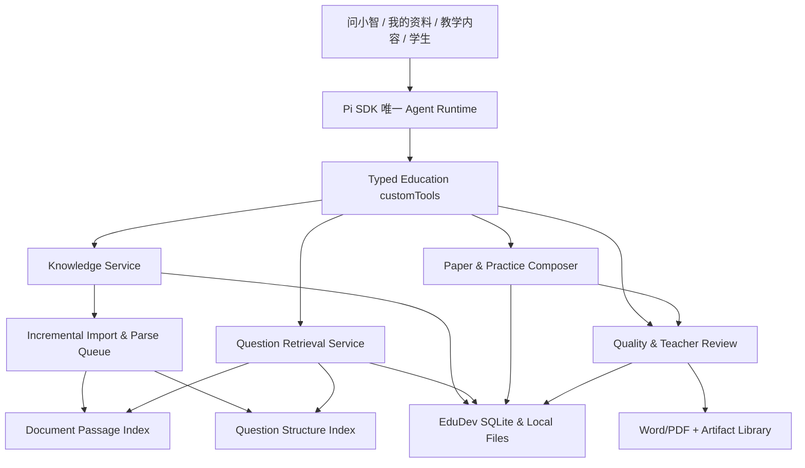

# 小智 EduDev｜本地多模态知识库与智能组卷系统技术实施方案

<!-- kb-s6-current:start -->
## 2026-10-12 当前：KB003扫描资料按页接续限定接受；功能优先

Current Phase：4/5 DOING；Master未完成。Goal工具本轮读取为历史blocked，不能用文档伪称已恢复；本轮无技术阻塞，按用户继续指示推进。Current Task：扫描资料中断不再重复已完成页。Last verified commit：488f8109d68027a6eb488e9d04c4eb5073d153cd（保护dirty，未提交）。Previous turn：C3候选结构化转写。Next：复杂整卷候选自动整理与集中审核。

Done（本片限定）：复用现PDFium/RapidOCR逐页处理与MaterialRepository/确定性队列，私有v2请求支持已完成页接续；进度缓存按资料SHA/worker SHA/引擎绑定、严格页序/大小/完整性/路径校验、临时文件原子替换。停止或重启保留页进度；全部完成仍走现source CAS/lease/SQLite事务才提交正文，未完成页不是可检索事实。旧v1图片/预览/layout与正文引擎身份保留。损坏缓存重识别，旧runtime完整保留回滚。无新包、模型下载、额外模型调用、AgentLoop、DDL或IPC。

Evidence：apps/desktop/test-results/goal/kb-ocr-resume-20261012/progress.json；build/type exit0 SHA77a4ba6b3181df787756c9ff1f7064ba37fde3fa02d4f01dc740b321b0e0a3f6/348。正式Electron education-journey-MzsnED：3项/3启动/0renderer错误，真实六页物理扫描→完成1页后UI停止→零部分正文→重启/教师重试从第2页→六页事务提交→再次重启精确冷读，模型0次。缓存实例5项包含损坏/源版本隔离/恢复。没有修改前端，不新增视觉验收声明；没有反复运行旧全套。

Failed/Learning：首次patch上下文不匹配未写入；一次测试文件编辑工作目录错导致FileNotFoundError，纠正后完成。首E8mP4j实例已过，检查到接续流增加wire体积后，有限扩大传输边界而不放宽文档上限，重建并用最终MzsnED闭环核对。原始日志、两个实例与回滚before保留。

Doing/Next：执行表docs/goal/FEATURE_FIRST_EXECUTION.md。知识库/智能组卷整体DOING；下一整卷候选集中整理/审核→复杂100分卷与答案修复隔离→错题同类/变式→长教材/目录/30–40GB/安装→OpenMAIC互动课堂→Hermes教师反馈技能晋升/回滚。Pi唯一编排。每片功能可用后做对应必要实例，旧无关全套不作为独立功能前置；具体风险才加定向验证。

限界：仍为50页/50MiB/1MiB正文边界，不等于长教材或40GB验收。复杂图/公式自动识别及可靠答案、跨学科24题质量、安装、完整OpenMAIC/Hermes仍OPEN。上轮候选由明确用户参考转写产生，不证明自主看图。三项目复用清单是实施计划，本轮未复制OpenMAIC/Hermes代码或复核其HEAD。独立harness审计块保持。
<!-- kb-s6-current:end -->

## 2026-10-11 KB-S5-B限定接受，接续S6（历史读点）

Current Phase 4/5 DOING；Master ACTIVE。Current Task KB-S6：自然材料整卷/复杂图公式/答案质量及Office-WPS联合验收，随后KB002三模式/5变式/验证修复隔离，再KB003后台增量/任务优先/30–40GB/安装。Done：S2-A/S2-B/S3/S4-A/S4-B/S5-A/S5-B各自限定接受。Doing：知识库与智能组卷完整交付。Failed：首次失败保留，当前定向门禁通过。Blocked：无。Last verified commit488f8109d68027a6eb488e9d04c4eb5073d153cd（dirty，未提交）。

KB-S5-B自然扫描图文交付 LIMITED_ACCEPTED（单题范围）。build 517b30ea70e2e46b1e1b2fbc68d311a461b9d052f1d50e42850b00fa74fb867e /340文件；build/typecheck exit0、领域292、组件203/203、导出边界15、Office底座17、coordinator11、正式新版Electron17项/2启动/20张浅暗双尺寸截图/0 renderer错误、兼容smoke207/207。真实授权物理扫描→同Pi提取完整题面原图→教师六项核对及补充答案→纯题库1题8分卷→同Office按版本图片确认→学生/教师DOCX/PDF四份真实文件→重启读回。DOCX媒体hash与PDF解码像素等于确认原图；学生文本答案隔离、改标题旧确认失效、缺图片确认拒绝、实际图片损坏拒绝与停止无落盘均通过。Microsoft Word 16.0 独立实例只读打开两份DOCX并实际渲染，输入文件字节不变。4条Paper谱系、0条误标AI来源，4个批准hash匹配；教师补充答案和解析仍未独立验证。证据：apps/desktop/test-results/goal/kb-office-rich-20261010/closeout.json。

本片仅接受自然物理扫描的一道8分图文题及原图交付；不是自然数学100分卷、复杂公式/图表完整正确性、可编辑公式或答案正确性证明。WPS实际打开、S6更广自然材料/质量、hybrid/ai_original、5变式/自动修复隔离、30–40GB及安装仍OPEN。


## 2026-10-09 KB-S3限定接受，下一S4（历史读点）

Current Phase 4/5 DOING；Master ACTIVE。Current Task KB-S4：真实错题照片→本地OCR/教师确认→本机相似Top10→可审核练习；复用现错题facts/题库/PracticeReview。随后S5/S6学生卷与教师卷Word/PDF/真实图公式联合验收，再KB002 hybrid/ai_original/5变式及答案校验、KB003增量30–40GB。语义检索质量、可信答案与导出仍OPEN。 S3精确合同见KB_S3_DELIVERY_CONTRACT.md；source_only整卷已限定验收，最终MVP仍必须实现三模式、相似题、真实资料与Office。

KB-S3 source_only整卷蓝图/审核/快照 LIMITED_ACCEPTED。build a0f860ac56680a4ddb1fa7798edd1e7c90812fae92f73b7a1156dddee7338448 /340文件；build/typecheck exit0、领域274、组件200/200、正式新版Electron12项/3启动/0 renderer错误、补充冷副本视觉3项/1启动/0模型请求、兼容smoke207/207。32张最终浅暗1366×768/1920×1080截图实际查看。23道教师UI创建对照，20道唯一题满足10×3+6×5+4×10=100；重复/缺答案/错年级、编辑废止、拒绝、精确缺口、真实源变化与恢复、幂等、停止无晚写、两次冷读和真实DeepSeek同Pi等待教师审批通过。原题不改，不自动补题，answerVerified=false；自制文字对照不是自然扫描卷或数学正确性证据。证据：apps/desktop/test-results/goal/kb-paper-20261009/closeout.json。


## 2026-10-09 KB-S2-B限定接受，下一S3（历史读点）

Current Phase 4/5 DOING；Master ACTIVE。Current Task KB-S3：100分source_only蓝图→确定性配额去重选题→缺题提示→教师预览/确认→版本化整卷快照/冷读。随后S4真实错题Top10、S5/S6 Office联合验收、KB002三模式/变式、KB003 30–40GB。语义相似与可信答案复用仍OPEN，不恢复通用解题支线。 精确S3合同草案见KB_EXAM_ACTIVE_TASK.md末节。既有Practice/exercise_sets要求学生，整卷须复用独立审核action并保存现题库快照，不建第二题库。

KB-S2-B 保守同题候选/版本绑定 LIMITED_ACCEPTED。build cb0a5c473cbffc23d483cd2c2027f80405ac1fdbb57b44495fa4402072e8c79f /340文件；build/typecheck exit0、领域258、组件194/194、正式新版Electron12项/3启动/0 renderer错误、兼容smoke207/207。12张浅暗1366×768/1920×1080截图已实际查看。28道教师UI创建对照：跨记录ID/CRLF同题2条，改数值条件保持独立；20+2分页，真实Pi/DeepSeek同次10条安全别名/duplicateOf，源变化拒绝、精确恢复、两次冷启与索引重建通过。仅本地保守候选，绝不自动合并/删题或证明答案正确；页面范围current_page、Pi范围returned_candidates。证据：apps/desktop/test-results/goal/kb-identity-20261009/closeout.json。


## 2026-10-09 KB-S2-A 关键词底座限定接受（历史读点）

Current Phase 4/5 DOING；Master ACTIVE。Current Task KB-S2-B：先完成组卷所需保守同题去重/版本绑定，再接S3纯题库100分蓝图、缺题与教师预览；可信答案复用/语义相似仍为S2余项，随S4完成，不作为不依赖它们的整卷预览前置。通用解题及其他模式不恢复为独立前置。 S3审查：现PracticeReview最多8题且强绑定学生，saveExerciseSetFromDraft需要studentId；不能把教师整卷硬塞成三元练习或虚构学生，下一合同须明确整卷快照/账本接缝。

KB-S2-A 关键词检索底座限定接受。当前build `443eae07f599fda05dfc5f241f85a8f62c942bc5cc9855cbc5e48f69777e3314` / 340文件；build/typecheck exit0，领域252、组件194/194、正式新版Electron11项/3启动/0 renderer错误、兼容smoke207/207。8张当前浅暗1366×768/1920×1080截图已实际查看。28道教师UI创建对照题，六项硬过滤命中22道、20+2分页；真实Pi/DeepSeek读10条并标hasMore；冷恢复、索引删除重建、旧来源拒绝与精确恢复均通过。不是语义Top10、同题指纹、答案正确性、100分卷、数学Word/PDF或30–40GB验收。证据：`apps/desktop/test-results/goal/kb-retrieval-20261009/closeout.json`。


## 当前最高专题优先级：知识库与智能组卷（2026-10-09）

已验边界与后续门禁见精简执行卡；本次整理不把尚未实施模块标完成。

用户最新指示：整理上下文，集中完成知识库与智能组卷。当前唯一执行索引：[KB_EXAM_ACTIVE_TASK.md](KB_EXAM_ACTIVE_TASK.md)（仓库绝对定位 `docs/goal/KB_EXAM_ACTIVE_TASK.md`）。接续为 **KB-S2检索→S3纯题库100分卷→S4错题相似练习→S5/S6 Word/PDF联合验收→KB-002三模式/5变式→KB-003增量30–40GB**。R3/R4只按组卷/变式所需嵌入，通用解题长线及其他模式延后；下方旧节的R2→R3→R4线性Next不再是当前执行顺序。Master及知识库四项产品决策保持。


## 2026-10-09 B5-B限定接受与R2接续

范围：只接受本切片事实一致性/来源读取与恢复；更广答案质量不标完成。

本节是当前读点，下方同日旧节保留历史证据，不能覆盖本节。M05/M10 B5-B仅来源事实一致性保护已接受：answer/analysis镜像冲突及v2题干冲突由同一只读helper检测；typed IPC保留安全错误，题本/同Pi来源弹窗拒绝展示冲突正文，精确恢复后可读。旧v1摘要语义、questionVersion、批准与原图未被自动修复或重写。

当前build 367d53b3d85dbb2e1855cbb7db977859f94129e529aec6898f40b2dca8d3f6bf / 340文件，正式前后、冻结快照与兼容smoke后一致。build/typecheck exit0；领域243、组件194/194、兼容smoke207/207；真实DeepSeek/Pi Electron24项/4启动/0 renderer错误。32张当前浅暗1366×768/1920×1080截图与4份原图实际查看；三个隔离标量故障均拒绝、精确恢复、冷启一致；原生手动压缩1次后冷继续通过。此压缩不是新的自然自动阈值基准，smoke仅兼容路径，不作新版视觉依据。

物理扫描无独立标准答案仍missing，图15未知标记不认作答案；教师自制跨页算术仅来源绑定对照，answerVerified=false。完整B5独立质量、可靠求解/五tools、语义Top10、100分卷/Office、30–40GB、自然教师、安装/VPN-off与完整Codex体验仍OPEN。

**Next：R2保守同题指纹/中文检索、硬过滤/版本与可信复用合同→R3受限AST/SymPy→R4同Pi五tools→R5–R7错题/组卷/Office/容量。** 不因缺物理答案停止后续，也不凭题面批准/来源标签把答案当正确。Master ACTIVE、Phase4/5 DOING。证据：`apps/desktop/test-results/goal/b5-facts-20261009/closeout.json`；首次RED/build/组件失败与回滚副本保留。无DDL/依赖/第二runtime/日常资料或凭据改动，无提交/push，另一worktree保留。


## 2026-10-09 本轮低成本解题路线审查与交接

本轮仅技术路线审查补充，不覆盖Master与既有KB合同。12项目对比/十项设计见解题技术审查；新MIT固定验证器作为R3/R6适配候选。§46 B4完整必要题面仍下一实施合同，source_only100分＋错题Top10两个MVP不取消。

方案：`docs/architecture/XIAOZHI_SOLVER_OPEN_SOURCE_TECHNICAL_REVIEW.md`；任务卡：`docs/goal/XIAOZHI_SOLVER_IMPLEMENTATION_TODOLIST.md`；证据：`apps/desktop/test-results/goal/solver-audit-20261009/requested-review/`。以下历史保留其当时范围。


> **本地执行更新（2026-10-08）**：用户已指定本专题优先于旧 DT-05 下一任务。当前审查、差距、冻结合同和任务顺序见 [§19](#19-2026-10-08-本地源码审查与进度)、[§20](#20-kb-exam-001-首片合同与数据边界)、[§21](#21-后续任务清单与依赖)。原 v1.0 的远端分析保留，§18 的“未读取 Windows 本机”仅描述初版；本轮已读取本机源码，但**尚未执行专题样本闭环、构建或产品验收**。Master Goal 不变。

> 版本：v1.0 · 2026-10-08  
> 状态：产品方向已确定；技术设计和实施验收合同；**不是已实现功能声明**。  
> 适用：Windows、Electron + React、TypeScript、SQLite、Pi SDK 唯一 Agent Runtime。  
> 目标：老师能够通过一句话生成可编辑试卷、答案、解析和 Word/PDF；或通过学生错题图片检索同类题、生成变式练习，并能回查来源。

## 0. 四轮苏格拉底问答决策（冻结）

| ID | 已确认产品决策 | 交付含义 |
|---|---|---|
| DEC-01 | 首期 A+B 并行 | 「智能组卷」与「错题→相似题→变式练习」属于同一 MVP；不能只做知识库聊天演示 |
| DEC-02 | 三种组卷模式 | 仅原题、知识库优先混合、AI 原创；默认自动路由，老师可显式覆盖 |
| DEC-03 | 自动后台整理 + 任务优先解析 | 导入即登记、可浏览；后台异步解析/增量索引；即时任务可提升相关资源优先级；未处理部分明确呈现 |
| DEC-04 | 分级审核与自动修复 | 自动检查并尝试替换/修复；有疑点题进入待审区，不得冒充通过；合格部分可形成待审稿，正式无疑点卷可交付 |

**非目标**：本期不构建第二 Agent Loop、不另起一个具有独立教师/学生真源的服务端、不以所有 40GB 必须完成 OCR 才能使用为前提、不自动给学生记分、不默认上传含个人信息的原始图片、不保证任何 LLM 原创题一定正确。

## 1. 本次源码基线与新增关键发现

这次检查的 GitHub 远端 HEAD（本地未 push 修改不可见）：

| 仓库 | 本轮固定 SHA | 新情况 | 处理原则 |
|---|---|---|---|
| [EduDev](https://github.com/ZhouXuan-Yu/EduDev) | `488f8109d68027a6eb488e9d04c4eb5073d153cd` | 已有 `question-host.ts`、question/practice-review、mistake-ocr/facts、material-tools/repository；说明部分底座已经存在 | **先沿调用链审查并复用**，不能重新搭一套题库/审批 |
| [DeepTutor](https://github.com/HKUDS/DeepTutor) | `6cf793bd868ba5ecbe64722936d4be8fab5a01df` | v1.6.14，release 描述包含原题视觉练习、可恢复索引、统一视频阅读等 | 逐领域提取能力；绝不把独立 AgentLoop 带入 Pi |
| [OpenMAIC](https://github.com/THU-MAIC/OpenMAIC) | `472b26d0d5ccac6cd59d222e3e41b3c634ea39fb` | 近期增强公式渲染安全、DSL、generation 等 | 后续互动题展示/编辑可复用；本期不引全站 Runtime |

### 1.1 EduDev 应优先复用的现有文件

- `apps/desktop/src/main/assets/material-repository.ts`：本地资料登记、分页、body、source 版本验证、ingest；现已有文件 hash/状态检查；需加索引层和大型队列，不另造第二资料库。
- `apps/desktop/src/main/assets/material-tools.ts`：Pi 现有 `office_list_materials` 和 `office_read_material`；当前是**目录+分段正文读取**，不是完整题目检索；保留并增加新的结构化工具。
- `apps/desktop/src/main/education/question-context-provider.ts`：已有 QuestionBankItem 的结构化事实读取及内容版本；直接作为原题 provenance 的基础。
- `apps/desktop/src/main/education/question-host.ts`：已有 DeepTutor question pipeline 的本地规范化 Worker；保留所选 AST/协议边界，不直接迁其 AgentLoop。
- `apps/desktop/src/main/education/question-review-repository.ts`：已支持会话/学生隔离、源版本检查、教师审核、确认后保存及冲突检查。
- `apps/desktop/src/main/education/practice-review-coordinator.ts`：已支持 original/similar/variant 练习角色、实读原题来源、教师确认，后续直接扩成练习出题闭环。
- `apps/desktop/src/main/students/mistake-ocr-api.ts` 与 `mistake-facts-api.ts`：已有本地图片 OCR、教师校正以及学生事实确认边界，不应该重新实现图片上传/学生隐私逻辑。
- `apps/desktop/src/renderer/components/QuestionNotebookWorkspace.tsx`、`ExerciseSetLibrary.tsx`、`MistakesWorkspace.tsx`：作为教师可视工作流；组卷编辑页只补缺失部分。
- `apps/desktop/src/main/xiaozhi-agent/pi-session.ts` 与 `production-host.ts`：唯一 Pi tools 注册、取消、审批和公开投影的接入点。

**特别注意**：EduDev `material-repository.ts` 现有文件名称/格式检索并不等于 40GB 的全文与题目相似检索；`question-review` 的校验也不等于数学正确性证明。两者要在原组件旁边增量扩展。

## 2. 产品核心体验与最小闭环

### 2.1 智能组卷——教师一句话

老师：“用初二上册教材和我自己的题库，出一套 100 分一次函数单元卷；选择 10、填空 6、解答 4，中等难度；Word 和 PDF，附解析。”

执行链：

1. Pi 从自然语言提取组卷蓝图 `PaperBlueprint`，缺少的年级/学科等从当前班级或教师默认配置推断，不可推断则只询问必要信息。
2. 通过 `education_search_questions` 检索结构化题库，使用知识点、题型、年级、难度硬过滤，再按语义相似度/来源质量/多样性重排。
3. 运行确定性组卷求解器满足总分、题数、题型分布、知识点覆盖、难度分布、来源限制、重复上限；无法完全满足时明确给出约束冲突。
4. 按当前模式决定是否由 AI 生成缺口题；每道原创题保存 parent/reference、模型版本和创建原因，不伪造教材出处。
5. 执行题目完整性、重复、答案和知识点适配的分层质量门禁；不合格题自动修复或替换，超过限定次数进入待审。
6. 生成试卷预览，保留题目来源、版本、老师编辑痕迹；通过审核后生成 Word/PDF 和独立答案解析；创建 `paper_artifact`，出现在「教学内容」。

### 2.2 错题相似题——教师拍照

老师上传学生的数学错题照片：“找 10 道同类型，再生成 5 道稍难的变式题，做成专项训练。”

执行链：

1. 复用已有 `mistake-ocr` 本地图片处理和教师文本校正入口；保存原图版本与 OCR 结果，但不擅自认定错因。
2. 题目结构化：题干、公式、图、题型、已知条件、求解目标、知识点候选、难度、学生错误类型（老师可确认）。
3. `education_find_similar_questions` 返回相似题，要求**同一解题方法/知识点结构**，而非仅词面相近；按“同构原题/相同考点不同情境/难度递进”分组。
4. 老师确认 10 道原题后，`education_generate_variants` 生成 5 道结构化变式，保留 parent IDs / derivation 与质量结果。
5. `education_build_practice` 输出专项练习；如绑定学生，保留学生 ID 和错题来源，**不自动推断掌握度、分数或作答事实**。
6. 训练后的真实作答再经老师确认，才能更新学习记录/掌握度/复习调度。

## 3. 总架构：唯一 Agent、双索引、三条业务链



角色划分：

- **Pi**：接收意图、调用工具、流程协调与用户交互；不管理第二套数据库/后台异步队列，不承担大量逐文件 OCR 调度。
- **Import Service**：本地文件扫描、解析、排队、可恢复状态；它是确定性任务调度器而不是 AgentLoop。
- **Document Index**：段落/章节/页/公式/图表、引用链；服务资料问答与知识点证据。
- **Question Index**：一道题为最小原子对象，题干+选项+图+公式+答案+解析+来源页+版本；服务组卷与相似题。
- **Paper Compiler**：把题目候选组织成符合硬约束的 `Paper`，不能靠一次 LLM prompt 直接保证分值和题型正确。
- **Quality Gate**：检测重复、结构、答案等；判定自动通过、需重试/替换、需老师审核。
- **Review UI**：复用 question/practice review 组件、增强整卷可编辑性，业务提交全部回到主进程 typed API。

## 4. 30–40GB 本地知识库：先盘点、增量化、任务优先

### 4.1 资料生命周期

`discovered → hashed → queued → parsing → extracted → question_candidate → reviewed/indexed → ready`；错误分支 `retryable_failed / permanent_failed / cancelled / stale`。索引状态必须按**文件级/页级/题级**分别记录；不能把“文件已登记”显示为“全内容可检索”。

- 导入立即创建本地文件目录及最小元数据（原始文件大小、扩展名、mtime、hash 或异步 hash）。
- 异步 worker 按优先队列调度：交互请求相关文件 > 近期高频资料 > 后台普通任务。
- 增量扫描使用 `size+mtime` 作为快速候选，`SHA-256` 做最终内容身份；不按路径认定唯一内容。
- 同文件改动后生成新版本；成功解析后原子切换索引别名，旧版本引用标记过期，允许回查历史；出错保留旧的可用索引并标示状态。
- 文件移动/删除只改变资源记录与可访问状态，不能悄悄重写老师此前的试卷历史和已确认题目。
- 支持停止/继续、kill 后重启、崩溃恢复、单文件失败隔离、并发限制、解析队列进度；不能把 40GB 全量送入一次模型上下文。

### 4.2 格式分流与解析

| 格式 | 首选处理 | 必须注意 |
|---|---|---|
| TXT / Markdown | 原有 text importer | 保留章节、标题、行号 |
| DOCX / PPTX / 可提取文字 PDF | 优先复用 EduDev 当前 Hana/AnyDoc/Office worker；对复杂布局再比较 Docling/MinerU | 必须保存段落页码/幻灯片编号/题组边界 |
| 扫描 PDF / 照片 | 已有本地 OCR → 复杂布局解析与公式专用识别 | 识别置信/疑点块进入审核，不把 OCR 文本当标准答案 |
| 数学公式 / 表格 | LaTeX 或 MathML 结构化存储，原图局部裁剪做证据 | 指数、根号、上下标、分式、正负号误差需特测 |
| 几何/函数图像题 | 题干图与多区域位置联结；可选多模态模型辅助图形理解 | 不可仅凭 OCR 丢弃几何图形；图片可原样纳入试卷 |
| 历史试卷/有答案卷 | 题组区域切分，答案区与题干可靠关联 | 必须区分“卷末答案”与下一个试题正文 |

**组件选型：**先比较 `Docling`（MIT）、`PaddleOCR`（Apache-2.0）、`Pix2Text`（MIT），`MinerU` 作为复杂布局候选但需要单独核对许可证及模型权重使用条件。不要一次安装所有 OCR 大模型或让用户安装 Docker。引擎采取 `ParserProvider` 接口，基于文件类型、资源、离线配置路由。Windows CPU 基线先跑通，再启用 GPU 加速。

### 4.3 文档与题目双索引

- 文档索引：`resource_id, version, unit_id, page, section, text, formula, asset_refs, embedding, FTS, source_bbox`。
- 题目索引：`question_id, variant_group, stem_normalized, options, figures, formula_ast, answer, analysis, subject, grade, chapter, knowledge_point_ids, difficulty, skill_signature, source_refs`。
- 对重复扫描件、不同排版但相同题目，结合规范化文本 hash、数学表达式规范化、感知图 hash、人工确认证据关联 `duplicate_group_id`。
- 出处必须支持原件文件名、版本、页码或页/区域、来源可信度。OCR 无法确定页码时只记录真实可证明的位置。
- 向量库只是**派生索引**，删除可从 SQLite + 本地来源重建；学生/教师业务事实仍归原 SQLite 管理。

### 4.4 容量与资源控制

40GB 是输入资料体积，不等于向量索引体积；具体题数、页数、图片数量、解析吞吐、磁盘占用需用实际样本测量。需设置可配置磁盘配额、解析 worker 最大并发、批次资源预算、OCR 缓存清理、索引构建进度和失败可重试机制。多模型的首次下载、离线部署大小、显存占用也要纳入 Windows 安装验收。

## 5. 搜索与相似题：不是“向量距离越近越相似”

### 5.1 四级召回

1. **结构硬过滤**：学科、学段/年级、知识点、题型、是否完整答案、授权资料集合、只原题模式；过滤不通过的候选不得被语义分数挽救。
2. **全文关键词检索**：SQLite FTS5/BM25 等，适合公式符号、专有术语、原题精确表达。
3. **语义/结构双向量召回**：题干语义 embedding + 可选“解法签名/知识点/表达式”表示，适合不同表述的同类题。
4. **Reranker + Diversity**：综合实际解题模式、知识点一致性、难度差、出处可靠性、重复分组与变式目标，并用 MMR/覆盖度避免返回 10 道几乎同一句题。

检索结果至少解释“为什么相似”：核心考点、解法模式、题型、难度变化、不同点、来源可追溯。不能只展示 `similarity=0.93` 就认定教学上相似。

初期技术建议：`SQLite FTS5 + 本地向量检索（优先复用项目既有 LanceDB 相关能力；如未接通再 POC）+ Python/TS 可插拔 reranker`。`Qdrant` 适用于后续更复杂规模场景，但本地桌面首期不宜强制部署服务。Embedding 可以评估 `bge-small-zh-v1.5`（轻量）与 `BGE-M3`（更丰富能力），必须用真实中文题目和公式题评测，而不是按通用榜单直接选。

### 5.2 三个检索任务必须分开

- `exact_lookup`：根据已知来源、ID、局部文本定位原题。
- `same_method`：相同知识点与解题方法，但数字/情境可变化；错题训练首选。
- `same_topic_broaden`：考点接近但解法可不同；组卷补充覆盖使用。

返回每项 `match_type / evidence / confidence / source / answer_status / verified`。相似匹配与生成变式要分清：原题检索不能由模型“凭空编一个很像的题”来凑数。

## 6. 智能组卷引擎：硬约束必须代码求解

### 6.1 Blueprint

```ts
type PaperMode = 'source_only' | 'hybrid' | 'ai_original';
interface PaperBlueprint {
  subject: string;
  grade: string;
  syllabusId?: string;
  resourceScope?: string[];
  knowledgePointIds: string[];
  mode: PaperMode;
  totalScore: number;
  durationMinutes?: number;
  itemCount: number;
  distributions: Array<{
    questionType: string;
    count: number;
    scoreEach?: number;
  }>;
  difficulty: { easy: number; medium: number; hard: number };
  avoidQuestionIds?: string[];
  answerRequired: boolean;
  explanationRequired: boolean;
}
```

必须有 `validateBlueprint`，检查每类题数量总和、总分、知识点映射、难度分配、模型可用性和可用题库覆盖。对于解答题非固定分值可用范围或显式分值数组，不要求所有题一律同分。

### 6.2 三种模式严格定义

| 模式 | 行为 | 不足处理 |
|---|---|---|
| `source_only` | 只选知识库内来源明确、具备使用资格的原题 | 找不到 20 道就显示实际 8 道与缺口，不得悄悄补原创题 |
| `hybrid` | 原题优先；不足部分变式或原创，明确标记来源与关系 | 新题必须单独质量验证；未达要求则待审或给出缺口 |
| `ai_original` | 依据知识点蓝图生成新的题目，知识库用作课程/难度参考 | 不给原创题伪造原件页码；无法验证不能被标为正式合格 |

可采用 CP-SAT/整数规划（如 OR-Tools）解离散配额，也可以先用可证明约束的确定性搜索/回溯 MVP；首期题型和题数不大时避免过早引入大型原生依赖。模型可以建议分配比例，不能越权修改老师硬性指定的题数、分值、纯原题模式。

### 6.3 题目生成与去重

变式生成要基于 `VariationSpec` 而非笼统“重新出一道”：可变化量包括数字、条件顺序、现实情境、图形参数、知识点组合、题目难度；禁止不合理或丢失解的替换。每个题存 `generated_from[]`、变化说明、prompt/model 版本、生成批次、质量报告。近重复（仅替换数字）可以作为定向训练，但整张测试卷应设置同类题数量上限。

## 7. 质量门禁：D 方案的可执行状态机

每道题经历：`draft → schema_checked → format_checked → content_checked → answer_checked → duplication_checked → approved / needs_review / rejected`。

### 7.1 分级验证

- **P0 硬性规则**：题型与选项合法、题目完整、总分匹配、来源引用存在、公式可渲染、图片资源可达、试卷导出文件可重新打开、跨学生隔离。
- **P1 客观正确性**：计算/代数题采用 SymPy 或学科求解器辅助验证；多选答案要与选项匹配；必要时双路径重算与原题参考答案一致性比对。数学求解器不能覆盖所有应用题/几何证明题。
- **P2 质量判断**：知识点匹配、真实难度是否符合、是否超纲、答案解析前后一致、表述是否含歧义；可用另一个验证调用辅助，但不能把两个 LLM 一致当正确性证明。
- **P3 教师审核**：证明题、复杂图形题、开放性答案、低置信 OCR、无法验证的新题和跨学科争议题进入人工确认。

### 7.2 自动修复策略

每道题限制生成/修复尝试次数（**初始建议 2 次，后续用数据调参**）；先做确定性修复（格式/分值/去重/候选替换），再必要时调用 AI 重写。多次失败后标 `needs_review` 并给老师明确原因。**不能隐藏未通过题或将其混入正式卷面**。老师编辑后需要使依赖的答案/校验状态失效，触发增量复核。

### 7.3 整卷发布

- `ready`：所有纳入正式卷面的题通过当前规则，且导出验证通过；可按 D 方案直接生成正式文档，并保留“建议教师审阅”提示。
- `review_required`：有疑点；可保存明确标记的草稿和已经过校验的部分，不作为“正式可用试卷”交付。
- `blocked`：分数/题量等硬约束不满足，或来源/授权/文件错误；拒绝正式导出并说明缺口。

教学高风险使用（例如正式考试、评分）应在产品中提供教师最终审核开关；即使自动门禁通过，也不保证不存在学科性错误。

## 8. 数据模型建议（增量迁移，避免第二真源）

在现有 `teacher_resources / resource_chunks / question_bank / exercise_sets / ai_confirmation_items / document_artifacts`（实际表名以数据库迁移核对为准）基础上，新增**必要的独立表**。以下是逻辑模型，不是未经审计直接执行的 DDL：

| 逻辑实体 | 关键字段 | 作用 |
|---|---|---|
| `import_jobs` | id, resource_id, resource_version, stage, priority, checkpoint, attempt, error, updated_at | 增量解析、恢复、取消、失败 |
| `content_units` | id, resource_id, version, page, section, bbox, text_ref, formula_ref, asset_ref, content_hash | 带来源的段落/图/公式 |
| `question_sources` | question_id, resource_id, version, page, bbox, capture_id, confidence | 题目到真实文档/图像的谱系 |
| `question_enrichment` | question_id, normalization, skill_signature, difficulty_version, duplicate_group, verification_state | 扩展现有 QuestionBankItem，不复制核心题干 |
| `paper_blueprints` | id, constraints_json, mode, status, teacher_id, version | 保存一次组卷意图与约束 |
| `paper_items` | paper_id, question_id, variant_id, position, score, source_role, verification_version | 整卷固定快照和题目顺序 |
| `paper_quality_reports` | paper_id, item_id, check, severity, evidence, checker_version, resolution | 可审计质量记录 |
| `question_variants` | id, parent_question_ids, variation_spec, prompt_model_version, verification_state | 原题/变式联系 |
| `knowledge_index_versions` | resource_version, index_name, model_version, status, built_at | 索引重建与原子切换 |

教师或学生的实际答题、成绩、错因必须留在原业务表和确认机制里，不放到向量数据库中作为另一个事实源。每个写入使用现有事务、版本对比、权限和确认接口。

## 9. Pi SDK：工具清单与调用合同

**Skills 是工作流说明书，customTools 是有权限、可审计的真实能力实现。** 不要以 Skill markdown 代替业务代码。工具统一提供 typed schema、主窗口权限、当前 session/student scope、`AbortSignal`、幂等 `commandId`、来源版本、错误码、进度事件。

| 工具 | 输入核心 | 返回核心 | 写权限 |
|---|---|---|---|
| `education_list_materials` | query, page | 资料/状态/索引覆盖 | 只读，沿用原 `office_list_materials` |
| `education_search_knowledge` | scope, query, topK | 章节/片段/公式/来源 | 只读 |
| `education_search_questions` | grade, subject, knowledgePoints, types, query, mode | 结构化题、ID、来源、状态 | 只读 |
| `education_find_similar_questions` | questionId 或 confirmedOcrId, similarityMode, limit | 同类题及相似理由、来源 | 只读 |
| `education_generate_variants` | verifiedQuestionIds, variationSpec, count | 带谱系的待审变式 | 候选暂存；不直接写正式题库 |
| `education_plan_paper` | PaperBlueprint | 配额、候选可用数、缺口与 planId | 草稿 |
| `education_compose_paper` | planId, version, commandId | 试卷候选快照及检查状态 | 草稿 |
| `education_validate_paper` | paperId, version | 分项质量报告/待审项 | 审核版本 |
| `education_submit_paper_review` | paperId, edits/approvals | 教师确认后的不可变版本 | 现有主进程确认机制 |
| `education_export_paper` | acceptedPaperId, formats | Word/PDF/答案/解析与文件来源 | 经授权本地文件写入 |
| `education_build_practice` | sourceQuestionIds, variants, studentId? | 专项练习及来源 | 使用原 practice-review / teacher confirmation |
| `education_get_index_status` | scope/jobId | 覆盖率、任务进度、错误项 | 只读 |

统一返回建议：`{ success, schemaVersion, commandId, data, sources, coverage, warnings, quality, retryable, errorCode }`。危险的导出覆盖、写入已确认题库、学生事实更新必须经主进程的权限/确认边界；Pi 只是发起者。

### 9.1 两个 Skill

- `smart-paper`: 将教师自然语言转换成 blueprint → 查询资料覆盖与题库 → 确定性求解 → 按模式 AI 补题 → 质量门禁 → 预览/输出。
- `mistake-to-practice`: 读取本地 OCR 已确认题干/学生范围 → 多级相似检索 → 教师可见差异 → 变式生成/质量验证 → 练习/导出。

两个 Skill 的模板中明确：**不能将尚未完成解析的资料说成已检索、不能将 AI 自编题称作教材原题、不能猜测学生真实错因、不能绕教师确认自动记成绩。**

## 10. 开源方案对比与复用决策

| 候选 | GitHub | 角色 | 决定 |
|---|---|---|---|
| EduDev 现有 materials / questions / OCR / review | https://github.com/ZhouXuan-Yu/EduDev | 业务真源和生产入口 | **KEEP + EXTEND，第一优先** |
| DeepTutor 1.6.14 | https://github.com/HKUDS/DeepTutor | question pipeline、practice/learning、recoverable indexing 借鉴 | **ADAPT 教育领域，不迁 AgentLoop** |
| OpenMAIC 当前 HEAD | https://github.com/THU-MAIC/OpenMAIC | DSL/quiz renderer、后续互动卷与课件 | **Phase2/后续 ADAPT，不迁 server runtime** |
| Docling | https://github.com/docling-project/docling | 通用 PDF/Office 结构化解析 | **POC 候选，复杂文档首选比较之一** |
| PaddleOCR | https://github.com/PaddlePaddle/PaddleOCR | 图像 OCR/版面 | **复用原 OCR 前提下比较补缺** |
| Pix2Text | https://github.com/breezedeus/Pix2Text | 公式/混排文档解析 | **公式专项 POC** |
| MinerU | https://github.com/opendatalab/MinerU | 复杂 PDF/公式/版面 | **复杂输入候选，单独核许可证/模型部署** |
| RAGFlow | https://github.com/infiniflow/ragflow | chunking、检索、引用策略参考 | **REFERENCE，不嵌整站服务和 Agent** |
| RAG-Anything | https://github.com/HKUDS/RAG-Anything | 多模态 RAG 模式参考 | **REFERENCE/可选实验，不建立第二数据真源** |
| LanceDB | https://github.com/lancedb/lancedb | 嵌入式多模态向量检索 | **优先 POC** |
| Qdrant | https://github.com/qdrant/qdrant | 高性能独立向量服务 | **仅规模或隔离必要时再选** |
| SymPy | https://github.com/sympy/sympy | 可验证数学表达式与求解 | **数学题质量门禁专项评估** |

开源代码、模型权重、字体和转依赖**分别核许可证、下载/修改/再分发条件**。不要把 GitHub 仓库的根许可证自动视为所有模型/资产的许可证。OpenMAIC 最近公式安全修复也提示：渲染来自老师/模型的不可信 LaTeX/HTML 必须隔离与限额，不能直接信任 `dangerouslySetInnerHTML`。

## 11. 教师 UI 和产品归属

- **问小智**：只显示一个聊天入口，出现“解析中 15/200 文件”“查到 18 道原题/缺 2 道”“3 道待审核”等可理解的进度和快捷操作。
- **我的资料**：资料导入、文件夹同步、索引覆盖与可检索状态、出错重试、来源页定位；复杂技术配置放高级选项。
- **教学内容**：试卷模板、蓝图编辑、题目替换、拖动顺序/分值、答案解析预览、导出历史、正式/待审状态。
- **学生**：错题图片 OCR 教师校正、相似题、专项训练、学生实际成绩/掌握度；老师未确认前不自动创建学生事实。
- **设置**：离线/在线模型、知识库磁盘配额与索引策略、审核严格度、导出默认格式；权限/隐私默认安全。

不引入另一套 OpenMAIC AI chat UI。沿现有 HeroUI Pro 产品壳、question/practice review、Hana/Office 文件宿主补业务模块。

## 12. Word/PDF 与版式合同

使用一个 **Paper AST / Canonical Document Model** 分离“试卷内容”和“渲染”。从单一已确认 Paper 版本分别导出：教师版（含答案解析）、学生版（不含答案）、独立答案解析、可选答题卡。

要求：数学 LaTeX/OMML 公式、图片题、题号、页码、分栏/分页、每题分值、页眉/学校/班级/姓名字段、可编辑 Word。优先复用已有 EduDev Office 生成及 DOCX 导出/教师修订链路；PDF 优先验证真实 DOCX→PDF 转换器或可信渲染模板，并用文件二次读取/图片审阅确认内容。**不能以“生成 DOCX 文件成功”直接宣称公式、分页和图片版式正确。**

## 13. 生产安全与隐私

- 文件读写严格使用 EduDev 已授权的根目录、canonical path 与版本校验；解析器放受限子进程，单文件上限、内存/CPU/耗时/队列并发可取消。
- 默认原图、姓名、学生记录不上传在线 API；如老师选择云端解析，显示清晰授权和最低必要信息、脱敏范围。
- 外部导入的 Word/PDF/图片/公式/HTML 都是**不可信输入**；禁止文档文字诱导 Pi 越权调用工具，模型产生的程序代码也不能当生产逻辑执行。
- 错题绑定学生必须 `studentId` 与 teacher/session 权限双重校验，不能靠 prompt 自述学生名字跳过授权。
- 索引和缓存可清理/重建，清理不能删除原始资料和老师手工确认的题目。
- 同一来源版本、同一命令幂等，导出文件覆盖时使用 CAS/确认。

## 14. 阶段实施：尽快做真实闭环，不先铺满架构

| 阶段 | 目标 | 交付与接受门禁 | 建议优先级 |
|---|---|---|---|
| P0 基线与合同 | 对齐当前最新 EduDev，盘点已有 material / question / review / OCR / Pi 工具，冻结数据契约；选 50–100 份覆盖公式/图形/扫描件的真实匿名样本 | 源码依赖图、迁移清单、测试样本、当前能力真/假/待测分类、回滚点 | 立即 |
| P1 可检索完整原题 | 资料导入→题目切分→来源定位→结构化题库→关键词/向量/混合检索 | 题目完整率、OCR 错误率、Recall@K/MRR、来源正确率测量；20 题可检索演示 | 最先实现 |
| P2 第一条闭环：原题组卷 | `source_only`，硬性约束、题目去重、教师可编辑卷、Word/PDF 导出 | 100 分/指定题型全符合；缺题时不造假；文档二次读回；冷恢复 | 核心 |
| P3 第二条闭环：错题相似题 | 图片→本地 OCR→教师纠错→相似检索→10 道题→专项练习 | 不漏图片/公式；10 道题有来源；相似理由可解释；跨学生隔离 | 核心 |
| P4 AI 变式和混合组卷 | `hybrid`/`ai_original`、变式谱系、去重、解析生成和修复 | 自动校验 + 疑点人工门禁；AI题显式标注；改题后复核 | 核心 |
| P5 40GB 稳定性/产品化 | 增量索引、队列恢复、优先级、配额、复杂文档评测、离线 Windows 打包、性能 | 真实分级数据集、断电恢复、内存/磁盘峰值、索引稳定、错误可追查 | 必需上线门禁 |
| P6 进阶个性化 | DeepTutor 学习策略、掌握度、错题复习队列、OpenMAIC 互动练习 | 仅真实确认数据驱动，黄金学生练习/反馈闭环 | 首期稳定后 |

**重要调整**：P1–P4 完成端到端闭环再做大规模存储重构。`db.ts` 应逐领域渐进 Repository 化；不为了“架构漂亮”先拆七千行文件导致教育功能停工。尽量原依赖、原 Schema、原权限与当前 Pi Host 上增量实现。

### 14.1 首期建议量化门禁（提议值，基于数据集测量后调整，不是已达到）

1. 组卷硬约束合规率 **100%**（题数、总分、指定原题模式、题型数量）；否则拒绝正式发布。
2. 出处准确率 **100% 可回查真实源版本**；无法确认的原题不能被标“已证实出处”。
3. 错题检索：自建 ≥200 对经老师标注的同类/不同类题对；目标 `Recall@20 ≥ 90%`，且 Top10 教师认可率 ≥85%，按学科/图题分组报告。
4. OCR：真实中文数学/图形题测试集，按题干、公式、图题分开统计；低置信局部有教师可修正路径。
5. 新生成客观题：无已知答案/解析冲突才能通过自动质量门禁；综合题、证明题的自动“通过”不能只依赖 LLM 一致性。
6. 1000 文件增量导入/取消/冷恢复无数据损坏；40GB 整体任务在真实 Windows 机器上测峰值/恢复，不设未经测试的速度承诺。
7. DOCX 与 PDF 随机抽样视觉核查；学生卷不可泄露答案，答案卷题号与原卷一致。
8. 必须留存首次失败日志、真实 commit/构建 SHA、可复现命令、迁移备份与回滚记录。

## 15. 建议先做的第一张研发任务卡

**EPIC KB-EXAM-001：真实资料→结构化原题→纯题库组卷闭环**

实现范围：从 `MaterialRepository` 读取 20–50 份匿名初中数学试卷与教材样本；用现有 OCR/解析 Worker + DeepTutor question normalization 生成题候选；老师确认后写现有 question bank；Pi 注册 `education_search_questions`、`education_plan_paper`、`education_compose_paper`；基于当前 Office 宿主导出完整 100 分试卷；展示原题出处。并至少用一张真实错题图检索 10 道相似题。**AI 生成变式属于下一张任务卡，但必须预留 provenance 和审核字段**。

接受标准：同一 EduDev Electron 生产入口，真实 Pi 调用而非 mock；老师可从“问小智”启动、在“我的资料”查看来源、在“教学内容”看到卷子、在“学生”看到错题；重启后仍一致；指定纯题库模式不可能偷用模型补题。

## 16. 可直接复制到 Codex Goal 的执行指令

> 先完整读取 `docs/goal/XIAOZHI_CODEX_GOAL.md` 与 `CURRENT_STATE.md`，遵守已有架构、安全、主线程/renderer 边界。将本方案作为“知识库 + 智能组卷”专题要求文档接入现有 Goal，不覆盖 Master，也不声明旧阶段完成。读取本次 GitHub 最新 SHA 及本地未提交变更，冻结基线；逐调用链确认 materials、question、practice、mistake OCR、Office 导出和 Pi tools 的当前实现，优先复用。先执行 EPIC KB-EXAM-001，按 Research → Reuse Comparison → Contract → Implementation → Test → Acceptance → Fix 的流程推进。不得新建 AgentLoop、第二资料真源、未经教师确认的学生事实；不得绕已有 Pi Host、IPC main-frame 权限、source CAS、取消/重试与 review gate。用实际 Electron + Windows 样本测源准确率、题目完整性、100 分分配、缺题退化、答案隔离、DOCX/PDF 文件可读与冷恢复。每阶段更新项目进度、失败证据、回滚点和来源链接；仅证据通过的切片标记 accepted。

## 17. 后续 Archify 图更新点

在之前三仓图基础上增量补五个责任边界：`Import Scheduler`、`DocumentIndex + QuestionIndex`、`SimilarQuestionRetriever`、`ConstraintPaperComposer`、`PaperQualityGate + ArtifactExporter`。与已有 `MaterialRepository / PiProductionHost / ReviewRepository / OmniEduStore` 连线，按实际源码 commit 和路径画图。图不替代真实运行链路及测试报告。

## 18. 当前限制、未验证部分和引用

本方案以 GitHub 可验证远端 HEAD 与当前仓库文件为主要证据，**没有读取 Windows 本机 `D:\WorkProject\EduProject` 的未 push 修改，也没有在你的 Windows 设备上进行真实 OCR/组卷性能压测**。所有性能、正确率和资源目标都是拟定验收标准；选型需先跑 POC。相关固定源码：

- EduDev material service: https://github.com/ZhouXuan-Yu/EduDev/blob/488f8109d68027a6eb488e9d04c4eb5073d153cd/apps/desktop/src/main/assets/material-repository.ts
- EduDev question review: https://github.com/ZhouXuan-Yu/EduDev/blob/488f8109d68027a6eb488e9d04c4eb5073d153cd/apps/desktop/src/main/education/question-review-repository.ts
- EduDev practice review: https://github.com/ZhouXuan-Yu/EduDev/blob/488f8109d68027a6eb488e9d04c4eb5073d153cd/apps/desktop/src/main/education/practice-review-coordinator.ts
- EduDev mistake OCR: https://github.com/ZhouXuan-Yu/EduDev/blob/488f8109d68027a6eb488e9d04c4eb5073d153cd/apps/desktop/src/main/students/mistake-ocr-api.ts
- DeepTutor repository: https://github.com/HKUDS/DeepTutor/tree/6cf793bd868ba5ecbe64722936d4be8fab5a01df
- OpenMAIC repository: https://github.com/THU-MAIC/OpenMAIC/tree/472b26d0d5ccac6cd59d222e3e41b3c634ea39fb
- Selected OSS links appear in §10.

## 19. 2026-10-08 本地源码审查与进度

### 19.1 基线和证据强度

- 当前本地 HEAD 与 `git ls-remote origin HEAD` 同为 `488f8109d68027a6eb488e9d04c4eb5073d153cd`，提交标题“优化小智教师辅助功能”。本轮开始时工作区只有本方案未跟踪；不覆盖该文件原文，不修改用户数据库、配置、凭据和历史。
- 完整重读 Master 2584 行，SHA-256 `dbc1619f5a0390a150b4b8940cbc0e2147623920ae2815c34a2b353860f41302`。原 Phase 4/5 保持 DOING；知识库专题作为优先工作包插入，不宣布此前 Phase 完成。
- DeepTutor 本地 `be1701108a22c1037bb8004322ef6145302cbf5e`，5 处既有未提交修改保持；本轮只读远端 HEAD `6cf793bd868ba5ecbe64722936d4be8fab5a01df`。OpenMAIC 本地 `636fab0d7edee5e7c2694117c38ece8f623573f9`、工作区干净；远端 `472b26d0d5ccac6cd59d222e3e41b3c634ea39fb`。未 fetch、升级或改写第三方。
- 项目当前资料检索/题目规范化仍固定旧 vendored revision `f07029c…`；“上游已更新”不代表已安全升级。下一实现逐文件核对差异、许可证及依赖后再决定。
- 历史照片五变式闭环 closeout 文件仍在：`apps/desktop/test-results/goal/dt05-photo-cycle-20261006/closeout.json`；记载旧 HEAD `90d67381…`、build `084bf520…`、正式实例 21 项、兼容 2 项、冷恢复视觉 2 项。它证明其历史 owned 样本范围，**不能当作当前 commit 的专题组卷/Top10 验收**。本轮未重跑或重新签收历史截图。
- 图谱查询本轮未返回有效结果，终止等待后按规则使用限定目录源码读查。以下为关键调用边界审查，不冒称全仓安全审计或运行行为证明。

### 19.2 当前真实能力与复用分类

|链段|当前代码与限制|决定|专题状态|
|---|---|---|---|
|入口/编排|`main/index.ts:516` Pi Console Facade；`production-host.ts:373–379` 注册题库、审核、资料及学习工具；`pi-session.ts` 原 Session/customTools|KEEP 原宿主授权、取消、脱敏、公开投影；EXTEND 教育工具，不再起 loop|底座已有，专题工具待实现|
|资料登记/解析|`assets/material-repository.ts` list/body/ingest/source；原 Hana 文档 Worker、文件 hash、状态及正文 CAS；body 每页10段，Pi 每次交付1段|KEEP/EXTEND 既有 SQLite 与文件；后台持久任务、优先级、重启恢复增量补齐|已有单文件能力，不是大库队列|
|全文资料查找|`education/search-provider.ts` 调用固定 DeepTutor 本地 matcher；`readingSnapshot` 一次读取已收录正文，20,000 单元/8MiB 上限，超限报错；原页码未定位|KEEP 小库确定性基线；EXTEND 派生 FTS/向量索引与真实覆盖；不得宣称40GB已可全文检索|关键词能力存在，规模/语义评测未验|
|完整原题识别|`education/question-host.ts` 只规范化给定题目 JSON；不是从文档识别题干/选项/图/卷末答案的切分器|ADAPT 文档单位与完整题候选；比选成熟解析器；保留原件区域、完整性疑点|关键缺口|
|正式题库/原题审核|`question_bank_items`、`QuestionNotebookWorkspace`、原writer存在；`question-review-repository.ts:decide` 一律 `sourceKind:'generated'`，要求已有父题|KEEP 题真源；EXTEND 独立原题导入审核 action/来源合同，不能借变式审核伪造教材来源|题库底座已有，教材原题接缝缺失|
|结构化检索|`db.ts:3967` 学科/知识点/题型/难度过滤，SQL最多20条；`shared/question-context.ts` Pi仅支持 query/subject/knowledgePoint；Provider只取8条，未传年级/题型/难度/来源资格|EXTEND 版本化分页、完整硬过滤与来源资格；保持旧 read 引用有效|不能保证20题组卷或Top10|
|检索分值|现 `searchQuestionBank` score 为固定0.9/0.6关键词提示，不是实测语义/方法相似性|KEEP 线索；不能用于质量证明；新增独立方法匹配与评价|相似题Top10未验|
|变式审核|`QuestionReviewRepository` 原账本、source CAS、同事务确认、生成题谱系；单批最多8题|KEEP/ADAPT，保留生成题标签；原题审核单独扩展|历史5变式样本有证据，不等于原题提取|
|专项练习|`PracticeReviewRepository` 保存原exercise_sets/引用；最多8道并强制活动学生绑定|KEEP 原writer与隔离；EXTEND 10题分页审核、上限/协议兼容；班级试卷不借学生身份绕行|Top10练习及非学生整卷缺口|
|错题照片|`students/mistake-ocr-api.ts` 本地固定OCR、教师校正；facts确认同源根题及实际事件|KEEP 原图/学生权限/确认；ADAPT 根题进入同方法检索；真实复杂公式/图仍需人工核对|历史印刷合成样本通过，专题真实样本未验|
|确定性组卷|已检查生产 main/shared/preload 与教育工具，未发现 `PaperBlueprint`、source_only、plan/compose 工具或组卷约束求解器|EXTEND 专门 Paper 领域，复用题快照/账本；不靠模型写100分文本替代|未实现生产闭环|
|导出|`office-artifact-service.ts` 已有授权工作目录、版本化文件、确认、恢复；`OfficeDraft` 仅标题/章节/段落/表格，无公式/题图节点|KEEP 文件宿主及产物真源；ADAPT Paper AST→Word/PDF；版本化公式/图片节点补缺|普通文档底座已有，数学试卷未验|
|教师预览/回读|现题本、练习库、审核卡、教学文件库可复用；没有本专题整卷蓝图/分值/来源/质量编辑验收|ADAPT 现 HeroUI/审核样式；EXTEND 整卷组件，业务不堆App.tsx|待实现|
|重复运行时|历史 ai-harness/DeepTutor/OpenMAIC运行时|RETIRE候选仅限被Pi替代且无生产引用的路径；保留教育纯领域及旧数据兼容|本专题不恢复，也不未经验证删除|

当前结论：**已有可复用教育底座，KB-EXAM-001尚未端到端实现。** 不报告未经度量的完成百分比。已有能力的存在、历史样本通过、当前专题验收是三种不同证据。

## 20. KB-EXAM-001 首片合同与数据边界

本轮完成的是审查与任务合同整理，未开始生产代码修改。以下约束先冻结；精确DDL/IPC和选型必须在相关切片实施前补足，不能把§8逻辑表整套直接创建。

### 20.1 已确认的不变量

1. 原文件与题图保存在本机；结构化事实仍在既有SQLite；FTS/向量只作可重建派生索引。
2. 继续使用 `teacher_resources`、`resource_chunks`、`question_bank_items`、`exercise_sets`、`ai_confirmation_items`、`document_artifacts` 和原事务宿主；新增来源、质量、蓝图、任务字段/表仅存必要扩展，不复制另一套题干真源。
3. 原题引用至少固定 questionId+questionVersion 和可核验的 resourceId+resourceVersion+实际单位/区域。未知页码保持未知；图与公式必须连到同源文件版本。源文本变化使候选/质量失效，已经确认的历史卷保留快照并提示来源已变，不能静默重写。
4. `OriginalCandidate` 与 `GeneratedCandidate` 区分：原题审核保留 extracted 来源、完整题面/选项/图/公式/答案关联及疑点；AI改写进入generated并保留父题，不可伪装成原文。归一化不证明题目或答案正确。
5. `QuestionEligibility` 分开记录结构完整、来源有效、答案可用、方法标注、确定性校验结果和教师确认。不得用现有0.9/0.6分值或“教师核对”tag直接证明这些条件。
6. `PaperBlueprint` 固定模式、资料范围、学科/年级、题型/题数/分值/难度/知识点配额、重复上限及版本；用整数最小分值单位运算，不用浮点累加作合格判断。候选不足返回实际可用数与约束冲突；source_only 禁止任何隐式原创或变式补题。
7. `PaperSnapshot` 固定题顺序、每题分值、正文/答案/解析及其引用、蓝图/校验/教师编辑版本。编辑后相关质量失效，重新校验；学生卷从快照明确排除答案解析，教师版与答案版使用同一题号映射。
8. 自动修复仅作用于未确认候选；初始最多2次是候选质量策略，**不是Agent运行token预算**。失败进入待审隔离区，不带入正式卷。教师确认过的原题不自动覆盖。
9. 首期正式卷必须教师预览确认，再进入原文件审批；§7.3“自动ready”只表示校验准备就绪，不豁免现有确认/写文件审批。后续如需自动正式发布，须单独明确产品与权限决策。
10. SimilarQuery 使用已确认OCR根题/题库版本和解法、知识点、题型约束；返回真实原题及匹配依据，不凑10条。库不足、方法标注不足、图形不可解析都明确报缺口。
11. 非学生组卷使用教师会话；不伪造学生绑定。学生专项练习继续复用session/student权限。8→10/20题及新过滤字段走版本化兼容，不仅改一个常量。
12. 无新增依赖安装决策。先测当前解析器，缺失再比选Docling/Pix2Text/PaddleOCR；分别核实代码、模型权重、许可证、CPU/内存、离线包体。OR-Tools、向量模型、MinerU均不能凭初版推荐直接安装。

### 20.2 第一实施切片 KB-EXAM-001-S1

**教师结果**：导入指定匿名真实资料，在“我的资料”看到每份实际解析状态；在题候选预览核对一整道原题及选项、公式、题图、答案出处；编辑/拒绝/确认后可在题本及Pi实读，原件可回查。只有该切片通过才继续整卷。

**先补齐的合同**：原题候选schema与实际来源区域；原题审核action与确认writer；任务覆盖/状态和恢复；typed preload；候选预览组件；题库过滤兼容；教师可读错误和局部成功状态。具体变更清单从当前共享类型开始，表/迁移先在新库和旧库副本验证。

**兼容/回滚**：保留现有资料/题本/变式审核入口；新增功能可关闭并继续原检索。已有原题、正式产物、学生历史不可被重建覆盖。迁移增量幂等；任务按资源版本+步骤幂等，停止不得提交晚到结果。测试只用明确指定样本与测试数据根。

**接受**：实际正式Electron→原main/Worker→SQLite/文件→Pi读取；无效/取消/来源过期/解析失败零正式题写入，重复确认幂等；复杂题图/分式/指数/答案关联逐题审查；新/旧库及重启一致；1366×768和1920×1080浅暗截图逐图检查。保存精确命令、build SHA、首次失败、文件哈希及回滚点。仅格式通过不算数学通过。

**当前前置输入（2026-10-08 已收到）**：用户指定 `D:/WorkProject/EduProject/test`：4份扫描PDF（36页，无文字层）、6张含手写批注的物理图片。公开物理卷用于隔离副本验收；学生姓名文件只在本地检查，不上传。暂无独立数学样本/标准答案。用户允许补答案讲解，必须作为 AI 补充候选，保存推导和复核状态，不冒充教材参考答案或自动确认数学正确。

### 20.3 S1-PDF-OCR 子切片冻结合同（实施前）

- 教师结果：当前“我的资料”导入真实公开扫描PDF，显示逐页识别进度、停止/重试及实际页码正文；明确文字识别未经教师核对，图形和公式仍以原件为准；重启读取同一SQLite记录，无模型调用。
- 复用：现 RapidOCR3.9.2 / ONNX Runtime1.30.0固定离线模型、原OCR exe/父进程退出/哈希锁/共享Worker池；原MaterialRepository、资源登记、主进程文件选择、取消及同SQLite事务。Pi仍唯一Agent编排。
- 新依赖：仅构建环境加入锁定 pypdfium2 5.14.0（BSD-3-Clause / Apache-2.0及PDFium第三方许可证），Win x64 wheel 3,947,280字节，官方SHA256 `149fd5c6397b8df8bf7911a93506eff0be874f877afe7ac936cf5d37d21a6a06`。其无必需Python运行时依赖，复用现Pillow/NumPy；PyInstaller收集PDFium DLL和所有许可证。最终增量包体实测后记录；不用Codex Python作为产品运行时，不采用云MinerU或另一个OCR模型。
- 合同：独立 `xiaozhi.local-pdf-ocr.v1` worker请求/完成/进度；PDF<=50MiB、<=50页、渲染最长边2400像素/16M像素上限、每页文本<=128k、整份正文<=现DOCUMENT_MAX_OUTPUT；超限/空文档/密码保护/Worker故障明确失败。内部300秒超时是本地解析保护，不是Agent运行预算。
- 数据：不新增题干真源/表；复用既有 `resource_chunks.page_number`，每个实际页分别切段且映射真实1-based页码；原OCR输出与引擎版本保存为派生正文。一次原资源CAS事务提交全部成功页；未完成/取消不提交半份正文。不推断题图区域、不写答案/正式题库。
- 接缝：shared新PDF-OCR协议、固定exe host、MaterialRepository fallback（仅PDF needs_ocr）、原commit可选页输入、typed MaterialJob可选进度、原资料正文组件页码与OCR提示。旧文本/Office导入及image-OCR v1保持兼容；无数据库DDL。
- 恢复/回滚：先在独立dist候选构建并实测，保留旧exe/manifest副本；不改真实配置/用户库。崩溃前无正文提交；资源保留，可显式重新收录。持久后台队列/断页续跑仍属于后续S1任务，不以此切片冒称已完成。
- 接受：协议/超限/取消/CAS单元与集成、现renderer组件门禁、build、正式生产Pi入口隔离Electron导入用户公开6页卷→SQLite真实页码→停止重试→冷恢复；浅暗1366×768/1920×1080检查，原样本SHA不变，无模型请求。完整S1/KB001仍OPEN。

## 21. 后续任务清单与依赖

专题编号是工作包，不替换Master Phase。A/B属于同一MVP：顺序实施避免跨层混改，但S3和S4两条闭环都通过才可接受KB-EXAM-001。

|顺序/卡片|教师可见结果|主要实施点|接受门禁|状态|
|---|---|---|---|---|
|S0 当前基线与调用链|可核对当前能力、缺口和计划|本节KEEP/EXTEND/ADAPT/RETIRE、冻结不变量、取样清单|本地/远端SHA和源码定位；明确历史证据边界|本轮已整理；非功能验收|
|S1 完整原题入库|资料→完整题候选→教师确认→题本/Pi读取|复用解析/OCR，增量原题来源/图/公式/答案关联；原审核扩展；最小持久任务与覆盖|匿名真实样本、取消/失败/CAS/幂等/新旧库/冷恢复|NEXT|
|S2 结构化检索和相似基线|按年级/题型/来源筛选；看见相似依据|复用SQL/题上下文，版本化分页与scope；FTS基线，方法标注/去重；向量/reranker以实际评测选择|Top10实际原题、硬过滤、尾页、不足不凑数；记录Recall/MRR与图题分组|OPEN|
|S3 纯题库100分整卷|一句话→100分卷→教师预览编辑|确定性蓝图验证/求解器、题快照与质量；source_only严格只取合格原题|题数/题型/总分/难度/来源/重复100%满足；缺口不偷补；修改使审核失效|OPEN|
|S4 错题相似题闭环|真实图片→本地OCR/校正→Top10→专项练习|复用mistake-facts/根题和practice review，安全支持10题|真实公式/图题人工核对、学生隔离、十题出处/匹配依据、不足状态、重启|OPEN|
|S5 数学试卷Word/PDF|学生卷/教师卷/答案解析可打开|Paper AST接原Office文件宿主；公式/题图节点、审批/版本产物|Word可编辑，PDF可读，A4/Office/WPS公式图/分页逐页核对，答案不泄露|OPEN|
|S6 KB-EXAM-001联合接受|同一新版产品两条闭环可连续使用|正式Pi实调，重启持久化，故障恢复与旧数据回归|真实源→20题100分→Word/PDF；另真实照片→Top10练习，固定build及证据完整|OPEN|
|KB-EXAM-002 三模式与5变式|hybrid/ai_original和5变式可审核交付|复用question review谱系；新增题质量隔离/最多2次修复/改题复核|AI来源显式；客观计算可复核，复杂题待审；不改原题/真实成绩|OPEN|
|KB-EXAM-003 大库稳定化|后台增量、任务优先、取消恢复和覆盖|S1持久任务扩展并发/优先级/配额、派生索引版本与原子切换|1000文件/真实分级数据；40GB峰值/恢复/离线Windows实测|OPEN|
|返回原Goal|完成其余DeepTutor、OpenMAIC及长期能力|DT剩余讲义/检索/联合验收→MA-01至05→JOIN→Phase6/7/8；根据专题已接受证据去重|所有Golden A–G与Master DoD，不能被本专题替代|OPEN|

首个整卷实例建议：选择10题×3分、填空6题×5分、解答4题×10分=100分。它是可核验样本蓝图；真实题库没有足量合格题时，返回明确缺口，不能降低条件或偷补。

S2量化评测分两级：先固定小样本与人工相关性标注，比较现关键词基线/候选方案并报告分母；MVP扩大到至少200标注题对。初版Recall@20≥90%/Top10认可≥85%仍为待测提议，未经真实测量不得标达标。

每卡沿既有统一领域runner、renderer组件runner与Electron Golden runner增加用例；不再每需求新增一个smoke脚本。依次执行Recherche/Reuse→Contract→Implement→Typecheck→Unit/Integration→正式Electron→内容/图/公式审阅→Failure/Restore→Acceptance；首次失败保留。

## 22. 本轮收尾与下一步

- 本轮交付：本地源码差距与复用分类、专题任务依赖、第一切片不变量和接受合同；同步Goal/稳定CURRENT与根四文档。本轮没有业务代码、DDL、依赖或运行配置变更。
- 本轮验证：本地/远端HEAD只读核对、关键源码读取、历史closeout存在及其基线核对、文档链接/格式检查；不把计划审查写作Typecheck或Electron通过。
- 核验命令：`git rev-parse HEAD`、`git ls-remote origin HEAD`、`git status --short`；第三方分别使用 `git -C D:/WorkProject/DeepTutor ...` 与 `git -C D:/WorkProject/OpenMAIC ...`；Master 使用 `Get-FileHash docs/goal/XIAOZHI_CODEX_GOAL.md -Algorithm SHA256`；收尾 `git diff --check` exit0。更新范围为既有13份状态/规则文档加本方案增补；Master哈希不变。
- 下一步唯一实施任务：**KB-EXAM-001-S1：匿名真实资料→完整原题候选→教师确认→原题库/Pi读取**；实施前补精确共享schema/来源/审核/任务迁移合同。样本目录待补；先继续不依赖样本的复用和合同工作。
- 不关闭完整KB-EXAM-001、DT-05、Phase4/5或Goal；所有其他原OPEN项仍保留。

## 23. 2026-10-09 新用户路线修正与现场更新

本节是最新有效增补，§22为2026-10-08历史收尾；其中“无业务草稿/样本待补/仅文档无依赖”不能外推为当前状态。原Master不覆盖，四项KB决策（双MVP、三模式、持久增量任务优先、隔离复核）保持。

1. 用户最新要求先审真实源码→4指定＋至少5开源项目→许可与两方案→低成本求解/工具验证/讲解/业务联动→Demo门槛与开发任务。本轮该审计/设计已交付，不继续大规模开发。
2. [十项技术审查](../architecture/XIAOZHI_SOLVER_OPEN_SOURCE_TECHNICAL_REVIEW.md)与[逐卡TODO](XIAOZHI_SOLVER_IMPLEMENTATION_TODOLIST.md)为执行补充。推荐现Pi/RapidOCR/SQLite＋可插拔公式/小语义＋受限SymPy/DeepSeek；Qwen后续显式接入，FastAPI仅可选纯transport。许可未核组件不直接商用复制，AGPL只参考设计。
3. test已到：4份PDF36扫描页＋6照片，主要物理，无独立数学gold；用户可让AI补解，但补解独立候选/教师核验，不能冒原答案或自身gold。
4. S1-PDF-OCR现有dirty draft和fixedexe构建，首次build TS2322已修、npx tsc --noEmit exit0；**没有成功新build/正式OCR/组件/领域/Electron/视觉接受**。新exe646文件279,003,617bytes、增量8,197,854bytes只是包体证据，不能标S1 DONE；未验草稿保留，不删除用户脏改。
5. 新实施顺序：R1-A/S1先接受PDF前置→R1-B完整原题图公式/来源/审核→R2可信精确复用/结构检索和相似→R3受限数学verify→R4同Pi求解/讲解→S3/S4组卷100分＋错题Top10→S5/S6数学WordPDF/联合接受→三模式/大库→原Goal。求解专题不取消KB001双闭环或先做第二Runtime。
6. 验收数字/成本算例是目标/假设，未有当前真实求解/provider/40GB实测。证据在solver-audit-20261009与kb-exam-samples-20261008，详Goal ACCEPTANCE；Master SHA未变、Phase4/5 DOING/Goal ACTIVE。无提交/push/凭据/正式数据修改。

## 24. 2026-10-09 Goal 续行：R1-A 执行合同

R0审计交付后，恢复持续Goal，从最早未验的R1-A继续；本节更新§23的“本轮不继续实施”时点，产品/许可/隐私不变量不变。

- 模块M02/M03；教师结果与§20.3一致：公开6页物理扫描卷在新版资料页面本地识别，真实页码、未核对说明、停止/重试、失败与冷恢复可操作。仅文字前置，不将OCR算作公式正确、完整题切分或答案验证。
- 修改面限定现PDF草稿、shared PDF协议、现MaterialRepository/commit/IPC/两资料组件及统一领域/renderer/Golden runner。无DDL、新题真源、云调用或新增依赖；runtime锁保持PDFium5.14.0/RapidOCR3.9.2/旧image协议。原exe保留用于回滚。
- 先实跑候选fixedexe与公开sample03，再补协议严格性、页码/有界内容、空页/损坏/密码/超限、源CAS/取消不提交半份正文。真实进程停止以close为证，不能仅观察Promise取消。
- 测试只使用test样本副本和独立test-results/profile/data。新版导航与原主进程链正式Electron验证；实读SQLite/文件SHA及冷恢复，两个尺寸浅暗截图实际查看。既有日常窗口、数据库、凭据、另一worktree不变。
- 保存首次失败、精确命令、build/hash/报告，build→renderer→统一领域→正式Golden→相关smoke。未验门禁保持OPEN；接受R1-A后才能推进R1-B原题保真/审核，完整KB001及Master均不关闭。
- 回读发现旧metadata推断把非私密正文一律标teacher_verified；本切片仅新PDF OCR片段改为machine_extracted/background，私密仍unverified，不批改历史库。真实pageNumber加入正文引用哈希；未知页历史哈希原样保留，page变更让旧引用失效；旧PDF草稿引用重新读取，不静默认可过时定位。无DDL。

## 25. 2026-10-09 R1-A 文字前置接受与下一片

仅接受R1-A文字前置，完整S1/KB001/Phase4/5仍OPEN/DOING，Goal ACTIVE。新版资料页面真实6页扫描卷→本地fixedexe→同SQLite实际页码→停止/重试/坏或加密PDF/源CAS/真实主进程死亡/冷恢复；无模型调用、题目/答案或学生事实写入。下一唯一任务R1-B：完整原题图/公式/来源→教师校正确认→原题库/Pi读取。

当前build 8f2c2f180a5bf337dbff2258c9ec408d06cba944a4c2bf86d1867019f38c693b / 340文件；renderer174、领域164、正式Electron13、旧image宿主10、旧业务smoke207均通过。8张新版浅暗1366×768/1920×1080首末页截图已逐张查看；静态视觉不替代动画、全Codex或人类教师验收。证据：apps/desktop/test-results/goal/kb-exam-samples-20261008/closeout-r1a.json。

首次fixedexe PdfPage上下文管理失败、metadata窄类型TS2322、强制测试误杀Playwright启动器已修复，原失败证据保留。无当前阻塞。

真实内容缺口：第1页3(2)选项漏识，第6页表格/仪表/坐标图未保留结构。新OCR不是确认原题；R1-B必须按原图固定QuestionBlock/SourceAnchor/答案来源/教师审核、完整题与跨页、受限图资源和旧库迁移合同，复用question_bank_items/review，不用AI偷补原件。后台持久任务也仍OPEN。

## 26. 2026-10-09 解题路线审查复核与R1-B开发准备

按最新用户要求先完成审查与方案，不开始大规模产品实现。十项交付在[解题技术审查](../architecture/XIAOZHI_SOLVER_OPEN_SOURCE_TECHNICAL_REVIEW.md)，逐卡任务及R1-B B1–B5接缝在[实施清单](XIAOZHI_SOLVER_IMPLEMENTATION_TODOLIST.md)。原Master、KB双闭环/三模式/持久增量任务优先/隔离复核四项不变。

- 当前R1-A仅文字前置接受，out与accepted-build同指纹8f2c2f18…/340文件；本轮回读证据不重跑产品门禁。旧§23“草稿未验”不再代表当前状态，报告对应段已修正。可靠解题/原题图公式/40GB仍OPEN。
- 当前题库检索score0.9/0.6是代码常数，非语义/正确概率；资料正文搜索20,000 chunks/8MiB有界内存链不能扩常量冒称40GB。现questionVersion无题块/图/来源字段，generated writer不能直接当原题writer。这些具体限制已加入下一合同与任务卡。
- 11仓库HEAD只读复核，10不变、SymPy更新8c02bd2（rs_nth_root精度修复含测试）；已补核新LICENSE/parser/solveset及变更源，未安装/运行新依赖。原84来源hash匹配/17捕获失败保留。许可未知代码不复制、AGPL不未经许可并入闭源；国内低成本API只作必要候选生成，不替代教师/工具核验。
- 两套路线均沿同Pi/数据真源：普通桌面A为默认，重版面/视觉/GPU增强B需实际样本和设备POC。可选FastAPI纯transport，默认fixed worker。五tools未上线，精确DDL/schema仍由R1-B B1冻结，不将草案当安全实现。
- 下一步R1-B B1精确schema/迁移/资产/审核与旧v1兼容→B2解析/持久任务→B3教师校正→B4同题本/Pi版本读回→B5真实内容/新旧库/故障/冷恢复接受。之后R2/R3/R4和100分+Top10/数学导出/大库。独立答案gold缺失时保留unknown，用户授权AI补解仅候选。

## 27. R1-B/B1 题面与出处合同（实施前冻结，2026-10-09）

- 模块 M05/M03；本片建立完整原题的存储与版本底座，不把它称为完整R1-B。现题本/变式审核/错题事实继续使用原入口。教师可见原题校正与确认留在B3；本片没有新增页面或IPC写入权限。
- 复用：question_bank_items唯一题目真源；questionFacts/questionVersion、question-context provider、mistake-facts原CAS；现ai_confirmation_items教师审核宿主。Pi SDK只管编排，不负责领域题面合同；不搬入DeepTutor/OpenMAIC运行时。源仓库与许可证证据见解题技术审查。本片无新依赖、模型或外部服务。
- 精确DDL：现question_bank_items增量添加 `document_json TEXT NOT NULL DEFAULT ''`，空串表示旧文本题，没有隐式原件定位/教师确认。幂等检测PRAGMA，不覆盖任何旧列。新库和旧库副本分别验证，回滚关闭新写入并保留新列；已含document的题不得降级成旧哈希。
- 唯一共享格式 `xiaozhi.question-document.v1`：source固定resourceId/resourceVersion/parserVersion/ocrVersion；顺序题块为text/latex/image/table/choices/subquestion；每块固定id和真实页码/归一化区域。image只存不透明asset ID+SHA+mime+尺寸，不存绝对路径/URL。子题深度3、全题最多256块、JSON UTF8最多128KiB；严格拒绝未知字段/getter/非有限数字/重复ID/无面积区域/循环对象。
- 答案及解析分别标记source/teacher/ai_generated/missing，source必须有同源区域；AI仅候选，missing无文本；不允许verified/confidence/teacherConfirmed自声明。结构验证不证明内容完整、数学正确、源文件有效或教师已确认。
- QuestionBankItem只增加可选document读模型；QuestionBankItemInput及公共创建IPC不增加document字段。B3实现真实材料CAS、资产根/哈希核对、取消/幂等与教师审核事务后才开放内部写入，不允许renderer直接附加原件出处。
- 版本：旧无document题维持字节相同的原SHA；新document的图/公式/区域/出处/引擎版本全部参与SHA。损坏JSON拒绝读取；错题验证同步解析该字段，禁止绕过新版本CAS。
- Pi输出只保留既有脱敏文本；不将document中的题图、原件标识或未经脱敏文本自动上云，明确报告题面结构是否未交付。含图/结构的文本投影不得冒充完整原题输入。B4负责授权原件展示和必要上下文的后续投影。
- 本片门禁：共享边界/新旧库幂等迁移/旧hash兼容/元数据变更CAS/Pi不泄露/坏数据拒读；build、renderer、统一领域、相关smoke与正式Electron新旧库冷读证据。测试在独立test-results数据根。完整原题图片与答案人工检查、完整教师UI、真实求解和导出仍留B2–B5及R2–R7，不以B1通过关闭它们。
- 收尾证据：solver-audit-20261009/source-refresh.json、sympy-refresh与design-refresh-closeout.json。无新产品代码、DDL、依赖、凭据、正式资料/数据库或另一worktree变更；未提交/push。Phase4/5 DOING，Goal ACTIVE。


### 27.1 本片真实结果与余项

只接受R1-B/B1题面存储与版本底座小切片；完整B1、R1-B、KB001、Phase4/5及Master Goal仍OPEN/DOING/ACTIVE。题面合同结构合格不等于原件真实、完整、数学正确或教师已确认。

最终build SHA 8aaa054ab86fbe8b830b34a7ac07699222642288c561019bcc17781eb349baf0（340文件）；build/typecheck通过、renderer174/174、领域171、正式Electron6/5次启动/0 renderer错误/前后build一致。兼容smoke207在本片加固前build通过，最终build未重跑全207；不得混作一个build证据。证据：apps/desktop/test-results/goal/question-document-20261009/closeout.json；模型调用0。

新库/旧库native6证据为受控合成存储夹具；真实公开卷的完整图/公式解析仍未实现。本片无公开document写入入口，无来源/答案自动确认。内部writer须从document原子生成既有文本字段兼容投影，避免两套题干/答案真源。

首次TS2550及IPC测试适配已修，first-failures.json保留；最终build冻结到同证据目录accepted-build。Next：补齐B1同源题图资产根/哈希/授权与现审核ledger原题类别/内部writer合同，再B2真实版面与唯一公式候选POC/持久任务→B3教师校正确认→B4题本与Pi完整上下文→B5原件逐题/故障/冷恢复。R2–R7及KB001双闭环保持OPEN。

## 28. B1 原页/区域保真宿主与教师预览合同（实施前，2026-10-09）

- M02/M03/M05：教师在现“我的资料”选择PDF后能打开原页，在软件内核对OCR遗漏的图、表、公式和选项；支持翻页、停止、重试、源变更提示及冷启动重新打开。当前不写原题/答案/学生事实，完整B1原题审核writer与B2自动抽题仍待完成，不把预览当完整切题。
- 复用选择：现MaterialRepository导入文件/同SQLite/主帧IPC授权；同PDFium5.14.0固定exe与local worker pool、parent watcher、网络禁用；现HeroUI资料页Button/Pagination及主题。DeepTutor be17011 question_extractor依赖MinerU解析和LLM，不具备同源Windows区域安全宿主；OpenMAIC636fab0 asset-manifest依赖DSL/IndexedDB，不迁移第二存储。Pi1.0.2不提供PDF区域事实授权。原页渲染采用已有PDFium，不新增模型/依赖/AgentLoop；已读官方PDFium API和HeroUI官方/MCP组件。
- 无DDL。共享格式xiaozhi.material-page-preview.v1：requestId/resourceId/源SHA/实际page/归一化box；公开IPC仅接受ID/版本/区域，不能指定路径、exe、任意图片或模型。renderer只收到受限PNG数据URL和元数据，不上传模型。内层worker格式xiaozhi.local-pdf-page.v1，固定engine pdfium-5.14.0-page.v1；输入原PDF≤50MiB/≤50页，最长边2400、PNG≤4MiB、stdout≤6MiB、stderr≤64KiB、45s。仅当前选择页渲染，不运行OCR/模型。
- 原件捕获：复用现资料根，从DB定位路径；不允许符号链接/目录重定向/多硬链接/路径逃逸；有界读、文件身份与源SHA前后检查。输出PNG签名/IHDR/尺寸/SHA复核，page/box/engine/输入SHA均与请求一致。区域坐标为PDFium按原页rotation后栅格左上角归一化[x0,y0,x1,y1]，floor/ceil裁剪覆盖边界；零面积/越界/非有限数拒绝。
- 题图身份是输入SHA+engine+实际page+box+PNG SHA派生的不透明asset_UUID；本片预览只传本地有界字节，重启从原件确定性重建。正式确认的题图快照由后续原题审核内部writer保存到受限question-assets/v1根并绑定question document/ledger，不能以本片预览回执替代确认或持久正式资产。原件变化、缺失或旧引擎不可用时拒绝，禁止悄悄重标新图为旧图。
- 取消按requestId绑定，前端旧请求epoch失效后不得显示晚到图片；主进程只释放实际关闭的child，父进程死亡终止child；无伪running写入。窗口关闭停止。预览不改变既有资料OCR收录状态。
- 原题审核后续合同：复用ai_confirmation_items，action独立pi_original_question_candidate，propose只接受main由真实资料region/引擎产生的candidate，不能renderer自由造document；source-only文本/选项/图/公式必须完整对照，未知答案保持missing，AI补解单独候选。教师最终document与旧stem/answer/analysis投影同事务写question_bank_items并保存审批effect；受session/student/run、源CAS、资产哈希、取消和幂等保护。教师编辑后使旧验证/批准失效。完整DDL/类型/IPC在原题审核切片继续冻结，不使用本片来豁免。
- 验收：当前Electron真实公开sample03首末页/图表与区域PNG→原件SHA/实际页/屏幕对照→停止/越界/坏PDF/源CAS/重启；两个尺寸浅暗，实际查看截图；统一领域涵盖未授权帧/范围/格式/坏回执/取消晚到及复用旧SHA。build、renderer、相关Golden和smoke，精确command/build/首次失败/回滚锁。保留旧fixedexe/manifest供旧过程及回滚，不修改日常状态/凭据/另一worktree，不提交/push。

### 28.1 本片限定验收与继续位置

仅接受B1原页/区域预览小切片，完整B1/R1-B/KB001与可靠解题仍OPEN，Phase4/5 DOING，Goal ACTIVE。现“我的资料”可在本机查看PDF原页、翻页、放大、停止、重试；源变化/丢失/坏文件诚实提示。保留图、表、公式及选项的原件栅格，不等于自动切题、公式转写或答案正确。无新依赖/DDL/模型调用/另一AgentLoop，无原题/答案/学生事实写入。

最终out与accepted-build3逐文件一致，SHA b3e51f18bbe0ff8604918a3a4dc846020136679dc6e5f4333686827ad3839843 / 340文件。最终build/typecheck通过、renderer174、领域175、正式Electron12/2次启动/0 renderer错误/前后build一致，3项独立原件像素对照通过，8张深浅双尺寸原页截图已查看（仅预览面板；不代替完整Shell/动画/教师D/安装E）。PDF13及旧smoke207在accepted-build2通过，其main/preload与最终完全一致，renderer不同；不混称全207在最终build运行。旧image宿主10通过，同新固定runtime。证据：apps/desktop/test-results/goal/material-preview-20261009/closeout.json；逐命令/首失败/回滚与指纹均保留。

Next：B1正式question-assets/v1同源快照、现ledger原题类别与内部writer精确合同/实现→B2真实版面/唯一公式候选POC/持久确定性后台任务→B3教师校正确认→B4题本/Pi完整必要上下文→B5逐题原图/答案/故障恢复验收。然后R2–R7及KB001纯题库100分/错题Top10/Word-PDF/重启双闭环，继续Master其他任务。

取消用例采用一次1500ms真实子进程stdin延迟；不是伪造worker或回执。最终原页1/6及区域与独立直接PDFium栅格逐像素一致；这不验证识别文字/数学/答案。当前没有题图持久writer、原题批准、自动题块/公式或完整Pi题面投影，不能把B1完整任务改为DONE。

精确回滚：保留新out后选择上轮question-document-20261009/accepted-build及原pdf-v1-dist（646文件全hash回读通过）；不回退/删除教师SQLite、原件或历史。安装包资源装配和自然用户D/E仍未验。


## 29. 解题路线当前审查与继续位置（2026-10-09）

十项技术审查见docs/architecture/XIAOZHI_SOLVER_OPEN_SOURCE_TECHNICAL_REVIEW.md；当前复核记录solver-audit-20261009/current-review。本次无产品改动/DDL/新依赖，原Master不变，Phase4/5 DOING。§27题面存储、§28原页预览限定接受；完整B1仍OPEN。

下一合同仍按§28后续原题审核约束：正式question-assets/v1、main产生且验证同源候选、现ledger独立原题类别、真实run/session/student授权（不得伪造AI run以凑账本）、源与资产CAS、取消/幂等、崩溃后文件和SQLite恢复、canonical document/旧文本投影同事务。尚未冻结具体writer/DDL/IPC，不将本节当其完成合同。随后B2–B5真实原题闭环、R2可信检索/Top10、R3受限验证、R4同Pi求解讲解、R5–R7原两MVP/导出/三模式/大库。

现照片/扫描PDF文字有遗漏，原页PNG保真不能转化为公式识别/标准答案gold。用户允许补解仍为AI候选，教师独立核验后再纳入标准集；教师资料/学生图不自动上云。高成本商业搜题不是核心，无未授权爬虫，Pi仍唯一Agent。

## 30. B1 正式原题资产与教师审核切片合同（实施前冻结）

- M03/M05，复用现Pi1.0.2、MaterialRepository、question_bank_items/document_json、ai_confirmation_items与HeroUI ChatTool。无新依赖/DDL/AgentLoop。当前DeepTutor抽题器依赖MinerU/LLM，OpenMAIC媒体manifest不是题库事实，均不复制其运行时。
- 教师从小智提出“从资料某页保存原题”，Pi先实际读取该资料正文，在本轮observed资料ID/源SHA范围内调用education_propose_original_question。不得伪造run；真实session/run/student身份与既有审核相同。没有成功正文实读、不明确页面/区域、图形无法理解时明确待教师核对，不能称自动完整抽题。本片每次一题、一页一个覆盖完整题面的区域；跨页/自动版面/公式结构化继续B2。
- 工具只收resourceId、page、box与题目名称/学科/年级/知识点/题型/难度/候选转写。不能收document/asset路径/PNG/答案或解析。main以observed版本重新读取原件并使用既有fixed PDFium生成region，绑定实际PNG哈希/尺寸/engine。候选文字仍未核实，原图留作完整条件依据；答案/解析初始missing。
- 新共享xiaozhi.education.original-review.v1；现ledger独立action pi_original_question_candidate、xioriginal_UUID；摘要复用question_review事件但kind=original。typed IPC只读当前session候选和教师confirm/reject；公共QuestionBankItemInput保持不含document。图仅本地有界dataURL，不自动送模型。
- 候选PNG存cache/question-candidates/v1；确认时保存question-assets/v1不透明asset_UUID.png。均受canonical根、无链接/多硬链接、文件身份、<=4MiB、SHA/PNG尺寸校验；独占临时文件sync、独占link发布后删除临时硬链接（读取前nlink必须为1），不覆盖已有同ID；不依赖Windows rename覆盖行为。内容寻址同ID不得覆盖异内容。文件先持久，SQLite后提交；文件孤儿不是题目事实、不得出现在题本，无自动清理历史；重试校验后重用。崩溃时SQLite事务回滚为pending，冷恢复可再次决定；暂存/未引用正式文件保留供恢复，后续GC需专门合同。
- 教师卡展示原图、来源实际页/区域和可编辑转写/元数据；确认按钮要求显式“已对照原图核对完整题面”，不是数学正确声明。教师可补答案/解析，保存为teacher；留空保持missing，不把AI或OCR当source答案。图和转写构成同一个canonical document，旧stem/answer/analysis从该document投影，在同BEGIN IMMEDIATE事务创建原题、document_json和批准effect；不改学生事实。
- 确认前后源CAS、实际run/session/student/主帧、活动运行代际租约、asset哈希和取消检查；相同call与相同决定幂等，改内容冲突。拒绝/停止/源过期/损坏不写正式题。新题版本包含document，Pi文字reader仍明确拒绝结构不完整，B4另做完整必要上下文，不静默上传原图。
- 题本增加按question ID+version授权的本地图回读与missing答案提示；不能凭asset ID枚举。正式保存的历史题面读自己的不可变快照，原件后续变化不改旧题；批准前原件变化必须拒绝。已批准题本是现教师本地资料，即使原会话归档仍可从主帧按题目版本读取历史题图；归档会话不能读取/批准Pi候选，更不产生学生或模型上下文授权。以当前问题版本核对避免旧元数据换图。
- 门禁：边界/同源/伪造/重复/取消/资产损坏/原件变化/跨session学生/事务后中断/冷恢复；build、renderer、统一领域、正式Electron真实公开扫描卷→Pi工具→教师编辑确认→题本图→SQLite/文件→重启。两个尺寸浅暗实际查看，保存build/source SHA、首次失败与回滚。模型代理验收仅证明真实Pi/IPC流程，不称真实DeepSeek或数学gold。完整B1/R1-B/KB001/可靠solver/Master保持OPEN，旧入口/数据/凭据/另一worktree不动。


## 31. B1单题单页原题资产/教师审核接受与后续（2026-10-09）

仅接受单题、单页、一个原件区域的原题审核/入库切片。完整B1/R1-B、KB-EXAM-001、可靠解题、100分组卷/错题Top10/数学导出/30–40GB仍OPEN；Phase4/5 DOING，Master Goal ACTIVE。

实现：§30合同沿唯一Pi与现MaterialRepository；实际资料正文实读后方可提原题，main渲染固定原件；缓存候选→不可变正式PNG；教师转写/完整性/补解编辑或拒绝；canonical document、legacy text及现ledger同SQLite事务；题本按qid/version惰性读图。新工具不接任意路径/PNG/模型答案，未知保持missing。当前题目原图完整保留第6页仪表/表格/坐标，范围是人工核对单题、单页，不冒称自动完整抽题。

最终build/typecheck通过；renderer174/174、统一领域192（新增原题边界17）、真实DeepSeek正式Electron13/4次启动/0 renderer错误、独立原PDF与候选/正式PNG逐像素对照2项通过。8张深浅主题、1366×768/1920×1080原题审核与题本截图已实际查看。最终accepted-build4与当前out逐文件一致，采用现evidence.mjs指纹SHA `991bcce76eab745609ccb8fa012ff2d17711749366261656e753514d0fa94a0b`（340文件）；旧smoke207通过于build3 `d16dfa9b639d55c0b517b5b94c754a18b6f8c5e56fc160ed4ed4ccc936989da4`，main与最终不同，不能称全207在最终构建运行。

实际强制死亡发生于question/document/批准SQL已写未COMMIT；应用冷启动回滚二者，正式PNG孤儿无权利，显式重试保存同一候选。源CAS、cache/formal损坏、停止、幂等和归档历史只读均已验。独立像素对照证明候选与持久PNG未换源/缺栅格，不证明转写/数学/答案正确。Teacher答案/解析来源在领域边界验证；正式真实样本答案missing，没有以AI补解作独立gold。

真实Pi请求证明本轮正文实读→工具→审核流程，不证明数学答案正确；教师交互为隔离Electron自动操作，不是独立人类教师签收。当前答案origin=missing，未新增学生事实。原图只在本机显示，Pi题面reader遇document仍明确拒绝不完整文本读取；完整上下文待B4，不允许漏图解题。

Next：B2真实版面/题块定位、唯一公式候选许可/权重/设备POC、现SQLite上的确定性持久解析任务与任务优先→B3完整题块/跨页/来源答案校正→B4题本/Pi完整必要上下文→B5原图/公式/答案与恢复联合验收→R2可信精确复用/语义Top10→R3受限验证→R4同Pi五tools/讲解→R5–R7双业务闭环/导出/三模式/大库，继续Master其余任务。

证据：`apps/desktop/test-results/goal/original-review-20261009/closeout.json`；commands/source-manifest/build-identities/native-provenance/visual-acceptance/first-failures同目录。回滚保存原始资料、已批准题/ledger、formal资产和候选；用上次material-preview accepted-build3整包及未变fixed runtime回退，禁删库/清文件；恢复forward build可恢复新UI。

本地/远端HEAD `488f8109d68027a6eb488e9d04c4eb5073d153cd`一致；dirty保留。无新依赖/DDL/Worker或AgentLoop，无提交/push；测试使用隔离资料/数据/profile，未改日常凭据、资料、历史或另一worktree。Master SHA未变：`dbc1619f5a0390a150b4b8940cbc0e2147623920ae2815c34a2b353860f41302`。

## 32. B2-a 持久后台资料整理合同（2026-10-09，实施前冻结）

M02/M03，教师添加资料后立即回到可操作目录；本地后台收录，不阻塞浏览/切换；可优先处理、停止和重试，实际主进程死亡后重启接续。仅是B2的一部分；自动版面/公式识别仍需独立真实POC，不能用队列验收代替。

Reuse：现MaterialRepository、resource_parse/ai_tasks、固定Hana Office/PDFium/RapidOCR宿主、SQLite原子正文提交、HeroUI Pro ListView/Button。Pi已有会话/工具/取消，不另造Agent；DeepTutor批量解析/MA媒体任务不能引入其loop或事实库。确定性单消费者共享现本地Worker限额；无新增依赖/DDL/事实表。

Contract：共享xiaozhi.material-parse-task.v1，版本化payload保存在现ai_tasks；以原task ID/input_hash为真源，仅显式新后台导入或教师重试的资源采用新payload，不自动消费历史占位任务。资源ID+contentHash固定，公开任务视图无文件路径/owner。native主帧typed IPC：materials:import-background、materials:queue、materials:queue-action；动作只收resourceId/version与prioritize/cancel/retry。旧knowledge:import/typed同步retry保留至兼容验收。运行claim用status+payload CAS，owner PID/nonce，事实提交同事务检查claim及原件SHA；取消/旧owner不得提交。已收录正文不重复OCR或追加chunks。

调度：默认FIFO；显式优先任务可中止本进程后台Worker并使其原任务重新排队，任务优先级高于后台；单文件整体提交，无虚构逐页checkpoint。状态pending/running/succeeded/failed/cancelled，失败不自动无限重试；显式取消不在重启后恢复。启动只恢复本schema且owner PID已死亡的running任务；活进程不抢占。正常退出中止并重新排队，不遗留假running。未知owner/损坏payload不执行，界面诚实失败；PID复用安全优先，不冒充可靠跨主机租约。

实现：新assets/material-parse-queue.ts域适配；db.ts仅构造/增量连接import与现事务guard；index生命周期start/close；preload单类型入口；现MaterialsWorkspace追加轻量后台状态/优先/停止，沿用唯一新版页面。Pi office_read_material遇尚未收录资源先请求现队列优先；等待受当前run/signal约束，正文未提交绝不冒充检索成功。保留原件/题库/审核/学生/session隔离，不上云原图、不补数学答案。

Acceptance：共享验证+真实SQLite CAS单元/集成（旧任务不采用、源版本、双claim、取消/旧owner、FIFO/优先、停止/重试、死亡恢复、损坏输入、已收录幂等）；build/renderer/专项；正式Electron实际扫描PDF后台导入→页面可切换→优先→停止/重试→正文真页码→实际进程死亡/冷恢复→坏文件提示/原件CAS；深浅1366×768与1920×1080截图实际查看；固定build SHA/命令/首次失败/readback/回滚。完整B2/KB001与可靠求解仍OPEN。

Rollback：停止消费者，保留所有SQLite/原件/任务，恢复此前accepted-build4；不删除新任务/事实、不回退数据。旧同步入口可诊断与兼容。公式候选仅保存官方源/权重卡Apache声明与固定revision，尚无本机速度/精度或独立许可证全文证据，不加入生产runtime。

## 33. B2-a 实现与限定验收（2026-10-09）

现已有MaterialParseQueue，复用ai_tasks/resource_parse。正式导入入口改用materials:import-background，旧同步knowledge:import/retry仍保留；任务payload为xiaozhi.material-parse-task.v1，sourceHash/attempt/owner、status+payload CAS保护。经实际验收，旧enqueueResourceParseTask原来没有调用点，本片明确接上且INSERT SELECT NOT EXISTS避免重复任务。FIFO时间戳相同用SQLite rowid保持入队顺序。

新任务在本机单消费者解析；优先任务可中止当前后台Worker并重新排队；取消保持cancelled，重启不自动重跑；正常关闭重新排队，实际死亡的owner恢复；损坏payload隔离为failed而不堵后续批次；不接管活PID。公开任务列表有界100+选中项，聚合数在SQL计算，不逐项读取原件。Pi office_read_material仅请求已采用新schema的任务，不静默接管历史占位，不无限重试失败/教师取消；等待受当前run/isCurrent/signal约束，成功后再读同资料正文。

已验最终accepted-build5 SHA e128d1521fb00761a3b8f3ecd8248fb21ccda6362ee419792d4fd90d153a060f/340文件；build/typecheck、renderer177、统一领域209（新增队列17）、正式Electron11/4启动/0 renderer错误通过，actual DeepSeek deepseek-flash/Pi实读一次run、native工具证据存在。12张新版深浅1366×768/1920×1080后台/错误/Pi优先结果截图已实际查看。同一accepted-build5最终兼容207/207通过；当前out与该构建指纹一致。完整命令、首次失败、readback和rollback保存在apps/desktop/test-results/goal/material-background-20261009/closeout.json。仅B2-a后台整理切片接受，完整B2/R1-B/KB-EXAM-001仍OPEN。

限定：单文件完整提交/整体重启，不是页级增量checkpoint或40GB吞吐；现固定OCR文字，不是题块/公式/答案识别。PID复用保守不抢占，活owner异常需教师停止/重试。无新依赖/DDL/AgentLoop/公式模型安装，无题目/答案/学生事实自动创建；后台正文仍未经教师核对。SDK观测usage不等于账单、单题费用或缓存命中率。

## 34. B2-b 下一实施卡草案（前片接受后冻结精确合同）

1. 复核固定RapidOCR真实输出中现被丢弃的boxes/scores，先在隔离公开原页做有源SHA/真实页/坐标的块候选POC；不以正文行推断完整原题，不破坏原图。
2. 唯一公式候选优先PP-FormulaNet_plus-S；官方HF固定revision 3d46f557e3a1752f4bf81202395af3b5ecfadfd2，inference.pdiparams 256845006字节，官方模型卡声明Apache-2.0，但独立LICENSE文件404。PaddleOCR 3.7.0/PaddlePaddle 3.3.1元数据、RapidDoc Apache源码许可快照见research；先核完整依赖/模型再选一个窄CPU POC，不安装整套Pipeline或多候选到生产。候选偏英语公式，不默认中文公式可靠。上游表中速度不是本机测量。
3. 对已授权公开扫描页建立可回溯ROI/手工校对公式转写对照；图形/手写/遗漏诚实记录，不把转写正确当解题正确，不把AI补解作为独立答案gold。
4. 固定环境/代码/权重/哈希，实测冷启动、峰值内存、单块耗时、失败/超时与识别差异；只有结果支持才扩展现固定Worker的版本化协议。旧v1入口继续验收，生产切换前做Windows打包/设备测试与回滚。
5. B3复用现原题审核/同SQLite题面与来源合同，支持多块/跨页/答案出处教师修正；B4补全Pi必要图/公式上下文，缺失仍拒绝；B5联合验收，再R2可信检索/Top10→R3受限SymPy→R4同Pi五tools→R5–R7双MVP/Office/三模式/大库。Master其余DT/MA/JOIN及Phase6–8保持原清单，不能替换完整Goal。

官方依据： https://huggingface.co/PaddlePaddle/PP-FormulaNet_plus-S/tree/3d46f557e3a1752f4bf81202395af3b5ecfadfd2 、 https://github.com/PaddlePaddle/PaddleOCR/blob/main/docs/version3.x/module_usage/formula_recognition.md 、 https://github.com/RapidAI/RapidDoc 。本片只完成调研快照，无新公式/版面功能验收。

## 35. B2-b 版面与公式本机 POC 合同（2026-10-09，实测前冻结）

M02/M03；当前B2-a已接受，本片先验证真实候选可行性，再决定生产协议/界面适配。目标是保留原件SHA、真实页、OCR四边形和候选公式；文字框不冒充完整原题，公式转写不冒充解题或数学正确。

Reuse：当前固定RapidOCR 3.9.2/create_engine与PDFium 5.14.0的相同光栅尺度；本地公开sample-03、现原页与题图审核能力。Pi不负责像素检测/数学识别，无新AgentLoop/事实库。DeepTutor整页解析有其云/循环依赖，OpenMAIC媒体并非题图事实真源；本片不迁这两套runtime。公式仅试官方PP-FormulaNet_plus-S及官方FormulaRecognition API，不手写解码器或复制AGPL题库代码。

Contract：POC输出仅在apps/desktop/test-results/goal/layout-formula-20261009：source SHA/页/渲染SHA/尺寸、四边形原坐标与归一化坐标、文本/分数、engine/version、识别耗时、峰值内存、候选公式ROI/人工转写对照和错误。每页≤2000框，输入≤50MiB/50页；不得修改原件/日常SQLite/凭据。先审固定版本包/依赖元数据与许可证，在独立测试venv下载唯一权重并核官方hash；记录额外包、字节和Windows DLL问题，不触碰已锁生产OCR环境。不将模型卡声明当完整商业发行合规结论，不自动上传扫描卷；识别时禁止网络。

Implement：本轮只改计划/状态/POC脚本与隔离证据；现生产Worker/preload/UI/SQLite合同保持v1至POC接受。真实扫描页渲染与原图/公式对照、CPU冷启动与两次暖推理、空白/非法输入/超时或失败退出、源SHA重读；离线复跑和原件哈希保护。依赖安装仅候选所需闭包，不能安装整套VL、多模型或GPU框架。若公式运行失败，保留真实错误、调查有界替代，不把假输出或新API调用当本地成功。

Acceptance：实际结果与源图逐项核对，未识别的图形/手写/公式明确记为遗漏；不编造整体准确率。原生产out和锁定OCR运行时SHA不变；git diff --check；没有生产源码改动时不以无关Electron测试冒充新能力。只有POC/许可/设备证据支持后，另冻结版本化Worker→main→preload→教师候选审核→SQLite/重启合同，执行build/领域/正式Electron/双尺寸视觉与恢复验收。完整B2仍OPEN，POC不是生产功能完成。

Rollback：保留本轮证据，取消仅本轮拥有的进程；生产仍用上一已验构建与固定OCR，不删除原件/任务/数据库。Next：真实版面候选及公式结果→版本化协议与现原题审核多块/跨页→完整Pi上下文→可靠检索/验证/组卷双闭环；Master全目标不缩减。

## 36. B2-b 首候选失败后的路线修正（2026-10-09，对照前）

S固定权重已在隔离CPU通过离线加载和6输入×2次实际推理；这是推理API成功，不是识别质量通过。比热公式水下标被识为符号、单位结构有错，海水密度中文出现伪符号，纯数字体积尾部出现损坏LaTeX；退化热值原图不能强定gold；图表产生长伪公式，空白返回减号。保留formula-report-S.json、原始日志/ROI与预先人工转写，不做静默字符修补后冒称原始识别成功。S不提升为生产默认。

因此下一唯一活动候选改为官方PP-FormulaNet_plus-M，同一FormulaRecognition API/71包隔离环境，不新增runtime/生产依赖。官方模型卡Apache声明，固定revision 712e6e2e4c313b1ea163be5c350127b82662c58d；权重617064962字节、官方LFS SHA f16ef9b5c8227da70d3ec969a5195f4d62c1154427b883f4d6cff07633654041。下载后逐件核hash，仍需独立分发/权重/依赖合规与设备验收；不是自动商用许可批准。S旧权重仅为证据保留，不是多模型并行产品。M对照同三清晰公式、一退化片段、图表和空白，每项两次、CPU2线程、禁止网络；记录实际单位/指数/中文与速度/内存，不以较大模型自动认定更可靠。任何结果不得自动写入题库/答案/学生事实。

原件/生产out/固定OCR及事实库不变；完整B2、自动切题、可靠求解、40GB仍OPEN。若M仍不满足，保留结果并在人工候选路径与已审替代公式模块中选择下一验证，不启用收费搜题或私有爬虫，也不改唯一Pi编排。

## 37. B2-b 本机 POC 结论（2026-10-09，含失败）

状态：**POC_CONCLUDED_WITH_FAILURES；生产能力 NOT_ACCEPTED**。证据目录 `apps/desktop/test-results/goal/layout-formula-20261009/`，完整 `closeout.json`、原始报告、权重/依赖/source/script SHA 和首次失败保留。无产品源码/生产依赖/DDL/UI 改动，无资料上云，无 Git 提交或 push。Master 与正式 out/固定 OCR 源码及 manifest SHA 回读未变，Phase4/5 DOING、Master Goal ACTIVE。

|真实实验|实测与结论|未证明的能力|
|---|---|---|
|原固定 RapidOCR/PDFium，公开物理扫描卷6页|304个文字行四边形；每页3.609–4.263秒，加载0.667秒，峰值working set750088192字节/commit1355378688字节。实际查看6原页＋6框覆盖图＋5ROI|四边形不是完整题目边界；图形拓扑、表格关系、共享图/跨页仍未建模|
|官方PP-FormulaNet_plus-S|6输入×2次API返回；中文下标/单位错误，体积LaTeX损坏，图表产生伪公式，空白返回减号；不采用为默认|KaTeX可渲染的错误也存在，不能凭渲染/置信宣称题面正确|
|官方PP-FormulaNet_plus-M|3清晰crop主要符号/指数/中文/单位与预先人工转写一致；这6次实际推理1.494–2.331秒，首次加载6.301秒。退化crop单位误读|仅三处清晰公式的小样本，不是总体准确率/数学答案验证|
|M负对照|图表首调用触发整个实验180秒超时，第二次未运行；保留partial报告。独立控制复跑空白2次均输出减号，丢失图片真实FileNotFoundError|未通过自动识别质量门禁；超时不能标全6类通过|

本机i7-13650HX/14核20线程/约32GiB RAM，CPU2线程，无GPU；不是16GB普通设备基准。M正常4crop后的peak working set1169641472字节；图表期间一次RSS观测1209446400字节，因超时无完整峰值，不把快照写成峰值。离线API进程禁用socket连接、使用已核hash的本地权重，报告blocked network attempts=0；未证明所有商业安装/国内下载条件。

测试闭包71包：PaddleOCR3.7.0/PaddleX3.7.2/PaddlePaddle3.3.1 CPU/numpy1.26.4/tokenizers0.22.2/ftfy6.3.1，隔离env890573965字节；S参数256845006字节、M参数617064962字节，另有模型配置。完整hash锁、安装notice清单和pip check通过保留。模型卡Apache声明不等于权重/训练数据/依赖商业发行批准；tokenizers及bce-python-sdk未附独立安装notice，MPL/LGPL/native wheel闭包仍须逐件发行核验。生产OCR环境未改，不能将实验env体积称最终安装包体积。

首失败还包含缺ftfy、错误许可字段假设、control过滤KeyError，均保留真实日志并修复后复跑。原180秒包装器用Windows venv launcher的child.kill，存在树清理风险；终态查询实际launcher/child均已不在，当前无本片进程。磁盘包装器已改PID /T /F，但该修订尚未做强制子进程故障验收，不能借终态无进程声称可靠取消完成。180秒是确定性OCR实验timeout，不是Agent token/运行预算。

裁决：只支持“可回溯文字框＋原图保留＋教师选定清晰公式的待校正候选”路线；S默认候选退回，M可继续候选POC，不推广全页自动公式/自动原题确认。真实OCR/API实验零LLM请求，不代表生产单题总成本为零。未知答案仍missing，AI补充必须ai_generated，不作为独立gold。

## 38. B2-c 下一实施合同草案（先审核与冻结，不在本轮大改）

目标M02/M03：教师在现“我的资料”原页界面查看有源版本的文字框候选，能选择/校正并明确拒绝不完整原题；公式增强为可撤回的选装候选，尚未经商业包与设备门禁不得默认上线。继承现MaterialRepository/MaterialParseQueue、原页宿主、OriginalQuestionRepository/ledger、question-document.v1、Pi/Office。不得另起事实库、AgentLoop或FastAPI业务后台。

1. **Contract**：拟增 `shared/material-layout.ts` 单一版本合同，`xiaozhi.material-layout.v1` 含resourceRef/sourceSHA/page/rasterSHA/width/height、固定parser/model版本、pixel quad＋normalized quad、text/score、candidateKind、needs_review。50MiB/50页/每页2000框/有界stdout与stderr、结构校验、错误码/取消/超时写入合同。score仅识别输出。旧bbox_json含义先审查，不把新坐标静默混入旧数据；已有question anchors为归一化坐标。2026-10-09续行源码纠正：OCR与原页实际均按长边2400渲染，1600是UI放大宽度，非原件光栅。仍须验证来源/光栅版本后再映射。
2. **Implement**：原 `python/omni_edu_ocr/worker.py` v1继续可用，新增显式v2操作保留真正boxes；`main/xiaozhi-agent/ocr-host.ts`校验及owned-child-tree退出；领域适配放assets，不堆index/db/App。派生候选放授权cache带schema/source/version/hash manifest，可重建；正式源/题图仍现资产宿主，SQLite仍唯一事实。不让Worker接任意URL/路径或写正式题库。
3. **IPC/UI**：扩展现material IPC/typed preload和MaterialOriginalPreview，opaque refs、主帧来源/授权/源CAS/取消/幂等仍强制。教师可查看原图、候选框、选区、修正/拒绝；loading/empty/partial/error/cancel/retry可见。先文字框纵切，公式另一个受限纵切，不能把自动题号猜测直接确认入库。
4. **公式门禁**：先空白/过大图/格式检查，明确选区类型；图表/手写/模糊输入保留原图与待校正状态。按次限输出/超时和独立owned进程树，不执行模型Python；申请取消须实际退出再终态。固定M权重/依赖notices与打包、16GB设备及无Python安装/离线POC先验。无法满足则默认手工LaTeX＋原图，不继续装多个模型试图掩盖缺口。
5. **Persistence/B3**：现原题审核只支持单image/region，下一B3须版本化扩展多块/跨页/源答案与asset reader，并验旧历史；这属于明确后续合同，B2-c不可擅改generated writer为原题。公式候选未确认不写正式document；任何条件/图/答案修改使相关批准/验证版本失效。不新增学生事实推断。
6. **Acceptance**：限定源人工标注题界/符号，不够真值则报告不足。Typecheck→组件/领域→正式Electron→6页及图表/空白/损坏/源CAS/取消/实际进程死亡/冷恢复→1366×768与1920×1080深浅截图→真实图/公式/答案出处审查。生产代码有改动才运行仓库指定build/renderer/专项/必要smoke；当前POC不借旧测试声称新UI完成。实际超时与Windows venv child-tree反例是必测项。
7. **Rollback/Next**：v1入口/已验build5与固定OCR保留；候选增强关闭即可继续原页/教师校正，不降级或删除真实DB/原件/批准历史。完成B2-c后B3→B4完整Pi必要题面→B5联合→R2可信精确复用/Top10→R3受限SymPy→R4同Pi五tools→R5–R7两条业务闭环/三模式/Office/大库；Master其他DT/MA/JOIN与Phase6–8不标完成。

## 39. B2-c 文字区域生产纵切合同（2026-10-09，编码前冻结）

M02/M03；教师可见结果：现“我的资料→查看原页→识别文字区域”，在真实原图选择文字框，核对暂存转写、清除选择、停止/重试；页候选在本机缓存，可在重启后同源回读。题库正式确认沿B3后续原题审核，不自动把行/页变成题或答案。

Reuse/Compare：现RapidOCR3.9.2真实boxes与fixed PDFium；现原页renderer/主帧IPC/MaterialRepository.original源CAS；HeroUI官方Checkbox/TextArea/Button文档已核。Pi不做像素识别；DeepTutor本地be170110/OpenMAIC636fab0解析/媒体属于既审候选，当前可复用宿主更小且已验，无需迁runtime。S/M公式POC未过质量及发行门禁，保持后续独立候选路径。没有新包/模型/数据库/AgentLoop。

共享合同 `material-layout.ts`：页query固定schema/requestId/resourceId/version/page/refresh；worker receipt为`xiaozhi.local-pdf-layout.v1`，page/render/source SHA、同2400 PNG、真实pixel/normalized quad、文字和score，最多2000行、128k字符、6MiB输出、45秒、stderr64KiB。空白成功返回零框并显示empty，不能伪造公式。每个行固定kind=text、needsReview=true，严查坐标/自交/范围/PNG/source/page/engine匹配。无题号分组承诺。

接缝：worker增加显式独立操作，保留image/pdf/page v1；ocr-host新固定入口；assets/material-layout领域校验与cache；materials:page-layout/layout-cancel主帧IPC→typed preload→现MaterialOriginalPreview下独立MaterialLayoutPreview。renderer只获得opaque resource、版本与有界数据，不能选worker/path/模型。cache/material-layout/v1为派生JSON（hash envelope），坏/缺cache明确重试重建；双原件CAS后返回，不改变原件或resource_chunks/parseStatus。教师校对输入为明确未保存临时稿，不冒称批准或数学正确。

固定exe仅用既有RapidOCR/PDFium依赖，构建到`.local-ocr/layout-v1-dist`并逐文件lock；原page-v1-dist保留。无DDL迁移。必须检查真实停止/主进程死亡后进程退出、源变化/空白/非法路径/外窗口/缓存损坏/冷恢复；不能把venv公式取消故障跳过后宣称所有公式修好。

门禁：build/typecheck、renderer与相关领域、正式Electron6页真实读取/图覆盖/框选择/文本校对/停止及源CAS/cache失败/重启、深浅双尺寸实际视觉；同新exe验旧image/PDF/preview/后台主路径，关键用户路径按仓库test:smoke。命令/build/source/首失败/截图和rollback在material-layout-20261009。已冻结11文件源码回滚快照与旧manifest/out SHA；不得覆盖日常资料/凭据/另一worktree。只在真实通过时限定接受B2-c，完整B2/R1-B/KB001及Master保持OPEN/ACTIVE。

## 40. B2-c 本机生产纵切验收（2026-10-09）

Phase **4/5 DOING**，Master Goal **ACTIVE**。仅接受B2-c文字区域切片；完整B2、R1-B、KB-EXAM-001、可靠解题与两条最终业务闭环仍OPEN。

最终build `85d8e4d7ecf997f052bf56f532c73e09d5f0710dfc7bc993ffaf8ab8b408f872`（340文件）与当前out逐文件一致；build/typecheck、renderer179、领域216、原生兼容11、正式Electron11/2启动/0 renderer错误、旧smoke207/207通过；16张深浅双尺寸截图实际查看。

公开物理扫描卷6页共304待校正文字行；UI识别＋回读实测每页7.851–8.900秒，不是纯模型基准或总体准确率。Page4 S₂→zS、Page6 U₀→U。且部分选项漏识别，原图完整保留；不能称完整切题/数学正确/来源答案。临时校对稿未存为正式题目，重启只复用派生候选cache；本片0模型请求，不等于整个解题成本0。S/M公式POC未推广；自然教师/日常profile、安装、16GB、VPN-off、30–40GB未验。

现我的资料原页复用2400 PNG及真正RapidOCR quadrilaterals，严格版本/几何/PNG/source/engine验证。以派生JSON缓存复用，写/sync/rename失败清理；缓存损坏必须显式重识别，源CAS先于回读返回。教师校对为临时稿，加入选区不覆盖手工改动，只有显式提取覆盖；重启不冒称临时稿保存成功。窗口/main退出后owned frozen worker实测退出，不能外推未验venv公式树。

原件6页每页44/48/72/55/38/47行=304，source SHA 24c4675a7676053459b6223a7bbfc0020e12b1d5c33db5e0dac9484dcde4e9b6；该数量不是题目数。空白零行不造公式；本片0模型调用。worker SHA 3ccd211e3620afa614919a9671c118a0789539c5650b4628360f2d7e7e3b671e，新exe646文件/279007043字节，旧锁运行时每件hash回读一致。无新依赖/DDL。

本地/远端HEAD `488f8109d68027a6eb488e9d04c4eb5073d153cd`，dirty保留，未提交/push。唯一Pi、同SQLite事实及旧page-v1运行时保留；没有新依赖、模型、DDL或AgentLoop；测试仅隔离目录，无日常资料/凭据/历史/另一worktree改动。Master SHA未变。

Evidence：`apps/desktop/test-results/goal/material-layout-20261009/closeout.json`（含source/build清单、commands、first-failures、manual-review和16张实际查看的截图）；正式当前UI为`education-journey-NEu3AR`，旧207仅兼容证据。

首失败保留typecheck/Node bundle/Checkbox CSS/runner重复分支/旧PDF协议测试错误；首次11检查后整体失败未算成功，最终NEu3AR整体成功才接受。回滚点：baseline.json/rollback-source、旧page-v1-dist及原build e128d152…；不删除原件/SQLite/批准历史。

## 41. B3 下一实施卡：完整多块/跨页与来源答案审核（已审接缝，编码前另冻结具体合同）

目标M03/M05：教师对照多个真正源区域、条件、图形、表格、选项/小题与答案页，校正一整题并用现原题审核事务保存；候选文字行不自动分组为可信题目。依赖B2-c已限定接受；B2公式增强仍默认人工LaTeX＋原图。

**Recherche/Reuse已读真实源码**：shared/question-document.v1已有6种blocks及最多16锚点/256块/128KiB上限、source/teacher/missing/ai_generated来源；original-question-review.v1、OriginalQuestionRepository/propose/decide/questionImage、coordinator/API、QuestionAssets与PiOriginalQuestionReview目前仅single image/region。同ai_confirmation_items ledger＋question_bank_items document_json事务/CAS，不能新增事实库。MaterialLayoutPreview临时转写没有持久权威，只有教师显式动作才能转为待审候选。

1. **KEEP**：question-document.v1、材料original源版本、资产hash/本地PNG、SQLite create/ledger同事务、session/student/run授权及confirmed幂等，v1既有历史/入口。**EXTEND**：版本化多区域候选、显式排列/跨页/来源答案审核UI与正式document装配、所有对应asset本机回读。**ADAPT**：单questionImage与v1 view显式旧适配，绝不能称单原图代表完整多页题面。**RETIRE**：仅在新路径正式验旧历史后移除“第一图等于整题”的假设，不删v1数据。
2. **Contract待编码前冻结**：另original review v2，列出有源SHA的regions/blocks/必要图资产和答案来源；明确总payload/图片字节/页数限额及错误码，遵循现document容量。未知答案missing；source答案必须真实答案页锚点＋教师核对；教师自补teacher，模型补充ai_generated，不允许转标source。校正条件/图/选项/答案后批准/验证必须绑定新版本。尚无代码/DDL，不将此草案当已验协议。
3. **Implement顺序**：v2 shared/纯validator→同repo/asset多块pending与atomic确认writer→typed coordinator/preload→现原题审核UI与当前资料入口的显式转交→题本多原图/锚点回读。现Pi sole工具调用仍沿observed material version，不在renderer/Worker新增直写批准权限。资产publication与DB失败需保持可重试且不造重复事实。
4. **主路径验收**：真实6页物理扫描卷选跨区域条件/图/表/选项；另显式答案页对照若不足则保持unknown。不能用AI答案当独立gold。教师明确完整性确认后保存→题本多图/正文/来源→冷启动一致；原件/source/page/blocks/hash任何变化拒绝旧确认。
5. **故障/兼容**：v1已批准/拒绝/归档历史回读；多图缺失/损坏、取消、main中断、旧owner、并发两次确认、source CAS、事务回滚与不越student/session。build/typecheck→renderer/专项边界→正式Electron真实路径→深浅双尺寸视觉/真实图公式答案→冷恢复及必要兼容smoke。记录最终build SHA、首失败和rollback；一片完成才更新Goal状态。
6. **保持后续边界**：B3通过仅代表教师审核的完整原题，不等于数学正确。B4仍须独立验证Pi完整必要题面/隐私/结构，B5联合通过后进入R2可信检索、R3受限SymPy、R4五tools与R5–R7两条闭环。30–40GB、安装/设备/无VPN和人类教师签收另验。

## 42. B3 多区域原题及答案出处交付合同（2026-10-09，实施前冻结）

M03/M05，Phase4/5 DOING、Master ACTIVE。上一B2-c正式证据回读通过。上一轮为progress（新代码、真实六页、故障与视觉证据）；当前从下一未完成B3继续，不将Master缩成OCR切片。代码图谱Transport closed，使用限定源码审查。保护HEAD488f8109…全部dirty与日常数据库、文件、凭据。

Reuse/Compare：现原题审核v1/QuestionAssets/question-document.v1/同SQLite事务与Pi customTools可直接扩展；DeepTutor本地be170110及最新6cf793bd、OpenMAIC本地636fab及最新9bbd34e许可证/主能力已查，纯题型算法继续现固定vendor，不迁Store/AgentLoop。HeroUI官方Button/TextArea/Checkbox与现ChatTool复用，React Pro/Design Taste已读；finesse无可用本地来源。外部完整题库/教育runtime会重复已有真源，AGPL未授权代码不并入。选现宿主Adapter，无新增依赖/模型。

共享新 `original-multi-review.ts` 显式v2；v1原入口/数据保持。一次同resource/sourceSHA最多8区域，每区域page1–50及normalized box，角色question/answer/analysis，至少一个question，去重；图片单张4MiB、合计16MiB，JSON题文仍现128KiB AST。独立pending action/id前缀使用既有ai_confirmation_items，不加表/DDL。Pi同一原题工具可选regions，模型只能提交题面区域、空答案，observed resource版本由main赋予；教师能调整页/框/角色/顺序、核对所有原图再确认。来源答案必须实际answer区域锚点＋非空教师核对转写＋明确出处核对；教师自行补充teacher，缺失missing，不接模型声称source。

新领域实现是现OriginalQuestionRepository的multi适配，同QuestionAssets/SQL Host；candidate revision SHA保护范围更新，并保留初proposalDigest保证callId重放与教师修改不相互覆盖。修改范围必须源CAS/租约/当前pending且显式重置完整性/出处勾选；确认同事务保存question/document/approval digest。全部正式图hash进入document及approval；题本gallery回读所有批准图，不让旧单图API默默返回第一图。多图原件及教师最终稿保持本地，Pi回执只有状态/个数，B4完整模型上下文仍后续。

接缝：现repo/coordinator→production-host→原题IPC注册新增multi-review/decide/revise和questions原图列表→typed preload→独立PiOriginalMultiQuestionReview（同ChatTool及既有状态容器）→现题本多图。旧review/history/已批准/归档图回读必须兼容；typed contracts为唯一接口。原图region角色通过固定main渲染，不接受任意路径/assetId/PNG或模型执行代码。

验收顺序：typecheck/build→既有统一领域/组件→正式当前Electron真实公开扫描跨页与受控公开答案页→教师编辑/来源确认→多图题本→冷恢复。真实样本没有答案则missing；受控答案仅测试来源，不充当真实卷数学gold。故障：空范围/重复/超限/外帧/跨session、旧revision、源变化、缺图/坏图、取消、事务写后死亡、重复确认/冲突与旧v1历史；深浅双尺寸原图/控制实际视觉。命令/build/source SHA、首失败和回滚保存在original-multi-20261009。旧worker/cache/表不迁移；新入口未验不得删除旧入口。只在真实门禁通过标本片限定接受，B3完整题面类型/独立答案审核、B4/B5及R2–R7仍按证据判定，不先标完成。

## 43. 用户本轮解题路线审查交接（2026-10-09）

遵最新“先完整审查/方案，后考虑开发”，本轮未继续§42产品代码。实际B3共享v2/repo/coordinator/typed API/UI/gallery草稿存在，build2/typecheck与领域224/renderer181日志已回读；尚未正式Electron、源图/答案、深浅双尺寸视觉和完整强制死亡/冷恢复门禁，**B3仍DOING**。当前out已为草稿1cb12a07ae1785be00e8e2d3ec8a79299dab004df954cb7d5381baaf4eff17ce/340文件，§40“当时out相同”不能外推当前。

十项审计/11开源/许可/两方案/五tools/FastAPI/成本/量化Demo见docs/architecture/XIAOZHI_SOLVER_OPEN_SOURCE_TECHNICAL_REVIEW.md当前首节；开发交接在docs/goal/XIAOZHI_SOLVER_IMPLEMENTATION_TODOLIST.md。推荐保持Pi唯一/同SQLite/固定OCR/题库优先/受限AST验证/DeepSeek；Math bank只设计参考，Edu-RAG/Math-GPT授权未知不复制。FastAPI不另启runtime，公式/embedding/向量选择经过许可和本机POC再用。

Next：核当前实例/草稿source/build/owner→按§42正式验收/修复B3→B4必要完整Pi题面/图义与隐私→B5联合→R2可信精确/相似Top10→R3受限SymPy→R4同Pi五tools→R5–R7既定组卷/错题两MVP、Office/三模式/40GB。最小文字/教师校正题Demo不等待复杂手写全自动，但输入缺漏必须人工校正，不偷补。Master原合同未改，ACTIVE，Phase4/5 DOING。此次证据仅审查/文档，apps/desktop/test-results/goal/solver-audit-20261009/route-realignment/。

## 44. B3 草稿接续与正式接受合同（2026-10-09）

本轮Goal续行恢复实施，§43仅审查的轮次已结束。上一轮为progress：真实审查证据及文档矛盾修正改变下一动作；本轮从§42尚未通过的正式B3接受继续。完整Master2584行已重读，Phase4/5 DOING、MasterACTIVE，不关闭完整目标。

复用§42已有shared/repo/IPC/preload/HeroUI原题卡与gallery；无新DDL/依赖/模型/AgentLoop。先冻结当前out指纹1cb12a07…到隔离accepted-build1与接续源清单，旧13文件rollback-source不覆盖。图谱项目存在，但新multi符号查询无结果；search_code调用未及时返回，终止本地只读编排后按已知文件有界回读，不把旧索引当新代码证据。

先修正式用例：revision反例绑定同一候选的旧版本，补真实owned Electron确认SQL写后强制死亡→冷恢复pending→教师重新填写/确认；公开六页物理卷保留missing答案，三页教师算术对照明确非原卷gold。正式全部图/来源/源CAS/外帧/坏图/幂等/冷恢复与双尺寸深浅截图，逐张实际查看；发现真实实现缺口再按相同合同修复、重新build和门禁，不扩大业务范围。

测试写入original-multi-20261009与owned education-journey-*；日常数据库/原件/配置/凭据/另一worktree不改。最小门禁build、renderer、统一领域、正式Electron、旧v1兼容和必要smoke，记录每个最终build、命令/首失败/图与readback、回滚。仅本片通过才限定接受；自动切题、数学gold/完整结构编辑、B4/B5、R2–R7与Master全部DoD依然按证据判定。

## 45. B3 多区域原图/来源审核：限定接受（2026-10-09）

Phase **4/5 DOING**，Master **ACTIVE**。只接受 B3 多区域原图/来源审核纵切，不接受完整原题转写、数学正确性、B4/B5 或完整 KB-EXAM-001。

最终 build `df2a6f837b39d5feaa66df56b4239101552ebd613c23277a2ef4b4e317c99828` / 340 文件与当前 out、正式流程前后逐文件一致。build/typecheck、renderer **181/181**、领域 **225**、真实 DeepSeek/Pi 正式 Electron **12 项 / 3 启动 / 0 renderer 错误**、全部 5 张原件像素对照和旧兼容 **207/207** 通过。12 张深浅主题、1366×768/1920×1080 截图及 5 张原图实际查看。停止真实范围渲染子进程实测 **1617ms / SIGTERM**，不外推其他设备或完整性能基准。

真实物理扫描题两块原图完整保留条件、图14/图15、表、选项与小题；**手工文字仅摘要，缺少例如“不更换实验器材”等完整条件，不能单独作为 LLM 完整题面**。该卷没有独立答案 gold，答案保持 missing。另 3 页算术对照为明确教师自制材料，只验证跨页及来源锚点，不冒充该卷标准答案；来源答案与教师补解分别保存。scope 更改须重确认，source CAS、外帧拒绝、真正确认 SQL 事务中 main 强制死亡/回滚、冷恢复、损坏整组报错/恢复与幂等均通过。

复用同 Pi、ai_confirmation_items、question_bank_items/document_json 与 QuestionAssets；取消修复沿现 owner AbortSignal，不新增 AgentLoop、DDL、依赖或模型。SDK 12 条 assistant usage 保留，cacheRead 是 SDK 报告 token，不是题库命中率；SDK 价格 0 表示这里未知，不等于账单免费。

**Next：B4 完整必要题面上下文精确合同 → B5 联合验收 → R2 可信精确复用/相似 Top10 → R3 受限 AST/SymPy → R4 同 Pi 五 tools → R5–R7 两 MVP、Office、三组卷模式和 30–40GB。** 不得通过删除 document 或仅发 stem 绕过 `document_context_unavailable`。完整解题/语义检索/数学导出/40GB、自然教师、设备/安装/VPN-off 仍 OPEN；Master 其他 DT/MA/JOIN 与 Phase6–8 保持 OPEN。

Evidence：`apps/desktop/test-results/goal/original-multi-20261009/closeout.json`；最终正式路径 `education-journey-15t76q`。本地/远端 HEAD `488f8109d68027a6eb488e9d04c4eb5073d153cd`（dirty 保留）；未提交/push，不改日常资料、凭据、历史或另一 worktree。Master SHA 未变。以下历史保留其当时范围，以本节和最新真实证据为准。

## 46. B4 下一卡：完整必要 Pi 题面上下文合同前审查

此为下一设计起点，不是已实现能力。源码接缝已核：`question-context-provider.ts` 的 education_search_questions / education_read_question 使用本轮 discovered 别名与 questionVersion，student sanitizer、32KB上限及 readback CAS 已有；遇 document 目前 fail closed。B3 document.v1 保存真实原图＋教师摘要，不满足 text-only 完整题意。

1. KEEP：同 Pi tools/opaque references、readQuestionContextSource、questionFacts/version、source CAS、会话/学生/取消、隐私 sanitizer 与同原图资产。禁止新事实 DB、独立 RAG/AgentLoop 或 Worker 直写教师确认。
2. 下一轮先审 read/context→practice/question proposal→Office 消费与压缩恢复接缝，再冻结版本化“完整必要上下文”协议。题干、选项、小题、表、公式和图义逐项覆盖；缺项返回具体 incomplete/unsupported，不能把老师勾选本机原图视为模型理解图义。
3. 默认国内 text-only provider 走教师确认必要转写/图义，原始学生图片不自动上传。若另建显式图片提供模式，须先核官方 model capability、最小区域/脱敏和真实用户授权；不能按provider名假设支持vision，也不以LLM猜测补题。
4. 答案/解析保留 source/teacher/missing/ai_generated 和实际锚点；出处可信不等于数学正确。完整文本必须绑定当前 question/source/document 版本及校正记录；编辑后旧完整性/验算/缓存失效。
5. 模型只获必要脱敏上下文，私有文件路径、整库、原PNG和无关学生事实默认不传；receipt/别名来源可回溯但不扩大权限。停止/owner切换/压缩/冷恢复不得悄悄用旧摘要继续。
6. Demo：跨页算术完整条件与源答案可读；真实物理“禁止换器材”、电压表接线/量程、表、坐标/选项必须在必要上下文中，不足则明确拒绝解题；源或图义变化拒绝旧版本。真实Pi provider读取→教师可见输出→重启/错误路径/两尺寸主题、费用usage单独记。该片仍不冒充独立数学gold、100分/Top10或40GB完成。
7. 回滚：旧文本题reader/v1原图历史保留；新完整projection只在其验证协议满足时启用。B4接受后才B5联合门禁、R2可信复用、R3受限SymPy、R4五tools及R5–R7两条业务闭环。

## 47. B4 完整必要题面：实施合同（2026-10-09，尚未接受）

目标M03/M05/M10：教师逐项核对条件、公式、表格、图义、选项、小问，同一个Pi读取完整必要转写；来源答案与教师补解保留各自origin，answerVerified仍false。最终B4包含新原题审核与已保存旧图文题补全、修改后旧引用失效、压缩/冷恢复和真实Electron/双尺寸主题验收，不把任一内部步骤冒充完整B4。

KEEP：question-document.v1、questionFacts/version、原图QuestionAssets、原multi审核ledger/SQL事务、typed preload、现Pi工具别名/学生脱敏/32KB上限、正式journey和领域runner。EXTEND：可选draft projection、question-document.v2及同原题writer，六项每项provided/not_applicable/missing；statement不能not_applicable。缺项不得进完整上下文，旧v1不能由勾选或tag升级。v2结构与来源仍在同document_json，完整投影参与questionVersion，不新增事实表/Agent/依赖。

安全合同：合法v2 JSON不代表有教师授权。main须实读同confirmed原题账本与摘要、完整文档一致性、源hash和全部资产后，才提供脱敏投影。对模型只给六项必要文本与安全出处，不发送原PNG/asset路径；源变更、损坏、取消、越权、过大、缺项明确失败。派生题/practice在读来源时同样校验当前版本与确认，不能只在UI检查。

内部依次实施：A共享合同/新审核writer/当前reader及原审核UI；B已保存v1/v2题本的完整题面修订与批准链（同ledger，原图历史与旧答案不覆盖）；C正式Pi/教师可见结果、来源/编辑/停止/压缩/重启及失败联合验收。A的测试通过不将B4标DONE，旧题编辑缺口必须保留Doing。

兼容/回滚：v1存量与旧多区域draft继续可读、可审核原件，但reader仍拒绝不完整语义；新UI逐项校正后才写v2。无DDL与新模型；回退代码前保留原件/ledger/v2完整JSON备份，不将v2静默当v1。新增字段仅扩展领域文件，不向App.tsx/db.ts/main/index.ts堆业务；db仅增加facade。统一现领域与journey测试，记录首次失败、源/buildSHA、SQLite回读、截图和回滚点。

研究复用：现Pi已有customTools/stream/owner/compaction；DeepTutor固定question helper为题型格式而非原题确认；本地DeepTutor be170110…/OpenMAIC 636fab0…不能替换本地主进程授权或题目事实。复用现OriginalMulti/QuestionAssets与HeroUI React Checkbox/TextArea，Pro MCP列表已读取，文档调用未及时返回，使用公开官方文档与本机现有同款审核表单。该本地源绑定/授权协议是项目adapter，不迁入第三方AgentLoop。

## 48. 低成本解题审查与B4交接（2026-10-09）

本次按用户最新任务只补审查/方案，未推进产品代码。§47 A草稿真实存在，229领域/build日志回读通过；B旧题补全/批准链、C正式Pi/Electron/双主题尺寸/故障恢复未完成，B4保持DOING。当前out0467789a…不是B3df2a6f83…，不得继承旧build接受。

十项方案、12项目/许可证/两路线/五tools/FastAPI/成本/量化Demo见 `docs/architecture/XIAOZHI_SOLVER_OPEN_SOURCE_TECHNICAL_REVIEW.md`；后续精确卡见 `docs/goal/XIAOZHI_SOLVER_IMPLEMENTATION_TODOLIST.md`。下一B4-B→B4-C/B5→R2–R7；本次来源回读证据 `apps/desktop/test-results/goal/solver-audit-20261009/final-current-review/`。保持Pi唯一、同事实真源/审批/源CAS/教师确认，不因路线修正恢复旧Agent运行时。

## 49. B4-B 已保存原题补全合同（2026-10-09，未接受）

教师结果：题本中对照全部原图，补全或修订六项必要转写，明确确认后更新同一道题；取消不改事实，旧引用失效，原答案出处不改变。覆盖旧单图v1、多图v1和新v2，不另建原题。

复用：原QuestionAssets、单/多图批准receipt、同ai_confirmation_items result_json、questionFacts/version、QuestionProjectionFields及HeroUI Button/Checkbox。现Pi已经提供编排/流式/压缩；DeepTutor/OpenMAIC没有拥有本项目批准与源CAS的接口，故该部分是本地主进程adapter。不迁第三方runtime/数据库。

合同：新增版本化typed IPC completeOriginalQuestionContext；请求包含主进程核对的题版本、幂等requestId、完整projection及complete=true。原批准effect保持原digest/draft/saved，追加不可变contextRevisions，每条保留before/after题快照、原批准digest、上一修订digest、确认时间和requestId。SQLite原题更新和批准链同事务；无DDL、依赖或新Agent。真实原件hash、全部资产、批准根与当前版本在提交前后重查；原件版本/资产内容/答案出处篡改、伪造receipt、旧版本、重复分叉、取消或宿主退出不得提交。

题本是当前本机教师authority，仅经main-frame IPC可修订；不暴露为Pi直接写工具。不从请求接受student/session/run身份，沿真实原批准绑定核对现session/run/student关系；历史聊天归档不改已批准原题的教师所有权，已失效学生关联拒绝写。结果仍answerVerified=false，不是数学验算。

回滚/故障：保留原批准与所有原图，旧v1不自动升级；拒绝/取消不写。读取当前题和图片需验证完整修订链，不能只放宽旧saved.version比较；legacy审核历史仍返回原批准版本。现领域runner先验证旧图补全/修订/旧引用/幂等/损坏/源变更/事务中断/关联隔离/冷恢复，再接题本UI、renderer/build和正式Electron浅暗双尺寸。B4-B/C未完整验收不标B4完成。

## 50. B4-B限定证据与下一入口（2026-10-09）

## 2026-10-09 Goal续行：B4-B旧题补全的限定证据

Phase **4/5 DOING**，Master **ACTIVE**。本节为审查交付之后的Goal实施，不覆盖此前审计的历史边界。复用同Pi、题库/批准账本、QuestionAssets和HeroUI表单；无DDL、新依赖、第二Agent、提交或push。

当前build `3ccdf438a6671069d74a3e80c19487816de21dc05340b38c3575766ee796234e` / 340文件，正式流程前后与当前out一致。类型/build通过；领域 **236**、renderer **183**；正式Pi/真实DeepSeek旧题补全 **10项 / 3启动 / 0 renderer错误**，证据 `education-journey-H1dgFq`。8张浅暗1366×768/1920×1080实际逐张查看，确认控件可达、标题栏归位、无横向溢出。兼容冒烟 **207/207，exit 0**；最终日志与固定build读回已归档。

教师可在题本补全六项转写，同题更新版本；原批准digest/draft/saved、所有原图和来源答案保留，修订链与canonical文档同事务。真实取消、原件变更、外帧/旧版本拒绝、事务内main强制死亡/回滚、字段修改撤销确认、重启和新版本原图读回通过。实际新Pi收到六项脱敏文本及来源答案，answerVerified=false、originalImagesIncluded=false；不发送原图/私有路径。

范围：正式旧多页算术资料为明确教师自制对照，非独立数学gold；旧单页/new-v2追加与恶意/损坏/关联隔离为领域证据，未外推自然教师、全学科或正式新审核入口。原物理扫描题仍缺完整可靠图义，不自动补条件或升级为可解题。完整B4/B5、解题验证、语义Top10、100分/数学Office、40GB、安装/VPN-off仍OPEN。每题修订历史当前受256条/2MiB安全边界限制，上限UX/长期归档仍待验证；这不是运行token预算。

首次失败保留：缺方法RED；Checkbox结构与隐藏input定位；旧验收SQLite路径未重绑定引发错误源故障注入。只改到test-results旧测试文件，已从保留原件按SHA `01f3c751…`恢复；后续克隆先核hash、仅重绑定本份local_path并强制故障目标在新隔离目录，不能作为生产备份搬迁验收。最后截图修正外层scroll，不使用force点击。日常数据/凭据/另worktree未改。

**Next：B4-C：新多区域审核六项字段的正式入口（先更新原KB-ORIGINAL-MULTI旧stem选择器），完整图/公式/选项与独立答案审查，编辑/停止/压缩/恢复联合验收→B5→R2精确可信复用与Top10→R3受限AST/SymPy→R4同Pi五tools→R5–R7。** Evidence：`apps/desktop/test-results/goal/question-projection-20261009/` 的b4b日志/build/source读回与固定build快照；最终证据见b4b-closeout.json。Git本地/远端HEAD `488f8109d68027a6eb488e9d04c4eb5073d153cd`（dirty保留）。以下历史按原范围解释。


## 51. B4-C 新原题完整题面联合验收合同（2026-10-09，实施前）

M03/M05/M10：继续当前新审核入口，六项必要转写均由教师逐项核对后才能保存v2；真实物理扫描题保留全部条件、量程/刻度、图义、数据、选项、小问与缺失答案事实；跨页算术来源仅作绑定控制，不称独立gold。教师修改字段、范围/出处、停止、压缩、冷恢复不得恢复旧确认或重复保存。

KEEP：同Pi、typed IPC、原multi批准账本、questionFacts/source CAS/全部资产、HeroUI QuestionProjectionFields/ChatTool。复用Pi原生compaction和现Golden/domain runner，不增加Agent、DDL、依赖、旁路API或运行预算。DeepTutor本地be170110…、OpenMAIC636fab0…不拥有本地主进程教师授权；独立runtime方案RETIRE，现adapter EXTEND。HeroUI官方Checkbox页面与技能已核，同Content/Control/Indicator；Pro MCP调用待返回，TextArea官方路径失败则复用已安装同组件。

本轮改动边界：原multi journey的旧stem选择器/完整覆盖/真实源审查、必要UI校验与对应组件/领域边界；确认reader/版本/停止/压缩接缝若缺口则在现领域修复，先补证据。所有草稿仅存在当前会话UI，重启不默认恢复确认；已批准事实与来源不覆盖。无数据库迁移。

验收：先记录旧脚本首次失败，逐项核物理原图后真实UI导入→同Pi提议→教师六项→SQLv2→画廊→实际Pi read→原生摘要/冷启动→重新检索，验证脱敏文本逐项精确、原图不上传、答案未独立验证、事实不变。真实source CAS/事务死亡/范围停止/损坏、字段编辑撤确认、两尺寸双主题像素审查；不以直接DB注入或工具代理代替用户入口。共享领域/type/build/renderer及关键路径smoke全部记录。复杂图读数未能可靠确认则保持missing并明确未验，禁止用AI补条件。

回滚：b4c-before保留本轮dirty源码，不还原无关修改；已接受B4-B固定build仍保留，代码回退须先复制验证v2和修订账本兼容，不删除用户事实。完成B4-C后才B5与R2–R7；B4整体在全部联合门禁前仍DOING。


## 52. B4-C限定接受与B4-D下一合同（2026-10-09）

当前build `33ffc86cc404e48068dbb18f18138aaa153753b0ca14c424e572e5bb6fc7ff1b` / 340文件，与正式流程前后、当前out及固定快照逐文件指纹一致。build/typecheck **exit 0**；领域 **237**、renderer **185/185**、兼容smoke **207/207**。正式当前Pi/真实DeepSeek **16项 / 4启动 / 0 renderer错误**；补充冷副本UI **2项 / 8张 / 0模型请求**。共 **20张**浅暗1366×768/1920×1080截图实际逐张查看；新增核对进度与原图/来源/按钮均有当前像素证据。

新原题初审支持六项逐项核对，字段修改撤销覆盖和完整确认；范围原生修改成功后六项状态全重置、保留未保存转写。共享界面显示已核对6/6或5/6及缺项，未完整核对不能确认。真实物理原图→教师转写→题本→同Pi精确读回→原生手动压缩→冷继续已贯通；不上传原图/私有路径、不补物理答案、不改批准事实。source CAS、外帧/旧版本、真实渲染停止、事务内main强制死亡/回滚、损坏整组报错/恢复、冷启动及幂等通过。停止实测 **1483ms / SIGTERM**，仅当前设备样本，不是性能承诺。

接受范围是教师提供六项文本的完整传递与版本/审核/恢复安全，不是每个图义已经独立判真。图15已有深色标记，来源不明，须补明确原图审查；物理卷无独立标准答案，保持 missing；跨页算术是教师自制来源控制，不冒充扫描卷答案gold。完整B4/B5、可靠解题、语义Top10、100分数学卷、40GB、自然教师、安装/VPN-off与完整Codex一致性仍OPEN。

首次失败完整保留：旧stem选择器超时、模板字符串构建错误、同值fill未触发React编辑、原生CDP评估promise被回收。已修对应接缝；只对该精确观测错误限时重试同一存活应用，不吞执行错误。截图在动画稳定后复位外层scroll；克隆先核hash再只重绑定本副本local_path。smoke构建曾与同源formal进程重叠，最终指纹相同，但后续禁止并发重建与正式运行。图谱精确查找本轮未返回，采用有界当前源码，不把图谱当行为证据。

B4-D目标M03/M05/M10：先逐图核图15已有标记及来源，将不确定性显式标注而不是隐去；保留当前原图/批准版本，必要转写应可拒绝或保持缺失。复用既有单/多区域review、QuestionProjectionFields、原题context修订、同Golden runner；先修旧单区域验收选择器，正式验证新单区域projection，再同build旧v1单/多页及new-v2修订/取消/范围六项重置/源CAS/冷恢复与Pi读取。无新数据真源/Agent/DDL；若现合同不能表达“不确定图义”，先冻结精确扩展再实现，不以state=provided掩盖。答案无gold不补原题，不接受数学正确性。

切片门禁沿§51及Master；B5才原图/文字/来源版本联合接受，R2–R7依序。已有B4-B/C证据无需重新造runner；只扩展具体未验接缝。回滚本轮dirty源见b4c-before，旧接受build保留；不删用户资料/事实。

Evidence：`apps/desktop/test-results/goal/question-projection-20261009/b4c-closeout.json`；正式 `education-journey-cHFfHO`，定点视觉 `education-journey-otIM5j`。本地/远端 HEAD `488f8109d68027a6eb488e9d04c4eb5073d153cd`；Master/日常数据/凭据/另一worktree未改，未提交或push。Phase **4/5 DOING**，Master **ACTIVE**。以下旧节仅保留当时证据，不能覆盖本节。

## 53. B4-D 单区域接入完整审核与未核对阻断合同（2026-10-09，实施前）

M03/M05/M10，当前真实缺口：Pi工具page/box仍进入旧single writer/UI，不能在初审提供六项projection；regions入口已有同multi完整审核/源CAS/原图/版本/恢复。新single并不是“只换旧选择器”即可接受。候选A给legacy single再复制完整schema/writer/UI；候选B新page/box适配为一个region复用现multi；候选C独立新审核。选择B，A/C重复实现退役候选，但旧single reader/receipt/候选续办暂KEEP。

现Pi已有工具/流式/取消/压缩；DeepTutor be170110…、OpenMAIC636fab0…没有本地原图批准authority；不迁运行时。HeroUI现QuestionProjectionFields/ChatTool及Checkbox复用；不新增UI库或依赖。图谱精确符号无结果，文本图谱查询未及时返回，后续仅有界当前源码复核。当前base build33ffc86c…与B4-C证据核对，b4d-before保留7份dirty源码/340文件manifest。

实施边界：同createOriginalQuestionCoordinator将fresh page/box转换为单元素questionToolRegions并交现multi.propose；已有同session/run/call的legacy single只能复用原id及原校验，不能第二次入库；跨类别同call冲突拒绝。现main decideMulti对pending确认必须存在完整projection，防止直接typed IPC省略六项绕过UI；confirmed legacy幂等只复用原事实。拒绝/停止不改源/资产/事实。

未核对规则沿projection v1 missing，不发明“置信度=正确”。看不清读数/标记来源不明时保留本机文字并设尚未核对，当前UI和main拒绝完整确认；取消/重启不得变provided。观察到图15有不明深色标记必须显式记录，不把标记当标准答案。resolved示例只声明可见内容/未知标记出处，不能升级answerVerified或scan gold；求解时处理该歧义的后续R3/R4策略仍待实施。

测试：现原题领域runner先RED覆盖page新route、旧call不分叉、malformed/冲突/未observed/省略projection/uncertain missing拒绝。现Golden扩展新的单区域实际Pi→原图→六项→缺项/修改/CAS/停止/强制死亡/入库→read/cold；多区域新增范围六项都missing且notes保留、显式图15来源未知断言。既有旧v1单/多页context修订及new-v2再修订使用现runner，不另建事实/runner。固定build后依次运行build/type、renderer、domain、正式、visual双尺寸主题、smoke；保存首失败/日志/来源SHA/回滚。未验的联合范围不标B4/B5完成。

数据/回滚：无DDL或持久层迁移；旧single和multi v1receipt保持可读，旧确认题需教师补projection。main原权限/学生会话/源CAS/全图校验不放宽；正式资料和凭据不动。回退只按b4d-before本轮diff，保留所有原事实，不覆盖其他dirty。旧single新建入口在新统一入口真正验收前不删除。


## 54. B4-D限定接受与B5任务交接（2026-10-09）

当前build `e02ddc1d62d37152928c97718ea14894389982fcdbfd2453cb673cd08a417c51` / 340文件与四次正式流程前后、smoke后out和固定快照逐文件一致。build/typecheck exit 0；领域 **239**、组件 **185/185**、兼容smoke **207/207**。真实Pi/DeepSeek正式 **50项 / 13启动 / 0 renderer错误**：fresh single 20、旧v1单页10、旧v1多页10、新v2再修订10；40张浅暗1366×768/1920×1080截图实际逐张查看。smoke在四次正式进程退出后才重建，未与正式测试重叠。

新page/box工具输入适配为一个region，复用现multi完整六项审核；旧同call的single候选继续原id/校验，不分叉。真正pending确认必须有projection，省略字段或必要图义尚未核对，UI/main均阻断；范围成功更改后实际六项全missing且每项草稿保留。源CAS、取消/真实子进程停止、事务内main强制死亡/回滚、损坏画廊/恢复、幂等和冷启动通过。旧v1单/多页及new-v2均经题本修订、精确版本Pi读回，原批准/图片/答案出处不改。

首次RED是fresh page/box仍走旧审核。三个兼容首次各通过前9项，最后实际Pi检索却用了不存在的initial.title，query变undefined；测试改为已确认stem关键词后各10项通过，不把该错误归于API Key或吞掉读取失败。原报告/日志完整保留。图谱精确查询无结果、文本查询300秒超时，才采用有界当前源码；无reindex。内联node -e复杂引号与错误cwd读取各失败一次，改为带guard文件helper/正确cwd；必须核每个命令exit，不能凭最后shell exit判成功。

只接受已核对文本传递和版本/权限/恢复安全。真实扫描原图已查看，图15深色标记显式记录来源不明；未核实的必要读数保持missing。物理卷没有独立标准答案，算术跨页资料是教师自制绑定控制，不能作为扫描答案gold。answerVerified=false；Pi只获必要文本，不发原图/私有路径。原生手动压缩1次＋冷继续不是新的自然自动阈值基准。完整B4/B5、可靠解题、语义Top10、100分数学卷/Office、40GB、自然教师、安装/VPN-off和完整Codex一致性仍OPEN。

B5实施前必须冻结逐题来源与答案质量合同，优先复用现审批/QuestionAssets/完整projection。一个明确可验证的独立数学样例可补答案，但标teacher/generated并经固定验证或独立复核，不覆写原卷缺失答案事实。先消除硬条件遗漏/图义冲突，再R2检索；不为完成B4造自然教师或答案gold。现内部来源标签产品文案为待修项。

**Next：B5原图/公式/来源/答案质量合同与独立核对 → R2可信同题零额外生成/相似Top10 → R3受限AST/SymPy → R4同Pi五tools → R5–R7错题、三模式组卷、Office与30–40GB。** 现题本可见`teacher_resource`/`generated`内部来源文案，列为B5/R2产品文案待修，不把40截图限定核对当整页UX完成。

Evidence：`apps/desktop/test-results/goal/question-projection-20261009/b4d-closeout.json`，含当前源码/加载脚本、build、命令、首次失败、40张已查看截图及回滚快照。 本地/远端HEAD 488f8109d68027a6eb488e9d04c4eb5073d153cd（dirty保留），Master SHA未变、Phase4/5 DOING、Master ACTIVE。没有DDL、新依赖、第二运行时、日常数据/凭据变更、提交/push；另一worktree保留。历史节只保留其当时范围。
## 55. B5-A 来源与答案质量声明合同（2026-10-09，实施前）

M05/M10，先前B4-D为有效推进，不重跑其四类兼容以代替新质量任务。当前题本仍显示teacher_resource/generated/canonical/SQLite等内部词，答案区域未并列显示answer/analysis各自origin，容易把存在答案当已验算。B5完整逐题独立语义/答案质量仍未满足，本切片只修真实来源与答案声明，不能据此将B5或R2标DONE。

KEEP：现题本导航/listQuestionNotebook、canonical题/QuestionDocument、原图/批准账本、QuestionContextEditor、现HeroUI/布局与Golden runner；无数据/IPC/DDL/依赖变化。EXTEND：现题本答案展示抽成小型只读presenter，沿既有document.answer/analysis.origin明确原资料/教师补充/小智生成/缺失/历史未知，始终提示未独立核对正确性；未知字段不猜来源、不原样显示。来源名只作界面翻译，不改变sourceKind。候选A复制第三方题库UI，B适配现事实与组件，C新增来源数据库；选B，A有许可/重复状态成本，C引入第二真源。DeepTutor/OpenMAIC当前本地HEAD仍be170110…/636fab0…；其工具输出不能拥有本机题目来源/批准权限，不迁其runtime。Pi已有读取/流式/压缩，无新Agent能力。

图/公式/条件对照已再查看真实第6页；不明标记明确原图可见，不作为答案。答案独立校验在R3/R4后才能按验证范围另建receipt，本切片不得写answerVerified=true、伪造标准答案或隐藏缺失。数学与主观题的质量策略仍沿低成本审查方案。已保存事实/来源origin/原图/历史不得被界面翻译覆盖。

修改边界：QuestionNotebookWorkspace、只读答案presenter、现renderer组件测试和original-multi Golden的题本断言/截图；不改App/db/main。验收从真实当前Pi生成候选→教师确认→题本展开参考答案，分别核源答案/教师解析/扫描卷缺失；两尺寸浅暗真实截图、冷恢复与数据字节一致；SSR覆盖无document历史、AI来源、脚本文本转义和缺失。build/type、renderer、领域、现关键路径smoke全部记录首次失败与当前build。不得以模拟SSR代替正式页面。新切片回滚保留当前dirty源码，旧B4-D固定build/事实不动。

既有smoke首次停在要求页面显示local_bank的历史断言；正式产品文案已正确翻译。修复范围补充现electron-smoke题本断言：页面核中文来源、分类成功和课堂使用，同时继续核持久化原sourceKind、类别version CAS和使用事实，不删除这些检查。首次失败日志smoke1.log保留；smoke源码先单独保留SHA/副本，再运行smoke2。产品build不因测试文案更新而改变；不为该失败恢复内部枚举显示。


## 56. B5-A限定接受与独立质量下一任务（2026-10-09）

当前 build `55b02f7db10fe4530098f0447bd92d89566841acb698e51b02e68ec6e38df9a3` / 340文件与正式前后、smoke后及固定快照一致。build/typecheck exit 0；领域 **239**、组件 **190/190**、兼容冒烟 **207/207**。真实 Pi/DeepSeek 正式 Electron **22项 / 4启动 / 0 renderer错误**。24张当前product-five-spaces浅暗1366×768/1920×1080截图实际逐张查看；新增答案出处与缺失/未核验提示均有当前像素。smoke只在正式进程退出后重建；另存并查看1张legacy兼容题本截图，不把该旧壳截图当新版设计验收。

题本参考答案与解析分别标注原资料提供、教师补充、小智生成、尚未提供或历史来源待确认；所有参考答案明确尚未独立核验。真实来源对照答案/教师解析与物理扫描题缺失都经过当前页面展开操作。教师确认题面不等于答案正确；原题、来源origin、批准、版本和图片字节保持，冷重启与同Pi精确读回通过。内部sourceKind/canonical/SQLite等不再出现在该题本的教师可见文案；未知来源不猜测。

首次renderer RED实际抓到旧内部文案，修复后190项通过。首次smoke要求页面显示local_bank导致失败；旧来源/分类成功/manual页面断言改为中文，并新增持久化sourceKind/usageType检查、保留原version CAS。smoke2通过，smoke1失败日志完整保留。编辑helper在源/测试写入后因错误假定合同位于文件头而失败；合同实际已正确追加，不重跑helper，不以随后测试exit 0掩盖前一命令失败。历史日志名和desktop cwd下repo前缀只读查询各失败，核正确路径恢复；其shell最后exit不作为gate证据。图谱单次精确查询有界等待无结果，终止同一请求后读当前有界源码，无reindex。

仅接受B5-A来源/答案声明与本切片UI；完整B5独立图义/公式/条件/答案质量仍DOING。物理扫描卷无独立标准答案，仍missing；教师自制跨页算术只是来源绑定对照，不是扫描答案gold。answerVerified=false，不上传原图/私有路径，不将模型自评作证明。原生手动压缩1次与冷继续已验，不是新的自然自动阈值基准。完整可靠解题、Top10、100分数学卷/Office、40GB、自然教师、安装/VPN-off、完整Codex体验及Master后续阶段仍OPEN。

**Next：B5-B逐题独立对照来源/公式/必要条件与答案质量 → R2可信同题零额外生成、相似Top10 → R3受限AST/SymPy → R4同Pi五tools → R5–R7错题/组卷/Office/30–40GB。** 不重复B4四类兼容代替新质量任务，不把本轮文案修复当完整解题完成。

Evidence：`apps/desktop/test-results/goal/b5-source-20261009/closeout.json`；正式 `education-journey-n5msKi`，含当前源/加载脚本、固定build、日志、24张已查看截图、失败与回滚点。 本地/远端HEAD 488f8109d68027a6eb488e9d04c4eb5073d153cd（dirty），Master SHA未改，Phase4/5 DOING、Master ACTIVE。无DDL、新依赖、第二runtime、日常资料/凭据变更、提交或push；另一worktree保留。历史节保留当时范围，不覆盖本节。

## 57. B5-B 来源事实一致性与真实原图对照合同（2026-10-09，实施前）

M05/M10；上一轮B5-A为已验推进，本轮读取Master与当前源码后发现独立缺口：QuestionDocument结构合法不保证其answer/analysis文本与题目行一致，v2完整题面也有双份statement。questionVersion必须保持原身份哈希，不能因新检查改变所有旧批准/修订链。v2批准与版本读取已阻断部分损坏，但题本只读展示和旧v1读取仍需显式防止混合事实。真实物理第6页已再次查看，不把图15不明手写痕迹当答案。

KEEP：同Pi/SQL/QuestionAssets/批准/contextHistory、现questionVersion身份及旧v1摘要约定。EXTEND：shared question-facts内纯只读一致性检查；比对answer/analysis与document各自text，v2另比对stem与projection.statement；v1不要求摘要stem等于图块。现readQuestionContextSource遇冲突返回稳定错误，无正文/图/私有ID泄漏；题本和现HeroUI来源弹窗复用QuestionAnswerEvidence，冲突时不显示带出处的答案。ADAPT：现Golden/领域/SSR测试。RETIRE候选：来源弹窗重复答案展示，复用现只读presenter。无DDL、新事实字段、依赖、第二运行时或自动修复数据。

候选A在现shared事实/主进程reader/只读UI加检查；B静默以doc覆盖题目行；C新建质量真源/Agent。选A；B篡改事实，C重复系统。Pi已有流式/工具/持久化/取消/压缩，不承担本机原件authority；现DeepTutor/OpenMAIC local为be170110…/636fab0…，本轮只读upstream HEAD已为6cf793bd…/9bbd34e6…，未迁新上游代码、运行时或依赖，其完整差异审核仍独立OPEN。现HeroUI Modal/题本presenter直接复用，无新增设计组件或上游UI复制。

修改边界：question-facts、question-context（共享读取结果）、question-context-provider、question-context-api、既有preload、QuestionNotebookWorkspace（冲突题干占位）、QuestionAnswerEvidence、PiQuestionSource、现question-document-boundaries/renderer-component-state-test/original-multi Golden。主进程 typed IPC仍现通道，只允许source_changed/question_fact_conflict稳定错误码，其他异常统一unavailable；公共中文提示本地题目与原图核对记录不一致，请检查题本，不假称重新检索即可修复。读时不修改questionVersion/字段/批准，无数学证明或answerVerified=true。缺失/AI/教师/原件来源仍严格区分。

门禁：先RED证明真实镜像冲突；领域覆盖v1/v2 answer/analysis/statement、旧无document哈希不改、v1摘要兼容、拒绝无泄漏/恢复。正式当前Pi来源→教师确认→题本展开→对本轮隔离SQL的三个标量逐项故障→当前UI冲突/主进程typed读取拒绝→精确恢复原行→同Pi读取/来源弹窗→手动压缩/冷继续。故障仅当前test-results目录和本轮两个题，保留原批准/资产/行对照；不可写日常数据。双主题/1366×768/1920×1080截图；build/type、SSR、领域、formal、smoke按序，formal退出才重建。首失败/源SHA/加载脚本/build/命令/回滚保留。

接受范围：已逐图对照的本轮物理第6页与明确教师自制算术原图、来源绑定及事实一致性保护；不将教师自制算术作扫描答案gold，不接受数学/物理正确性、完整B5扩样或全产品UX。答案证明由R3/R4交付，不把无独立答案作为停止所有后续工作的理由。通过本源样本与冲突门禁后进入R2保守可信同题复用/相似检索，B5更大样本的独立质量验收保持OPEN并随R3/R4继续。


## 58. 低成本解题路线审查与接续（2026-10-09）

本轮按用户七步顺序交付十项审查，不继续产品重构。默认A现Pi/固定OCR/同SQLite题库优先/受限AST-SymPy/DeepSeek，可选GPU B保持同事实合同。§57 B5-B为未验草稿：领域RED exit1，typed错误映射、组件fixture与正式恢复尚未通过，不套旧B5-A build结果。先收该限定一致性门禁，再R2→R3→R4→R5–R7；独立数学质量随R3/R4继续。题面批准/来源origin不是答案核验，可信解析复用须显式答案核对或版本化receipt；允许补答案但必须保留新增出处，不把补解自身当gold。


完整设计：`docs/architecture/XIAOZHI_SOLVER_OPEN_SOURCE_TECHNICAL_REVIEW.md`；实施：`docs/goal/XIAOZHI_SOLVER_IMPLEMENTATION_TODOLIST.md`。证据：`apps/desktop/test-results/goal/solver-audit-20261009/requested-route-review/readback.json` / `supplement.json`。Master ACTIVE、Phase4/5 DOING；本轮未重跑build/provider/Electron/上游测试，当前B5-B草稿未接受，资料/凭据/另一worktree保留，无提交或push。


## 59. B5-B限定接受（2026-10-09）

本节是当前读点，下方同日旧节保留历史证据，不能覆盖本节。M05/M10 B5-B仅来源事实一致性保护已接受：answer/analysis镜像冲突及v2题干冲突由同一只读helper检测；typed IPC保留安全错误，题本/同Pi来源弹窗拒绝展示冲突正文，精确恢复后可读。旧v1摘要语义、questionVersion、批准与原图未被自动修复或重写。

当前build 367d53b3d85dbb2e1855cbb7db977859f94129e529aec6898f40b2dca8d3f6bf / 340文件，正式前后、冻结快照与兼容smoke后一致。build/typecheck exit0；领域243、组件194/194、兼容smoke207/207；真实DeepSeek/Pi Electron24项/4启动/0 renderer错误。32张当前浅暗1366×768/1920×1080截图与4份原图实际查看；三个隔离标量故障均拒绝、精确恢复、冷启一致；原生手动压缩1次后冷继续通过。此压缩不是新的自然自动阈值基准，smoke仅兼容路径，不作新版视觉依据。

物理扫描无独立标准答案仍missing，图15未知标记不认作答案；教师自制跨页算术仅来源绑定对照，answerVerified=false。完整B5独立质量、可靠求解/五tools、语义Top10、100分卷/Office、30–40GB、自然教师、安装/VPN-off与完整Codex体验仍OPEN。

**Next：R2保守同题指纹/中文检索、硬过滤/版本与可信复用合同→R3受限AST/SymPy→R4同Pi五tools→R5–R7错题/组卷/Office/容量。** 不因缺物理答案停止后续，也不凭题面批准/来源标签把答案当正确。Master ACTIVE、Phase4/5 DOING。证据：`apps/desktop/test-results/goal/b5-facts-20261009/closeout.json`；首次RED/build/组件失败与回滚副本保留。无DDL/依赖/第二runtime/日常资料或凭据改动，无提交/push，另一worktree保留。

本轮复用/功能推进优先清单已写入EDUCATION_BRANCH_TODOLIST.md末尾（2026-10-12）。D五变式为下一唯一开发入口；C3全科质量仍OPEN并随实例补齐，不以未通过能力冒称完成。新的上游纯函数/包迁入仍需固定源码与许可证，当前不整搬三项目运行时。
