# 页面索引

状态：PARTIAL。以下为实际观察，未列出的状态均未覆盖。图片分辨率均为 1362×901 像素；这不是已测量的窗口外框或内容区尺寸。

所有图片均遮盖侧栏已有会话标题；问小智、我的任务和教学任务另遮盖任务文案。工具返回 JPEG，转存 PNG 没有缩放或改善画质。

## P01-01 问小智

- 入口：问小智；状态：首页，已有最近任务。
- 图片：[P01-ai-current.png](images/P01-ai-current.png)；滚动：初始可见区域。
- 路由与组件：运行构建未建立源码映射；参见 `apps/desktop/src/renderer/ui-system/page-contracts.ts` 的页面合同。

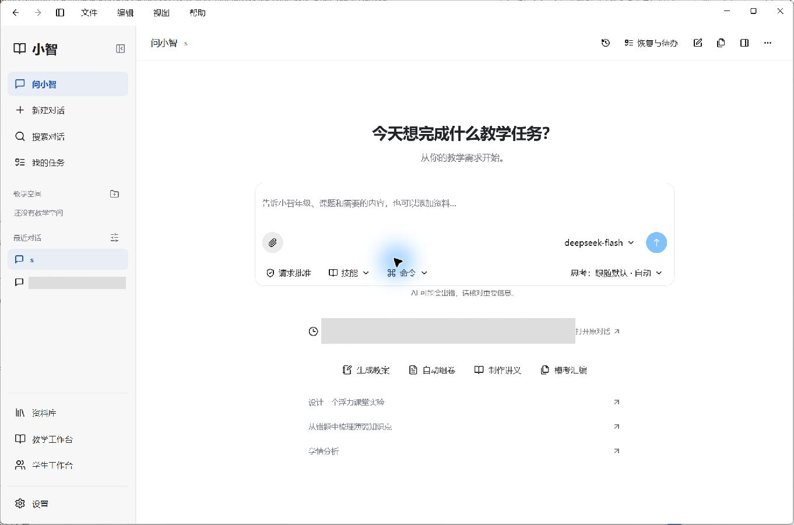

## P02-02 我的任务

- 入口：我的任务；状态：任务总览，未完成。
- 图片：[P02-tasks-current.png](images/P02-tasks-current.png)；滚动：初始可见区域。
- 路由与组件：运行构建未建立源码映射；参见 `apps/desktop/src/renderer/ui-system/page-contracts.ts` 的页面合同。

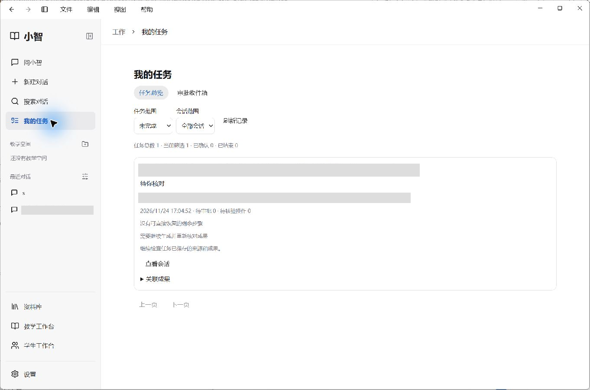

## P03-03 资料库

- 入口：资料库；状态：已有资料列表。
- 图片：[P03-library-current.png](images/P03-library-current.png)；滚动：初始可见区域。
- 路由与组件：运行构建未建立源码映射；参见 `apps/desktop/src/renderer/ui-system/page-contracts.ts` 的页面合同。

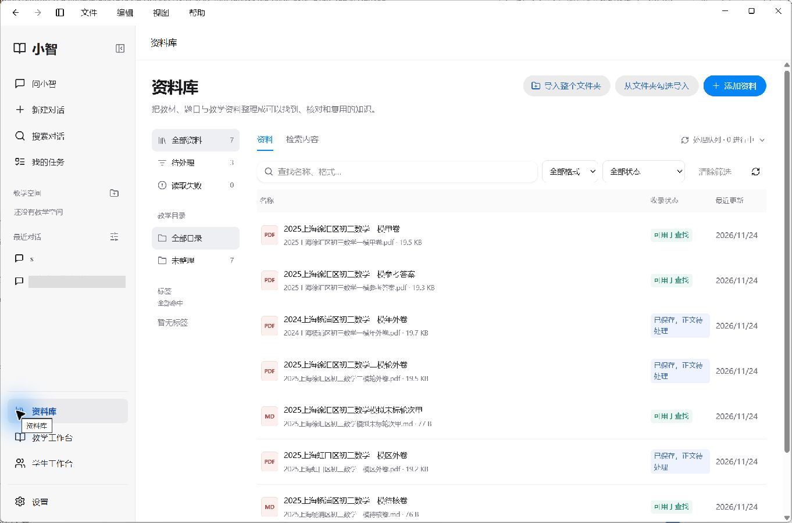

## P03-04 资料库

- 入口：资料库 → 第一份资料；状态：概要侧栏。
- 图片：[P03-library-detail.png](images/P03-library-detail.png)；滚动：初始可见区域。
- 路由与组件：运行构建未建立源码映射；参见 `apps/desktop/src/renderer/ui-system/page-contracts.ts` 的页面合同。

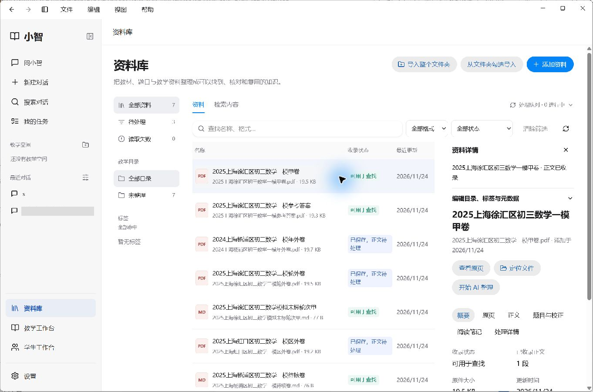

## P04-05 教学工作台

- 入口：教学工作台；状态：教学任务。
- 图片：[P04-teaching-current.png](images/P04-teaching-current.png)；滚动：初始可见区域。
- 路由与组件：运行构建未建立源码映射；参见 `apps/desktop/src/renderer/ui-system/page-contracts.ts` 的页面合同。

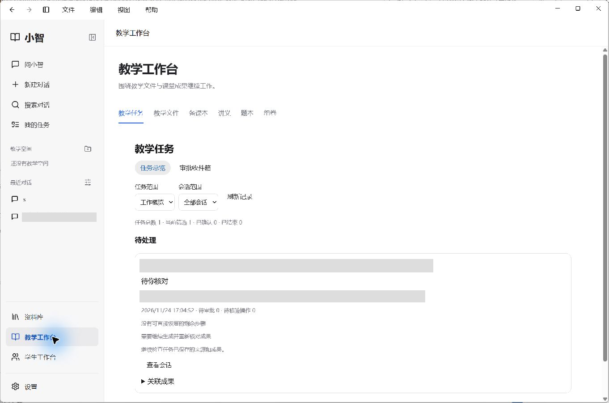

## P05-06 教学文件

- 入口：教学工作台 → 教学文件；状态：空态。
- 图片：[P05-files.png](images/P05-files.png)；滚动：初始可见区域。
- 路由与组件：运行构建未建立源码映射；参见 `apps/desktop/src/renderer/ui-system/page-contracts.ts` 的页面合同。

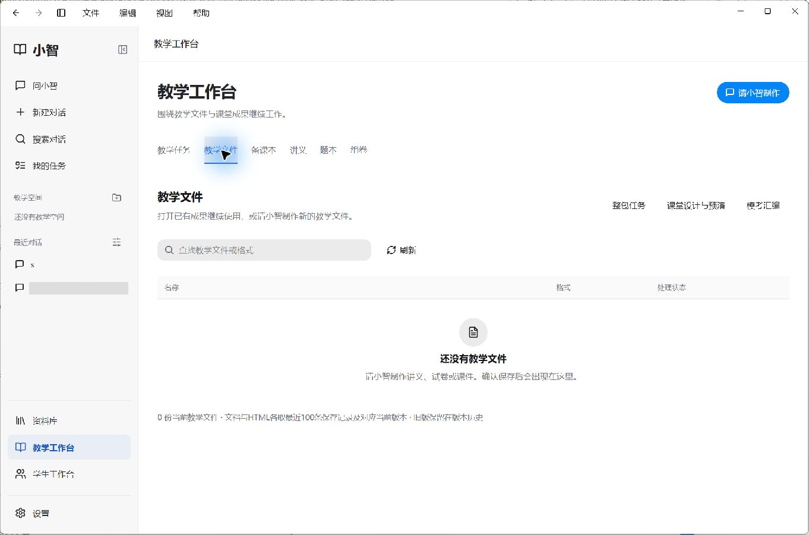

## P06-07 备课本

- 入口：教学工作台 → 备课本；状态：空态。
- 图片：[P06-prep.png](images/P06-prep.png)；滚动：初始可见区域。
- 路由与组件：运行构建未建立源码映射；参见 `apps/desktop/src/renderer/ui-system/page-contracts.ts` 的页面合同。

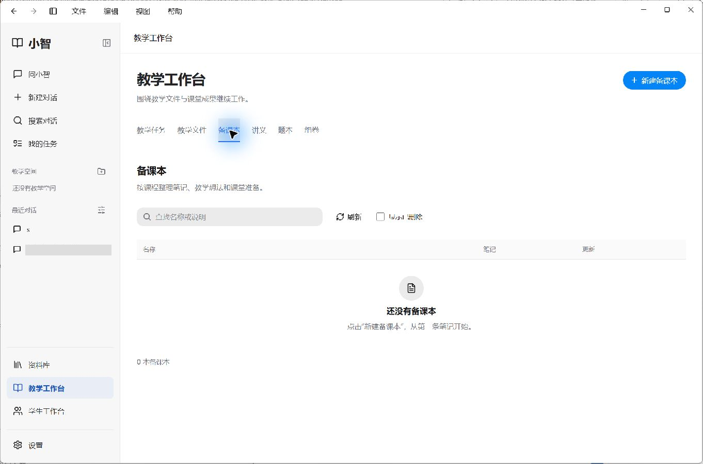

## P07-08 讲义

- 入口：教学工作台 → 讲义；状态：空态。
- 图片：[P07-handout.png](images/P07-handout.png)；滚动：初始可见区域。
- 路由与组件：运行构建未建立源码映射；参见 `apps/desktop/src/renderer/ui-system/page-contracts.ts` 的页面合同。

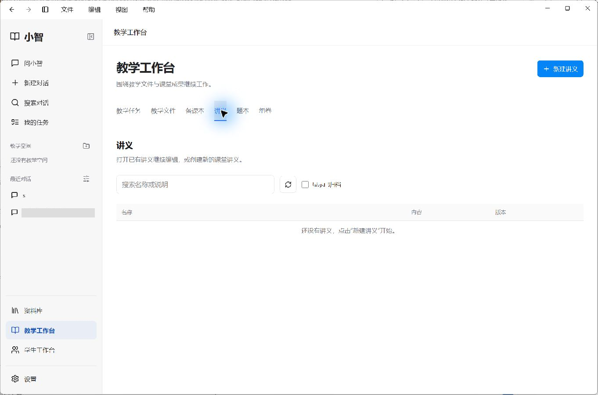

## P08-09 题本

- 入口：教学工作台 → 题本；状态：空态。
- 图片：[P08-questions.png](images/P08-questions.png)；滚动：初始可见区域。
- 路由与组件：运行构建未建立源码映射；参见 `apps/desktop/src/renderer/ui-system/page-contracts.ts` 的页面合同。

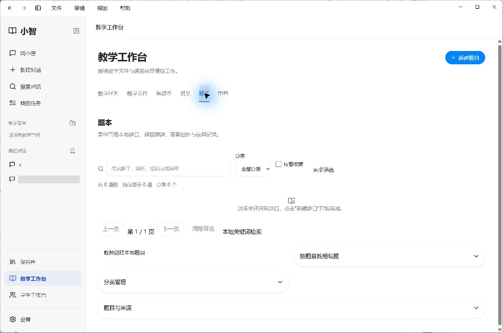

## P09-10 组卷

- 入口：教学工作台 → 组卷；状态：题库空态。
- 图片：[P09-paper.png](images/P09-paper.png)；滚动：初始可见区域。
- 路由与组件：运行构建未建立源码映射；参见 `apps/desktop/src/renderer/ui-system/page-contracts.ts` 的页面合同。

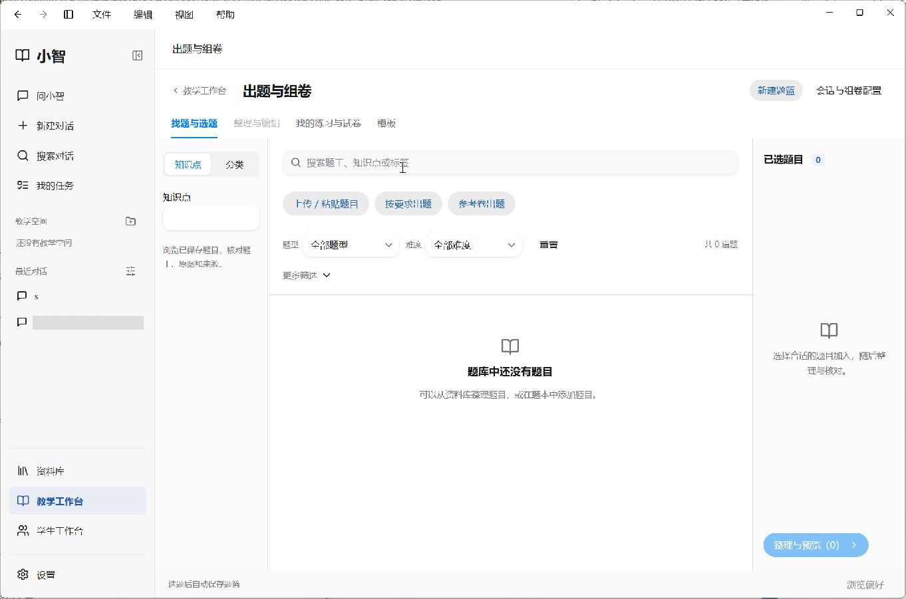

## P10-11 学生工作台

- 入口：学生工作台；状态：空态。
- 图片：[P10-students.png](images/P10-students.png)；滚动：初始可见区域。
- 路由与组件：运行构建未建立源码映射；参见 `apps/desktop/src/renderer/ui-system/page-contracts.ts` 的页面合同。

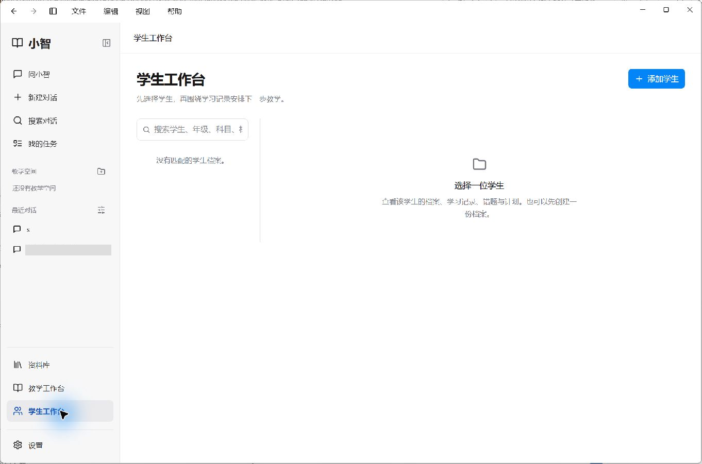

## P11-12 学生档案

- 入口：学生工作台 → 添加学生；状态：空白表单，未保存。
- 图片：[P11-student-form.png](images/P11-student-form.png)；滚动：初始可见区域。
- 路由与组件：运行构建未建立源码映射；参见 `apps/desktop/src/renderer/ui-system/page-contracts.ts` 的页面合同。

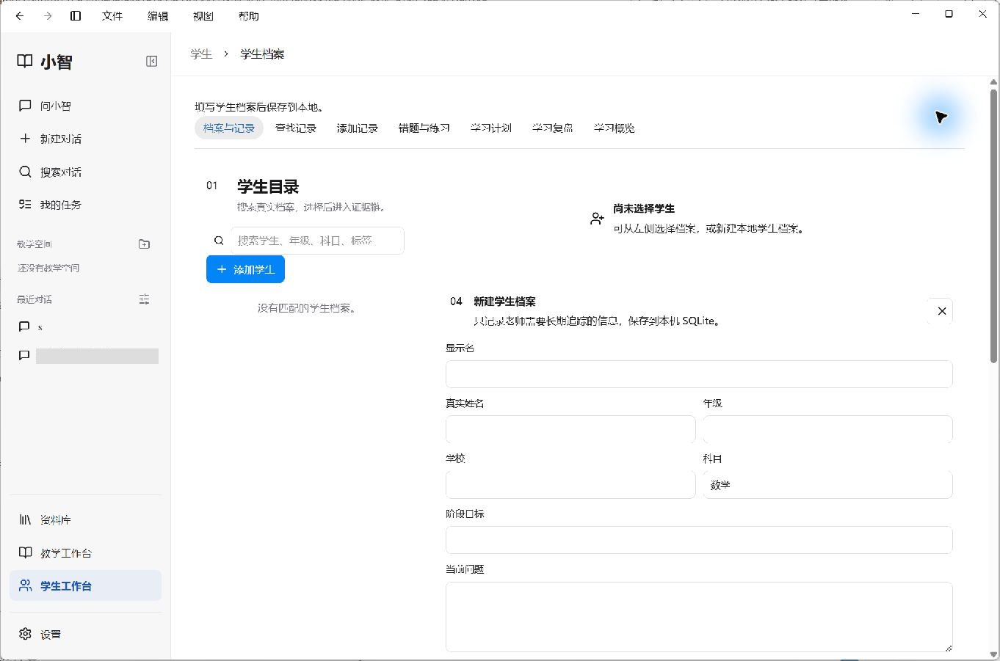

## P12-13 设置

- 入口：设置；状态：模型与连接，密钥为空。
- 图片：[P12-settings.png](images/P12-settings.png)；滚动：初始可见区域。
- 路由与组件：运行构建未建立源码映射；参见 `apps/desktop/src/renderer/ui-system/page-contracts.ts` 的页面合同。

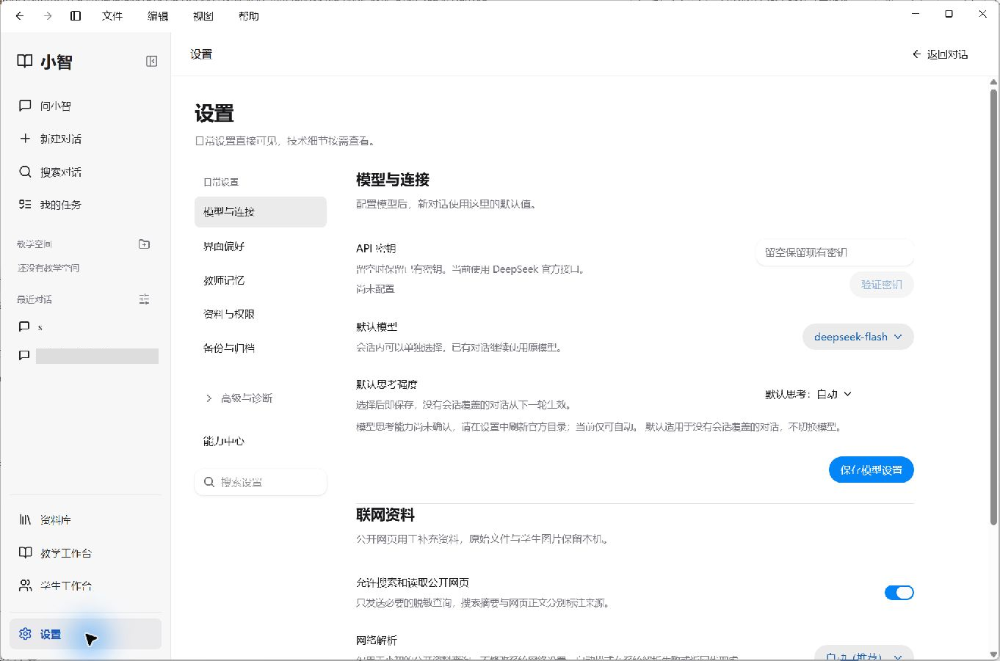

## 未采集或仅空态

- 教学文件、备课本、讲义、题本、组卷、学生工作台仅空态；缺少可公开的已有内容和代表性编辑样本。
- 学生查找记录、添加记录、错题与练习、学习计划、学习复盘、学习概览：未采集；空学生目录不能代表这些页面已覆盖。
- 讲义编辑与历史、试卷编辑与预览、模考目录与核对、教案/PPT 入口、设置其余分类、弹窗和内部滚动区域：未采集。
- 1366×768、1920×1080、800×768 三种目标窗口均未实测，不能用现有图片替代。
- 未完成完整代码路由与可见入口交叉检查；不能断定任何页面入口未暴露。
- 桌面工具曾中断重置，重新连接后仅补采组卷、学生与设置；本轮尚未完成全清单及缺漏复查。
